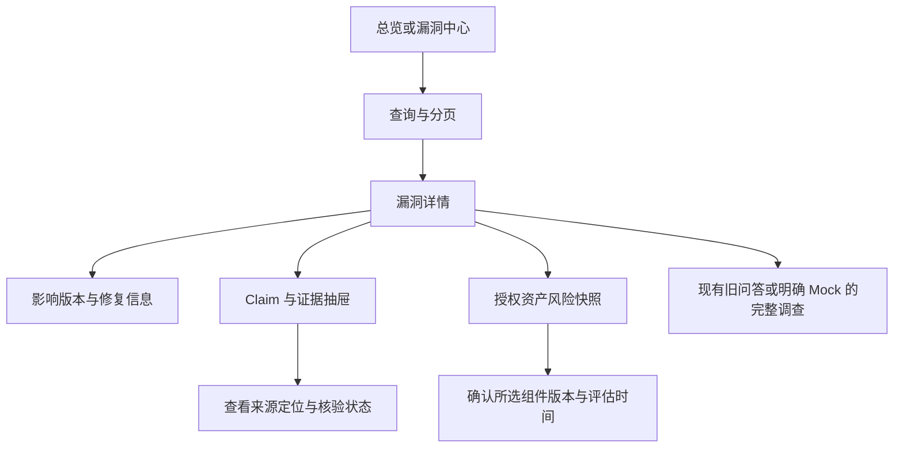
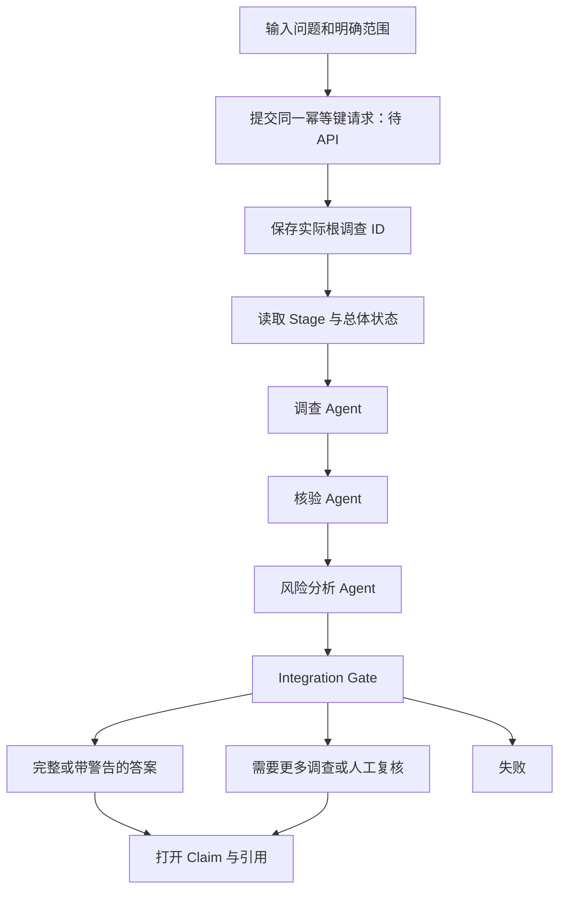

# 核心用户流程

图中的页面路线可指导前端；标注待 API 的步骤目前只能在明确 Mock 模式演示。

## 现有安全情报读取

用户不受某条漏洞影响，只能得出该漏洞/版本/快照范围内的判断，不能出现“整个资产已安全”文案。

## 完整自主调查（待 Phase 12-B API）

前端显示过程摘要，任务执行与可信状态都以服务结果为准。阶段图不是让浏览器按定时器自行执行或判定的流程；历史 Mock 显示“回执回放”，不伪装在线执行。

## 冲突与复核

Claim / 范围 → 显示支持与反对证据 → 说明冲突或证据不足 → 复核读取 → 填写理由与决定预览 → 提交（目前代理阻断）→ 重新读取最终状态与审计。

409 时保留草稿，重新读取 revision，请用户核对后再提交。证据不能被前端覆盖或删除以消除冲突；复核状态与调查 Gate 状态也不是同一枚举。

## 取消、断网与返回

- 浏览器切页/AbortController 只停止浏览器请求，后端任务不会因此取消。
- 用户取消：提交取消请求（待 API）→ 显示 cancel_requested → 继续安全查询 → 看到终态 CANCELLED。
- 提交超时结果不明：保留原 request_key 和问题范围，按正式幂等协议恢复；不盲目生成新 key。
- 返回调查：以实际根 ID 读取状态/答案；历史列表需 Phase 12-B。当前旧问答 run ID 只在会话内存，不能声称已有服务器历史入口。
- recovery_required：显示恢复待确认，停止“成功”交付和自动新调查，等待后端处理。
