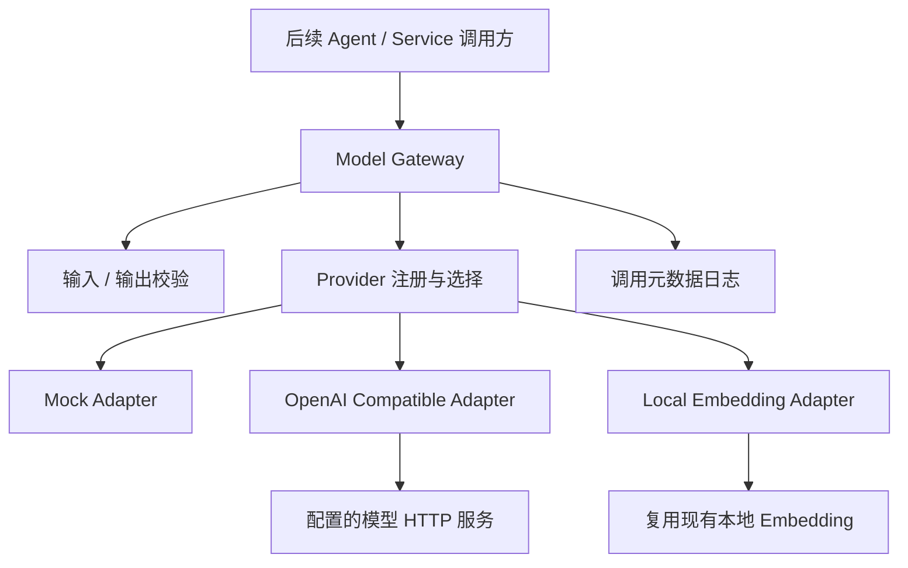

# AegisAI Phase 9-A：Model Gateway 实施计划

日期：2026-10-08。状态：**代码检查与计划已完成，等待用户确认；尚未实施、尚未执行本阶段测试。**

目标：在现有后端中新增可独立使用的模型统一调用层，提供文本生成、结构化生成、Embedding、健康检查、Provider 扩展和调用记录。

依据：用户本轮 Phase 9-A Prompt，特别是第“三”项“输出 MODEL_GATEWAY_PLAN.md”“等待确认后再实施”，以及“不修改已有业务模块”的边界。Phase 0 基线见 [PROJECT_STATUS.md](C:/Users/X/Documents/Codex/2026-10-03/files-mentioned-by-the-user-9/PROJECT_STATUS.md)。

本阶段仅实施下文列出的新增模块、配置示例、依赖声明和测试。保留现有确定性 Agent、Tool Gateway、Hybrid Retrieval、数据库与七个页面；不接入 Dify，不开发或修改 Planner、DAG Scheduler、Integration Gate，不启动云端部署。

## 1. 已检查的当前状态

| 项目 | 代码事实 | 处理决定 |
| --- | --- | --- |
| 后端布局 | FastAPI 应用位于 `backend/app`；已有 `assistant`、`tooling`、`knowledge`、`core`、`api` 等包 | 新增 `backend/app/llm`，不搬迁任何包 |
| 生成模型 | 未找到实际生成模型客户端或统一 Gateway | 新增统一入口和 Provider Adapter |
| Agent | `assistant/roles.py` 明确为确定性工具角色；风险合成也不调用生成模型 | 原样保留；后续阶段按 Gateway 接入 |
| 本地 Embedding | `knowledge/embedding.py` 使用 fastembed，缓存本地加载、禁止自动下载；模型为 `sentence-transformers/paraphrase-multilingual-MiniLM-L12-v2`，384 维 | 通过新适配器复用，保留原有调用点 |
| 检索与索引 | `knowledge/index.py` 使用 `.passages()`；`retrieval.py` 使用 `.query()`；存储与筛选依赖模型名称，向量为 PostgreSQL 数组 | 不换模型、不重建索引、不写现有向量表 |
| Prompt | 根目录 `prompts/*.v1.md` 为配置文档，注明无活动生成 Provider，已含外部内容不可信、证据独立核验等约束 | 不修改、不自动装入 Agent；本层接收明确传入的 messages |
| 配置 | `core/config.py` 是采集 Settings；`backend/.env.example` 没有模型配置 | 新增独立 ModelConfig，在示例文件追加模型配置 |
| HTTP | `core/http.py` 是采集 GET 客户端，有限定的数据源地址和重试规则 | 不改采集白名单；模型适配器单独使用已有 httpx |
| 日志 | `core/logging.py` 已有 JSON 事件格式，禁止任意异常文本、请求头和 URL 入日志 | 保留该文件；新模块沿用元数据记录原则 |
| 依赖 | 锁定文件已有 Pydantic 2.13.5、httpx 0.28.1、jsonschema 4.25.1、fastembed 0.8.1、pytest 9.1.1 | 不装模型 SDK；补齐已有依赖的声明，保留现有锁定版本 |
| 测试 | `backend/pytest.ini` 配置现有测试；公共 conftest 的数据库 fixture 按需启用，结束钩子会写数据库测试报告 | 新测试不使用数据库 fixture；执行时保护既有报告，单独保存本阶段结果 |

证据入口：[本地 Embedding](C:/Users/X/Documents/Codex/2026-10-03/files-mentioned-by-the-user-9/backend/app/knowledge/embedding.py:7)、[索引](C:/Users/X/Documents/Codex/2026-10-03/files-mentioned-by-the-user-9/backend/app/knowledge/index.py:12)、[语义检索](C:/Users/X/Documents/Codex/2026-10-03/files-mentioned-by-the-user-9/backend/app/knowledge/retrieval.py:12)、[确定性角色](C:/Users/X/Documents/Codex/2026-10-03/files-mentioned-by-the-user-9/backend/app/assistant/roles.py:52)、[采集配置](C:/Users/X/Documents/Codex/2026-10-03/files-mentioned-by-the-user-9/backend/app/core/config.py:6)、[日志约束](C:/Users/X/Documents/Codex/2026-10-03/files-mentioned-by-the-user-9/backend/app/core/logging.py:5)。

### 必须披露的现有 Embedding 边界

“不修改现有业务模块”与“全项目所有模型调用都经过 Gateway”不能在不改现有调用点的情况下同时完成：当前 `knowledge/embedding.py` 的 fastembed 调用已经存在。

本计划遵循本阶段的模块边界：**所有新增模型调用均通过 Gateway；现有知识检索链路保持原样**。新增 LocalEmbeddingAdapter 可通过 Gateway 使用同一个本地模型，但不自动迁移现有索引与工具调用。后续迁移只需在获得授权后调整依赖注入位置，不重写检索算法。实施文档会明确这一遗留边界，不宣称全项目已完成迁移。

## 2. 模块设计



技术栈：Python、已有 Pydantic v2、httpx、jsonschema、fastembed、pytest。使用同步接口以匹配现有后端工具调用方式；本阶段不增加异步与流式输出两套实现。

职责边界：Gateway 负责配置路由、统一结果、校验、错误映射和审计；Adapter 负责具体协议与响应解析；业务负责构造任务和证据。模型输出不自动成为 Claim、Evidence 或可信核验结论。

### 计划文件清单

下列相对路径均以当前项目根目录为基准；实施时只允许触及此清单。

| 文件 | 操作 | 职责 |
| --- | --- | --- |
| `backend/app/llm/__init__.py` | 新增 | 导出 Gateway、配置及公开 Schema |
| `backend/app/llm/config.py` | 新增 | 独立配置、环境变量读取、Provider 工厂配置校验 |
| `backend/app/llm/schemas.py` | 新增 | 输入、结果、Usage、错误、健康状态、调用记录 |
| `backend/app/llm/gateway.py` | 新增 | 四个统一入口、选择 Adapter、输出校验、生命周期 |
| `backend/app/llm/records.py` | 新增 | 脱敏结构化日志与可注入 RecordSink |
| `backend/app/llm/providers/__init__.py` | 新增 | 内置 Provider 注册表 |
| `backend/app/llm/providers/base.py` | 新增 | Provider Protocol、能力声明、内部响应与错误 |
| `backend/app/llm/providers/mock.py` | 新增 | 明确标注的确定性测试结果，无网络调用 |
| `backend/app/llm/providers/openai_compatible.py` | 新增 | Chat Completions、Embedding、健康探测的 HTTP 适配 |
| `backend/app/llm/providers/local_embedding.py` | 新增 | 懒加载复用 LocalEmbedding，不下载模型 |
| `backend/tests/model_gateway/test_contracts.py` | 新增 | 输入输出、结构化校验、错误和日志测试 |
| `backend/tests/model_gateway/test_providers.py` | 新增 | Mock、本地 Embedding、Provider 切换测试 |
| `backend/tests/model_gateway/test_http_adapter.py` | 新增 | HTTP 协议、实际回环服务、故障边界测试 |
| `backend/.env.example` | 仅追加 | 无凭据的模型配置示例与 Mock 标记说明 |
| `backend/requirements.in` | 最小补充 | 声明锁定文件已有的 jsonschema、fastembed，不升级依赖 |
| `docs/MODEL_GATEWAY_IMPLEMENTATION.md` | 实施后新增 | 设计、架构、接口、配置、真实测试结果、扩展与限制 |

测试运行产生的本阶段记录保存至 `work/model_gateway/`，不覆盖历史评测报告。不存在 Git 仓库，实施前使用文件哈希和必要的配置文件备份记录变更边界，不创建仓库或重整目录。

## 3. 统一接口与 Schema

公开接口草案：

```python
class ModelGateway:
    def generate_text(self, request: TextRequest) -> ModelResult[TextData]: ...
    def generate_structured(
        self, request: StructuredRequest,
        *, output_model: type[BaseModel] | None = None,
    ) -> ModelResult[StructuredData]: ...
    def embed(self, request: EmbeddingRequest) -> ModelResult[EmbeddingData]: ...
    def health_check(
        self, *, capability: Literal['text', 'embedding'] = 'text',
        trace_id: str | None = None,
    ) -> ModelResult[HealthData]: ...
    def close(self) -> None: ...
```

Gateway 同时支持上下文管理，确保 HTTP Client 正常释放。Provider 使用相同四种能力的 Protocol；本地 Embedding Provider 的文本能力声明为不支持。增加 Provider 时增加 Adapter 与注册项，不修改业务调用方。

### 输入

- `TextRequest`：messages（system/user/assistant，文本内容）、max_output_tokens、可选 temperature、可选 trace_id。禁用任意额外请求参数，不接收业务输入中的 API Key、Base URL 或任意模型名称。
- `StructuredRequest`：文本输入字段、可选 `json_schema`；`json_schema` 与 `output_model` 必须且只能选择一种，Gateway 将 Pydantic 模型转换为 Schema。
- `EmbeddingRequest`：非空 texts 列表、purpose（query/document）、可选 trace_id。query 必须只有一条；document 支持有界批量。
- 输入统一禁止未知字段；上限：messages 32 条、文本总量 64 KiB、输出上限 4096 token、Embedding 单批 32 条/总量 64 KiB、Schema 64 KiB。上限由本层校验，不承诺跨供应商精确输入 token 计算。
- 无效请求返回 `INVALID_INPUT`，不调用 Provider，并记录安全元数据；Pydantic ValidationError 的原始输入和值不进入日志。

### 输出

`ModelResult[T]` 至少包含：request_id、trace_id、provider、requested_model、model、function、is_mock、status（success/failed）、started_at、finished_at、duration_ms、usage、data、error。

success 必须有 data 且没有 error；failed 的 data 为 null 且必须有类型化 error。UTC 时间带时区，耗时使用单调时钟；每次调用产生独立 UUID。

- `TextData`：text、finish_reason。
- `StructuredData`：经验证且可 JSON 序列化的 data、schema 名称/摘要。传入 Pydantic 模型时执行其验证器，最终返回 JSON 形式，避免业务绑定供应商响应对象。
- `EmbeddingData`：vectors、dimension、purpose；按输入顺序对应，数量一致、维度一致、浮点有限且非零。模型与时间、Usage 在结果公共字段中提供。
- `Usage`：input_tokens、output_tokens、total_tokens，允许 null；没有供应商统计时明确为未知，不按字符数编造 token 或费用。Mock 显式为模拟、零计费；本地 Embedding 没有计费 token 统计，不伪装云端 Usage。
- `HealthData`：capability、state、probe_kind、model_seen；健康探测不等价于文本质量、Embedding 质量或 Agent 智能。

## 4. Provider 与配置

### 4.1 Mock Provider

本地默认使用 Mock，结果固定标记 `is_mock=true`。文本为明确的模拟文本；结构化数据使用显式注册的测试 fixture，再经过真实 Schema 校验；Embedding 为有稳定算法标识的确定性模拟向量。

不根据任意 Schema 编造漏洞分析，不把模拟向量写入现有知识索引。不支持的结构化 fixture 返回失败。故障注入仅用于测试构造参数，不暴露给业务请求。

### 4.2 OpenAI Compatible Provider

使用现有 httpx，不引入 OpenAI SDK。Base URL 含协议和版本路径，例如 `https://api.example.invalid/v1`；只追加固定端点，避免重复 `/v1` 或覆盖已有路径。

- 文本与结构化：`POST /chat/completions`，非流式、单结果。
- Embedding：`POST /embeddings`，使用独立 Embedding 模型名，解析并检查返回 index、数量、维度及 Usage。
- 健康：`GET /models`，检查配置模型是否列出。端点不支持时返回明确的 `HEALTH_UNSUPPORTED`，不偷偷发生成请求，不宣称模型已健康。
- 默认认证要求 API Key；仅显式开启的本地回环服务可无 Key。公网仅 HTTPS；HTTP 仅允许明确配置的 localhost/127.0.0.1/::1；禁止 URL 内嵌用户名、密码、查询参数或 fragment。
- 地址从服务器配置读取，业务不能改地址。禁用重定向，避免认证头转发；测试可以注入 Transport，但生产配置不接受外部传入的 Transport。
- connect/read/write/pool timeout 有界；响应以有界流读取，最大 4 MiB。这里的 timeout 是 HTTP 操作超时，不宣称提供 Agent 总任务强制终止。
- 本阶段不自动重试或切换 Provider，一次调用最多一次模型 HTTP 请求。429、5xx、网络超时映射错误及 retryable，重试决策交给后续调用方；401/403、非法输出不自动重试。
- 拒答、空结果、输出截断、响应体损坏分别返回显式错误。Provider 的原始错误响应不透传给日志或用户。

兼容 API 不代表每个供应商都支持同一组参数。token 参数通过 `MODEL_TOKEN_PARAMETER=max_tokens|max_completion_tokens` 选择；temperature 为可选，不发送未经启用的参数。新增供应商能力通过 Adapter 声明。

### 4.3 Local Embedding Adapter

新适配器在调用时导入并复用 `knowledge.embedding.local_embedding()`，保持原模型、384 维、query/passages 区分、本地缓存和不下载策略。无缓存或模型加载失败时返回 `MODEL_UNAVAILABLE`，不下载、不回退 Mock。

本地 Adapter 只支持 Embedding；不能作为文本 Provider。健康检查按需加载本地模型，明确 `probe_kind=local_model_load`，不将“文件存在”当作推理成功。

### 4.4 配置项

| 环境变量 | 默认/约束 |
| --- | --- |
| `MODEL_PROVIDER` | `mock`；可选 `openai_compatible` |
| `MODEL_NAME` | Mock 默认 `mock-text-v1`；远程必须明确配置 |
| `MODEL_API_BASE` | 远程必须配置；不是业务请求字段 |
| `MODEL_API_KEY` | SecretStr、repr 隐藏，不保存到仓库或报告 |
| `MODEL_ALLOW_KEYLESS_LOCAL` | 默认 false，只允许回环地址 |
| `MODEL_EMBEDDING_PROVIDER` | 默认同文本 Provider；另可选 `local_embedding` |
| `MODEL_EMBEDDING_NAME` | Mock 默认 `mock-embedding-v1`；本地固定；远程必须明确配置 |
| `MODEL_EMBEDDING_DIMENSION` | Mock 默认 384；本地固定 384；远程需声明预期维度以校验 |
| `MODEL_TIMEOUT_SECONDS` | 默认 30，范围 1–60；连接超时不超过 5 秒 |
| `MODEL_MAX_OUTPUT_TOKENS` | 默认 1024，范围 1–4096；请求不得超出配置上限 |
| `MODEL_STRUCTURED_MODE` | `prompt_json` / `json_object` / `json_schema`，默认 `prompt_json` |
| `MODEL_TOKEN_PARAMETER` | 默认 `max_tokens`，可显式切换 |

配置使用独立 Pydantic ModelConfig，不改变采集 Settings；无效或未知 Provider 配置在创建 Gateway 时失败，错误脱敏。切换配置后创建新实例，不原地修改运行中 Provider，也不自动加载已有 `.env` 文件。

免费配置示例：

```ini
MODEL_PROVIDER=mock
MODEL_NAME=mock-text-v1
MODEL_EMBEDDING_PROVIDER=local_embedding
MODEL_EMBEDDING_NAME=sentence-transformers/paraphrase-multilingual-MiniLM-L12-v2
MODEL_EMBEDDING_DIMENSION=384
```

该配置表示模拟文本生成加真实本地 Embedding；它不表示已经接入真实生成模型。离线 CI 可以将 Embedding Provider 也设置为 mock。远程模型是否计费由供应商决定，Gateway 不隐式启用它。

## 5. 结构化生成与错误行为

1. 调用前验证 Schema。统一支持 JSON Schema Draft 2020-12、本地 `$defs`/`$ref`；不允许外部引用或 Schema 验证器下载远程资源。
2. Pydantic 路径使用 `model_json_schema()`；原始 JSON Schema 路径使用 jsonschema 对 Schema 本身做合法性检查。
3. `prompt_json` 将输出结构要求加入专用消息，不传 response_format；`json_object` 或 `json_schema` 仅在明确配置支持后发送。
4. 三种模式均执行本地验证；供应商承诺不能替代本地校验。对原始 JSON 严格解析，拒绝代码围栏、JSON 外附加文本、NaN/Infinity 和重复对象键，不做静默修复。
5. 使用 Draft202012Validator 进行字段/类型/枚举/必需项校验；按需要启用标准 format 检查。Pydantic 路径随后使用 `model_validate_json(..., strict=True)`，执行自定义验证器并尊重模型的 extra 策略。
6. 非法 JSON 返回 `INVALID_JSON`，Schema 不匹配返回 `SCHEMA_VALIDATION_FAILED`，供应商拒绝格式参数返回 `PROVIDER_REQUEST_REJECTED`；均记录失败和元数据。
7. Schema 验证通过只说明结构正确，不说明漏洞判断正确、证据充分或可以跳过人工复核。

错误至少覆盖 INVALID_INPUT、INVALID_SCHEMA、CAPABILITY_UNSUPPORTED、AUTHENTICATION_FAILED、RATE_LIMITED、TIMEOUT、NETWORK_ERROR、PROVIDER_ERROR、PROVIDER_REQUEST_REJECTED、INVALID_RESPONSE、INVALID_JSON、SCHEMA_VALIDATION_FAILED、INVALID_EMBEDDING、MODEL_REFUSED、OUTPUT_TRUNCATED、MODEL_UNAVAILABLE、HEALTH_UNSUPPORTED。

配置错误通过脱敏的 ConfigError 暴露；已创建 Gateway 后的调用失败通过 ModelResult.error 暴露。KeyboardInterrupt/SystemExit 不被包装成普通模型错误。

## 6. 每次调用记录

记录字段：request_id、可选 trace_id、provider、requested_model、实际返回 model、function、is_mock、attempt_count、started_at、finished_at、duration_ms、usage、status、error_code、error_message、retryable。

所有生成、结构化生成、Embedding、健康检查都生成记录；输入校验失败也记录，attempt_count 为 0。发出模型请求后，即使结构化校验失败也尽量保留返回的 Usage；供应商未给出则为 null。

默认 RecordSink 输出白名单字段的 JSON 日志；可注入内存 Sink 供测试，附加 JSONL Sink 用于本地审计，默认路径 `work/model_gateway/calls.jsonl`。JSONL 不写提示词、模型原文、向量、API Key、Authorization、完整 URL 或任意异常堆栈。线程写入有锁并 flush；UTC 时间与 ASCII 转义保持 Windows 终端兼容。

`error_message` 使用固定安全描述，模型名与 trace_id 长度受限、控制字符被拒绝。日志失败必须显式报告 `AUDIT_WRITE_FAILED`，不得导致再次请求模型；结果保留 original_error 与已知 Usage，避免丢失实际调用信息。

本阶段不建立新的日志数据库表，不计算未经定价配置的费用，不存储模型隐藏推理过程，不做日志查询页面。日志后续可按 request_id/trace_id 接入既有 Agent Trace。

## 7. 实施顺序与可运行测试

以下步骤仅在用户确认后执行。每项先增加会失败的必要测试，再实现最小功能并运行相关测试。计划阶段不提前生成测试结果。

### 任务 A：类型、配置与 Provider 边界

- [ ] 为输入上限、未知字段、非法 Provider、Key 脱敏与能力不支持编写契约测试。
- [ ] 运行并确认失败来自尚未实现的模块/行为。
- [ ] 新增 config.py、schemas.py、providers/base.py，实现配置工厂和统一结果。
- [ ] 运行并通过这组测试，确认不加载模型或访问网络。

### 任务 B：Mock、Gateway 与审计

- [ ] 测试成功文本、可验证的漏洞分析 fixture、模拟向量、失败状态和每调用一条记录。
- [ ] 实现 mock.py、gateway.py、records.py；Mock 返回清晰标记。
- [ ] 测试非法 JSON、Schema 失败、外部 Schema 引用拒绝、日志中无凭据/输入/输出；记录保存失败不会触发第二次模型调用。
- [ ] 实际运行通过，确认 provider 构造与业务调用解耦。

### 任务 C：OpenAI Compatible Adapter

- [ ] 通过可控 HTTP Transport 测试请求路径、认证、配置模型名、JSON 模式、Usage 和 Embedding index 重排。
- [ ] 实现 openai_compatible.py；不修改 core/http.py、不安装模型 SDK。
- [ ] 测试 401、429、5xx、超时、非法响应、超大响应、拒答、截断、向量维度/数量错误、NaN、重定向拒绝、无隐式重试。
- [ ] 启动仅监听回环地址的临时协议测试服务器，实际通过 httpx 发请求验证序列化和连接行为；测试结束关闭服务。
- [ ] 在同一业务调用示例中更换配置使用 Mock / OpenAI Compatible，验证不修改调用方式。

### 任务 D：本地 Embedding 复用

- [ ] 测试 query/document 分流、固定模型身份、能力不支持、缓存加载失败不下载/不降级。
- [ ] 新增 local_embedding.py，仅包裹现有 LocalEmbedding；使用注入替身测试失败分支。
- [ ] 若已有缓存可用，实际执行一条查询和一批文档 Embedding，验证 384 维、有限、非零，记录为真实本地推理。
- [ ] 若缓存不可用，保留明确失败证据；不把替身测试报告为实际本地推理，也不自动下载模型。

### 任务 E：验收、文档与停止

- [ ] 补充 `.env.example` 和已有依赖声明；不填写真实凭据、不升级锁定文件。
- [ ] 运行新模块全部测试并保存完整结果，记录 Python/依赖版本、测试数、失败和跳过数。
- [ ] 静态核对没有给 Agent/Tool/业务包添加模型 SDK、没有新增模型调用绕过 Gateway；单独披露旧 fastembed 入口。
- [ ] 对比实施前后文件哈希，确认 Agent、API、知识业务、数据库、前端和 Prompt 文件未改变。
- [ ] 编写 `docs/MODEL_GATEWAY_IMPLEMENTATION.md` 的六个要求章节，并附旧 Embedding 边界、实际测试范围及真实 Provider 待验证项。
- [ ] 完成后停止，仅交付 Phase 9-A，不进入 Runtime 或后续阶段。

### 测试执行方式

确认后在 `backend` 目录使用已有虚拟环境，例如：

```powershell
.\.venv\Scripts\python.exe -m pytest tests/model_gateway -q --junitxml=../work/model_gateway/junit.xml
```

测试前记录已有 `work/database_test_report.json` 是否存在并备份；测试结束后恢复其原内容，若原本不存在则移除本次钩子生成的文件。本阶段以单独的 JUnit 和执行日志为依据，不修改公共 conftest，也不把 Gateway 测试错误标成数据库验收。

无需 PostgreSQL、Dify、外网 Key 或云服务器即可跑 Mock 和 HTTP 协议测试。本阶段未触及既有业务，不为凑数重跑整个数据库/前端套件；如出现依赖冲突或意外业务改动，再有针对性补做回归。

## 8. 验收矩阵及报告口径

| 用户要求 | 验收证据 | 不能据此宣称的内容 |
| --- | --- | --- |
| generate_text | Mock 成功；HTTP Adapter 对合规响应成功 | Mock 等于真实生成模型 |
| generate_structured | 漏洞分析 fixture 同时通过 JSON Schema/Pydantic；非法结果显式失败 | 结构正确等于安全判断正确 |
| embed | 模拟向量契约；兼容接口向量契约；已有缓存时真实本地推理 | 已迁移全部 Hybrid Retrieval 调用 |
| Provider 切换 | 配置切换 Mock / Compatible，调用方式不变 | 所有国产模型均已通过兼容测试 |
| health_check | Mock、本地模型加载、HTTP /models；不支持明确失败 | 探测成功等于 Agent 质量验收 |
| 调用日志 | 成功/失败/校验失败/健康调用均有完整脱敏元数据 | 已具备模型成本结算或完整运营平台 |
| Agent 不直接调用模型 SDK | 现有 Agent 保持无 SDK；新增调用全在 Gateway/Adapter | 旧 fastembed 已从业务模块迁走 |
| 实际运行测试 | 单独保存测试命令、时间、版本、数量、结果 | 合同服务器等于真实供应商模型实测 |

OpenAI Compatible 的本地合同服务器证明协议实现可运行，**不证明真实云端模型已调用成功**。若用户之后在本机配置真实模型地址与凭据，可追加一次有明确范围的真实 smoke test，并单独报告；当前不索要凭据、不调用付费模型，也不把未执行的实测标为通过。

## 9. 主要风险与控制

| 风险 | 处理 |
| --- | --- |
| 旧 Embedding 入口与全链路 Gateway 要求存在范围冲突 | 本计划明确保留旧入口；后续授权后仅迁移注入点，本阶段不伪报已迁移 |
| 换模型导致向量空间不一致 | 不碰现有向量数据；返回模型与维度；远程/Mock 结果禁止自动写入已有索引，后续迁移须新建模型版本并重索引 |
| 模型别名、服务端模型升级 | 同时保存请求与响应模型名；响应缺少模型名须有警告；不能仅以维度相同证明向量兼容 |
| 各兼容服务格式差异 | 配置 token 参数及结构化模式，能力不支持显式失败，不自动反复请求 |
| 调用泄漏 Key 或业务数据 | SecretStr、受控目标地址、禁用重定向、白名单日志、不透传错误正文 |
| Mock 混入比赛准确率/效果评测 | 每个结果和记录强制携带 is_mock；文档区分模拟、协议测试、真实推理 |
| 自动下载/调用付费服务 | 复用 local_files_only 模型；Mock 默认；远程只在显式配置后使用，无自动降级和重试 |
| 公共测试钩子覆盖历史报告 | 测试前后保留原文件，使用本阶段专属 JUnit 和日志 |
| 无 Git 回滚 | 限定新增文件与两处最小配置追加，记录前后哈希及原配置备份 |

## 10. 官方协议与校验依据

接口参数以本次实际读取的官方文档为依据。Chat Completions 支持多种 response_format，但 Schema 模式有供应商/模型及 Schema 子集限制，因此本地校验始终启用：[OpenAI Chat Completions](https://developers.openai.com/api/reference/resources/chat/subresources/completions/methods/create)、[Structured Outputs](https://developers.openai.com/api/docs/guides/structured-outputs)。

Embedding 响应含向量、index、模型和 Usage，适配器将其转换为统一结果并验证输入对应关系：[OpenAI Embeddings](https://developers.openai.com/api/reference/resources/embeddings/methods/create)。

Pydantic v2 的 Schema 导出与 JSON 验证通过 Context7 核对官方仓库文档；项目使用已安装版本，不因文档版本选择而升级：[JSON Schema](https://github.com/pydantic/pydantic/blob/main/docs/concepts/json_schema.md)、[Model validation](https://github.com/pydantic/pydantic/blob/main/docs/concepts/models.md)。

## 11. 当前交付与下一动作

本轮只新增本计划文件。没有实现 Gateway，没有修改业务，没有安装依赖，没有启动模型服务，也没有本阶段测试通过的结论。

下一动作：**由用户确认此计划及旧 Embedding 保留边界后，执行 Phase 9-A 的任务 A–E；完成即停止。**
