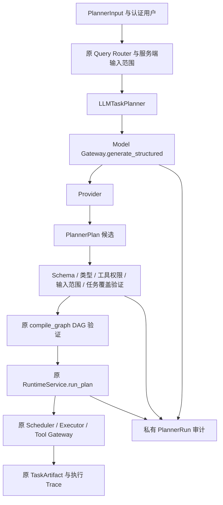

# AegisAI Phase 10-B：受约束 LLM Task Planner 实施结果

日期：2026-10-08。**Phase 10-B 已完成**。一次独立审查发现的两项重要问题已按 RED→GREEN 修复，最终完整回归 **643 项通过，零失败/错误/跳过**。本阶段结束，不进入 Phase 11。

## 1. 实现内容

新增独立 `app.planner` 包，模型只生成候选任务计划。计划通过服务端验证后转换为 Phase 10-A 原 TaskPlan，由原 Runtime 执行。未安装新依赖、引入 Agent 框架或改变数据库结构。

- Planner Interface、Request/Response、五种任务类型和固定 Task Registry。
- Model Gateway 的 `generate_structured()` 调用；借用 Gateway，不直接访问 SDK、不关闭调用方的 Gateway。
- 非法计划最多重试一次，第二次仍失败返回 `PLANNING_FAILED`；永久错误与审计故障立即失败。
- 私有原始输出诊断、每次调用元数据、验证错误和 PlannerRun 持久化。
- 独立 `PlannerService.plan_and_run()` 入口、所有者隔离、并发幂等、缓存计划重新校验和 Runtime 运行关联。
- 原 Runtime 投影记录规划阶段模型事件，`generation_calls` 使用实际 `attempt_count` 求和；原确定性路径保持零调用。

原 Assistant POST 与七个前端页面保留现有入口。模块完成不代表网页问答已经切换为 LLM 规划。

## 2. Planner 架构



只有服务端授予的权限生效。默认 `READ_ONLY`，`refresh=false`；Planner 不访问数据库或工具，持久化由独立 Trace Store 完成。

复杂资产问题强制祖先链：`vulnerability_lookup → version_match → patch_analysis → risk_analysis`。实际版本匹配必须调用原 `match_component_vulnerabilities`，具备输入组件 ID 和服务端 WRITE 权限；`resolve_component` 仅识别身份。资产风险任务必须读取所属资产风险，不能只查询 EPSS 冒充资产分析。

## 3. Schema 设计

| 协议 | 关键字段及约束 |
| --- | --- |
| PlannerInput | 原 QueryRequest；可选 component_id、snapshot_id、component；actor 由认证层另传 |
| PlannerTaskContract | 继承原 TaskContract；额外 planner_type，JSON 别名 type；原执行类型仍为 tool_sequence/input_required |
| PlannerPlan | plan_id UUID、objective、tasks、reasoning_summary、confidence 必填；1–16 任务；整份 JSON ≤64 KiB |
| PlannerContext | 服务端规划 ID、Trace ID、actor、RuntimePolicy、输入/路由 JSON 快照、Prompt/Registry 版本和实际模型元数据 |
| ValidatedPlan | 原 RuntimePlan 不可变 JSON、类型映射、候选快照、验证器版本与摘要 |
| PlanningOutcome | VALIDATED/PLANNING_FAILED、可空已验证计划、错误及最多两次尝试 |
| PlannerSnapshot | PLANNING/VALIDATED/PLANNING_FAILED；可空 Runtime ID 与独立执行状态 |

`plan_id` 是模型候选标记，不能覆盖服务端生成的 PlannerRun ID。规划自评 confidence 未校准，只记录于私有规划 Trace，不复制为情报、证据或 Artifact 的可信度。reasoning_summary 只要求简短步骤说明，不收集隐藏思考过程。

## 4. Validation 机制

按顺序验证，失败前不执行工具：

1. Gateway 严格 JSON、重复键/非有限数检查、JSON Schema 和 Pydantic；Validator 再验证候选完整快照。
2. 五种任务 Literal 与角色工具白名单，包括未使用的 allowed_tools；原工具权限必须属于服务端策略。
3. 原 ToolSpec 参数 Schema，绑定输入 CVE/资产/组件/快照/产品/版本和过滤范围；拒绝替换 ID、结果表达式、未知参数与 refresh。显式 CVE/UUID 必须使用 get_vulnerability；列表查询的产品、日期及高危过滤与服务端范围完全一致，不允许新增 ai_relevance 筛选。
4. 工具任务最低验收 `tools_succeeded + output_nonempty`，证据搜索额外要求 `evidence_present`；显式目标覆盖与必要依赖。
5. 缺项仅允许真实缺失的 target、asset_id、component_id、snapshot_id、version、write_authorization；零工具、零预算，依赖它的后续任务由原 Runtime 阻塞。
6. 去除业务标签，转换原 TaskContract，调用原 `compile_graph()` 检查环、重复/缺失依赖、权限、16 任务/8 层/32 调用预算等。

错误返回固定 code/path/message，避免把异常原文变成重试指令。重试返回完整新计划，不静默修正、不改成规则计划、不切换供应商。

诊断回调默认关闭，收到 Provider 文本后、Gateway 验证前捕获；保存最多64 KiB，附完整长度、SHA-256、脱敏和截断标记。已知模型 API Key 脱敏。Provider 尚未返回文本的异常记录 `raw_output=null` 语义和 `NO_TEXT_RESPONSE`，不伪造原文。默认 ModelResult、CallRecord 和旧公共 GET 不包含私有原文。

Trace 复用 `AgentRun`，`agent_type=planner-v1`，原文位于 `details.planner_v1`。幂等键按 actor/type 隔离；请求摘要包含输入、策略、模型与 Prompt/Registry 版本。同键不同内容冲突，并发同键只创建一个新规划。Runtime 使用由服务端规划 ID 派生的固定键，避免重复执行。关联执行状态时读取权威 Runtime 行，拒绝以晚到的运行中快照覆盖已经完成的状态。Trace 的 latency 为模型调用 duration_ms 之和；AgentRun.duration_ms 保存规划整体持久化时段。

## 5. 修改文件

新增生产文件：

```text
backend/app/planner/
  __init__.py
  interface.py
  schemas.py
  context.py
  registry.py
  validator.py
  llm_planner.py
  prompts/task_plan_v1.txt
  trace.py
  service.py
backend/app/llm/diagnostics.py
```

已有生产文件只修改两处：`backend/app/llm/gateway.py` 增加可选诊断观察者；`backend/app/runtime/trace.py` 增加安全规划调用投影和实际计数。

新增 `backend/tests/planner/` 六个测试模块与 fixture/conftest；`work/planner/` 保存基线、账本、测试运行器、日志/XML/JSON 与审查材料。247 个原文件哈希比对确认：只有上述两处修改，无删除或意外改动。Task Contract、DAG、Scheduler、Executor、Provider Adapter、Tool Gateway、Hybrid Retrieval、旧 Embedding、业务配置与前端未修改。

## 6. 测试结果

真实运行测试，无跳过：

| 验证 | 结果 | 证据 |
| --- | --- | --- |
| Schema / Context / Registry | 14 通过 | work/planner/task1_green.json |
| Validator / 原 DAG 转换 | 28 通过 | work/planner/task2_green.json |
| Gateway 诊断 + 既有 Model Gateway | 97 通过，含原89项 | work/planner/task3_green.json |
| Planner / 重试 / 失败 | 14 通过 | work/planner/task4_green.json |
| PostgreSQL 审计 / 幂等 / Runtime 关联 | 8 通过 | work/planner/task5_verified.json |
| Planner + Runtime + Model Gateway 联合验证 | 250 通过 | work/planner/task6_green.json |
| 额外兼容 HTTP 模型 Schema 协议 | 1 通过 | work/planner/http_protocol_verified.json |
| 首次通过的完整后端回归 | 630 通过，0失败/错误/跳过；117.734秒运行器耗时 | work/planner/acceptance_full_suite.json |
| 独立审查问题复现→修复 | 13项，RED时11失败/2通过，GREEN时13通过 | work/planner/final_review_red.json、final_review_green.json |
| 修复后最终完整后端回归 | **643通过，0失败/错误/跳过；120.765秒运行器耗时** | work/planner/reviewed_full_suite.json |

最终643项包括原548项与新增95项。五项指定场景均真实运行：单漏洞查询；四段资产影响链；未知任务拒绝；越权工具拒绝；Gateway超时后一次恢复。执行链使用真实 PostgreSQL、原工具 Gateway 与独立工作进程，不替换 Scheduler/Executor。模型响应是显式 Mock fixture或受控 HTTP 协议响应，不计入真实模型准确率 Benchmark。

RED→GREEN 记录保存于各 task*_red 文件。端到端 RED 发现资产风险仅查询 EPSS 的计划被接受；补上资产风险查询约束后通过。集成初测发现持久化时间字段的 Python/JSON 严格验证边界问题，已修正。

完整回归初次629通过/1失败：迁移测试运行器缺少 `AEGIS_DATABASE_URL`；已将其强制绑定专用测试库。第二次629通过/1失败：未改动的 Runtime 进程取消测试发生一次瞬时 PID 存活断言失败；失败后的两个 PID 均不存在，无 late.txt，独立复测和三次连续复测通过。保留全部记录；未宣称已确定或修复该瞬时失败根因。最终完整回归630通过。

仅有原 Starlette/AnyIO DeprecationWarning。完整回归的空库迁移检查与提交型 Planner/Runtime 测试使用不同专用集群；旧阶段测试报告自动恢复，不覆盖历史证据。

一次独立上下文只读审查由 gpt-6-astra/high 完成，Critical 0、Important 2、Minor 0。两个 Important 均认可并修复：

- 晚到的并发请求可将 COMPLETED 写回 RUNNING/PLANNING：用真实数据库的晚到快照及受控并发顺序先复现失败，再从权威 Runtime 行读取状态。
- 模型可添加日期/高危/AI相关性过滤，漏掉指定 CVE 或产品列表记录：先复现纯验证接受错误范围，再强制精确目标查询及完整绑定服务端筛选条件。

对应新增13个检查（含正确范围的正例与既有产品替换拒绝正例），绿色后最终643项全部通过。没有派发第二次审查，没有将未复现的修复宣称已验证。完整审查见 `work/planner/final_review.md`。无延后的小问题。

## 7. 当前限制

- 本机默认配置为 Mock，默认 Provider 没有通用 Planner fixture；任意提问不会伪装成真实模型理解。尚未验证真实模型规划质量、费用、准确率或答辩 Benchmark。
- 新入口是内部服务方法，未新增 HTTP POST、未切换前端。后续接入者必须从认证层传 actor，并由服务器制定权限，不能读取模型授权字段。
- 匹配工具读取实际已存组件版本；查询风险读取已有快照，不自动创建资产或重算风险。缺项、未核验证据与 UNKNOWN 保留不确定性。
- 不支持跨任务结果参数绑定、自动续跑、规划中断后恢复或长期学习。进程意外停止时已保存的 PLANNING 状态需要运维处理，重复请求不会偷偷重新调用模型。
- 沿用 Gateway Provider I/O 超时，不等于严格规划总墙钟期限；Runtime 120秒预算只管执行。未增加规划进程监管器。
- Provider 在返回文本前拒绝响应时，Gateway 无法记录未收到的文本；明确记录缺失原因。结构化协议支持范围取决于实际供应商，必须配置后验证。
- 原 Runtime 取消测试有一次瞬时失败记录，虽然后续复测均通过，仍应在目标部署环境关注；本阶段没有扩大范围修改它。

接入示例：

```python
from app.llm import ModelGateway
from app.runtime.contracts import RuntimePolicy
from app.runtime.service import RuntimeService
from app.planner.llm_planner import LLMTaskPlanner
from app.planner.trace import PlannerTraceStore
from app.planner.service import PlannerService

policy = RuntimePolicy()  # 服务端默认只读
gateway = ModelGateway()  # 由调用方管理生命周期；沿用 Phase 9-A 模型配置
planner = LLMTaskPlanner(gateway, PlannerTraceStore(engine))
service = PlannerService(engine, planner, RuntimeService(engine, policy=policy), policy)
snapshot = service.plan_and_run(planner_input, authenticated_actor)
```

沿用 `MODEL_PROVIDER`、`MODEL_NAME`、`MODEL_API_BASE`、`MODEL_API_KEY`、`MODEL_STRUCTURED_MODE`、`MODEL_MAX_OUTPUT_TOKENS` 等配置。需要真实模型时由本机环境提供配置；本阶段未调用付费模型。

## 8. 下一阶段建议

先配置并评测真实模型的结构化规划质量，准备明确的权限与缺项案例，再按新指令讨论下一阶段。Phase 11、多 Agent、Integration Gate、前端展示优化与长期学习本轮均未启动。

执行判断及审查记录集中在 `work/planner/ledger.md`。全部执行判断及可能代价如下：

| 判断 | 执行方式 | 若判断失误的代价 |
| --- | --- | --- |
| 无 Git 的证据保存 | 哈希基线和独立日志替代 Git辅助脚本/提交；保留 work/planner，不删除证据 | 哈希本身不能还原其他并发改动 |
| 最新四段链优先 | 按用户最终指令强制 lookup→version→patch→risk | 某些本可并行的资产计划被保守拒绝 |
| 真实模型评测边界 | 只验证工程与协议，不声明真实模型质量/费用/延迟 | 真实准确率与预算尚未证明 |
| Provider未返回文本边界 | 保持批准的观察者边界；记录NO_TEXT_RESPONSE，不重写Adapter | 部分供应商截断/拒绝前的文本无法重建 |
| 原Runtime瞬时失败 | 保存失败/复测证据，不声明根因修复或其他系统保证 | 部署时可能再次出现取消时序问题 |
| 恢复/缓存/性能边界 | 不增加自动恢复或负载开发；新请求用新键，中断PLANNING由运维处理 | 手工恢复、同键旧结果或容量限制 |
| 原算法与前端/后续阶段 | 保留548项回归；不声称全域验证、不切换前端或进入多Agent | 旧算法局限仍存在，网页仍走原入口 |

本轮仅启动专用测试数据库，结束时停止并保留集群数据及历史；不影响正在使用的项目数据库或前端服务。
