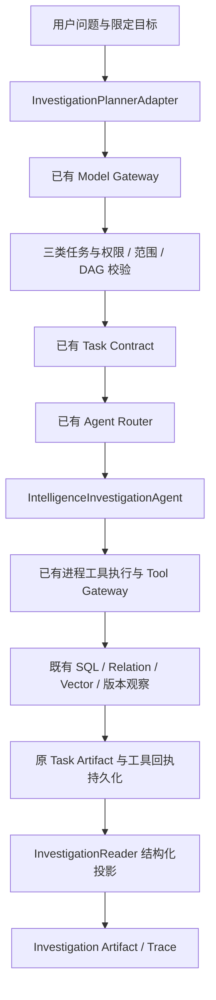

# Phase 11-B1 完成报告

状态：**Phase 11-B1 已完成并停止。** 2026-10-08 验收：原有 716 项 + 新增 84 项 = **800 项全部通过**，零失败、零错误、零跳过。一次独立只读审查的五项重要问题均已用失败复现、修复和完整回归验证；没有延期的小问题。

## 1. Agent设计

实现 `IntelligenceInvestigationAgent`，继承原 `InvestigationAgent` 接口，注册 ID 为 `investigation_agent`，实现版本为 `intelligence-investigation-v1`。

显式调查注册工厂只安装一个具体专业 Agent，支持 `vulnerability_lookup`、`evidence_search`、`asset_lookup`。保留原默认专业注册表和已有应用入口。未实现 Verification Agent、Security Analysis Agent、Integration Gate。

Agent 只消费已经验证的 Task Contract 和结构化依赖 Artifact。所有工具执行交给原 `ProcessSupervisor` → 原 WorkerExecutor → Tool Gateway；Agent 内没有模型、数据库、外部 API 或任意脚本执行逻辑。每个运行独立实例与进程监管对象，复用原取消、超时、进程清理协议。

## 2. 调查流程



调查计划使用固定三类任务与八种只读工具白名单。未知任务、越权工具、写入或刷新要求、范围外的目标/资产/组件参数、循环与超预算均拒绝。组件版本问题要求执行已有版本算法的只读包装；组件适用性问题缺少版本时，服务端要求真实 input_required(version) 节点。

根据最新“禁止修改 Planner”指令，新增限定调查的 Planner/Runtime 适配层：复用原 Model Gateway、Planner 审计协议、Task Contract、图验证、Runtime、Scheduler、AgentExecutor 和存储。原 Planner 源文件及默认行为保持不变；受约束规划最多两次结构化请求，保留原始诊断与拒绝原因。

Agent 按已授权步骤逐个调用工具，沿用相同总截止时间和预算。某个工具失败后可以继续后面的独立只读步骤，保留失败回执和已有结果；不会重试未知步骤、改写参数或增加工具。

## 3. Artifact设计

`InvestigationArtifact` 使用现有 Pydantic/FrozenModel 体系，包含：

- 身份：`artifact_id`、`run_id`、`task_id`、`agent_id`、`schema_version`。
- 状态：`status`、`runtime_status`、`partial_result`、`information_status`。
- 漏洞/组件/资产：`vulnerability_id`、`canonical_id`、`description`、`component`、`asset`。
- 影响与来源断言：`affected_versions`、`fixed_versions`、`version_match`、`cvss`、`cwe`。
- 发现项：`poc_candidates`、`patch_information`、`findings`。
- 审计：`evidence`、`conflicts`、`uncertainties`、`confidence`、`failed_tools`、`tool_calls`、`dependency_artifact_ids`。
- 大结果引用：`evidence_storage`、`receipt_references`。

业务状态规则：

| 情况 | 业务结果 | 原 Runtime 行为 |
| --- | --- | --- |
| 有目标数据和足够当前、可定位的权威来源 | COMPLETE | 满足原验收才能 SUCCESS |
| 工具失败，保留已得结果和错误 | PARTIAL | FAILED；依赖节点仍 BLOCKED |
| 工具失败且有冲突 | PARTIAL + CONFLICT 信息等级 | FAILED；保留冲突和失败 |
| 无数据或缺少可信当前证据 | INSUFFICIENT_EVIDENCE | WAITING_REVIEW，后续不解锁 |
| 已有未解决冲突或当前同范围来源矛盾 | CONFLICT | WAITING_REVIEW，交给后续阶段 |
| 全部工具失败 | PARTIAL + INSUFFICIENT_EVIDENCE 信息等级 | FAILED |

`CONFIRMED` 只继承已有、当前、受信任声明与对应核验支持证据；不进行新的核验，也不把“官方链接存在”当作确认。PoC 保持静态候选，保存 `observed_status`，不执行代码、不推断可用性。模型的计划置信度不写入情报置信度，未知值保留 `null`。

历史观察不会覆盖当前判断。相同 RawDocument 被复用时，Evidence 当前性仍按其不可变 Observation 判定。来源级别、适用范围、定位和关联观察随执行回执保存。权威来源必须关联当前目标：按工具回执中的限定 target 或保存的观察/声明身份关联；无关语义命中保留候选引用，不给另一目标背书，也不能把无关依赖声明当作当前目标已确认。

独立证据任务可以仅输出发现的 Evidence/Claim 观察及来源，不强制依赖漏洞详情节点；观察保存在 findings，保持候选等级。

投影上限为 512 KiB，拒绝非有限 JSON；验收前预留正式 record_id/sequence_no 的持久化开销。超限返回明确 PARTIAL 引用，保留信息等级，完整工具回执保留，不静默裁剪事实。任何不完整投影不能维持 Runtime SUCCESS 或解锁依赖。

## 4. 工具调用链

| 调查任务 | 允许工具 | 复用能力 |
| --- | --- | --- |
| vulnerability_lookup | get_vulnerability / search_vulnerabilities / inspect_component_version | 原漏洞查询、产品识别、版本比较 |
| evidence_search | get_evidence / get_claims / relation_query / semantic_search | 原证据、声明、关联及语义检索 |
| asset_lookup | get_asset | 原所有者限定资产查询 |

只新增 `inspect_component_version` 的严格输入及只读包装，调用原 `resolve_component`、`vulnerability_detail`、`compare_version`。结果保存精确包身份、当前/历史范围、修复版本来源、IN_RANGE / OUT_OF_RANGE / UNKNOWN 和不确定性。

Tool Gateway、模型网关、旧 Embedding 调用点、采集与安全业务算法没有被替换。向量检索沿用已缓存本地模型和已有有界精确检索实现。

## 5. Trace变化

复用原 Planner 审计、runtime-v1 AgentRun、TaskTrace 和 ToolCallRecord 持久化，增加只读调查结果与任务链投影：Agent ID、Task ID、实际工具、起止时间、状态、Artifact ID、是否真实执行。

`InvestigationReader.read(run_id, actor)` 限定同所有者，只从当次持久化计划、Artifact 与正式工具回执重建结果。核对 Registry/实现版本、任务指纹、Trace/Artifact 身份和状态、正式 record_id/sequence_no、工具名称、参数和 Envelope。阻塞节点没有虚构工具调用。

新 Service / Reader 实例可以读旧执行快照；修改实时 Source 元数据不会改变已经保存的结果。同一请求键不重复模型或工具调用；跨所有者和伪造引用拒绝读取。

内部调用入口：

```python
service = IntelligenceInvestigationService(engine, model_gateway)
snapshot = service.plan_and_run(planner_input, actor)
# snapshot.planning_status == VALIDATED 后，读取实际 runtime_run_id
result = service.read_results(snapshot.runtime_run_id, actor)
trace = service.read_planner_trace(snapshot.planner_run_id, actor)
```

类型沿用 `PlannerInput`；目标来自 query.target / 问题中的 CVE，资产来自 query.asset_id，组件与版本来自 component 或原有问题解析。

## 6. 修改文件

新增生产文件：`backend/app/agents/investigation/` 下的 `schemas.py`、`normalize.py`、`roles.py`、`planning.py`、`investigation_plan_v1.txt`、`registry.py`、`validation.py`、`planner.py`、`agent.py`、`runtime.py`、`service.py`、`reader.py`、`__init__.py`；`backend/app/tooling/investigation.py`。

仅修改五个既有文件：

| 文件 | 增量变化 |
| --- | --- |
| backend/app/agents/contracts.py | 专业语义类型增加 asset_lookup，旧 PlannerType 不变 |
| backend/app/agents/router.py | 可选固定角色表，默认旧白名单 |
| backend/app/agents/executor.py | 将可选角色表传入原 Router，旧回执/结果验收保留 |
| backend/app/tooling/contracts.py | 注册只读版本观察输入和工具 |
| backend/app/tooling/adapters.py | 只读工具分派和来源元数据装饰 |

测试新增在 `backend/tests/agents/investigation/`。另修正一处既有测试夹具 `backend/tests/runtime/fixtures/slow_worker.py`：完整 PID JSON 写完后原子发布就绪文件，消除取消测试读取空文件的竞态；没有修改 Runtime 生产代码或放宽取消断言。

实施证据在 `work/investigation/`，包括所有失败/通过日志、JUnit、原文件哈希、范围检查和决策记录。

对照 240 个原始源文件：五个兼容文件及一个测试夹具变化，零原文件删除；原 Planner、Runtime/DAG/Scheduler、Gateway 核心、数据库模型/Migration、原业务算法、前端未修改。本目录没有 Git，未编造提交或删除阶段证据。

## 7. 测试结果

最终实际执行结果：

| 验证 | 结果 | 证据 |
| --- | --- | --- |
| 原有后端测试 | 716 / 716 通过 | reviewed_full_suite.xml |
| 本阶段新增测试 | 84 / 84 通过 | reviewed_focused.json / reviewed_full_suite.xml |
| 全部后端 | **800 / 800 通过，0 failed / 0 errors / 0 skipped** | reviewed_full_suite.json / .xml / .log |
| 原文件范围核对 | 240 文件基线；5 兼容文件 + 1 测试夹具变化；0 删除 | scope_check.json |
| 本轮测试服务清理 | 55435 / 55437 两个专用集群已停止，目录和证据保留 | cleanup.txt |

完整测试命令（在项目根目录运行，使用独立测试库）：

```powershell
$env:AEGIS_TEST_DATABASE_URL='postgresql+psycopg://aegis_test@127.0.0.1:55437/aegis_phase5_test'
$env:AEGIS_RUNTIME_TEST_DATABASE_URL='postgresql+psycopg://aegis_test@127.0.0.1:55435/aegis_phase5_test'
& 'backend/.venv/Scripts/python.exe' 'work/investigation/run_tests.py' reviewed_full_suite -q
```

退出码 0；pytest 用时 218.56 秒，外层证据运行器 221.844 秒。保留一项既有 Starlette/AnyIO 弃用警告。JUnit 中新旧用例分类复核保存在 `work/investigation/final_acceptance.json`。

覆盖用户要求的漏洞调查、vLLM 0.6.0 版本观察、证据发现、工具错误 PARTIAL、证据不足，另覆盖资产所有者、PoC 候选、冲突/历史来源、权限/范围/DAG、结构化重试、模型与工具调用幂等、正式回执引用、快照重建、超限引用、实际进程取消/超时和隔离清理。

完整链路：真实 Model Gateway 结构化调用（受控文本模型响应）→原 PostgreSQL Planner 审计→原 Runtime/Router/AgentExecutor→实际独立进程 Tool Gateway→真实合成数据库查询→正式 Artifact/回执→新 Reader。关系检索和本地 ONNX 语义检索也实际运行。合成数据显式标记 SYNTHETIC，不作为真实 CVE、模型质量或比赛 Benchmark。

实施中发现的测试夹具问题保留失败日志：数据库禁止更新不可变观察/范围，夹具改为插入新历史记录；测试 JOIN 使用明确关联条件。原数据库约束没有放宽。第一次全量测试 790 项中 789 通过，1 项旧取消测试因就绪空文件失败；随后用确定性测试复现根因，修正夹具，并通过原进程组 11 项验证（readiness_red / readiness_green）。最终 800 项完整回归已通过。

一次独立只读审查提出五项 Important 问题，均接受并进入同一修复轮：超限投影阻断、目标证据关联、独立证据完整性、失败/冲突状态优先级、缺失版本输入。8 个失败断言先复现，修复后与相关组共 55 项通过；补充跨目标依赖声明的失败复现后收紧确认范围，最终新组 84 项和全量 800 项均通过。审查记录在 `work/investigation/final_review.md`，没有跳过失败日志或安排重复审查。

## 8. 当前限制

- 本阶段完成的是内部调查服务与执行链；原前端和公共 HTTP 入口还未切换到它。
- 依赖已采集的本地数据，没有新增实时外部 API、爬虫或刷新操作。
- 组件身份无法解析、范围语义未知、无当前数据时明确保留 UNKNOWN，不能推断“安全”。
- 不进行新的证据核验、PoC 运行、补丁适用性判断或资产风险评分。来源范围冲突需后续处理。
- 真实文本模型的规划质量、真实漏洞数据正确性、吞吐和比赛评测未由这些合成测试证明；线上使用需配置已有 Model Gateway。
- 复用的语义检索保留原 1000 个块的有界精确检索限制，未实现 pgvector ANN。
- Scoped Planner 适配层需要独立维护，以避免改动已冻结的原 Planner。

本轮实施取舍的完整记录见 `work/investigation/ledger.md`：采用适配层而不修改 Planner；业务 PARTIAL 保留原 Runtime 失败门禁；只继承已有 scoped confirmation；无 Git 时保存哈希和日志；因注册依赖先完成工具再接注册；全部工具失败也返回 PARTIAL 且可无事实；修复共享测试夹具就绪竞态；新核验/来源独立性/资产安全结论延后；真实模型质量/真实漏洞正确性需要单独评测。

## 9. 下一阶段建议

等待明确的新阶段指令后，再讨论 Verification Agent 如何消费 Investigation Artifact、处理来源独立性/当前性/冲突与弃权。该建议只作为交接，本轮停止于 Phase 11-B1，不实施后续 Agent、Integration Gate、前端或部署。
