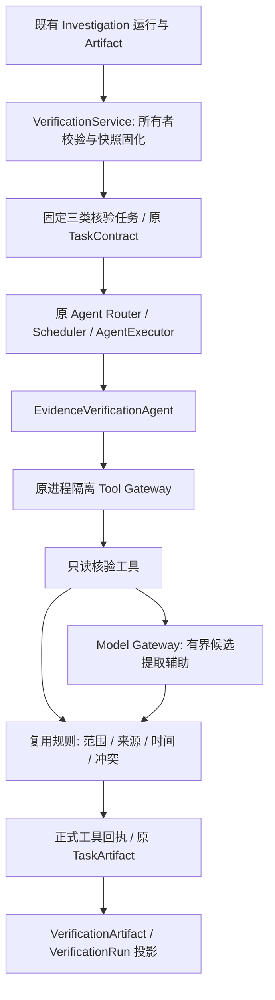

# Phase 11-B2：Evidence Verification Agent Implementation Plan

> **For agentic workers:** 确认实施后使用 `superpowers:executing-plans`，在当前会话逐项执行；沿用既有 Native 实施方式。当前文件是待确认计划，不代表能力已实现。用户原文第五节明确要求“等待确认后实施”。

**Goal:** 在既有专业 Agent 框架中实现 `EvidenceVerificationAgent`，把 Investigation Artifact 中的候选结论转成有来源、规则依据、冲突记录和弃权原因的 Verification Artifact。

**Architecture:** 新 Agent 通过只读 Tool Gateway 适配器消费所有者所属的调查快照，复用既有 Claim/Evidence 类型、版本算法和确定性核验规则。模型只提供受约束的候选提取/匹配建议；规则决定最终状态。新核验结果追加到既有 Runtime Artifact/回执/Trace，不改原调查结果或全局情报采纳状态。

**Tech Stack:** 既有 Python、Pydantic、SQLAlchemy、PostgreSQL、Model Gateway、Tool Gateway、Runtime ProcessSupervisor、pytest；不增加 Agent 框架、数据库表或模型 SDK。

**Spec:** `C:/Users/X/.codex/attachments/2ca8d2c8-2360-4cd6-8128-0fc2847ca2f2/Pasted text.txt`。前置交付：项目根目录 `PHASE_11B1_RESULT.md`；所有相对路径均相对本项目根目录。

## 1. Global Constraints

- 唯一业务 Agent：`EvidenceVerificationAgent`，`agent_id=verification_agent`；实现既有 `VerificationAgent.verify()` 协议。
- 只支持 `evidence_verification`、`claim_validation`、`conflict_detection` 三个新语义任务。
- 不重写 Planner、DAG Engine、Scheduler、Executor、Tool Gateway 或 Model Gateway。
- 不修改原 Investigation Artifact；只能增加核验结果和审计记录。
- Agent 不直接访问数据库、外部 API、模型或 SDK；数据操作通过 Tool Gateway，模型辅助由工具内的既有 Model Gateway 完成。
- 原五类 Planner 任务白名单、B1 三类调查任务和默认 Registry 保持原行为；新核验入口显式启用。
- 不调用旧写入工具 `verify_claim`、`detect_conflicts`、`verify_poc_candidate`、`request_review`；不调用旧 Integration/Adoption 写入链路。
- 不执行 PoC，不把 PoC 关联或静态确认写成“验证代码可用”。
- 不开发 Security Analysis Agent、Integration Gate、前端页面、HTTP 入口改造、采集器或部署功能。
- 本轮只交付此计划；确认后才编码、实际运行测试并生成 `PHASE_11B2_RESULT.md`。

## 2. Review Focus

| 必须关注的失败类型 | 所属任务 / 断言 |
| --- | --- |
| 伪造输入、跨所有者、跨 CVE/组件/分支证据、回执篡改 | Task 2 / 7：拒绝伪造；无副作用；不同范围不互相支持或冲突 |
| 镜像和历史来源被当作独立证据，缺失原文仍确认 | Task 2 / 3：同源去重；时间窗口；哈希和关联完整性；缺证据弃权 |
| 模型编造证据、提升来源等级或受外部文本指令影响 | Task 4：模型只能给候选；非法 ID/引文拒绝；模型失败仍可规则核验 |
| 弱化原 Runtime 失败门禁，越权工具或写入全局情报 | Task 5 / 6：只读工具；原失败状态保留；Claim/Review/采纳记录不变 |
| 重试产生不同时间/结论、遗漏冲突、超限后静默给出完整确认 | Task 2 / 7：固定上下文；幂等冲突拒绝；超限有明确部分/弃权状态 |

## 3. 已检查的当前实现与复用决定

| 当前文件 / 能力 | 检查结论 | 本阶段决定 |
| --- | --- | --- |
| `backend/app/agents/interfaces.py` | 已有 `VerificationAgent.verify(request, database_url=None) -> ExecutionOutcome` 抽象接口 | 新类继承，保持执行协议 |
| `backend/app/agents/contracts.py` | AgentTaskType 为原 Planner 语义加 `asset_lookup`；AgentArtifact 已扩展；单 Agent 最多 5 类任务、8 个工具 | 仅追加三个语义 Literal，不重构 Artifact/Contract |
| `backend/app/agents/router.py`、`executor.py` | 已支持可选 scoped task registry；正式结果必须与工具回执及依赖一致 | 使用既有兼容接口，不修改核心实现 |
| `backend/app/agents/investigation/schemas.py`、`reader.py` | B1 Artifact 是原 Runtime Artifact + 正式 ToolCallRecord 的投影，支持回执引用；Reader 校验所有者、身份和记录 | 新 Reader/输入适配复用其校验，不信任调用者提交的完整 DTO |
| `backend/app/agents/investigation/roles.py`、`registry.py` | B1 三类语义任务、八个只读工具均已冻结 | B1 代码和 Registry 不变 |
| `backend/app/enrichment/contracts.py` | 已有 ClaimType 和五种 VerificationStatus；另有旧同名 InvestigationArtifact | 复用枚举；输入明确使用 `agents.investigation.schemas.InvestigationArtifact`，避免误用旧富化类型 |
| `backend/app/enrichment/rules.py` | `evaluate_claim`、`compare_claims`、PoC/Patch 静态分类已有；镜像、当前性和时间窗口已有规则 | 复用纯函数；新适配层只做输入校验、范围绑定、计分与结果投影 |
| `backend/app/enrichment/evidence.py`、`queries.py` | 已有证据指纹、来源谱系、原文及 Claim/Evidence 映射 | 复用映射/指纹；实时查询结果必须固化，不能在 Reader 重建时重新读取当前状态 |
| `backend/app/enrichment/verification.py`、`tooling/adapters.py` | 旧 `verify_claim` 会改 Claim revision/status，并进入情报采纳；旧 conflict 工具也会写业务状态 | 不调用这些写入方法，避免提前进入 Integration Gate |
| `backend/app/db/models/intel.py`、`raw.py` | 已有 Claim、不可变 Evidence/RawDocument/SourceObservation、VerificationResult；Source/Claim 本身可变 | 不新增重复 ORM；新增的是执行 DTO。引用不可变记录，固定可变来源元数据快照 |
| `backend/app/runtime/service.py`、`store.py` | 既有运行创建、幂等、持久化和调度扩展接口；旧 ProfessionalRuntimeService 要求已验证 Planner 审计 | 新显式核验运行适配器复用 RuntimeService；不伪造 Planner Trace、不放宽旧入口审计 |
| `backend/app/llm/gateway.py`、`records.py` | 已有结构化输出、Provider 配置、超时、调用统计、脱敏记录 | 模型辅助只经 `generate_structured()`，复用配置；不新增凭据或外部服务 |

已读取 B1 最终验收证据 `work/investigation/final_acceptance.json`：800 项通过，0 failed / errors / skipped。其中 716 项原测试、84 项 B1 测试。本轮未重跑，不能把该证据称作 B2 的测试结果。两个专用测试集群上轮已停止。

### 3.1 方案取舍

采用“只读快照核验 + 追加执行结果”。直接复用旧写工具会修改 Claim/Review/采纳状态；纯 LLM 判断没有可复核的可信依据。新写入只限核验上下文、原 Runtime Artifact、ToolCallRecord 和 Trace，后续全局采纳另行授权。

### 3.2 调查与核验的真实交接边界

B1 将冲突/不足的业务结果保留为 `WAITING_REVIEW`，工具失败仍为原失败状态；旧 Scheduler 和同运行 `build_handoff` 不允许把它们当成成功依赖。保留这些门禁。

B2 内部服务以调查运行 ID、task ID、artifact ID 读取拥有者可见的已有快照，创建**新的核验运行**，保存 `source_run_id/source_artifact_id/source_snapshot_hash`。输入是待检查的观察材料，不能宣称是已接受的成功 DAG 依赖。B1 中根本没有生成 Artifact 的 BLOCKED / INPUT_REQUIRED 任务不能凭空核验。

原成功 Artifact 的同运行交接能力继续可用；本阶段不修改用户问题的 Planner，也不自动把核验任务拼进原调查计划。可演示“真实调查运行 → 内部核验服务 → 核验 Artifact”，不能宣称前端/公共问答已接通新链路。

## 4. 目标结构与任务映射

| 语义任务 | 只允许的工具 | 结果职责 |
| --- | --- | --- |
| `evidence_verification` | `evaluate_evidence_snapshot` | 全量核验所选 Artifact 的有界 Claim 集合，包含冲突与最终状态 |
| `claim_validation` | `validate_claim_snapshot` | 核验指定 Claim IDs，仍检查相关冲突，不能绕过反证 |
| `conflict_detection` | `compare_claim_snapshot` | 检查同范围 Claim/证据冲突；未发现冲突只表示此次检查无冲突，不能自动确认全部 Claim |

三个工具均注册为 `READ_ONLY`，参数为上下文 ID + 已固化的来源引用 + 所选 Claim IDs；不可接收任意 SQL、URL、工具名或模型自定义判定。服务端构造 `tool_sequence` TaskContract；Registry/Router 使用 scoped roles。`verification-registry-v1`、`evidence-verification-v1`、`verification-rules-v1`、`verification-assist-v1` 分别固定注册、实现、计分规则和提示版本。

## 5. 输入、Claim、Evidence 与输出协议

全部执行 DTO 使用既有 Pydantic FrozenModel：拒绝额外字段、NaN/Infinity，显式长度/大小限制，时区完整。

| DTO | 核心字段与约束 |
| --- | --- |
| `VerificationRequest` | source_run_id、source_task_id、source_artifact_id、task_type（三选一）、claim_ids、request_key、model_assistance（默认关闭）；actor 来自服务调用身份，不接受输入自报身份 |
| `VerificationContext` | context_id、owner、request_hash、source_snapshot_hash、evaluation_time、rules_version、source_snapshot、model_assistance、model/provider 配置标识（无 Key）；上下文首次创建后固定 |
| `VerificationClaim` | claim_id、statement、type（复用 ClaimType）、value、scope_key、vulnerability_id、package_identifier_id、branch、claim_revision、origin（stored/derived）、source_field、evidence_ids；statement 只展示，value/scope 才用于规则 |
| `VerificationEvidence` | evidence_id、claim_id、source_id/source_key、source_url、authority_level/scope、lineage_key、observation_id、raw_document_id、published_at/retrieved_at、content_hash/excerpt_hash、excerpt/locator、observed_value、stance、directness、is_current、integrity_status、exclusion_reasons |
| `ClaimVerification` | claim、status、confidence、supporting_evidence_ids、conflicting_evidence_ids、reason_code、rules_applied、score_components、warnings、unresolved_items |
| `VerificationArtifact` | 用户要求的 artifact_id、task_id、agent_id、claims、verification_status、confidence、supporting_evidence、conflicting_evidence、warnings、unresolved_items；增加 run_id、schema_version、source 引用/hash、evaluation_time、execution_status、partial_result、conflicts、tool_calls、model_calls、rules_version |
| `VerificationRun` | agent_id、input_artifact、claims_checked、evidence_used、result、confidence、execution_time；另加 run/task/artifact ID、起止时间、工具回执和规则/模型版本 |

### 5.1 Claim 提取

- 优先读取调查运行正式回执中的已有 Claim（含原 revision/value/scope），不以当前 live Claim 值覆盖旧值。
- 已有结构化影响范围、修复版本、补丁/PoC 候选可形成带字段定位与来源引用的 derived Claim；稳定 ID 由来源快照、字段路径、类型/范围和值指纹生成，不插入 ORM Claim。
- `version_impact` 展示项映射已有 `AFFECTS_VERSION`。组件实例影响须同时具备准确包身份、原版本算法的 IN_RANGE 结果及可确认的包范围证据；原 UNKNOWN 不升级。
- CVSS 按向量版本/评分主体分别核验，不能把不同版本评分当冲突；CWE/描述等未有对应 ClaimType 的字段保留观察，不硬造“已核验 Claim”。
- 单纯提到 CVE、仅候选 URL、自然语言描述、模型推测均不能成为已确认事实。

### 5.2 Evidence 固化与完整性

读源范围只限该源 Artifact 正式回执及其已有引用，不能扫描其他用户资产或引用无关漏洞记录。使用 B1 Reader 验证身份、回执序号/名称/参数/结果；`receipt_references` 场景从原回执重建完整数据，不以截断摘要替代。

不可变 Evidence/RawDocument/Observation 按原 ID 补足原文哈希、引文与定位。校验 SHA-256、excerpt_hash、source/raw/observation 关联和 Claim 范围。可变 Source 权威信息使用调查回执已经保存的快照；缺失信息不能从当前 Source 无声提升可信度。首次核验明确记录 `source_snapshot_as_of` 与 `evaluation_time`；重建结果不重新查最新来源。

当前性按首次固化的核验时间检查：在当时最新、已解析的同源同 external_id 观察才可用于确认，保留旧观察做历史展示。调查后发生更新时记录差异并降级对应旧观察，不能用新值覆盖旧调查结果。不得把未采集记录解释成否定证据。

对缺原文、缺定位、关联或哈希失败的证据保留排除原因，不计入确认；明确区分“内容完整性校验通过”和“内容所述事实已确认”。

### 5.3 状态与执行状态

复用 `VerificationStatus` 五态，不新增互斥的另一套状态定义：

| 状态 | 判定 |
| --- | --- |
| CONFIRMED | 完整性/身份/范围/时间通过，已有确定性规则满足确认且无有效反证 |
| PENDING | 可追踪候选仍需补证或人工处理；不可写成确认 |
| CONFLICT | 同范围当前有效支持与反证/不兼容 Claim 同时存在，展示两方与原因 |
| INSUFFICIENT_EVIDENCE | 没有足够可用证据、关键来源缺失、规则不支持或输入不完整 |
| REJECTED | 有明确拒绝依据，例如已有静态分类拒绝候选关联；不是“搜索不到” |

全量 Artifact 聚合：有有效冲突优先 CONFLICT；只有所有所选 Claim 都 CONFIRMED 且覆盖完整才 CONFIRMED；全都 REJECTED 才 REJECTED；其余有有效候选则 PENDING；无有效候选则 INSUFFICIENT_EVIDENCE。`conflict_detection` 无冲突时使用 PENDING 并注明仅完成冲突检查。

业务状态和原 Runtime 执行状态分别记录。模型辅助异常可保留确定性规则结果并注明降级；工具/快照失败、处理超限不能输出完整确认。必要时保持 FAILED/PARTIAL/WAITING_REVIEW，不把规则执行结束等同可信结论。

## 6. 规则、模型辅助与 confidence

### 6.1 确定性核验

1. **范围和身份门禁**：同 CVE、包/组件、分支及 Claim 语义才能比较；不能只比较文本。固定版本、影响范围、版本匹配使用原 canonical/interval/compare_version 算法。
2. **来源门禁**：沿用数据库四级 official/authoritative/secondary/community，并检查 authority_scope。NVD 的 official 元数据不等于厂商直接声明；域名字符串或模型说“官方”不能提升来源。
3. **直接性**：结构化字段/可定位的直接声明才为 explicit；仅提及相关编号为 mention；候选只能提供关联提示。
4. **时间**：复用 `evaluate_claim` 现有 aware-time、30 天检索时效和未来 5 分钟容差；检查发布时间、修复/版本时间的已知顺序。不重写既有窗口；旧公告即使真实也可能被该窗口限制，明确记录弃权原因。缺失发布时间/版本发布时间保留警告，不能声称已验证时间链。
5. **独立性**：复用来源 lineage/fingerprint 逻辑；OSV/GHSA/CVE 镜像、fork、同发布者重发不算多份独立确认；未知谱系归为同一个未解析组。
6. **冲突**：复用 `compare_claims`，在相同 scope 比较语义范围；等价表达不冲突，不同历史版本不冲突。当前有效的 `<=0.6` 与 `<=0.7` 范围须显式 CONFLICT，不能因一方权威更高就隐藏另一方。
7. **不推断缺失**：KEV 未列出不能推出“未被利用”；没有 PoC 不推出“无法利用”。PoC 静态关联确认不改变 `usability_status=not_evaluated`。

旧规则返回 supporting/contradicting/considered IDs、reason 和 method；新结果保留这些依据，不以新计分覆盖旧规则判定。

### 6.2 模型辅助边界

启用时调用 `ModelGateway.generate_structured()`，输出仅 `claim_id/evidence_id/quote/source_field/proposed_type/proposed_value/matching_hint`。不接受模型提供最终 status、authority、is_current、verified、confidence 或新 Evidence ID。

允许模型帮助从有界已知片段提取候选和建议对应关系；必须再次验证精确引用、ID、范围和字段/值。模型提取的非结构化候选可进入 PENDING；本版不单凭模型提取让它获得规则需要的 explicit 权限。确认仍需已有结构化/可确定验证的声明。

默认关闭，未配置模型也能规则运行；显式开启时使用已有 Provider 配置，单请求至多 1 次结构化调用，最多 8 条候选、每片段 1200 字符、模型 max_tokens=512、超时不超过工具剩余期限。非法 JSON/无配置/超时保留 `MODEL_ASSIST_FAILED` 或具体校验告警，规则继续；不隐藏失败，不自动尝试多个模型。

外部文本按 `UNTRUSTED_EXTERNAL_CONTENT` 输入，不能变更系统指令/工具权限。记录 request_id/provider/model/function/tokens/latency/status/error 和 prompt_version；不记录 Key/完整 Prompt，不把模型引文当独立来源。

### 6.3 confidence v1：可解释评分，不是统计概率

用于比较证据质量，不宣称概率校准、模型准确率或资产风险评分。公式：每份有效证据 `quality = source_weight × directness_weight`；按独立谱系取组内最高分，再取最高组加上 `0.10 × 次高组`，上限 1.00。

| 项 | 固定值 |
| --- | --- |
| 来源权重 | official=0.95；authoritative=0.85；community=0.45；secondary=0.30；普通博客上限 0.20；未知或 scope 不匹配=0 |
| 直接性权重 | 经规则确认的 direct=1.00；mention=0.25；unknown=0 |
| 资格门禁 | 非当前/超窗口/完整性或身份失败不参加有效支持计分，另保存排除原因 |
| 状态上限 | CONFIRMED 上限 1.00；PENDING / INSUFFICIENT_EVIDENCE 上限 0.49；CONFLICT 上限 0.49并分别展示支持/反证分；REJECTED 对原 Claim 的支持分为 0 |
| 缺证据 | confidence=0；分数缺失不能默认填高值 |

聚合 confidence 取所有所选 Claim 的保守最小值；空集合为 0，任何未处理 Claim 禁止聚合 CONFIRMED。模型不参与增加权重。高分不覆盖 CONFLICT，低分不改变旧规则已具备的确认依据。规则/权重均绑定 `verification-rules-v1`，未来调整必须新版本并另行评测。

## 7. 新增与修改文件

### 7.1 只允许兼容追加的原文件

| 文件 | 改动 |
| --- | --- |
| `backend/app/agents/contracts.py` | AgentTaskType 追加三个新核验语义 Literal，旧类型/字段/校验保留 |
| `backend/app/tooling/contracts.py` | 新增小型 VerificationSnapshotInput 和三个 READ_ONLY ToolDefinition |
| `backend/app/tooling/adapters.py` | 增加三个分发分支，转给新只读包装器；原工具实现不变 |

### 7.2 新文件及单一职责

| 文件（目录前缀 `backend/app/agents/verification/`） | 职责 |
| --- | --- |
| `__init__.py`、`schemas.py` | 显式导出和请求/Claim/Evidence/结果/Trace DTO |
| `snapshot.py` | 校验并读取拥有者的调查 Artifact、正式回执和不可变来源引用，构造候选 Claim/Evidence |
| `context_store.py` | 复用 AgentRun 表保存一次性固定的核验上下文，处理所有者/幂等/时间与来源快照 |
| `rules.py` | 纯适配函数调用原 evaluate_claim/compare_claims，范围/完整性门禁、计分与聚合 |
| `assistance.py`、`verification_assist_v1.txt` | Model Gateway 有界结构化辅助、候选校验和脱敏调用元数据 |
| `roles.py`、`registry.py` | 三任务/三工具白名单与显式 `create_verification_registry()` |
| `agent.py` | EvidenceVerificationAgent，复用 ProcessSupervisor/回执校验，支持取消/期限 |
| `runtime.py`、`service.py` | 固定计划来源证明、调用既有 Router/AgentExecutor/Scheduler 的内部入口 |
| `reader.py` | 从正式回执及已固化上下文投影 VerificationArtifact 和 VerificationRun |
| `backend/app/tooling/verification.py` | 三个只读工具包装器；数据读取/规则/模型辅助在工具边界内完成 |

测试放在 `backend/tests/agents/verification/`；实施证据放 `work/verification/`，包括新证据运行器、基线哈希、RED/GREEN 日志、JUnit 和验收统计；不覆盖 `work/investigation/` 历史证据。确认实施后最终只新增根目录 `PHASE_11B2_RESULT.md`，本计划保留。

不改原 Planner/Runtime/Graph/Scheduler/Executor 核心、B1 目录、原富化规则、数据库模型/Migration、前端、依赖版本。发现这些边界之外的阻塞，先记录原因并调整适配计划；不趁机重构。

## 8. 实施任务、接口与测试循环

统一测试命令：在项目根目录执行 `& 'backend/.venv/Scripts/python.exe' 'work/verification/run_tests.py' <证据名> -q <backend 内测试路径>`。实施开始时从 B1 证据运行器复用保护逻辑，输出改到新目录；每次保存退出码、日志和 JUnit，RED 为预期新断言失败，GREEN 为 0 failed/errors/skipped。使用已存在虚拟环境。

测试库明确设置 `AEGIS_TEST_DATABASE_URL=postgresql+psycopg://aegis_test@127.0.0.1:55437/aegis_phase5_test`、`AEGIS_RUNTIME_TEST_DATABASE_URL=postgresql+psycopg://aegis_test@127.0.0.1:55435/aegis_phase5_test`；仅在实施阶段按既有方式启动这两个专用集群，结束后停止。不得继承生产数据库地址。

### Task 1：冻结 DTO 与最小输出协议

接口：`VerificationRequest/VerificationContext/VerificationClaim/VerificationEvidence/ClaimVerification/VerificationArtifact/VerificationRun` 置于 `schemas.py`，字段见第五节。Artifact `schema_version=verification-artifact-v1`，遵守原 512 KiB Artifact 和有界回执限制。

- [ ] 新建 `test_schemas.py`：五态可往返；`assert result.agent_id == 'verification_agent'`；旧 B1 Artifact 可独立解析；额外字段、非有限分数、无时区时间、超限失败。
- [ ] 运行 `schemas_red -q tests/agents/verification/test_schemas.py`，确认新类型缺失或约束断言失败。
- [ ] 实现 DTO 与三个新语义 Literal；复用原 ClaimType/VerificationStatus，无 ORM 修改。
- [ ] 运行 `schemas_green` 相同用例及既有 `tests/agents/test_contracts_registry.py`、`tests/agents/test_artifacts.py`，确认旧协议兼容；保存基线哈希。

### Task 2：所有者快照、完整性与固定核验上下文

接口：`InvestigationSnapshotReader.read(request: VerificationRequest, *, actor: str) -> VerificationSourceSnapshot`；`VerificationContextStore.capture(request: VerificationRequest, *, actor: str) -> VerificationContext`；`VerificationContextStore.read(context_id: UUID, *, actor: str) -> VerificationContext`。`VerificationSourceSnapshot` 在 `schemas.py` 包含源 Artifact/回执引用、Claim/Evidence、来源 hash 和覆盖信息。

上下文存入既有 AgentRun 的独立 `agent_type=verification-context-v1` 命名空间，标识为输入快照审计，不伪装成 Agent 已执行。所有者 + request_key 通过既有 advisory lock 原子固化。相同请求返回原 evaluation_time/快照/config标识；不同内容使用原 IdempotencyConflict，不创建第二份执行。数据库读取在服务准备或只读工具边界完成，Agent 类不读取数据库。

- [ ] `test_snapshot.py` / `test_context_store.py`：`assert old_artifact_hash == after_hash`；跨所有者/篡改回执/ID 错配拒绝；同 key 时间/hash 不变，不同内容拒绝；receipt_references 可重建；Source 更新不回写旧 authority。
- [ ] 运行 `snapshot_red` 两个文件，确认失败；实现输入适配与上下文固化。
- [ ] 增加正文/引文 SHA-256、跨 scope、旧观察/新增观察测试；缺原文记录排除原因而不确认。
- [ ] 运行 `snapshot_green` 两文件；验证源运行和情报表内容/hash/revision 不变，新增仅上下文审计。

### Task 3：复用规则完成状态、冲突和可解释分数

接口：`evaluate_snapshot(context: VerificationContext, *, claim_ids: tuple[str, ...] = ()) -> VerificationAssessment`；`find_conflicts(claims: tuple[VerificationClaim, ...], evidence: tuple[VerificationEvidence, ...]) -> tuple[VerificationConflict, ...]`。Assessment/Conflict DTO 在 `schemas.py`；不创建数据库 ConflictRecord。

- [ ] `test_rules.py`：官方直接证据 `assert status == CONFIRMED`；弱博客 `assert weak.confidence < official.confidence` 且不确认；两个当前同范围不兼容范围 `assert status == CONFLICT`；无有效来源 `assert status == INSUFFICIENT_EVIDENCE and confidence == 0`。
- [ ] 运行 `rules_red`，随后仅实现适配、门禁、计分和聚合，不复制旧算法。
- [ ] 增加等价范围、跨分支/包、镜像同源、旧/未来观察、修复时间冲突、PoC 未验证可用、候选 REJECTED、无 KEV 不能否定、只选部分 Claim 仍检查反证断言。
- [ ] 运行 `rules_green` 以及既有 `tests/test_phase7_rules.py`，确认原规则不变。

### Task 4：受约束模型辅助与降级审计

接口：`assist_claims(context: VerificationContext, *, gateway: ModelGateway, remaining_seconds: float) -> ModelAssistResult`；`validate_hints(hints: ModelAssistResult, snapshot: VerificationSourceSnapshot) -> ModelAssistResult`。候选只增加辅助记录，不更改固化 Evidence 来源/当前性/显式声明资格。

- [ ] `test_assistance.py`：经真实 Model Gateway 的受控响应可产生合法候选；编造 Evidence ID/不在原文的 quote 拒绝；输出 CONFIRMED/authority 等非法字段验证失败。
- [ ] 运行 `assistance_red`；实现结构化提示与验证，沿用 Provider/config/records。
- [ ] 增加模型失败/非法 JSON/超时/提示注入测试：`assert deterministic.status == assisted_failure.status`，并存在告警；模型不能提高确认权重；记录元数据无 Key。
- [ ] 运行 `assistance_green`；实际进程测试使用本机受控兼容 API 响应，不依赖付费 API，也不声称真实模型准确率。

### Task 5：只读工具注册、Agent 与路由

接口：工具包装器 `evaluate_evidence_snapshot(session, arguments, actor)`、`validate_claim_snapshot(session, arguments, actor)`、`compare_claim_snapshot(session, arguments, actor)`；`create_verification_registry() -> AgentRegistry`；`EvidenceVerificationAgent.verify(request: AgentExecutionRequest, *, database_url: str | None = None) -> ExecutionOutcome`，并实现既有 `for_run`/`cancel_all`。

- [ ] `test_tools.py` / `test_agent.py`：三任务精确匹配；`assert registry.freeze().for_task('evidence_verification').contract.agent_id == 'verification_agent'`；未知任务由 Router 返回 AGENT_NOT_FOUND；非白名单/写工具拒绝；正式结果来自工具回执。
- [ ] 运行 `agent_red`；实现三个只读工具分支、scoped roles/registry、Agent 进程调用与原 validate_outcome 校验。
- [ ] 增加工具异常、超时、取消、清理、额外工具/伪造回执测试；Agent 不调用 DB/模型，Agent 输出不绕过回执接受门禁。
- [ ] 运行 `agent_green`；同事务前后核对 Claim/VerificationResult/ConflictRecord/Review/Adoption 数据无变化，默认 Registry 未启用新业务 Agent。

### Task 6：独立核验运行与 Artifact/Trace 投影

接口：`EvidenceVerificationService.run(request: VerificationRequest, *, actor: str) -> RunSnapshot`、`.read_results(run_id: UUID, *, actor: str) -> VerificationRunResult`；`VerificationRuntimeAdapter.run_context(context: VerificationContext, *, actor: str) -> RunSnapshot`；`VerificationReader.read(run_id: UUID, *, actor: str) -> VerificationRunResult`。RunResult DTO 在 `schemas.py` 包含 Artifact/VerificationRun 元组和原 Runtime 状态。

服务固定构造单核验任务，来源证明为已拥有且 hash 匹配的固化上下文；适配器必须通过 context_id/actor 重新读取已存上下文并对比 hash，不能信任调用者临时构造的 VerificationContext。核验 TaskPlan 的 role、工具、参数、规则/config版本必须与服务端重建计划完全匹配，再绑定原 Router。Runtime request_key 使用核验命名空间+原 key 的有界 hash，避免与 B1/旧 Runtime 同 key 冲突；保存父调查 planner_run_id 仅作关联，不伪造新 Planner 审计。

- [ ] `test_runtime.py` / `test_reader.py`：原 Scheduler/AgentExecutor 真实运行；新 Artifact 引用精确源 hash，源 Task/Artifact 状态不变；VerificationRun 含要求的字段和正式回执 ID。
- [ ] 运行 `runtime_red`；实现 RuntimeService 扩展接口、投影与追踪；新业务 Artifact 不挤进原 TaskArtifact.output 破坏正式回执约束。
- [ ] 增加 B1 CONFLICT/INSUFFICIENT/PARTIAL 输入独立运行、无 Artifact 的 BLOCKED 输入拒绝、幂等复读、live Source/Claim 后续变化不改已保存结果测试。
- [ ] 运行 `runtime_green`；`assert source_task.status == original_status`；跨 run 原 build_handoff 仍拒绝，核验输入链接不能冒充成功任务依赖。

### Task 7：完整链路、容量、回归与交付

- [ ] 新增 `test_end_to_end.py` / `test_process.py` / `test_limits.py`：真实调查 service → 正式 B1 Artifact → 核验 service → Gateway 子进程 → 原 Runtime/Trace → VerificationArtifact；所有测试数据明确 SYNTHETIC。
- [ ] 有界处理：最多 32 个 Claim、每 Claim 16 个 Evidence，总 128 份独立引用；超限必须报告未处理 IDs/计数与 partial_result，未处理集合不能聚合 CONFIRMED。调用参数只传固化 context 引用，遵守原 worker/Tool/Artifact/Trace 限制；原文最多读取已有 16 MiB raw 限制，不把整份原文送模型或塞 Artifact。
- [ ] 保存 `integration_red` 后实现仅本阶段容量/串联修复；运行 `integration_green`，包含真进程终止/超时/无残留和模型错误不重复调用断言。
- [ ] 最终运行 `full_suite -q` 全后端：确认原 800 项全部仍通过，再据 JUnit 实际统计 B2 新用例数，0 failed/errors/skipped；不预写最终数量。
- [ ] 自查改动范围、调用路径、结果不可变性与权限；完成一次独立最终审查（沿用 Native 方法，不逐任务创建 Agent），修复真实问题后只重跑受影响测试和必要全量。
- [ ] 生成 `PHASE_11B2_RESULT.md`：Agent 设计、Claim-Evidence 模型、流程、状态、修改文件、真实测试结果、当前限制、后续建议；链接证据，区分受控模型/合成数据与真实性能。
- [ ] 停止两个专用测试集群，保留所有证据；完成后立即停止，不实施下一阶段。

## 9. 风险与明确限制

| 风险 | 本阶段处理 |
| --- | --- |
| 旧数据缺完整原文/发布时间/Claim 范围 | 保存缺失原因；弃权或候选，不模型补齐 |
| 旧工具会触发采纳/Review 变更 | 独立只读包装器+表内容/修订号不变测试 |
| 来源“官方”分类范围过宽 | 检查 authority_scope 和声明类型，不因官方标签直接确认 |
| 旧 30 天核验窗口使历史公告无法确认 | 原规则不改；明确返回时间排除原因，窗口调整另行授权 |
| 对原失败 Artifact 的核验被误称自动 DAG 交接 | 使用可审计的跨运行源链接，旧门禁不变；不改 Planner |
| 实时来源刷新影响可复现性 | 首次固化当前性/原文引用/评估时间/规则配置，Reader 只重建已存结果 |
| 模型辅助引入延迟或假证据 | 默认关闭；单调用预算、精确引用验证、失败降级、固定版本 |
| confidence 被当作准确率/风险分 | 明确是启发式证据质量分，附分项和状态；未做概率校准 |
| 本版没有全局确认/采纳或公开页面 | 只返回新增执行结果，现有业务 API/前端不切换；后续阶段处理 |

## 10. 计划自查与当前停止点

- 用户要求的单 Agent、三任务、Claim/Evidence、规则+模型辅助、五态、不可变交接、Trace、五项必测均已映射到 Task 1—7。
- 已避免重复 ORM/核验算法，明确现有写工具及同运行失败门禁的边界。
- source snapshot / context / runtime / artifact / trace 的名称与引用一致；模型不会产生最终决策或改变权限。
- 本轮没有修改产品代码、安装依赖、启动测试服务或生成完成报告；800 是上一阶段已读取的验收基线。

**当前阶段：Phase 11-B2 计划完成，等待实施确认。** 确认本计划后执行以上任务；实施完成并真实验收后生成 `PHASE_11B2_RESULT.md`，停止于 B2。
