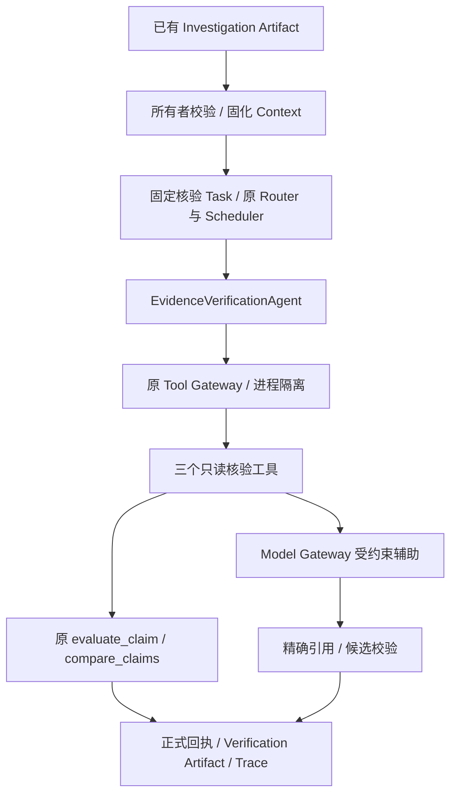

# Phase 11-B2 实施报告

更新日期：2026-10-09（北京时间）。**Phase 11-B2 已完成并通过最终验收：916 项通过，0 failed / errors / skipped。** 已停止后续开发；验收原件为 `work/verification/final_acceptance.json`。

## 1. 实现内容

新增 `EvidenceVerificationAgent`，注册 ID 为 `verification_agent`。仅在新的显式内部入口启用，支持 `evidence_verification`、`claim_validation`、`conflict_detection`；原默认 Registry 和 Planner 白名单保持原行为。

本阶段已接通“真实调查运行 → 所有者所属的调查 Artifact → 固化输入 → 核验任务 → 专业 Agent → 原工具进程 → 规则核验 → 新 Artifact/Trace”。不修改原 Investigation Artifact、候选数据、Claim revision/adopted、Review、ConflictRecord 或全局采纳状态。新增持久化限于输入审计及原 Runtime 的运行、回执、Artifact 和 Trace。



模型建议只进入辅助审计，不能修改来源等级、当前性、显式声明资格、工具权限或规则最终状态。Agent 本身不读数据库、不调用外部 API 或模型。

## 2. Claim–Evidence 模型

复用既有 Pydantic FrozenModel、ClaimType、VerificationStatus；新增执行 DTO，不新增 ORM 表或 Migration。DTO 拒绝额外字段、非有限 JSON 数值、缺时区时间和超限数据。

| DTO | 字段及用途 |
| --- | --- |
| VerificationRequest | source_run_id/source_task_id/source_artifact_id、三选一 task_type、claim_ids、request_key、model_assistance；所有者由服务调用身份提供 |
| VerificationContext | 所有者、请求 hash、来源快照 hash、固定 evaluation_time、规则版本、无凭据的模型配置标识 |
| VerificationClaim | claim_id/statement/claim_type/source_task_id/related_entities/status；另存 value、CVE/包/分支/scope、原 revision、stored/derived、字段位置和 Evidence IDs |
| VerificationEvidence | evidence_id/source_type/source_name/source_time/content/reference/hash/authority_score/directness_score；另存原文/Observation/Claim 关系、引文 hash、谱系、当前性及排除原因 |
| ClaimVerification | Claim、五态、confidence、支持/反证 IDs、规则和计分分项、告警、未解决项 |
| VerificationArtifact | artifact_id/task_id/agent_id、claims、verification_status、confidence、supporting_evidence/conflicting_evidence、warnings/unresolved_items；另含来源绑定、部分结果标识、冲突和正式工具/模型调用记录 |

Claim 优先来自源运行的正式回执，保持旧 value/revision，不读取 live Claim 值替换旧结论。未有等价 stored Claim 的结构化影响范围可形成稳定 derived 候选；没有不可变、Claim 绑定证据时不确认。原修复版本、PoC、Patch 等候选仍保存在输入快照；已有对应 Claim 可参与规则核验。CWE/自由描述等没有对应 ClaimType 的观察不强行变成已核验事实。

Evidence 校验 RawDocument/Observation/Source/Claim 关联、原文 SHA-256、引文 SHA-256 与定位。正文 JSON pointer、行定位以及原 PoC 生产者的 Base64 README 均按既有格式重建；README 解码复用有界 `decode_readme`，截断规则与原生产者一致。来源权威 metadata 使用调查回执中的快照；source_key 从正式回执已序列化的 Evidence 行恢复，不从 live Source 补齐。

## 3. Verification 流程与接口

1. `EvidenceVerificationService.run()` 校验所属运行及精确 Artifact，复用 B1 Reader 核对正式回执。
2. `VerificationContextStore` 通过原 advisory lock 固化拥有者 + request_key。相同请求返回原时间/hash/config；同 key 不同内容返回原 IdempotencyConflict。
3. 服务端构造单核验任务，原 Router、AgentExecutor、Scheduler 和进程监督器继续执行；调用者不能提供任意核验计划。
4. Agent 只调用任务对应的一个 READ_ONLY 工具；规则判断来源、范围、当前性、时间、独立谱系、支持与反证。
5. 从正式 ToolCallRecord/TaskArtifact 投影核验结果和 VerificationRun。复读不重新读取 live 情报或重复调用模型。

| 任务 | 唯一工具 | 语义 |
| --- | --- | --- |
| evidence_verification | evaluate_evidence_snapshot | 核验本次纳入的 Claim 集合 |
| claim_validation | validate_claim_snapshot | 核验指定 Claim，仍检查其他相关当前反证 |
| conflict_detection | compare_claim_snapshot | 找出冲突；没有发现冲突不等于全部事实确认 |

B1 的 CONFLICT / INSUFFICIENT / PARTIAL / WAITING_REVIEW 可以作为待检查观察材料进入**新核验运行**，保留精确 source 链接。该链接不是已接受的成功 DAG 依赖。BLOCKED 且未产出 Artifact 的任务不能凭空核验。原失败依赖门禁保持不变。

内部使用入口：`backend/app/agents/verification/service.py` 的 `EvidenceVerificationService`。调用方提供已经拥有的源 run/task/artifact IDs；通过 `.run(request, actor=authenticated_actor)` 执行，再通过 `.read_results(run_id, actor=authenticated_actor)` 读取。没有新增公共 HTTP 路由或前端接线。

## 4. 状态、可信度与边界

| 状态 | 本阶段含义 |
| --- | --- |
| CONFIRMED | 所选 Claim 满足原确定性规则，且此次覆盖没有缺口 |
| PENDING | 存在候选/支持材料，仍需补充；冲突检测未发现冲突也使用此态 |
| CONFLICT | 相同漏洞、包、分支和评分主体的当前有效来源存在不兼容结论 |
| INSUFFICIENT_EVIDENCE | 有效来源、原文、范围或规则依据不足；缺证据分数为 0 |
| REJECTED | 原静态规则明确不能支持该关联；不等同于资产安全或漏洞不存在 |

范围适配尊重现有实际数据源定义：KEV 只支持已知利用的正证据；OSV 保留包/版本和谱系限制；CVE/CNA 不能仅凭身份标签获得事实确认；厂商来源核对精确官方仓库和公告地址；GitHub 只提供静态关联候选，EPSS 不充当利用或版本确认依据。scope 和身份检查仍受原完整性/规则门禁约束。

confidence 是可解释的证据质量分，**不是统计概率、模型准确率或资产风险分**。来源权重 official=.95、authoritative=.85、community=.45、secondary=.30，普通博客最高 .20；direct=1、mention=.25、unknown=0。同谱系取最高，独立来源最高组加 .10×次高组，上限 1。非确认状态上限 .49；REJECTED 对该 Claim 的支持分为 0；聚合取保守最小值。模型不能加分。

容量：最多 32 Claims、每 Claim 16 Evidence、总 128 Evidence。详细冲突关系最多 128 条，但继续检查所有纳入的证据对，全部相关 Claim 保留冲突标识。任何超限都有计数/未处理引用、partial_result 和告警，不能聚合 CONFIRMED。输出超原 Artifact 预算时返回有界部分结果，原输入保留在所有者所属的 Context；Trace 仍保留实际 checked Claim IDs。

原 30 天时间窗口及未来 5 分钟容差保持不变。验证已提供的发布/获取时间一致性；上游未提供完整版本发布/修复 chronology 时保留 `TIME_CHAIN_PARTIAL`，不推断缺失日期。

## 5. Trace 与模型辅助

VerificationRun 包含 agent_id、input_artifact、claims_checked、evidence_used、verification_result、confidence、execution_time，以及 run/task/artifact IDs、起止时间、原 Task 状态、正式 ToolCallRecord 引用和规则版本。输入链接明确标记 `source_observation_not_success_dependency`。

规则版本 `verification-rules-v1`；Registry `verification-registry-v1`；实现 `evidence-verification-v1`；提示 `verification-assist-v1`。

`model_assistance` 默认关闭。显式打开后只经原 Model Gateway 的 `generate_structured()`，最多一次调用、8 个原文片段、512 输出 tokens、最多 5 秒请求预算。禁止 verdict/authority 等额外字段，核对已知 Claim/Evidence IDs、类型和值及精确引文。配置变更、非法 JSON、伪造引用、超时或模型不可用会记录告警并保留规则结果。调用元数据含 request_id/provider/model/function/usage/latency/status/error/prompt_version，不保存凭据。

## 6. 修改文件

原文件仅兼容追加三处（258 个原文件的 SHA-256 基线核对，无缺失及越界改动）：

- `backend/app/agents/contracts.py`：追加三个 AgentTaskType Literal。
- `backend/app/tooling/contracts.py`：追加 VerificationSnapshotInput 和三项 READ_ONLY 定义。
- `backend/app/tooling/adapters.py`：追加固定分发；核验引用保持固化 metadata，绕过旧 live Source 装饰。

新增生产文件 14 个：`backend/app/agents/verification/` 下的 `__init__.py`、`schemas.py`、`snapshot.py`、`context_store.py`、`rules.py`、`assistance.py`、`verification_assist_v1.txt`、`roles.py`、`registry.py`、`agent.py`、`runtime.py`、`reader.py`、`service.py`，以及 `backend/app/tooling/verification.py`。

新增测试及辅助文件 16 个，位于 `backend/tests/agents/verification/`。全部变化清单和 hash：`work/verification/scope_check.json`；原三文件差异：`work/verification/existing_changes.diff`。原 Investigation/Planner/Runtime 核心、前端、依赖及数据库模型/Migration 保持原文件 hash。

## 7. 测试与最终审查

使用原虚拟环境和两个独立测试 PostgreSQL 集群；实际运行，无付费 API。命令入口：

```powershell
& 'work/verification/run_tests.ps1' full_suite_final -q
```

| 验证 | 已读取实际结果 | 证据 |
| --- | --- | --- |
| 新鲜原测试基线 | 800 passed，0 failed/errors/skipped | work/verification/baseline_ready.json |
| 新模块初次完整测试 | 95 passed，0 failed/errors/skipped | work/verification/focused_suite.json |
| 初次全后端回归 | 895 passed，0 failed/errors/skipped | work/verification/full_suite.json |
| 单次独立审查修复后的相关测试 | 53 passed，0 failed/errors/skipped | work/verification/final_review_corrected.json |
| 最终全后端验收 | 916 passed，0 failed/errors/skipped | work/verification/full_suite_final.json |

最终 JUnit 逐项核对：原 800 个用例全部保留且通过，新增 B2 用例 116 个；无缺失原用例。pytest 用时 314.64 秒，证据运行器外层用时 317.50 秒。唯一告警是原 Starlette/AnyIO 的弃用提示，不是新增失败。原生产/测试/前端/迁移文件的基线核对仍只有三处已授权兼容追加；新增生产 14、测试/辅助 16 个文件。

用户要求的五项场景均实际验证：官方直接证据、弱来源降分、同范围来源冲突、证据不足、真实 Investigation → Verification Artifact/Trace 交接。另覆盖跨所有者/伪造 IDs/回执篡改、当前性刷新、旧快照复读、镜像不独立、原成功依赖门禁、未知/写工具拒绝、输入/输出超限、真正的 worker/后代进程取消及超时清理、模型失败/注入/非法 JSON 和实际 OpenAI Compatible 适配器的本机受控 HTTP 调用。

单次独立审查提出 2 项 Important（无 Critical/Minor）：实际中文数据源 scope 不兼容；解码 README 被错误视为原文不一致。均已先复现失败，再在新适配层修正并通过真实生产格式测试，包括原 EvidenceService/README 生产方式 → 正式 B1 回执 → B2 工具进程。第一版修复还复现旧引用不含 source_key，进一步从**原回执**恢复而非读取 live Source。审查原件保留于 `work/verification/final_review.md`；无需第二轮审查。

所有输入明确 SYNTHETIC，真实进程/数据库/网关路径不等于真实模型准确率或比赛 Benchmark。运行日志、JUnit、RED/GREEN 历史、原文备份和实施 ledger 均独立保存在 `work/verification/`，未覆盖前阶段证据。

## 8. 当前限制与下一阶段建议

- 新 Agent 通过内部服务显式启用；尚未自动拼入原问答 Planner，也没有公共 HTTP/前端交互接线。
- 仅确认本次所选、已覆盖的 Claim；不把整个漏洞、资产安全、所有原候选一并写成已确认。
- 无完整原文、未支持定位/版本语义、旧时间窗口或缺 scope 的数据会弃权；未绑定 immutable Claim Evidence 的候选保留在源快照。
- 不执行 PoC，不宣布 `verified_usable`，不自动修改全局确认、Review、采纳或 Integration 状态。
- 模型辅助仅做有出处的候选匹配；未进行真实模型质量、概率校准或上线性能评测。
- 当前目录无 Git 仓库；保留基线 hash、原文件备份、完整日志作为本轮历史，未编造提交/PR。

下一阶段可在新的明确授权下实现 Phase 11-B3 Security Analysis Agent，再讨论 Integration Gate；本阶段不实施。已停止开发并保存此报告；两个本轮专用测试集群的停止凭据为 `work/verification/cleanup.json`。用户已授权本阶段结束后关闭当前开发电脑，保存交付并完成清理后才启动一分钟延迟关机；记录于 `work/verification/shutdown_status.json`。关机不使用强制关闭参数。
