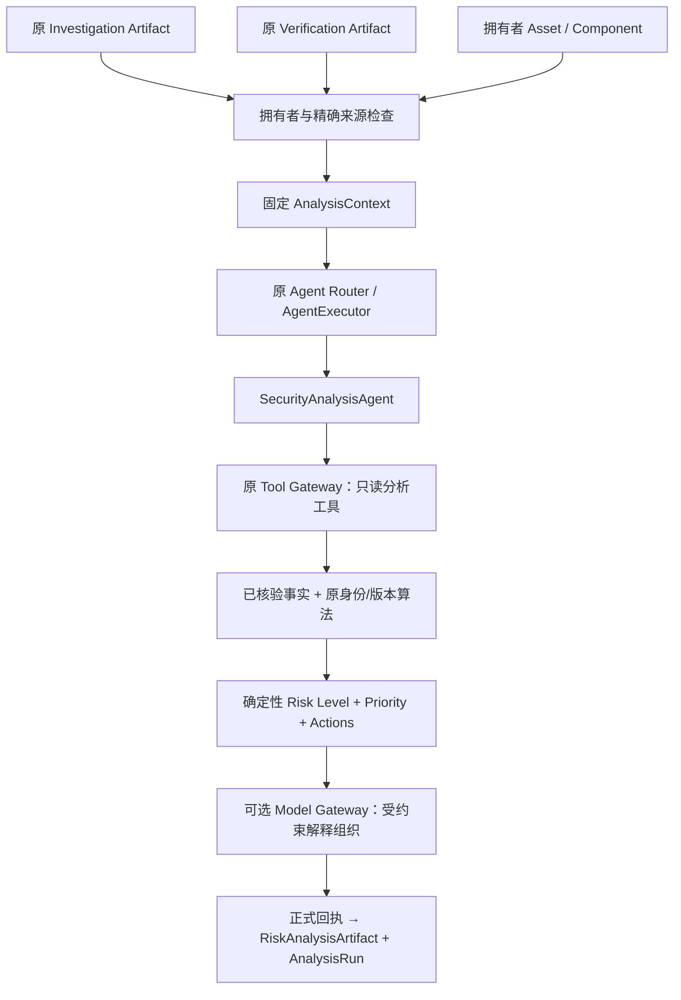

# AegisAI Phase 11-B3：Security Analysis Agent Implementation Plan

> 执行方式沿用 Native。2026-10-09 正式实施授权已解除本计划原等待限制；由当前会话逐项实施，并完成一次独立最终审查。复选框为实施进度；实际命令、测试名称及合并执行证据以 `work/analysis/ledger.md` 和 `PHASE_11B3_RESULT.md` 为准。原计划阶段记录保留为历史说明。

**Goal:** 基于不可变 Investigation Artifact、Verification Artifact 和拥有者资产上下文，新增可解释、可追溯的 Security Analysis Agent。

**Architecture:** 复用既有 Runtime、Agent Router、Agent Executor 和 Tool Gateway；新增显式启用的分析服务及只读快照工具。资产身份与版本比较沿用原算法，核验门禁在前，风险与优先级由确定性规则生成；模型仅辅助组织已计算结果的解释，失败回退。

**Tech Stack:** 当前 Python / Pydantic / SQLAlchemy / PostgreSQL、既有进程执行器、Model Gateway、pytest；不增加依赖和数据库 Migration。

**Spec:** [用户提供的 Phase 11-B3 指令](C:/Users/X/.codex/attachments/ac4cda00-d250-414d-8e57-7413316cbaab/Pasted%20text.txt)。状态日期：2026-10-09，Asia/Shanghai。

## Global Constraints

- 历史计划阶段要求：“先输出 `PHASE_11B3_PLAN.md`，并停下等待确认。不要直接实施。”正式实施授权已明确解除该等待条件。
- 只实现第三个专业 Agent；不重新调查、不重新核验证据、不修改原 Investigation / Verification Artifact。
- 不得无必要修改 Investigation Agent、Verification Agent、Planner、DAG、Scheduler、Model Gateway、Tool Gateway；需要兼容扩展时写明原因、范围和回归测试。
- 风险结果由“确定性规则 + 已核验事实”决定；模型不得改动 risk_level、priority、affected、verification_status。
- 复用原资产字段；没有 criticality 就 unknown，不新增数据库字段；候选 PoC 不等于真实利用，Patch 可用不等于已应用。
- 实施后必须执行完整既有套件，逐用例保留 916 项基线，报告新增、总通过、fail、error、skip 的实测数量。
- 停止于 11-B3；不实施 Integration Gate、Retry/Replan 新机制、Human Review 工作流、前端、部署、Benchmark。
- 当前目录没有 Git 仓库；实施前保存源文件哈希及修改文件备份，使用独立验收证据，不伪造提交或创建另一份项目。

## Review Focus

1. 不同拥有者、不同 CVE、不同包或不同分支的合法 Artifact 被拼接：应拒绝错误交接，或对未解析范围弃权；Task 2/7 固定测试。
2. 只选择已确认 Claim，遗漏同范围冲突或超限输入：应 UNKNOWN / REVIEW_REQUIRED，不能给出安全或高危定论；Task 3/7 固定测试。
3. 已确认“静态 PoC 关联”、高 EPSS、Patch 存在被当作利用已成功或风险已消除：分开记录，不提升为 VERIFIED_EXPLOIT、不降低为已缓解；Task 3/4 固定测试。
4. 模型通过合法解释字段编造精确版本、URL、已确认/安全结论：模型只选择已批准的因素及动作编号，最终文本由受控模板渲染；Task 5 固定测试。
5. 资产升级、来源刷新、模型配置变化或回执被篡改后读取旧结果：旧结果依原快照重建，错配拒绝，历史结果不能冒充当前实时状态；Task 2/7 固定测试。

## 1. 开发前检查结果

### 1.1 已核实基线

`work/verification/final_acceptance.json` 记录上一阶段：916 tests，0 failed，0 errors，0 skipped；800 个原有用例保留，B2 新增 116 个。对应证据为 `full_suite_final.xml/.log/.json`。

这是读取的上一阶段验收记录，**不是本轮重新运行的测试**。本轮没有启动数据库或测试服务，也没有修改产品代码。实施阶段先重新建立基线，再开展 RED/GREEN 和最终全量回归。

### 1.2 可复用能力与边界

| 能力 | 已有文件 / 接口 | 本阶段用法与边界 |
| --- | --- | --- |
| 调查结果 | `backend/app/agents/investigation/schemas.py`：InvestigationArtifact；`reader.py`：InvestigationReader.read(run_id, actor) | 读取原正式回执投影；保留 CVE、组件、范围、CVSS、PoC 候选和 Patch，不再次搜索 |
| 核验结果 | `backend/app/agents/verification/schemas.py`：VerificationArtifact / ClaimVerification；`reader.py`：VerificationReader.read(run_id, *, actor) | 消费结果状态及 supporting/conflicting Evidence，不重新执行核验规则 |
| 核验输入快照 | `verification/context_store.py`：VerificationContextStore.read(context_id, *, actor) | 固定原调查 Artifact、Claim 集合、覆盖信息、source_snapshot_hash 与评价时间，检查精确交接关系 |
| 资产所有权 | `backend/app/assets/inventory.py`：owned_asset(session, asset_id, actor) | 在输入准备阶段检查所有者；Asset / Component 信息只读固化 |
| 组件身份 | `backend/app/assets/identity.py`：resolve_component(session, value) | 复用精确包/PURL/生态解析；优先现有 Component.package_identifier_id，解析结果随后固化，不模糊匹配 |
| 版本比较 | `backend/app/assets/versions.py`：normalize_version / compare_version(version, value) | 原 PEP440 边界、区间并集、本地版本处理原样复用；目前不支持的生态保持 UNKNOWN |
| 优先级 | `backend/app/assets/priority.py`：assess_priority(context) | 复用 P0—P3、REVIEW、INFO 及因素解释；只传入通过本阶段门禁的快照事实 |
| 修复证据约束 | `backend/app/assets/remediation.py`：trusted_claim / get_remediation | 沿用“同包/分支、确认固定版本、Patch applicability UNKNOWN、无结果不等于无补丁”的语义；不调用基于实时全局采纳状态的入口 |
| 旧风险服务 | `backend/app/assets/risk.py`：risk_context / RiskService；`queries.py`：旧风险查询 | 旧服务包含实时情报读取、匹配/事件/风险快照写入，不能作为本 Agent 的计算入口；旧页面和 API 保持原链路 |
| 专业 Agent | `backend/app/agents/interfaces.py`：SecurityAnalysisAgent.analyze；Registry / Router / AgentExecutor | 已有第三类抽象接口，新增具体实现并显式注册，不替换基础框架 |
| 执行与 Trace | 原 RuntimeService、Scheduler、ProcessSupervisor、TaskArtifact / TaskTrace / ToolCallRecord | 用原正式回执与校验机制，新增业务结果投影及 AnalysisRun，不新建 Trace 数据库 |
| 模型 | `backend/app/llm/gateway.py`：ModelGateway.generate_structured | 可选、默认关闭；调用限制、日志和配置复用，Agent 类不直接调用模型 |

### 1.3 确认不能直接沿用的入口

- `AssetVulnerabilityMatcher.match()` 会桥接新增 Claim/Evidence，必要时写入 AffectedVersionRange；不是纯比较函数。本阶段不调用它。
- `trusted_claim()` 要求全局 adopted 和持久化 VerificationResult；B2 的 VerificationArtifact 是独立核验结果，不代表全局采纳。不能为了调用旧入口改写 Claim.adopted/status，也不能绕过旧门禁。
- `risk_context()` 使用实时数据库的 KEV、EPSS、PoC、remediation；直接调用会混入未由输入 Artifact 核验的事实。本阶段以只读 DTO 适配到纯函数 `assess_priority()`。
- 旧 Planner 的 risk_analysis 仍指向既有资产风险工具。新增分析 Agent 使用独立 scoped Registry；本阶段不切换 Planner 默认任务白名单或 Assistant 调用链。

### 1.4 数据缺口

Asset 已有 environment=`production/staging/development/unknown`、exposure=`internet/internal/development/unknown`，没有 criticality。AssetComponent 已有 package_identifier_id、ecosystem、namespace、purl、version、inventory_revision、identity_status；资产重要性固定 unknown，production 不能自动推断为 critical。

B2 ClaimType 有 KNOWN_EXPLOITED、POC_ASSOCIATION、PATCH_EXISTS、FIX_COMMIT、FIXED_VERSION、CVSS_SCORE 等，但没有 EPSS 概率核验协议，也没有“动态 exploit 成功”结论。第一版读取原回执中已有 EPSS 时仅作 SOURCE_ASSERTED 背景信息；不把它升级为已核验事实，不用它产生风险等级/优先级。本阶段不新建 EPSS Claim 或执行利用代码。

## 2. Agent 设计与执行链



具体实现放 `app.agents.analysis.agent.SecurityAnalysisAgent`，原抽象类通过导入别名引用，避免改动 `app.agents.interfaces.SecurityAnalysisAgent`。

| 语义任务 | 唯一允许工具 | 输出 |
| --- | --- | --- |
| risk_analysis | analyze_risk_snapshot | 完整风险与优先级结果 |
| asset_impact_analysis | analyze_asset_impact_snapshot | 同一门禁下的资产/版本结果，并保留统一风险字段 |
| remediation_prioritization | prioritize_remediation_snapshot | 同一门禁下的优先级与已有证据支持的动作 |

三个任务共享同一计算管线，不实现三套规则。每次显式内部请求针对一个调查漏洞、一个核验 Artifact、一个资产组件；固定单任务、单工具调用。分析服务不会自动调用调查/核验服务，完整串联由调用者显式提交已有结果。本阶段的跨运行来源链接不冒充同运行 DAG 成功依赖，不建设 Integration Gate。

注册 ID=`security_analysis_agent`，type=`security_analysis`，implementation_key=`security-analysis-v1`，Registry version=`analysis-registry-v1`，rules_version=`analysis-rules-v1`。原 TaskArtifact 的 professional artifact_type 仍为 `security_analysis_result`；业务投影另标 `schema_version=risk-analysis-artifact-v1`。

## 3. 输入、快照与交接协议

### 3.1 AnalysisRequest

复用 FrozenModel、UUID、TaskId、StrictBool、AwareDatetime，extra=forbid，不接受调用者提供 owner、置信度、风险等级或“已验证”标志。

| 字段 | 类型 / 约束 |
| --- | --- |
| investigation_run_id / investigation_task_id / investigation_artifact_id | UUID / TaskId / UUID，必填 |
| verification_run_id / verification_task_id / verification_artifact_id | UUID / TaskId / UUID，必填 |
| asset_id | UUID 或 None；None 是缺失资产上下文，不伪造库存 |
| component_id | UUID 或 None；有 asset_id 才能指定组件；不属于所选资产则拒绝 |
| task_type | risk_analysis / asset_impact_analysis / remediation_prioritization，默认 risk_analysis |
| request_key | 1—150 字符，非空白；拥有者作用域内幂等 |
| model_assistance | StrictBool，默认 False |

asset_id 存在、component_id 未给时，只在资产现有活跃组件中选择**唯一精确目标包**；多个部署版本/多个候选组件不自动任选，返回 UNKNOWN 并列出选择需求。最多检查 100 个组件，超过容量不能据截断列表声称不存在目标组件。未提供 asset_id 时不允许输入自由对象伪装成正式资产；本版仅支持拥有者库存和缺失上下文降级。

### 3.2 AssetContextSnapshot

asset_id、component_id、component（展示名）、package_identifier_id、ecosystem、namespace、purl、deployed_version、inventory_revision、asset_updated_at、component_updated_at、environment、exposure、criticality=`unknown`、is_demo、captured_at、context_status、unresolved_items。

exposure/environment 使用现有枚举，不将 development 猜成 isolated，不把 internal 当成隔离有效；缺字段 unknown。身份及版本来自原组件库存，包含原输入和规范化结果。资产快照含来源说明“用户库存声明，未执行网络扫描”；演示库存保留 is_demo。

### 3.3 AnalysisInputs / AnalysisContext

`AnalysisInputs` 包含两个原业务 Artifact 的完整有界 JSON、精确来源引用、B2 固定 Claim 范围/覆盖信息、资产快照、必要的原回执摘要/哈希；不复制整份原始文档或重新查询情报表。

`AnalysisContext` 包含 context_id、owner、request、request_hash、input_snapshot_hash、evaluation_time、inputs、rules_version、priority_rule_version=`asset-priority-v1`、model_identity。复用原 AgentRun 保存 `agent_type=analysis-context-v1`，显式标记为输入快照审计，不当作 Agent 已执行。

固化顺序：

1. 原 InvestigationReader / VerificationReader 校验拥有者运行、Task、Artifact 和正式工具回执；不存在/损坏/错配返回 `INVALID_INPUT_ARTIFACT`，对外不透露其他拥有者数据。
2. 依据核验运行的固定 route 读取原 VerificationContextStore；核对 VerificationArtifact.source_run_id/source_artifact_id/source_snapshot_hash 与调查三元组及快照哈希。
3. 校验 B2 source_task_id 与调查 task_id 相同，B2 snapshot.artifact 与原 InvestigationReader 投影一致；禁止跨 CVE 混合及自行重建新的“调查结果”。
4. 验证原输入/输出回执哈希、绑定的 Claim/Evidence ID、范围和覆盖记录；只验证交接完整性，不重新评价 Evidence 权威性或改变核验状态。
5. owned_asset 检查资产权限，读取现有组件，必要时复用 resolve_component 精确解析；所有选择及结果固化。指定不存在/跨拥有者资产返回统一 Asset not found，不能伪装为可正常分析的缺上下文。
6. 拥有者 + request_key 使用原 advisory lock；相同请求复用同 evaluation_time/快照，内容不同返回既有 IdempotencyConflict。

上下文最大 2 MiB；Claim 至多沿用 B2 的 32 条，Evidence 引用至多 128 条，不另截断后假装完整。超限保留关键 ID/哈希/覆盖计数，设置 `coverage_complete=False`、UNKNOWN / REVIEW_REQUIRED；无法验证最低必需身份或哈希则明确失败。Risk 输出和 Trace 遵守原 Artifact 512 KiB、工具包装预算 380 KiB；超限小型结果保留上下文指针、未处理数量和告警。

旧结果 Reader 只读取固化上下文与正式回执，不从实时情报/资产重新计算。后续资产更新不改变历史结果；输出 as_of、inventory_revision 和 `historical_snapshot=True`，不声称实时有效。重新评估要使用新 request_key；不增加自动重试/重规划。

## 4. 核验门禁、身份与版本匹配

### 4.1 消费结果，不生成新核验结论

RiskAnalysisArtifact.verification_status 原样保留输入 VerificationArtifact 的聚合状态；每个事实另保留 ClaimVerification.status、Claim ID 和引用。只消费已 CONFIRMED 的所需 Claim，REJECTED 不作为正面事实，也不意味着安全。

以下优先于一切风险定级：

| 输入条件 | 风险 / 优先级 / affected |
| --- | --- |
| Verification=PENDING / CONFLICT / INSUFFICIENT_EVIDENCE | UNKNOWN / REVIEW_REQUIRED / None；保留候选信息与 warnings |
| Verification=REJECTED，或者所需影响 Claim 被拒绝/缺失 | UNKNOWN / REVIEW_REQUIRED / None；不得把拒绝某条 Claim 当成已证明不受影响 |
| Artifact partial_result、输入覆盖不完整、运行 FAILED/CANCELLED/TIMEOUT、未核验的同范围影响声明 | UNKNOWN / REVIEW_REQUIRED / None |
| 缺 Asset Context、组件有歧义、无法确定包/分支、版本缺失/不支持 | UNKNOWN / REVIEW_REQUIRED / None |
| 两份 Artifact 身份/哈希不符或原正式回执无效 | INVALID_INPUT_ARTIFACT，执行失败，不生成可信风险结论 |

B2 的 WAITING_REVIEW 可作为审计输入保存，按原业务状态降级，不把它更改成 SUCCESS。选取单 Claim 的 claim_validation 或 conflict_detection 结果不代表完整影响核验：完整性检查覆盖原固定同包范围 Claim，遗漏任意相关影响/反证声明则弃权；不通过删除低置信 Claim 拼出 CONFIRMED。

### 4.2 Asset / Version 结果

- **MATCHED**：库存与已确认影响对象的精确 package_identifier_id 一致，或使用原 resolve_component 得到唯一精确发行包；产品展示名或 Product 关系不够。
- **NOT_MATCHED**：两侧身份均明确且确实是不同发行包；只说明所选组件不匹配目标，不证明整台资产未部署其他受影响组件。
- **UNKNOWN**：身份缺失、模糊别名、PURL qualifier/subpath、分支不明、组件选择歧义等。
- **AFFECTED / NOT_AFFECTED**：对完整同包/同分支已 CONFIRMED 影响范围调用原 compare_version。全部可比较范围结果一致才给出确定值，None 或不一致就 UNKNOWN；不实现另一套范围合并或“取最小修复版本”。
- 范围为空、未识别区间、不同分支不能拿来证明安全；PyPI 预发布、本地构建、上界是否含等原语义不变。
- NOT_MATCHED 时 version_match_status=UNKNOWN、affected=False，reason 明确“仅所选组件不相关”；必要的核验门禁失败仍优先 affected=None。

## 5. 风险因素、Risk Level 与 Priority

### 5.1 可用事实分类

`RiskFactor` 字段：factor_id、code、reason、value、claim_ids、evidence_ids、provenance（verified_claim / asset_inventory / candidate / source_assertion）、influences_decision。排除因素保留 rejected_reason；不把 candidates 当成确认事实。

| 因素 | 条件 / 用途 |
| --- | --- |
| VERIFIED_IMPACT | 同包/版本命中已核验完整影响范围，才允许 affected=True |
| VERIFIED_SEVERITY | 同 CVE 的 CONFIRMED CVSS_SCORE；使用其绑定的源评估 severity，保留 version/assessment_kind。只有 score 时不虚构 severity；存在原 source vector 时可复用 normalizers.common.metric 的源向量算法 |
| KNOWN_EXPLOITED_KEV | 同漏洞 CONFIRMED KNOWN_EXPLOITED 且 known_exploited=True；保留 CISA 依据和时间，是已有较强利用信号 |
| VERIFIED_POC_ASSOCIATION | CONFIRMED POC_EXISTS / POC_ASSOCIATION，只表示静态关联；必须标 usability=NOT_EVALUATED，不叫 VERIFIED_EXPLOIT |
| POC_CANDIDATE | Investigation 候选，仅作为待验证背景，不参加风险/优先级规则 |
| EPSS_SOURCE_ASSERTION | 原固定回执若已有数值/日期/Raw 引用可展示；非有限/超界、未来或超过原 7 天窗口标未知/过期。没有对应核验协议，第一版不参与定级 |
| FIXED_VERSION / PATCH / VENDOR_GUIDANCE | 只使用同包/分支的已 CONFIRMED Claim 与真实引用；availability 和 applicability 分开 |
| INTERNET_EXPOSED / PRODUCTION | 用户资产库存值，未扫描；production 不代替重要性字段 |
| CRITICALITY_UNKNOWN | 当前无持久字段，明确 unknown，不从资产描述或 LLM 推断 |
| NOT_AFFECTED_IN_SCOPE | 完整已核验范围下版本未命中，属于所选漏洞/组件范围的降低因素 |

CVSS 同版本/assessment_kind 的歧义保留 UNKNOWN 并告警；跨 CVSS 版本不称来源冲突。本版只在所有可用已确认 severity 一致时使用对应 band，不自行选高分隐藏差异。缺严重程度可仍保留已确认 affected=True，但 risk_level=UNKNOWN、priority=REVIEW_REQUIRED；如已有 KEV，允许由已确认利用信号产生 HIGH/CRITICAL。

### 5.2 Risk Level：确定性决策表，按顺序执行

先执行第四节门禁，然后运行以下规则，输出匹配的 rule_id、规则版本及支持因素：

| rule_id | 条件 | risk_level |
| --- | --- | --- |
| R0_ABSTAIN | 第四节门禁未满足 | UNKNOWN |
| R1_SCOPED_LOW | 确认的精确组件 NOT_MATCHED，或 MATCHED 且版本 NOT_AFFECTED | LOW，仅当前评估范围 |
| R2_EXPLOITED_EXPOSED | MATCHED + AFFECTED + Verification CONFIRMED + KEV 已确认 + exposure=internet | CRITICAL |
| R3_EXPLOITED | 上述已确认影响 + KEV，但未满足 R2 暴露条件 | HIGH |
| R4_SEVERITY_OR_ASSOCIATION | 已确认影响 + 已核验 severity=high/critical，或已确认静态 PoC 关联 | HIGH；不把静态关联写成成功利用 |
| R5_SUPPORTED_MODERATE | 已确认影响 + severity=medium/low/info，无强利用/确认 PoC 关联 | MEDIUM，保留暴露状态与处置条件 |
| R6_MISSING_SEVERITY | 已确认影响，但缺可使用的 severity 和利用/关联信号 | UNKNOWN |

第一版不实现“CVSS≥9 就 CRITICAL”、不因 internal/development 默认已缓解、不因 Patch 存在降低风险、不采用未经证实的资产重要性升档。该表是版本化工程策略，不是事故概率或获奖指标；未来 criticality/EPSS/已应用缓解需有可追溯输入后另行授权。

### 5.3 Priority：复用原 assess_priority

只有规则可正常判断的已确认影响才适配原纯函数：match_status=AFFECTED；severity 为可用的已核验 band；kev.confirmed 为已核验 KEV；poc.confirmed 仅已核验静态关联；epss.score=None；remediation.statuses 来自已核验动作可用性；exposure/environment 来自库存。

保留原返回的 legacy_priority/factor_codes/why_now/high_epss_threshold 和规则版本，按下表映射公开结果：

| 条件 / 原优先级 | 输出 priority |
| --- | --- |
| 门禁弃权或 risk_level=UNKNOWN | REVIEW_REQUIRED，覆盖任何原降档结果 |
| 确定 NOT_MATCHED / NOT_AFFECTED；原 INFO | DEFER，仅本次评估范围 |
| 原 P0 / P1 / P2 / P3 | 原样保留 |
| 原 REVIEW | REVIEW_REQUIRED |

因此 KEV + 已受影响但 exposure=internal 可以是 **HIGH/P0**；critical severity + 外网暴露但无 KEV 可以是 **HIGH/P1**；静态 PoC 确认但 severity 未知可为 **HIGH/P2**。风险与优先级分别记录依据，不按 risk_level 硬编码 priority。Patch 是否可用影响建议，不改变原优先级策略。

### 5.4 Confidence

表示本次分析依据质量，不是成功利用概率或校准风险分。正常结果取参与影响/严重程度/利用判断的已 CONFIRMED Claim confidence 的最小值，不因 LLM、资产外网暴露或增加动作而提高分数。缺必要事实为 0；弃权上限 0.49，源证据不足/无资产为 0；保留分项与截断/排除原因。priority、risk_level 与 confidence 独立。

## 6. 动作与模型辅助解释

### 6.1 RecommendedAction

action_id、action_type、summary、target_component、fixed_version（可空）、patch_reference（可空）、claim_ids、evidence_ids、preconditions、action_provenance、applicability。引用必须在输入 Artifact 或固定回执中存在。

- 同发行包/分支 CONFIRMED FIXED_VERSION 才能给出精确升级候选；复用 compare_version 检查候选版本确实位于完整确认影响范围外，且具有对应修复依据。多个分支/非可比版本不任选一个。
- CONFIRMED PATCH_EXISTS / FIX_COMMIT 且包/分支适用性明确时可建议评估/应用已引用 Patch；只确认“存在”但适用性未知则建议检查引用，applicability=UNKNOWN，不承诺一定修复。
- VENDOR_CONFIRMED 仅证明有公告；没有具体修复 Claim 不编造厂商命令或精确版本。
- 没有修复证据时输出“尚无确认的修复依据”，不能写“无补丁”。不能把调查阶段的 candidate/fixed 字段直接当确认升级目标。
- 可提供条件性一般动作：评估限制外网暴露、加强监测、复核资产/版本、补充调查。标记 GENERAL_PRECAUTION，不归因于厂商；不执行变更、不建立 ReviewTask。
- 关闭具体功能需有已 CONFIRMED EXPLOIT_CONDITION / REMEDIATION 及明确作用范围，本版不从漏洞描述或模型常识生成该类具体操作。
- UNKNOWN 必须带复核/补充信息动作；DEFER 只说明该范围无需当前处置，不保证整台资产安全。

Patch 可用因素不放进“已缓解”清单；mitigating_factors 仅当前确认的 NOT_AFFECTED / NOT_MATCHED 等范围事实。不存在“已应用补丁”的正式输入，本版不输出 RISK_MITIGATED。

### 6.2 可选解释模型

默认关闭。工具包装器可使用原 `ModelGateway.generate_structured()`；一次调用、max_output_tokens=512、timeout≤5 秒且不超过剩余期限，提示版本 `analysis-explanation-v1`，无 SDK/HTTP 直接调用。

`ExplanationDraft` 只包含 explanation_sections（受控枚举：impact/exploitation/exposure/remediation/uncertainty）、factor_ids 顺序、action_ids 顺序。模型对确定性结果做组织；最终 summary / actions.summary 使用相应因素及动作的受控模板渲染。模型不能提供自由版本/URL、风险字段、新 Evidence、厂商建议或“已确认/安全”断言。

校验所有 ID 来自已生成因素/动作，必须保留全部 mandatory 因素与动作；重复/遗漏/伪造/额外字段拒绝并回退原解释。模型不会覆盖确定性 action 的 fixed_version、reference 或 applicability；不接受通过 explanation 字段偷渡操作建议。

输出记录 model_assist_used、model_assist_status（DISABLED/SUCCEEDED/FAILED/SKIPPED）、model_calls、prompt_version。失败/超时/非法 JSON/配置缺失或变化只增加告警，rule_id、risk_level、priority、affected、verification_status、actions 的事实字段及原 confidence 不变。日志脱敏，保存 request_id/provider/model/function/usage/latency/status/error，不保存 Key/完整 Prompt。

## 7. RiskAnalysisArtifact 与 AnalysisRun

`RiskAssessment` 为纯计算结果；`RiskAnalysisArtifact` 复用 FrozenModel 扩展身份和正式回执投影，不替换原 TaskArtifact。

必需字段：artifact_id、task_id、agent_id=`security_analysis_agent`、run_id、schema_version、asset_id、component、version、asset_match_status、version_match_status、verification_status、risk_level、priority、risk_factors、mitigating_factors、affected（StrictBool 或 None）、reasoning_summary、recommended_actions、evidence_refs、warnings、unresolved_items、confidence。

额外审计字段：input_artifact_ids、input_snapshot_hash、context_id、evaluation_time、source_verification_time、inventory_revision、rules_version、priority_rule_version、rule_ids、priority_details、partial_result、coverage_complete、execution_status、tool_calls、model_assist_used/status、model_calls、historical_snapshot=True、scope_notice。

`AnalysisRun` 记录 agent_id/task_id/run_id、input_artifact_ids、input_snapshot_hash、asset_match_result、version_match_result（包含原 comparisons/normalization）、verification_status、risk_factors、mitigating_factors、risk_level、priority、rule_ids、model_assist_used/status、output_artifact_id、start_time/end_time/execution_time、status、tools_called。

只新增上下文与执行审计记录，不更新 AssetRiskSnapshot、AssetVulnerabilityMatch、Claim、Evidence、VerificationResult、ConflictRecord、Adoption、ReviewTask 或资产版本。保留输入 Artifact、原 Trace 与 hash 不变。

业务未知不等于执行错误：有效输入但需要复核时原 Task 状态 WAITING_REVIEW；正常有界规则结果为 SUCCESS；损坏输入 INVALID_INPUT_ARTIFACT；工具/进程失败保留原 FAILED/TIMEOUT/CANCELLED 和回执。Reader 不将原失败结果投影成确定受影响/不受影响；有结果也需标 partial / UNKNOWN。

## 8. 文件范围

### 8.1 仅兼容追加的现有文件

| 文件 | 最小改动 / 原因 |
| --- | --- |
| `backend/app/agents/contracts.py` | AgentTaskType 追加 asset_impact_analysis / remediation_prioritization 两个 Literal；risk_analysis 已有，原协议不改 |
| `backend/app/tooling/contracts.py` | 追加 AnalysisSnapshotInput（只有 context_id）与三个 READ_ONLY ToolSpec；不变更现有工具权限 |
| `backend/app/tooling/adapters.py` | 在目标解析/实时 Evidence 装饰前增加三个固定分发分支；不从实时 Source 重新装饰固定分析引用 |

### 8.2 新文件职责

| 路径 | 职责 |
| --- | --- |
| `backend/app/agents/analysis/__init__.py` | 显式导出，不自动切换默认注册 |
| `backend/app/agents/analysis/schemas.py` | Request / Snapshot / Context / Factor / Action / Assessment / Artifact / Trace DTO |
| `backend/app/agents/analysis/snapshot.py` | 原 Reader 交接完整性检查、库存只读快照、精确范围与覆盖记录 |
| `backend/app/agents/analysis/context_store.py` | 一次性拥有者固定上下文、幂等和哈希 |
| `backend/app/agents/analysis/rules.py` | 核验门禁、compare_version / assess_priority 适配、独立风险映射与置信度 |
| `backend/app/agents/analysis/recommendations.py` | 已确认修复引用、适用性和一般动作模板 |
| `backend/app/agents/analysis/assistance.py`、`analysis_explanation_v1.txt` | 受约束模型组织、验证、模板渲染与降级 |
| `backend/app/agents/analysis/roles.py`、`registry.py` | 三任务/三工具白名单、create_analysis_registry |
| `backend/app/agents/analysis/agent.py` | SecurityAnalysisAgent：原进程执行、取消/超时、正式回执校验；不含 DB/模型/风险算法 |
| `backend/app/agents/analysis/runtime.py`、`service.py` | 固定计划、原 Router / AgentExecutor / Scheduler 的显式内部接入 |
| `backend/app/agents/analysis/reader.py` | 从正式回执和固定上下文投影结果及 AnalysisRun，不读取实时事实 |
| `backend/app/tooling/analysis.py` | 三个只读包装器，共享 execute_analysis；数据/规则/模型调用处于工具边界内 |

新增测试集中在 `backend/tests/agents/analysis/`，证据运行器/日志在 `work/analysis/`。不修改旧测试来凑通过数，不覆盖 `work/verification/` / `work/investigation/` 历史证据。实施验收后新增根目录 `PHASE_11B3_RESULT.md`；本轮只新增本计划。

## 9. 实施任务与测试循环（已获正式实施授权）

沿用现有虚拟环境。首先从既有运行器复用保护逻辑到 `work/analysis/run_tests.py` / `run_tests.ps1`，OUT 改为 work/analysis，保留历史数据库报告恢复、JUnit、日志及退出码记录。原测试 ID 清单取自 B2 final XML 并固定为 916 个，不通过改名/删参数化用例改变基线。

命令模板，在项目根目录执行：

```powershell
& './work/analysis/run_tests.ps1' schemas_red -q tests/agents/analysis/test_schemas.py
& './work/analysis/run_tests.ps1' full_suite_final -q
```

运行器明确设置 AEGIS_TEST_DATABASE_URL=`postgresql+psycopg://aegis_test@127.0.0.1:55437/aegis_phase5_test`、AEGIS_RUNTIME_TEST_DATABASE_URL=`postgresql+psycopg://aegis_test@127.0.0.1:55435/aegis_phase5_test`；不继承生产库。只有确认实施后才按既有 pg_ctl 路径启动两份专用集群，结束停止；不安装数据库/大量依赖。

### Task 1：建立协议及原基线

**Files:** 新增 schemas.py、测试 conftest.py/helpers.py/test_schemas.py 和 work/analysis 运行器；修改 agents/contracts.py 的两个 Literal。

**Interfaces:** AnalysisRequest、AssetContextSnapshot、AnalysisInputs、AnalysisContext、RiskFactor、RecommendedAction、RiskAssessment、RiskAnalysisArtifact、AnalysisRun、AnalysisRunResult；所有类型位于 schemas.py，字段与第三/五/七节一致。

- [x] 保存原生产/测试文件哈希、备份三份允许改动文件，运行 `baseline -q`；要求 916 用例身份与 B2 一致且 0 fail/error/skip，否则先定位基线问题。
- [x] 写 `test_schemas_roundtrip_preserves_unknown`、`test_invalid_enum_nonfinite_naive_time_extra_fields_rejected`、`test_original_artifacts_parse_unchanged`；assert UNKNOWN/REVIEW_REQUIRED/None 可往返，跨字段不一致拒绝，旧 Artifact 不变。
- [x] 运行 `schemas_red`，确认新协议缺失或新断言失败；RED 不由环境错误充当。
- [x] 实现 DTO、有限值/体积/三任务校验与两个 Literal；不建立 ORM。
- [x] 运行 `schemas_green` 及既有 `tests/agents/test_contracts_registry.py` / `test_artifacts.py`，要求通过；记录本任务哈希与证据。

### Task 2：来源交接、资产快照和幂等

**Files:** snapshot.py、context_store.py、test_snapshot.py、test_context_store.py。

**Interfaces:** `AnalysisSnapshotReader(engine).read(request: AnalysisRequest, *, actor: str, evaluation_time: datetime) -> AnalysisInputs`；`AnalysisContextStore(engine).capture(request: AnalysisRequest, *, actor: str) -> AnalysisContext`；`.read(context_id: UUID, *, actor: str) -> AnalysisContext`。

- [x] 写 `test_cross_owner_or_cross_cve_handoff_rejected`、`test_verification_source_task_and_hash_must_match`、`test_missing_asset_is_unknown_not_foreign_asset`；错误交接 assert error.code == INVALID_INPUT_ARTIFACT，跨资产权限统一 Asset not found。
- [x] 写 `test_idempotent_snapshot_does_not_refresh_inventory_or_time`、`test_changed_request_same_key_rejected`；assert 同 key 哈希/时间/版本不变；不同内容明确幂等冲突。
- [x] 运行 `snapshot_red` 两个文件；实现精确 Reader / 核验上下文引用、拥有者检查及固定 inventory snapshot。
- [x] 增加 `test_multiple_components_and_inventory_limit_abstain`、`test_tampered_formal_receipt_rejected`；assert 多个部署不任选一个，截断不能声称 NOT_MATCHED，source Artifact/hash 与所有情报/资产业务表不变。
- [x] 运行 `snapshot_green` 两文件；核对只新增输入快照审计。

### Task 3：核验门禁、匹配与风险/优先级

**Files:** rules.py、test_rules.py、test_matching.py；复用原 assets/versions.py 和 priority.py，不编辑原算法。

**Interfaces:** `match_asset(context: AnalysisContext) -> AssetMatchResult`、`match_version(context: AnalysisContext, asset_match: AssetMatchResult) -> VersionMatchResult`、`assess_risk(context: AnalysisContext) -> RiskAssessment`；两个 MatchResult 类型补入 schemas.py，包含状态、理由、输入 Claim IDs 与原 comparisons。RiskAssessment 保留两个匹配结果；本任务只计算规则结果，recommended_actions 默认空，Task 6 工具包装器接入 Task 4 的 build_actions，不复制动作业务。

- [x] 写 `test_confirmed_kev_internet_is_critical_p0`、`test_confirmed_kev_internal_is_high_p0`、`test_critical_cvss_without_exploit_is_high_p1`；分别 assert 规则表结果，证明 risk 与 priority 不强绑定。
- [x] 写 `test_confirmed_fixed_boundary_is_low_defer`、参数化 `test_pending_conflict_insufficient_rejected_never_definite`；assert 冲突/不足始终 affected is None、UNKNOWN/REVIEW_REQUIRED，不从候选范围推出安全。
- [x] 写 `test_selected_claim_cannot_hide_conflict_or_omission`、`test_static_poc_candidate_never_verified_exploit`、`test_confirmed_static_association_keeps_usability_not_evaluated`、`test_epss_only_remains_source_asserted`；assert 未核验因素 influences_decision=False，不产生 R2/R3。
- [x] 写 `test_exact_package_not_product_display_match`、`test_unsupported_ecosystem_unknown`、`test_unknown_cvss_preserves_known_impact_but_review_priority`；使用原边界比较，未验证 PyPI 以外生态不猜版本。
- [x] 运行 `rules_red` / `matching_red`；按第四/五节实施纯适配和门禁，不等待动作或模型模块才能验证规则。
- [x] 运行 `rules_green` / `matching_green` 及原 `test_phase8_units.py`、`test_phase8_matching.py`；assert 旧优先级返回值未改。

### Task 4：有证据的处置动作

**Files:** recommendations.py、test_recommendations.py。

**Interfaces:** `build_actions(context: AnalysisContext, *, asset_match: AssetMatchResult, version_match: VersionMatchResult, risk_level: str, priority: str) -> tuple[RecommendedAction, ...]`。

- [x] 写 `test_confirmed_fix_action_references_exact_claim_and_patch`、`test_candidate_fix_or_wrong_branch_no_exact_upgrade`、`test_patch_availability_is_not_applied_mitigation`；assert 引用存在且同包，候选无精确升级字段，Patch 不降低等级/置信度。
- [x] 写 `test_fixed_release_still_in_affected_range_rejected`、`test_unknown_applicability_only_inspect_reference`、`test_missing_fix_keeps_absence_unknown`；不因列表有 fixed 就说已修复。
- [x] 运行 `actions_red`；实现安全动作模板及引用适配，复用 compare_version 检查修复候选，不访问实时 remediation 服务。
- [x] 运行 `actions_green`；assert GENERAL_PRECAUTION 不归因厂商，UNKNOWN 的复核动作不创建 ReviewTask。

### Task 5：可选模型解释与故障降级

**Files:** assistance.py、analysis_explanation_v1.txt、test_assistance.py。

**Interfaces:** `organize_explanation(context: AnalysisContext, assessment: RiskAssessment, *, gateway: ModelGateway, remaining_seconds: float) -> ExplanationResult`；ExplanationDraft / ExplanationResult 类型位于 schemas.py。函数只返回模板组织结果、调用元数据与告警，不返回新的决策或事实字段。

- [x] 写 `test_gateway_structured_ids_render_grounded_summary`、`test_model_cannot_add_version_url_or_verdict`、`test_missing_mandatory_actions_rejected`；验证 generate_structured 真实调用路径，非法 ID/额外字段回退。
- [x] 写参数化 `test_model_failure_preserves_deterministic_result`（失败、非法 JSON、超时、配置不可用/改变）；assert 五个受保护字段、confidence、动作版本/URL 完全相同，只新增说明失败告警。
- [x] 运行 `assistance_red`；实现第六节的单调用预算、ID 验证与模板渲染，配置/Provider 复用。
- [x] 运行 `assistance_green`；受控响应和本机兼容接口测试不使用付费 API，不宣称模型实际准确率；模型默认未启用不应创建调用记录。

### Task 6：工具、Agent 注册与原 Runtime 接入

**Files:** roles.py、registry.py、agent.py、runtime.py、service.py、tooling/analysis.py；兼容追加 tooling/contracts.py、adapters.py；test_tools.py、test_agent.py、test_runtime.py。

**Interfaces:** `create_analysis_registry() -> AgentRegistry`；`SecurityAnalysisAgent.analyze(request: AgentExecutionRequest, *, database_url: str | None = None) -> ExecutionOutcome`，实现原 for_run/cancel_all；`execute_analysis(session, name: str, arguments: dict, actor: str) -> dict`；三个工具包装器名称见第二节；`analysis_plan(context: AnalysisContext) -> TaskPlan`；`AnalysisRuntimeAdapter.run_context(context: AnalysisContext, *, actor: str) -> RunSnapshot`；`SecurityAnalysisService.run(request: AnalysisRequest, *, actor: str) -> RunSnapshot`。

- [x] 写 `test_three_tasks_route_to_security_analysis_agent`、`test_default_registry_and_planner_unchanged`、`test_forbidden_lookup_write_or_arbitrary_context_rejected`；assert 仅三个固定工具获许可，CVE 查询/核验写工具/任意 TaskPlan 拒绝。
- [x] 运行 `agent_red`、`tools_red`、`runtime_red`；实现固定单工具计划与显式 scoped Registry，原 Router/AgentExecutor/Scheduler/ProcessSupervisor 原样复用。
- [x] 工具包装器依次调用 assess_risk、build_actions，生成完整 RiskAssessment 后再调用可选解释辅助；模型前后校验受保护字段一致。Task 参数只传 context_id，Runtime adapter 必须按 actor 读取已存 context 比对，重建 plan/registry 指纹；runtime request_key 使用 `analysis:` + 有界哈希，与原运行隔离。
- [x] Agent 验证正式回执；非正常确定结果改为 WAITING_REVIEW，取消/超时按原机制清理；模型/数据库访问仅在准备服务及工具边界，Agent 不直接访问。
- [x] 运行相应 GREEN 及原专业 Agent/Runtime 测试；assert 旧 investigation/verification/assistant 入口结果与注册不变，业务表无额外写入。

### Task 7：Artifact / Trace 投影及真实交接

**Files:** reader.py，service.py 添加 read_results；test_reader.py、test_end_to_end.py、test_limits.py、test_process.py。

**Interfaces:** `AnalysisReader(engine).read(run_id: UUID, *, actor: str) -> AnalysisRunResult`；`SecurityAnalysisService.read_results(run_id: UUID, *, actor: str) -> AnalysisRunResult`。

- [x] 写 `test_investigation_verification_asset_analysis_real_handoff`：用已有 B1/B2 服务产生正式输入，再运行分析 scoped Runtime，经真实工具进程投影 RiskAnalysisArtifact；使用 SYNTHETIC 数据，不让分析入口重新调用 B1/B2。
- [x] 写 `test_trace_rebuilds_rules_factors_evidence_and_time`；assert Task→Agent→ToolCallRecord→Artifact 完整，三份来源链接、rule_id、version comparisons、模型状态、正式 output_artifact_id 可重建。
- [x] 写 `test_reader_rejects_tampered_output_context_binding`、`test_live_changes_leave_historical_result_unchanged`、`test_partial_runtime_or_oversize_never_safe`；assert 旧输入哈希不变，历史结果不随实时 asset/Source 改变，超限仍保留审计指针。
- [x] 运行 `integration_red`；实现 Reader 的原 validate_outcome/AgentArtifact 与正式回执校验，核对 route/context/input hash/tool arguments/result 和 Trace 身份，不能接受任意新 JSON 伪装输出。
- [x] 运行 `integration_green`，包含真进程取消/超时/清理、最大上下文/引用/输出容量；工具失败保持原失败回执，无结果时不造确定判断。

### Task 8：全量回归、独立审查与交付

- [x] 运行 `full_suite -q` 完整后端；逐个比对原 916 用例身份，要求全部保留且 0 fail/error/skip；用 JUnit 实际统计新增和总数，不预填通过数量。
- [x] 当前会话自查修改范围、旧业务文件哈希、没有调查/核验/直接 SDK 越界及业务表写入；完成一次独立最终审查，覆盖 Review Focus 和用户第二十一节七项检查，不逐任务派发新 Agent。
- [x] 修复真实发现，重跑受影响测试；修复代码后重新执行必要全量，最终验收只引用最新有效证据，保留审查发现与修复映射。
- [x] 生成 `PHASE_11B3_RESULT.md`：完成内容、架构、输入、规则、双维度设计、Verification 约束、Artifact、Trace、修改文件、新增/全量测试、审查、限制和下一阶段建议；附 baseline/最终 JUnit/源哈希/审查证据。
- [x] 停止仅本任务启动的两个专用测试集群，保留 work/analysis 证据。停止开发，不进入 Integration Gate 或其他下一阶段。

## 10. 已知风险与本阶段限制

| 风险 / 限制 | 本阶段决定 |
| --- | --- |
| B2 核验可包含部分/单 Claim，完整影响确认不足 | 依据原固定范围和覆盖标记弃权，禁止遗漏反证后定论 |
| 很多源 CVSS/修复版本只有调查字段，没有 CONFIRMED Claim | 展示候选和缺口；不伪造已核验 severity/精确升级建议 |
| 原版本算法目前只验证 PyPI/PEP440 | npm/Maven/Git/custom 等保持 UNKNOWN；扩展不属本阶段 |
| 资产没有 criticality、隔离或已应用缓解正式字段 | 保留 unknown；不从环境/描述推断，不改 ORM |
| EPSS 存在但没有 B2 概率 Claim 协议 | 可展示有出处快照，不加入决定性因素；不借读取新数据库事实绕过核验 |
| PoC 只有静态关联，即使关联已确认也不等于实际利用成功 | 候选/已确认关联/KEV 三类明确分开，usability 始终未评估 |
| 固定版本和 Patch 可能分支相关 | 严格同包/分支和当前范围检查；适用性未知只检查引用 |
| 模型结构化成功仍可能文字幻觉 | 仅选择已有因素/动作 ID，模板渲染，不生成新操作事实 |
| 原 B2 30 天证据窗口限制历史情报 | 不改规则、不重新验证；引用核验时刻及历史范围，不宣称实时风险 |
| 旧资产风险页与新 RiskAnalysisArtifact 各自存在 | 现有业务不切换；本阶段是内部可测试能力，前端/统一结果接入留待授权 |
| Risk policy 与 confidence 没有 Benchmark 校准 | 明示规则版本和依据，不声称统计概率、真实模型效果或获奖水平 |

## 11. 自查与停止点

- 用户开发前八项检查均已核对；可复用计算函数和不可直接调用的写入口已区分。
- 三任务、资产/版本匹配、Verification 约束、利用/修复区分、Risk/priority 双维度、解释、Trace 和错误处理映射至 Task 1—7。
- 用户十项必测对应 Task 2—7；完整 916 回归与独立审查在 Task 8。五项 Review Focus 都有具体测试名和断言。
- 对话提及的上一阶段自动关机已失败，原辅助进程已不存在；该一次性请求不扩展为本阶段计划完成后关机，本轮未重新触发。
- 上述“只新增计划、没有代码/数据库变更、不生成结果报告”是原计划阶段的历史范围；正式实施已在本计划授权范围内新增分析代码和审计记录。产品/测试变更及验收实测以结果报告为准。

**当前状态：Phase 11-B3 实施、独立审查问题修复与最终全量验收完成，PASS；只停止本任务测试资源，开发止于 B3。** 详细计数、时间窗口及运行器失败尝试、边界和剩余风险见 `PHASE_11B3_RESULT.md`。
