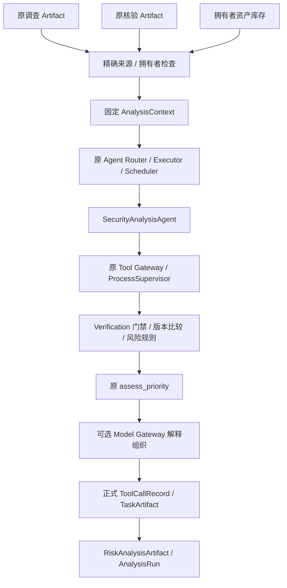

# Phase 11-B3 Security Analysis Agent 完成报告

日期：2026-10-09，Asia/Shanghai。正式实施授权来自 `attachments/7a274bb6-bedc-426c-aafe-0652d48344ea/Pasted text.txt`。

**验收状态：PASS。Phase 11-B3 内部分析能力已实现；最终全量 1058/1058 通过，原 916 项逐用例保留，新增 142 项；0 fail/error/skip。单次独立审查的六项 Important 已用反例复现、修复并回归。开发止于 B3。**

## 1. 目标与实际实现

已实现第三个专业 Agent 的内部显式分析链：消费原 Investigation Artifact、Verification Artifact 和拥有者资产库存，输出结构化 RiskAnalysisArtifact。没有重新调查、重新核验证据或覆盖原 Artifact。

三个 task_type 复用一套确定性计算：risk_analysis、asset_impact_analysis、remediation_prioritization。固定单任务/单只读工具、一次上下文准备、拥有者幂等请求、原正式回执和历史 Reader 已接通。

本阶段完成代码与真实工程链测试；商业模型/真实部署资产/安全准确率未进行实证评测。这些边界不以模拟数据代替。

## 2. 复用能力与架构



复用原 Task Contract、TaskPlan/DAG、Scheduler、AgentExecutor、ProcessSupervisor、Tool Gateway、Model Gateway、调查与核验 Reader、resolve_component、compare_version、assess_priority。旧 RiskService 包含实时读取及风险写入，本阶段没有调用或复制其写入逻辑；新增的是固定输入适配、门禁及已授权的风险策略。

入口：`SecurityAnalysisService.run(request, *, actor)` 与 `read_results(run_id, *, actor)`。actor 由可信内部服务提供。没有新公开 API，也没有自动切换默认 Planner / Assistant。

## 3. 输入与边界

AnalysisRequest 必须提供两份 Artifact 的精确 run/task/artifact 引用，可选拥有者 asset_id/component_id，request_key、task_type 和默认关闭的 model_assistance。多余字段、伪造 owner、错误 bool、错配 Artifact、源哈希损坏或跨拥有者数据拒绝。

AnalysisContext 固定原调查/核验 Artifact、原核验 Claim 范围/覆盖情况、Evidence 关系、调查回执哈希、资产版本/修订号/时间及模型配置身份。保存至原 AgentRun 的独立输入审计类型，不当作 Agent 已执行。

合法跨 Claim 冲突通过原 VerificationConflict 的同范围关系保存；支持证据仍须绑定本 Claim，跨 Claim 反证必须来自同一固定源及实际冲突关系。证据正文和引用与原核验快照一致。原冲突状态保持原样。

资产身份沿用原精确包/PURL 解析；增加快照中的 canonical package_name 用于与 Claim 值交叉检查。缺失、歧义、分支不明、未知版本/生态以及不能排除相关性的未核验影响声明保持未知。没有 criticality 正式字段，因此不从 production 或资产描述推断重要性。

幂等旧请求不刷新资产时间/版本；历史 Reader 只读固定上下文与回执。Artifact 带 historical_snapshot、evaluation_time、inventory_revision、scope_notice，不能代表整台资产实时安全。

## 4. 风险规则与独立优先级

| 规则 | 前提 | Risk Level |
| --- | --- | --- |
| R0_ABSTAIN | 核验/执行/范围/资产/覆盖门禁不足 | UNKNOWN |
| R1_SCOPED_LOW | 确认所选发行包不同，或全部确认范围均不命中 | LOW，仅此范围 |
| R2_EXPLOITED_EXPOSED | 确认受影响 + 确认 CISA KEV + 库存 internet | CRITICAL |
| R3_EXPLOITED | 确认受影响 + 确认 CISA KEV | HIGH |
| R4_SEVERITY_OR_ASSOCIATION | 确认受影响 + 有效已核验 high/critical severity 或适用的静态 PoC 关联 | HIGH |
| R5_SUPPORTED_MODERATE | 确认受影响 + 有效已核验 medium/low/info severity | MEDIUM |
| R6_MISSING_SEVERITY | 已确认影响但无可用严重程度/利用关联信号 | UNKNOWN，可保留 affected=True |

Priority 单独适配原 assess_priority：P0—P3；未知为 REVIEW_REQUIRED，明确当前范围不受影响为 DEFER。KEV/internal 可为 HIGH/P0，critical severity/internet/无 KEV 可为 HIGH/P1；没有把 risk_level 直接映射成 priority。

CVSS 检查明确版本、有限分值、向量/score/band 一致性。只使用直接确认的 band 或由原 normalizer 计算的已确认有效向量；单凭相同 score/version 不能把另一个调查条目的 band 当成已核验。异常 CVSS 产生警告，仍保留已确认版本影响或合法 KEV 决策。

候选 PoC 不参加定级；确认静态关联保持 usability=NOT_EVALUATED，并排除明确异包/分支。EPSS 是有出处的背景来源断言，不参加决定性策略。补丁存在不等于适用、已部署或风险已缓解。

## 5. Verification 约束与异常

PENDING、CONFLICT、INSUFFICIENT_EVIDENCE、REJECTED、覆盖遗漏、不完整/失败调查、核验失败、未知资产/范围都不能推出安全。affected=None 与 affected=False 明确区分。

RiskAnalysisArtifact.verification_status 保留原核验聚合状态；单 Claim disposition 和原 Evidence ID 保留。模型不能生成新的 CONFIRMED。

有效但需要复核的分析沿用 WAITING_REVIEW；工具/进程失败保持原失败 Artifact 与回执，业务投影为 UNKNOWN/REVIEW_REQUIRED/None 的部分结果。上下文最大 2 MiB；沿用 32 Claims / 128 Evidence；无组件选择最多检查 100 个库存组件。工具包装预算 380 KiB，原 Artifact 512 KiB；输出过大保留完整上下文指针并弃权，不能截断后产生安全结论。

## 6. 处置建议与模型权限

精确升级版本需同包、同生态、同规范名称/namespace 和明确适用范围的 CONFIRMED FIXED_VERSION；原比较函数必须证明候选在全部确认影响范围外。仅确认 Patch 存在时提供检查/适用性评估方向，未承诺已安装。厂商公告本身不等于补丁。

动作分 IMMEDIATE、FURTHER_INVESTIGATION、LONG_TERM_HARDENING，并标注 VERIFIED_CLAIM 或 GENERAL_PRECAUTION、依据、前提与适用性。未知结论有复核/补充信息方向，不创建 ReviewTask 或执行资产变更。

模型默认关闭。开启后只通过原 Model Gateway 一次 generate_structured，输出预算 512 token、网络超时至多 5 秒，外层受原 Runtime deadline / 进程树清理约束。模型仅组织已有因素和动作 ID，解释由受控模板渲染。非法 JSON、超时、额外字段、伪造/遗漏 ID、配置变化均回退，不改风险、优先级、影响、核验状态、置信度或动作事实。

调用审计记录 request_id/provider/model/function/usage/latency/status/error/prompt_version；不保存模型 Key、完整 Prompt 或自由操作指令。外部公告/描述没有进入解释模型指令。

## 7. Artifact 与 Trace

RiskAnalysisArtifact：原身份、两份输入 Artifact 引用、资产/版本匹配、Verification 状态、ExploitationSignal、PatchAvailability、Risk Level、Priority、因素/降低因素、动作、Evidence 引用、Claim dispositions、理由、警告/未决问题、规则与时间/哈希/修订号、原回执、模型状态。

AnalysisRun：发起者、输入/输出 Artifact、匹配比较过程、使用因素、规则 ID、风险/优先级、模型使用及耗时/状态，可沿 Run ID 回溯 Task → Agent → ToolCallRecord → Artifact。

输出 evidence_refs 对因素、动作和核验支持/冲突证据做有界并集，保证动作证据不悬空。Reader 校验固定计划、注册指纹、语义类型、绑定、身份、正式回执与结果；并重建确定性受保护字段，拒绝形状合法但没有回执/规则依据的结果。

confidence_kind 为 uncalibrated_heuristic；该分值表示本次依据质量，不能称为真实事故概率。

## 8. 实际文件变更

仅三份既有生产文件追加兼容接口：

- `backend/app/agents/contracts.py`：两个新 task_type Literal。
- `backend/app/tooling/contracts.py`：只有 context_id 的输入 Schema 和三个 READ_ONLY 工具。
- `backend/app/tooling/adapters.py`：三个固定工具分发，不装饰实时情报。

新增生产文件（15 个）：`backend/app/agents/analysis/` 的 `__init__.py`、`schemas.py`、`snapshot.py`、`context_store.py`、`rules.py`、`recommendations.py`、`assistance.py`、`analysis_explanation_v1.txt`、`roles.py`、`registry.py`、`agent.py`、`runtime.py`、`service.py`、`reader.py`，以及 `backend/app/tooling/analysis.py`。

测试位于 `backend/tests/agents/analysis/`：16 个 test 文件及 package/conftest/helpers 三个支撑文件。覆盖协议、来源/资产、门禁、版本、动作、模型、工具、Agent/Runtime、历史 Reader、真实交接、容量、真实进程清理和独立审查反例。

文档：本报告、`docs/SECURITY_ANALYSIS_IMPLEMENTATION.md`。实施进度更新原 `PHASE_11B3_PLAN.md`；完整测试、备份、源哈希、review 与 ledger 保存在 `work/analysis/`。

## 9. 测试执行与证据

| 运行 | 实际数量 | 结果 |
| --- | ---: | --- |
| 本轮新鲜原基线 baseline | 916 | 916 通过；0 fail/error/skip |
| 修复前定向 scoped_acceptance | 168 | 116 新增 + 52 原框架，全部通过；独立审查仍发现组合边界缺口 |
| 首次全量 full_suite | 1032 | 1031 通过、1 旧时间采样测试失败；0 error/skip |
| 审查反例 review_regressions_red | 13 | 13 失败，先复现后修复 |
| 补充分支 review_additional_red | 9 | 8 失败、1 有效无关发行包对照通过 |
| 补充向量 review_vector_red | 8 | 1 向量版本反例失败、7 已覆盖情况通过 |
| 修复后 review_fix_acceptance | 243 | 全部通过；0 fail/error/skip |
| 全量运行器显式文件顺序尝试 full_suite_order_attempt | 1058 | 1037 通过、21 旧 fixture 加载错误；0 fail/skip；保留失败证据 |
| 恢复普通收集 fixture_load_probe | 11 | 11 通过、1047 deselected；仅探针，不替代最终全量 |
| 最终全量 full_suite_final | 1058 | 916 原有 + 142 新增，全部通过；0 fail/error/skip；420.968 秒 |

最终全量于北京时间 2026-10-09 13:10 结束，退出码 0。`acceptance_audit.json` 实测 PASS：基线与上一阶段 916 项身份完全相同，最终无缺失、无重复，普通收集与执行用例集合相同；三份原文件备份与基线哈希一致。现有依赖产生一个 anyio 弃用警告，没有测试失败；本阶段未为该依赖提示扩大范围。

主要实际命令（在项目根执行）：

```powershell
& './work/analysis/run_tests.ps1' baseline -q
& './work/analysis/run_tests.ps1' full_suite -q
& './work/analysis/run_tests.ps1' review_regressions_red -q tests/agents/analysis/test_review_regressions.py
& './work/analysis/run_tests.ps1' review_fix_acceptance -q tests/agents/analysis tests/agents/test_contracts_registry.py tests/agents/test_artifacts.py tests/agents/test_executor.py tests/agents/test_router.py tests/test_phase8_units.py tests/test_phase8_matching.py
& './work/analysis/run_tests.ps1' full_suite_final -q
& './backend/.venv/Scripts/python.exe' './work/analysis/audit_evidence.py'
```

最后一条全量使用原目录自动收集，再由 `work/analysis/pytest_order.py` 仅将原时间规则用例移到执行开头；不显式列出文件、不选择子集。精确 pytest 命令及收集/执行用例顺序保存在 `full_suite_final.json` / `full_suite_final_order.json`。原测试、断言和生产时间规则没有修改。逐用例身份审计保留原 916 项，不以删除或重复用例改变基线。

此前尝试显式文件排序，影响了既有 conftest 装载，导致 21 个旧用例缺少 investigation_source fixture。该失败完整保存为 `full_suite_order_attempt.*`。恢复普通目录收集后，原时间样本和两个依赖该 fixture 的旧测试 11/11 通过；这只是加载探针，最终全量仍需独立通过。

首次全量失败原因：原 B2 参数在模块收集时取 utcnow()+8min，执行时按当前 +5min 检查；新进程测试使执行延后超过 3min，样本进入允许窗口。原文件单独运行 20/20；`legacy_clock_probe.json` 保存延后 4min 的纯函数状态对照。首次失败保留，提前执行该样本以保持原测试前提；未宣称修复此旧测试缺陷。

环境：Windows 11 build 26200，现有 Python 3.12.14 虚拟环境、PostgreSQL 17.11。专用数据库 `aegis_phase5_test`，legacy 127.0.0.1:55437，Runtime 127.0.0.1:55435；运行器不继承生产库。未安装依赖、修改 Migration 或使用付费模型。

真实工程路径测试使用 SYNTHETIC 官方证据/库存，由原 B1/B2 服务生成回执，经真实工具进程交接；兼容模型使用本机受控 HTTP。取消测试检查实际 worker 和 descendant PID，包含三次取消及下一运行实例；未将 Future 取消当成进程清理证据。协议用确定性生成往返与有限状态矩阵验证，没有为此安装 Hypothesis。

## 10. 独立审查与修复

只完成一次独立最终审查：`work/analysis/final_review.md`。原始结论 With fixes：6 Important、0 Critical；没有第二轮 reviewer。逐项先用反例证明，再修复并测试。

| 发现 | 本阶段修复 | 验证 |
| --- | --- | --- |
| I1 合法跨 Claim 冲突被误拒绝 | 验证实际同范围 Conflict 关系和固定 Evidence，而非强制反证同 Claim | 原 B2 实际 CONFLICT 交接；伪造正文/无关系/未知证据仍拒绝 |
| I2 可能同包的遗漏声明被忽略，误 LOW/DEFER | 未解析相关声明、同名但 ID 矛盾触发弃权；明确其他发行包对照可正常排除 | missing ID、矛盾 ID、有效其他包反例 |
| I3 异包/分支 PoC 被用于当前资产 | 使用前交叉检查发行包和范围 | 两种 PoC Claim 的异包/分支反例及原全局关联对照 |
| I4 错发行包修复版本仍给出升级 | 固定版本身份完整检查 + 原影响范围外比较 | 错生态/名称/namespace、有效修复及边界 |
| I5 不可靠 CVSS band/异常导致错定级或失败 | 去掉 score/version 反查未核验 band；检查分值、版本和向量一致性；捕获原 CVSS 库异常 | 非法 score/type/version/band/vector、有效向量、合法 KEV 不丢失 |
| I6 动作证据悬空 | 最终输出合并支持/冲突/动作引用，来源仍是固定输入 | 未知适用性 Patch 引用、冲突投影和容量降级 |

修复状态由反例 GREEN 和修复后全量证明；不把 reviewer 的修复前 With fixes 改写成“无问题审查通过”。完整原发现、探针和范围判断保留。

## 11. 兼容性、取舍和延期项

既有 286 份后端生产/测试文件的基线哈希中，只有授权的三份生产文件变动，无文件缺失；三份原文件完整备份与原哈希一致。原 Planner、Runtime、版本/优先级算法、调查/核验 Agent 及旧测试文件保持原内容。

实施判断与代价，按记录顺序：

1. 当前没有 Git：使用完整文件备份和源哈希；不新建仓库/工作树。代价是没有本轮 commit 历史，回滚依赖保留的文件备份。
2. 正式实施确认覆盖计划阶段等待要求：持续完成本阶段，不再要求重复确认。授权止于 B3，超出范围仍需下一指令。
3. 旧收集时钟测试先执行：不改原断言/规则，保留首轮失败和探针。代价是原测试顺序敏感性仍需后续修复；该处理不证明全局时间逻辑无缺陷。
4. 收窄计划中的源 severity 回填：只接受真正确认的 band/有效向量。代价是有些只有 score 的真实条目会产生更多 UNKNOWN；不能因此猜测 severity。
5. reviewer 范围外判断分别处理：旧取消根因保留残余竞态风险；真实资产/模型准确率仍未测；未支持生态/库存字段保持未知；EPSS/阈值/置信度未校准；独立旧 B2 修复留待后续；数据库管理员全权限篡改没有数字签名防护；未来规则升级需要版本兼容工作；默认 Planner/Integration Gate/API/前端/部署等不在本轮实施。这些代价均明确保留。
6. 延期的 Minor：紧凑代码格式、explanation_sections 更丰富渲染。现有受控 ID / 模板和权限边界已验证，未为排版扩大本轮。

## 12. 尚未验证与工程风险

- 未在真实资产、完整生产源或商业模型上验证；没有真实召回率/精确率、事故概率、性能压力或获奖结论。
- 新 Agent 取消/超时清理已测试，旧偶发取消全局根因仍未解决，不以复测通过宣称已修复。
- 原 B2 时间参数化样本会老化，已保留首轮失败及复现；不修改旧测试来凑数量。
- 当前版本语义主要是 PyPI/PEP440；其他生态、分支、重要性、补丁已部署状态仍保持未知。
- 历史 Reader 当前按固定规则版本重建；后续发布新规则需规划旧版本回放兼容，当前没有新增迁移平台。
- 快照哈希和不可变回执依赖现有数据库权限，未提供针对数据库管理员的密码学不可抵赖。
- 默认 Planner 尚未自动编排这个内部分析 profile；本阶段提供既有 Artifact 的显式接入，未冒充已完成 Integration Gate。

## 13. 下一阶段与停止

下一阶段建议由单独指令设计 Phase 11-C Integration Gate，消费现有三类 Artifact、保留证据和失败/未知状态。之后再授权真实模型/资产评测及前端展示。没有自动进入任何下一阶段。

测试资源清理：最终验收后校验本任务拥有者记录、数据目录、postmaster PID 与端口，仅停止 55435 / 55437 两份专用测试数据库。两次退出码 0，PID 文件已删除、原进程已退出；详见 `work/analysis/resource_cleanup.json`。本机工作文件和证据保留，未执行电脑关机。

实现说明：`docs/SECURITY_ANALYSIS_IMPLEMENTATION.md`。最终计数、案例身份和源文件审计：`work/analysis/acceptance_audit.json`、`scope_audit.json`、`final_source_hashes.json`；执行过程：`ledger.md`。
