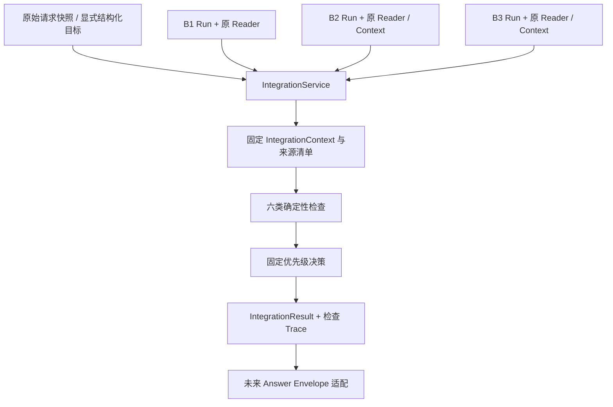

# AegisAI Phase 11-C：Integration Gate Implementation Plan

> 实施方式沿用 Native：获得“确认实施 Phase 11-C”后，由当前会话使用 `superpowers:executing-plans` 逐任务实施，最终进行一次独立审查。复选框均为未来工作。本轮仅审查、设计并生成本计划。

**Goal:** 对既有专业调查、核验、风险分析的真实结果进行全局交付验收，保留证据、目标范围、失败与未知语义。

**Architecture:** 上层显式 IntegrationService 读取拥有者结果，固化跨 Run 的来源关系和目标契约，执行六类确定性检查，输出 IntegrationResult。原 Runtime、三个 Agent、网页和领域算法保持原调用路径。

**Tech Stack:** 现有 Python 3.12 / Pydantic / SQLAlchemy / PostgreSQL / pytest；复用 AgentRun JSONB 审计，不新增框架、数据库表或 Migration，不调用模型。

**Spec:** [本轮用户完整指令](C:/Users/X/.codex/attachments/dba8e973-67a1-4ef2-af1a-6e7a85e8a68b/Pasted%20text.txt)。审查日期：2026-10-09，Asia/Shanghai。

## Global Constraints

- 本轮只授权源码审查、兼容性分析、技术设计、实施计划；不修改产品/测试代码，不启动测试数据库或重跑测试。
- 正式实施时保留原 **1058 项**测试身份；新增数量以实际 JUnit 为准，不预设通过数量或准确率。
- Gate 不是第四个专业 Agent，不调用工具、模型、扫描器或新 Planner，不修改原调查/核验/风险结果。
- 不重写 CVE 查询、版本比较、领域核验、风险策略、处置优先级、DAG、Scheduler 或状态机。
- 不切换网页默认入口，不新增公开 API、前端、自动 Retry/Replan、完整人工复核、Benchmark 或部署。
- 当前没有 Git。实施前保留实际文件完整备份及哈希；哈希仅用于核对，不能代替备份或版本控制。
- 设计说明与可执行步骤合并在用户指定的此文件；不额外创建项目、仓库或另一份设计文档。任务开始前需读取用户指令和本计划。

## Review Focus

1. 同一拥有者、不同漏洞/资产的合法 Run 被拼成一份结果：必须依据来源三元组和上下文哈希拒绝；Task 2 的错配测试固定。
2. 将必要任务降成可选，或把必要任务内部失败工具说成可选源失败：必须拒绝目标降级，不能输出 PASS_WITH_WARNINGS；Task 1/3 固定。
3. 同一证据 ID 在不同快照中对应不同内容，或转载被当作独立支持：引用必须带上下文与哈希，沿用来源血缘；Task 2/3 固定。
4. 旧验收随实时数据、模型配置或系统时钟变化而改写：已保存结果依固定目标、输入和评估时间回放；Task 5/6 固定。
5. 取消/中断与晚到成功同时发生，或 optional 分支发生清理失败：安全阻断优先，不因最后成功或警告标签降为 PASS；Task 3/5/6 固定。

## 1. 当前真实工程状态

### 1.1 证据核对与本轮验证边界

已读取 `PHASE_11B3_RESULT.md`、`work/analysis/final_acceptance.json` 和最终 JUnit。历史记录为 1058 项、0 failure/error/skip；其中原 916、新增 142。当前只读重算 `final_source_hashes.json` 的 **320 个生产/测试文件**：全部与 B3 最终哈希一致；三份 B3 交付文档也与最终记录一致。

这证明当前源码对应已记录验收，不等于本轮重新测试。两份专用测试库均没有 postmaster.pid；本轮未启动服务、执行 pytest、安装依赖或修改数据库。根目录无 `.git`，本轮范围内未发现 AGENTS.md。

### 1.2 Runtime 实际状态

| 源码 / 实际接口 | 已有能力 | Gate 的使用边界 |
| --- | --- | --- |
| `runtime/contracts.py` TaskContract / TaskPlan / TaskArtifact / TaskTrace | 严格类型、依赖、工具白名单、512 KiB Artifact；criteria 仅 tools_succeeded/output_nonempty/evidence_present | 复用执行契约；这些 criteria 不证明用户目标或领域事实已完成 |
| `runtime/graph.py` compile_graph | DAG、依赖、调用/深度/权限预算检查 | 对读取的原计划做结构核对；不生成另一套 DAG |
| `runtime/scheduler.py` Scheduler.run | 只有 SUCCESS 解锁依赖；终态 SUCCESS/FAILED/WAITING_REVIEW/BLOCKED | Gate 读取所有必要节点，不只看最后节点 |
| `runtime/executor.py` acceptance / validate_outcome / validate_receipts | failed 工具→FAILED；partial/no_result→WAITING_REVIEW；回执身份与数据检查 | 沿用这些结果，不把 WAITING_REVIEW 改写为 SUCCESS |
| `runtime/store.py` PostgresRuntimeStore.read_trace | 根据拥有者 Run ID 读取 TaskTrace 和已保存 TaskArtifact | 获取单个 Runtime 的完整任务快照；无业务充分性认证 |
| `runtime/trace.py` project | UI 投影：succeeded→COMPLETED，partial→WAITING_REVIEW | UI 状态是派生值，不作为 Gate 的唯一依据 |
| `agents/trace.py` ProfessionalTraceStore.read | Agent 绑定、任务指纹、输入/输出 Artifact 链 | 用于 Agent Trace；领域结果仍由对应 Reader 校验 |
| `db/models/application.py` AgentRun / ToolCallRecord | 拥有者运行审计及正式工具回执 | TaskRun **没有独立 ORM 表**，任务保存在 runtime_v1 JSON 中 |

Runtime TaskState 没有 PARTIAL、CANCELLED、TIMEOUT 三个枚举。PARTIAL 是工具/业务结果；取消和超时在 TaskArtifact 中表现为 FAILED 加 RUN_CANCELLED/TASK_TIMEOUT 等错误码，后续任务可能 BLOCKED。数据库 AgentRun.status 可以为 cancelled/timeout，UI 可能显示 FAILED。必须同时保留原始层级，不能按字符串同名互换。

根据一个 Run ID 能获取**该 Runtime 的计划与任务**，目前不能由它直接取得三个专业 Agent 的全部运行。B1 的 Planner Run、B1 Runtime Run、B2 Runtime Run、B3 Runtime Run 分别存在；B2/B3 还有独立输入快照 ID。它们通过明确来源引用交接。

### 1.3 三 Agent 接入现状

- B1：`IntelligenceInvestigationService.plan_and_run(PlannerInput, actor)`；`InvestigationReader.read(run_id, actor)` 投影调查结果。
- B2：`EvidenceVerificationService.run(VerificationRequest, *, actor)`；`VerificationReader.read(run_id, *, actor)`。固定任务 ID 为 verify，来源是 B1 精确三元组。
- B3：`SecurityAnalysisService.run(AnalysisRequest, *, actor)`；`AnalysisReader.read(run_id, *, actor)`。固定任务 ID 为 analyze，来源是 B1/B2 两份精确引用和拥有者库存。
- 三者都复用原 Runtime/Scheduler/AgentExecutor；B2/B3 采用独立只读固定计划，不接受任意旧 Planner TaskPlan。
- 三个服务与默认网页调用链均是显式 opt-in。B3 测试已跑通真实数据库/工具进程的交接，但没有一个自动编排三个服务的统一上层调查入口。

### 1.4 Planner 与已有验收机制

`planner/schemas.py` 的 PlannerPlan 有 objective、任务、reasoning_summary、confidence；PlannerInput 有 QueryRequest、component_id/snapshot_id/component。`planner/context.py` 临时生成 question、targets、asset_id、组件版本等 scope；route 含 days。当前没有完整 Objective Coverage 契约、结构化最终结果要求或绝对时间窗口。

`planner/trace.py` 存原始问题和模型候选/验证计划，但**不持久化完整原 PlannerInput/scope**。请求哈希包含输入，却不能从哈希还原资产和版本。Gate 不得用模型 objective 或计划已执行内容反推“用户本来只要求这些”。

原五类 Planner 中 risk_analysis 是旧资产风险工具角色，不是 B3 的 analyze_risk_snapshot。原资产分析验证要求 vulnerability_lookup→version_match→patch_analysis→risk_analysis 的祖先关系；version_match 使用既有 WRITE 工具。B1 独立白名单只有 vulnerability_lookup/evidence_search/asset_lookup，B2/B3 又是专用白名单。因此旧四段依赖不能直接替换为三 Agent 链，本阶段不改该 Planner 逻辑。

实际发现已有机制：

| 文件 / 机制 | 可复用 / 不宜直接调用的原因 |
| --- | --- |
| `assistant/gate.py` integrate | 已有 PASS/WARNINGS/REPLAN/HUMAN/FAILED 概念及确认必须有出处的原则；消费旧 assistant TaskArtifact、live attestation，缺目标、三 Agent 关系和时间契约，不能直接喂新业务 Artifact |
| `enrichment/integration.py` IntelligenceIntegrationService.adopt | 数据入库采纳门禁，可能写 Claim.adopted/ReviewTask，并实时重新核验；不是本阶段只读交付验收 |
| `runtime/executor.py` acceptance / validate_outcome | 复用执行验收与正式回执校验，不重复实现 |
| `agents/artifacts.py` AgentArtifact / build_handoff | 保留 Task/Agent 身份；同 Run 的执行依赖只允许 SUCCESS。跨 Run 的来源观察必须另行标记，不能冒充此依赖 |
| B2 Reader/Context、B3 Reader/Context | 已检查正式计划、来源、回执、哈希和受保护风险字段；优先复用 |

结论：已有局部 Gate 和领域采纳门禁，但尚无适配三份专业 Artifact 的全局目标验收。新增模块扩展这项缺失能力；保留旧 Gate 原调用和算法。

## 2. 三 Agent 契约兼容性矩阵

“必填”指 DTO 构造要求；有默认值的列表/状态在调用端可省略，但不能据默认空值证明不存在。业务 Artifact 是原 TaskArtifact/ToolCallRecord 的 Reader 投影，**没有三张独立业务 Artifact 表**。

| 字段 / 来源→消费 | 实际类型、必填/空值 | 持久化及引用 | 状态语义 / 兼容处理 |
| --- | --- | --- | --- |
| 三者 run_id | UUID；必填、非空 | 各自 runtime-v1 AgentRun.id | 三者通常不同；只能通过来源链关联 |
| 三者 task_id | TaskId=str，受字符/长度约束；必填 | 原计划/Trace/Artifact | B1 可多任务；B2 verify，B3 analyze；不能当全局唯一键 |
| 三者 artifact_id | UUID；必填、非空 | runtime_v1.artifacts 与 ToolCallRecord | 用 run/task/artifact 三元组定位，不只用 task_id |
| 三者 schema_version / agent_id | 固定 Literal，各自 v1 / 固定 Agent ID | Reader 投影、绑定和注册指纹 | 只支持当前确切版本；旧 assistant/enrichment 同名类型不能混用 |
| I.vulnerability_id / canonical_id | str\|None；默认 None | B1 工具结果通常数据库 UUID 字符串 / CVE 字符串 | V 顶层和 R 顶层没有这两个字段；通过固定上下文确认实体，不将 CVE 与数据库 UUID 等同 |
| I.component / asset / version_match | dict\|None；可空 | B1 原工具回执 | 信息发现/库存观察，不直接当已确认影响结论 |
| I.affected_versions / fixed_versions / cvss / evidence | list[dict]；默认空 | Artifact 或 tool_receipts 引用 | 候选/来源断言；列表空不表示没有漏洞/补丁 |
| I.status / information_status | COMPLETE/PARTIAL/CONFLICT/INSUFFICIENT_EVIDENCE；后者 CONFIRMED/CANDIDATE/CONFLICT/INSUFFICIENT_EVIDENCE | B1 投影 | I 的 CONFIRMED 来源摘要不替代 B2 Claim 核验 |
| I.runtime_status / partial_result / failed_tools | TaskState 必填；bool 默认 False；list 默认空 | 原 TaskArtifact 与回执 | 执行/业务状态分别检查；关键 PARTIAL 不能当可选告警 |
| I.dependency_artifact_ids | tuple[str,...]，默认空 | 原同 Run 成功依赖 | 是执行依赖，不是 B2/B3 跨 Run 来源链 |
| I.evidence_storage / receipt_references | artifact 或 tool_receipts；dict | 超限结果可指向完整回执 | 不因 Artifact evidence=[] 而忽略完整回执或认为证据消失 |
| VerificationRequest.source_run_id/source_task_id/source_artifact_id | UUID / TaskId / UUID；必填非空 | verification-context-v1 的 request/snapshot | 精确指向选中 I；支持读取 PARTIAL 观察，但不得把它升级成完整确认 |
| V.source_run_id/source_artifact_id/source_snapshot_hash | UUID / UUID / 64 位 SHA-256；必填 | V 输出和 B2 输入快照 | V 输出**没有 source_task_id**，须从 VerificationContext.snapshot/request 补全 |
| VerificationClaim.claim_id / origin / revision | 受限 str / stored 或 derived / int\|None | 固定 B2 source snapshot | stored 可能是 UUID，derived 是字符串；稳定性限定此快照，不能任意转 UUID 或实时重新派生 |
| Claim.vulnerability_id / package_identifier_id / branch / scope_key | str 必填 / str\|None / str\|None / str 必填 | 原实体及固定声明 | 当前漏洞、发行包、分支范围必须同源；不凭展示名称合并 |
| ClaimVerification.status / supporting_evidence_ids / conflicting_evidence_ids | VerificationStatus / tuple[str,...] / tuple[str,...] | V 固定核验结果 | status 应与内嵌 Claim.status 相同；合法跨 Claim 反证按 VerificationConflict 关联 |
| VerificationEvidence.evidence_id / claim_id | 受限 str；必填非空 | B2 固定源；可 stored 或 derived | 输出引用使用 context_id + evidence_id + hash，避免跨快照同 ID 覆盖 |
| Evidence.source_time/published_at/retrieved_at | AwareDatetime\|None；可空 | 原来源/观察元数据 | 发布与获取时间不同；缺时间不能用 Gate.created_at 补造 |
| Evidence.raw_document_id/observation_id/hash/excerpt_hash/reference | UUID\|None / UUID\|None / SHA\|None / SHA\|None / dict 必填 | 原文、观察、定位和哈希 | 已核验支持须可追溯；无完整关系是缺口或损坏，不能只数引用 |
| Evidence.lineage_key/integrity_status/is_current | str\|None / VALID/MISSING/INVALID / bool | 固定 B2 快照 | is_current 指快照时，不等于 Gate 调用时已实时刷新 |
| V.verification_status / partial_result / execution_status | VerificationStatus 必填 / bool / TaskState 默认 WAITING_REVIEW | B2 规则结果和原执行状态 | CONFIRMED/REJECTED 可执行成功，PENDING/CONFLICT/不足通常 WAITING_REVIEW；REJECTED 不等于版本不受影响 |
| V.evaluation_time / claims / conflicts | AwareDatetime 必填 / tuple / tuple | 固定核验时刻及结果 | Claim 子集、遗漏/超限必须从 Context 和 coverage 读取 |
| AnalysisRequest 的 I/V run/task/artifact | 两组三元组；必填 | analysis-context-v1 | 指向同一合法 I→V 链，不能只因同拥有者而混合 |
| AnalysisRequest.asset_id/component_id | UUID\|None；component 不能脱离 asset | 固定库存请求 | R 的 component 字段是名称，**不是 component_id** |
| AnalysisContext.inputs.asset | AssetContextSnapshot | 固定 asset/component ID、包身份、deployed_version、revision、captured_at | 当前没有正式 criticality 值/已应用补丁字段；unknown 原样保留 |
| R.input_artifact_ids/context_id/input_snapshot_hash | tuple[UUID,...] / UUID / SHA；必填 | B3 固定输入与回执 | inputs 的两份 Artifact 身份/顺序必须与 Context 一致 |
| R.asset_id/component/version | UUID\|None / str\|None / str\|None | 库存投影 | 与目标和固定库存匹配；不能从空字段猜测对象 |
| R.asset_match_status/version_match_status/affected | MATCHED/NOT_MATCHED/UNKNOWN；AFFECTED/NOT_AFFECTED/UNKNOWN；StrictBool\|None | 原风险计算 | None≠False；LOW 只说明当前明确不命中范围；UNKNOWN 可同时保留已确认 affected=True（严重程度未知） |
| R.verification_status | VerificationStatus 必填 | 继承 V 聚合状态 | 不允许把 V.CONFLICT/PENDING 覆盖成 CONFIRMED；失败降级仍保存原核验状态 |
| R.risk_level/priority | CRITICAL/HIGH/MEDIUM/LOW/UNKNOWN；P0—P3/DEFER/REVIEW_REQUIRED | 确定性 B3 输出 | 不重算/按风险级别映射优先级；沿用原规则和 Reader |
| R.exploitation_signal/patch_availability | 严格 DTO；有默认 unknown | 核验信号和动作引用 | 静态 PoC 关联≠成功利用；applied 固定 UNKNOWN，不可称已修复 |
| R.risk_factors/recommended_actions/evidence_refs/claim_dispositions | 有界 tuple，内部 ID/引用 | B3 固定结果 | 检查决定性因素和精确建议引用闭合，不让自由说明新增事实 |
| R.coverage_complete/partial_result/execution_status | bool / bool / TaskState | 输入覆盖与执行结果 | 业务弃权不等于程序异常；必要结论不能依部分结果 PASS |
| R.evaluation_time/source_verification_time/historical_snapshot | AwareDatetime / AwareDatetime / Literal[True] | 固定分析时刻 | 验收声明针对快照，不能改成实时扫描结论 |

## 3. Integration Gate 总体架构与集成位置

推荐**方案 B：上层服务显式验收**。



方案 A 在 Runtime.finish_run 后触发：目前 finish_run 只知道单 Run，且会被默认 Runtime、旧 Planner 和三个专用 adapter 共用。强行调用会要求 Runtime 理解跨 Run 目标/资产、改变现有 finish 事务及错误传播，并可能让原网页因 Gate 异常失败。因此不推荐。

方案 B 可用已提供的读取接口，独立测试、幂等验收和失败恢复；未接入的原网页不会受影响。代价是**不能据此声称已完成 User Query→三 Agent→最终回答的自动编排**。本阶段 Gate 接受已有结果清单，不自动运行 B1/B2/B3。

第一版支持单个明确漏洞、单资产及所选组件的专业调查验收。多漏洞/多资产、自由知识问答目标不得被悄悄压缩成第一项；返回 UNSUPPORTED_OBJECTIVE 的重规划原因。目标 Contract 留扩展能力，首版不扩建调度。

## 4. 输入协议与目标绑定

### 4.1 IntegrationRequest（新设计）

使用 FrozenModel / extra=forbid / 有限 JSON / 明确 aware 时间。actor 由可信服务参数传入，不从请求 owner 字段取。

| 字段 | 类型及限制 | 来源与意义 |
| --- | --- | --- |
| request_key | 非空 str，1—150 | 作为拥有者/type 作用域的幂等键 |
| run_id | UUID\|None，必填键允许 None | B1 Runtime 锚点；None 表示尚未创建，不能假造一个 Runtime |
| planner_run_id | UUID\|None | 可选原 B1 Planner 审计；必须反向关联该 B1 Run |
| objective_source | stored_planner_request / new_structured_request | 目标来源，禁止 generated_plan.objective 作为授权目标 |
| objective_profile | asset_impact_v1 / asset_risk_v1 | 可信服务选择；原问题明确要求风险/优先级时，较弱 profile 不能缩小目标；不支持或有歧义的目标保留缺口 |
| explicit_objective | ObjectiveContract\|None | new_structured_request 必须提供；stored 模式不接受覆盖原范围 |
| investigation / verification / analysis | ArtifactRef\|None | 每份 ref 含 run_id/task_id/artifact_id/schema_version；不存在的阶段可明确 None |
| optional_tasks | tuple[TaskRef,...]，≤16 | 只有可信服务明确声明且通过规则证明独立的非核心任务可选 |
| policy_version | Literal[integration-policy-v1] | 由服务固定；请求不能降低证据、时效或必要任务要求 |

ObjectiveContract：原问题（≤2000）、单一 target/canonical_id、asset_id/component_id、指定版本（可空但有缺口）、required_outcomes、时间约束、scope_mode、来源快照引用及哈希。outcomes 是白名单：vulnerability_identity、asset_identity、version_impact、risk_level、priority、remediation_status、exact_remediation、verified_exploitation。基础 profile 必含 identity、asset、version_impact；请求风险/优先级须相应覆盖，不能由 LLM 删除。exact_remediation/verified_exploitation 只有用户结构化明确要求时为必要项；不能把静态候选当完成。

目标来源处理：

- stored_planner_request：未来新增原 PlannerInput 私有快照。读取并验证 sha、question、target/asset/component、planner→Runtime 链；使用原 build_context/route 的受控解析。不采用模型 objective。
- 旧 Planner 缺原快照：返回 OBJECTIVE_CONTEXT_MISSING / REPLAN_REQUIRED。不能用模型候选或已跑工具推定原请求。
- new_structured_request：可信调用方明确提出一次**新验收目标**，允许复用旧 Artifact；目标在 Gate 自己的审计中固化，并透传 NEW_EXPLICIT_OBJECTIVE 警告。它不证明恢复了旧 Planner 的原始目标；不能和旧 planner_run_id 同时声称该目标来自旧规划。
- 无确切 target、资产、版本或不支持的目标：留下 objective_coverage 缺口；不猜测第一条目标或任意库存组件。

### 4.2 IntegrationContext（新设计）

字段：context_version、owner、run_id、planner_ref、objective、requirements、execution_snapshots、artifact_refs、三类 Reader 投影、verification_source、analysis_asset、source_fingerprints、trace_references、evaluation_time、input_snapshot_hash、policy_version、capture_issues。

requirements 保存必要阶段和 TaskRef(run_id,task_id)、原 TaskContract.acceptance_criteria、所需 outcome 及可选理由。默认所有原规划任务必要；只允许把独立、未被关键依赖/证据/结果使用的额外 narrative 搜索任务标可选。不能把缺少的 verify/analyze 或 get_vulnerability/版本/证据关键工具标可选。一个必要 Task 内部的失败工具不能在 Gate 被拆成可选任务。

三类业务投影分别是 InvestigationArtifact\|None、VerificationArtifact\|None、RiskAnalysisArtifact\|None；verification_source 为 VerificationSourceSnapshot\|None，analysis_asset 为 AssetContextSnapshot\|None。None 只表示明确缺阶段，必须产生检查缺口；不能用空构造的默认 DTO 代替实际结果。

Loader 步骤：

1. 按 actor/type 读取锚点、原 Planner 和全部显式 Run；限制角色数量，拒绝其他类型/拥有者。
2. 读取原计划、TaskTrace/TaskArtifact、正式回执引用及对应业务 Reader；按三元组找结果，禁止“最近一次成功 Run”兜底。
3. 读 VerificationContext：补 source_task_id、完整原 Claim/Evidence、遗漏数、所选 claim_ids 和 source_snapshot_hash。
4. 读 AnalysisContext：校验 request、输入 I/V 原文哈希、库存 ID/版本/revision 和 input_snapshot_hash；不刷新实时库存。
5. I→V→R 的来源链必须精确闭合。跨 Run 链标 SOURCE_OBSERVATION，原同 Run dependencies 标 EXECUTION_DEPENDENCY；不能相互代用。
6. 对所读 Run 核心数据、上下文、正式回执做前后指纹核对。正在推进的运行输出缺失→REPLAN；已经终态却改变核心指纹或出现错配→FAILED。不同 Reader 各自开 Session，不宣称它们天然属于同一数据库快照。
7. 固化评估时间和 JSON。首版 IntegrationContext ≤原 WIRE_LIMIT 4 MiB，结果 ≤原 ARTIFACT_LIMIT 512 KiB，整条审计 ≤原 METADATA_LIMIT 8 MiB。只存一次共享来源和精简执行 Trace，不复制每个 Tool 输出。超限返回受控 FAILED/INPUT_LIMIT，引用原结果仍保留，不截断后 PASS。

缺失处理：未提供必要阶段/未执行→REPLAN；运行中的 Artifact 尚未生成→REPLAN；提供 ID 却不存在、越权、错任务、错误版本，或终态 SUCCESS 没有对应 Artifact→FAILED。查询不存在和非拥有者均给统一受控错误，不能泄露其他用户运行内容。

旧 Schema 首版只显式支持上述三种 v1；遇到其他版本返回 UNSUPPORTED_SCHEMA。绝不通过去字段/补默认值转换成已支持版本。后续适配须有独立版本和回归。

## 5. 输出协议与 Answer Envelope 边界

IntegrationResult 使用 FrozenModel，字段如下；所有最终状态由程序生成。

| 字段 | 类型 / 可空规则 | 生成与持久化 |
| --- | --- | --- |
| integration_id / trace_id | UUID；必填非空 | 新 Gate 审计身份；不是第四个 Agent 或 B1 Runtime ID |
| run_id / source_run_ids | UUID\|None / tuple[UUID,...] | 原 B1 锚点及实际来源 Run；未创建锚点允许 None |
| status | PASS/PASS_WITH_WARNINGS/REPLAN_REQUIRED/HUMAN_REVIEW_REQUIRED/FAILED | 六检查结果确定性聚合 |
| objective_coverage | tuple[CoverageItem,...] | 每个必要 outcome：SATISFIED/ABSTAINED/MISSING/CONFLICT/NOT_APPLICABLE、依据和 check_id |
| task_completion_summary | tuple[TaskCompletionItem,...] | 原 run/task/state/tool/error、必要性及依赖结果，不改原状态 |
| artifact_references / evidence_references | 有界 tuple | 真实三元组、版本、快照/证据哈希、Claim/Evidence/原文/回执定位；没有则空并说明缺口 |
| checks / passed_checks / failed_checks | tuple[GateCheck,...] / tuple[str,...] | 固定规则 ID、结果、阻塞级别、相关任务/结论/来源 |
| warnings / blocking_issues / unresolved_items | tuple[IntegrationIssue,...] | 稳定 code、message、check_ids、refs；不用自由 LLM 分类 |
| replan_reasons / human_review_reasons | tuple[IntegrationIssue,...] | 可以同时非空；status 按优先级确定，另一类问题不能丢失 |
| final_result_references / validated_outcomes | tuple | PASS 两态才给可确定性交付的结论引用；非 PASS 不输出可当定论的 final refs |
| partial_result_references / abstention_reasons | tuple | 非 PASS 可保留供诊断的来源和明确弃答，不当作最终事实 |
| input_snapshot_hash / objective_hash / policy_version | SHA / SHA / Literal | 固定输入、目标和交付策略指纹 |
| evaluation_time / created_at / historical_snapshot | AwareDatetime / AwareDatetime / bool | 前者是验收时钟；后者不替代来源时间；范围说明必须透传 |
| persistence_status | STORED / NOT_STORED | 数据库异常/中断时不能伪造已保存审计 |

GateCheck：check_id、gate（六类之一）、outcome=PASS/WARNING/BLOCKED/ERROR/NOT_APPLICABLE、issue_code、reason、blocking_kind=NONE/REPLAN/HUMAN/FATAL、task_refs、artifact_refs、claim_refs、evidence_refs、objective_keys、observed_values、expected_condition。无证据的失败仍能关联实际缺失的 TaskRef/预期目标，不制造 evidence_id。

validated_outcomes 只引用已验收结果，不生成新的风险/修复/利用事实。remediation_status 的“尚无确认修复依据”可满足**说明信息状态**的目标，不能满足 exact_remediation。若真实信息不足，非 PASS 输出可追溯弃答。

未来 Answer Envelope 必须携带 integration_id/status、有效事实引用、warnings/blocking_issues、scope_notice、evaluation_time 和 abstention；仅 PASS 两态可交付对应已验收确定事实。模型可将允许事实组织为文字，但无权变更 Gate 状态。首版只定义这些字段映射，不实现 Answer Envelope API/前端或回答生成器。

## 6. 六大验收规则

固定注册 IG1—IG6，顺序稳定；Integrity 的致命失败后后续依赖检查标 NOT_APPLICABLE，并记录“缺少可信上下文”，不能把未检查项算通过。其余有效输入收集全部阻塞原因再决策。

### IG1 Task Completion

- 检查所有必要 Task 是否在原计划存在、Trace/Artifact 是否终态、依赖是否按原 SUCCESS 条件满足。
- CREATED/PENDING/READY/RUNNING、input_required、BLOCKED、关键 PARTIAL/no_result/WAITING_REVIEW→REPLAN；保留待输入、执行不足、部分工具不同原因。
- 关键普通 failed/timeout 若有可信错误回执→REPLAN（需要补充执行/调查）；坏协议、隔离失败、TASK_CLEANUP_FAILED 或用户 RUN_CANCELLED→FAILED，禁止建议自动重跑用户取消任务。
- WAITING_REVIEW 的业务原因必须继续读 IG3/IG4：关键冲突会升级 HUMAN，不能全部混称系统错误。
- 只有已验证可选分支失败且未损害必要依赖/证据/目标，才是 WARNING。Run 总体 failed 不等于所有必要任务失败；按任务实际结果判断，不能掩盖取消/资源安全错误。
- 不修改 Scheduler；同 DAG PARTIAL 阻塞后续仍为 BLOCKED。跨 Run B2 可以核验部分来源，但不能因此绕过必要调查完整性要求。

### IG2 Artifact Integrity

复用原 Readers、AgentArtifact、validate_receipts/validate_outcome 的正式结果。新增的检查只针对跨 Run 关联与目标：三元组/拥有者、Schema、Agent 绑定、输入上下文、证据指纹、重复引用、source task 和 I→V→R 链。相同 ref 重复声明或同 ID 不同正文不能用 dict 覆盖忽略。

必要 ID 错误/损坏、非预期 Run、混合漏洞/组件/库存快照、非法 JSON/非有限值、伪造支持证据、跨版本静默解析→FAILED。预先声明 None 的未执行阶段是 IG1 缺口，不误报为损坏。

### IG3 Evidence Coverage

先列出本次用户目标所需的关键结论，再关联：来源 I→B2 ClaimVerification→support/counter Evidence→原文/locator/hash→B3 因素/动作。不以证据列表长度证明充分。

- CONFIRMED 支持须在固定 source snapshot 中存在并绑定该 Claim/范围，状态、revision、hash、定位和正式回执一致；使用 B2 eligibility/核验结果，**不重新运行 evaluate_claim/evaluate_snapshot**。
- CANDIDATE、source assertion、PENDING/REJECTED、排除证据和冲突证据分别展示，不能计入确认支持。
- 使用 B2 lineage_key / score_components 的来源血缘分组。相同原始来源或转载不能算两份独立支持；缺血缘不创造新来源。默认接受已有合格核验，不额外强制两个官方源；明确要求独立多源时，无法证明独立→REPLAN。
- V 只选部分 Claims 或源有 omitted_*，对关键覆盖必须保留缺口；不能只挑已确认部分 PASS。
- 未核验/不足→REPLAN；关键 Conflict→HUMAN。声明已经确认却引用无法解析/不匹配→FAILED。

### IG4 Cross-Agent Consistency

检查上游状态、范围与下游既有值，复用 R 的 Schema/Reader 验证；不再次计算 CVSS/版本/优先级。

- R.verification_status 必须继承 V；CONFLICT/PENDING/不足不得出现确定受影响/安全结果。
- affected=None 不等于 False；UNKNOWN risk 可能保留 affected=True，但仍不能交付确定 risk_level；按具体必要 outcome 判断缺口。
- 确认 NOT_AFFECTED/NOT_MATCHED 应是 scoped LOW/DEFER/False，不得出现 HIGH/CRITICAL；资产版本未知不得出现确定版本命中。
- 候选或静态 PoC 不得成为 VERIFIED_EXECUTION。当前 usability 固定 NOT_EVALUATED；KNOWN_EXPLOITED 只能依据已有已确认 KEV 等支持，不等于本系统执行成功。
- 精确 fixed_version 必须引用同作用域 CONFIRMED 修复 Claim；依原 B3 结果判断其版本适用性，不另写比较算法。patch.applied=UNKNOWN 不能出现已修复声明。
- 决定性 factor/action 的 Claim/Evidence 引用必须闭合。GENERAL_PRECAUTION 不当官方补丁事实；风险预警/未知说明不当成已证实事实矛盾。
- 合法业务来源冲突→HUMAN；下游形状合法但和上游确定性约束矛盾→FAILED/RESULT_CONTRACT_INCONSISTENT。

### IG5 Objective Satisfaction

使用固定原始目标，逐项记录 SATISFIED/ABSTAINED/MISSING/CONFLICT；不做自然语言相似度评分。

- identity：CVE/canonical_id 与固定实体关系一致。
- asset/component：目标 UUID、部署版本和库存 revision 与 AnalysisContext 一致，不能用组件展示名代替。
- version_impact：有依据的 AFFECTED 或 scoped NOT_AFFECTED/NOT_MATCHED；UNKNOWN/None 记录弃答，不计作明确回答。
- risk_level / priority：用户要求时必须有确定结果；UNKNOWN/REVIEW_REQUIRED→缺口。严重程度未知但 affected=True 可以保留影响事实，仍不能称完整风险目标完成。
- remediation_status：有证据修复信息，或明确“缺少确认修复依据”；两者均可回答信息状态。exact_remediation 要求精确且有证据的动作，通用建议不满足。
- verified_exploitation：静态 PoC/KEV 均不表示此系统已执行复现；当前能力无法满足实测利用目标，明确限制/非 PASS。
- 时间范围必须检查原字段，不能把最近 N 天获取的证据说成最近 N 天发布的漏洞。
- 必要目标缺失→REPLAN；关键目标有冲突→HUMAN；资产/目标引用错配→FAILED。

首版保守保留必要 Task SUCCESS 条件。B3 因 severity 不足进入 WAITING_REVIEW 时，即使 affected=True，仍输出非 PASS 的部分可靠事实/弃答；不为了让全局通过而修改 B3 或降低必要任务要求。

### IG6 Freshness and Unresolved Issues

时间分开处理：来源 published_at、retrieved_at、核验 evaluation_time、库存 captured_at/revision、分析 evaluation_time、Gate evaluation_time。published_at 很旧但内容被近期获取/核验不自动算失效；也不代表该漏洞属于用户的近期发布窗口。

新增交付策略 `integration-policy-v1` 的明确首版值：来源获取最大 30 天（对齐原 B2 窗口）、核验与库存快照最大 24 小时、时间偏差容忍 5 分钟。后两项是**拟新增的保守交付策略**，不是已校准标准；固定在服务器 profiles.py，不能由请求扩大。

- current_snapshot：按固定 Gate evaluation_time 检查年龄，结果声明“截至所列快照”，不保证实时扫描/最新数据。过期必要来源、核验或库存→REPLAN。
- historical_snapshot：目标明确选定 Analysis evaluation_time 作为 as_of，检查当时各来源/核验/库存是否满足策略；始终透传历史警告。不能把晚于 as_of 的观察回填为当时已知。
- 近期发布窗口由目标的 days 或明确 aware 起止时间固定；来源路径要注明其指代。缺漏洞发布日期→REPLAN；超出窗口→目标未覆盖。不能用 retrieved_at 补发布时间。
- 必要时间缺失→REPLAN/TIME_MISSING；过旧→REPLAN/STALE；重要发布日期晚于获取、时钟未来或相互矛盾→HUMAN/TIME_INCONSISTENT；损坏/无时区类型→IG2 FAILED。
- 重大未决冲突→HUMAN；必要调查缺口→REPLAN；非核心限制→WARNING。unknown criticality、未执行 PoC 等若不属于必要目标仅警告，不虚构它们已验证。
- 已保存 Gate 只按原 evaluation_time 回放；新的“现在”验收须新 key/new snapshot，不随读取时钟修改原状态。

## 7. 状态决策表

检查 issue 使用明确阻塞类型，不解析中文 warning 文本推断级别。

| 优先级 | 状态 | 条件 | 示例 |
| ---: | --- | --- | --- |
| 1 | FAILED | FATAL：坏引用/Schema/来源链、不可用读取、安全资源失败、用户取消、Gate 中断 | 错 Run、伪造证据、取消后晚到成功、数据库不可用 |
| 2 | HUMAN_REVIEW_REQUIRED | 有关键 HUMAN 且无 FATAL | 同范围来源冲突、不可自动裁决的时间矛盾 |
| 3 | REPLAN_REQUIRED | 有必要 REPLAN 缺口且无上述阻断 | 关键阶段未跑、依赖阻塞、UNKNOWN、缺目标/支持/必要时间 |
| 4 | PASS_WITH_WARNINGS | 必要任务、目标、完整性、支持、一致性和时效均通过，存在非阻塞 WARNING | 独立可选源失败、历史/新显式目标说明、非必要 criticality 未知 |
| 5 | PASS | 上述必要条件通过且无 warning | 当前范围内完整、可靠、可追溯结果 |

HUMAN 与 REPLAN 同时存在时，状态 HUMAN，replan_reasons 仍完整保留；FAILED 时仍保留已有可信诊断。任何未执行检查不会计入 passed_checks。核心目标未完成时，不因“已诚实说明未知”自动 PASS_WITH_WARNINGS。

UNKNOWN 是业务弃权，普通工具/阶段失败也可能形成 REPLAN；两者都不自动当系统 FAILED。FAILED 的具体 reason 必须可观察，不能无限泛化。

## 8. Trace、持久化、幂等与异常恢复

### 8.1 现有审计体系中的表示

新增 `AgentRun.agent_type='integration-gate-v1'` 的**验收审计记录**，不是注册新 Agent。`details.integration_v1` 保存 request_hash、目标/输入固定快照、checks、result、trace_id、策略版本及结果哈希。无需新增 TaskRun、Gate 表或 Migration；不把 IntegrationResult.status 写进原数据库 status 枚举。

数据库 execution status 映射：PASS 两态→succeeded；REPLAN/HUMAN→partial；FAILED→failed；取消可记 cancelled，超时可记 timeout。业务 status 原样在 integration_v1.result 中。数据库存在部分结果不表示安全验收已通过。

IntegrationTrace 包含 integration_id/trace_id、原 Planner/Runtime/Agent/Artifact 引用、六类规则记录、目标覆盖、原因、评估及执行时间。来源 refs 必含原 trace_id 和 link_kind，可从验收跳回原任务/正式回执；检查记录带具体 Claim/Evidence/资产快照定位。没有关联证据时关联具体缺失的目标/Task，不造空壳证据。

### 8.2 推荐原子事务

Gate 是同步、有界、无外部调用的检查过程，采用**一笔独立事务提交固定上下文、所有检查及最终结果**。使用原 advisory lock/digest/transaction 机制和 actor/type/request_key 作用域，不覆写源运行。

- 在事务内先锁 Gate key，检查缓存。相同 request_hash 返回原保存结果，不重新读取当前源、刷新时间或再产生日志；同 key 不同请求→原 IdempotencyConflict。
- 新请求由固定 Loader 读取来源及目标。显式来源 Run 尚未终态时不做正式 PASS，返回 RUN_NOT_TERMINAL/REPLAN；即使必要任务先完成，也等该来源运行形成稳定记录。终态 Run 的可选任务失败则按任务级别处理。
- Loader 的原 Readers 使用各自 Session；前后核对 source_fingerprints。审计固定所读状态并注明 evaluated-as-of，不承诺终态 AgentRun 在数据库中有不可变约束或整个读取具有跨 Session 的串行快照。
- 纯 evaluator 只消费固定 Context；完成后一次提交 audit row。使用整份 JSON 替换，不原地修改嵌套对象。
- 中断在提交前→事务回滚，没有半个 PASS 审计；之后显式重试可以重新捕获。提交后重复请求→返回原结果。没有新的持久 RUNNING/lease/自动重试状态机。
- 原工具回执不可变保护与输入哈希沿用；AgentRun 是 Mutable，新增 Gate 审计只能依服务的禁止覆盖、哈希/Reader 检查保护，不能宣称数据库管理员不可伪造。

并发同 key 依数据库锁串行；不同 actor/key 各自独立。Gate 锁使用新 Session 的受控 lock_timeout，不能给旧 Reader/生产连接改全局选项。源读取沿用既有 30 秒 statement_timeout；取消/deadline 在读取前后和每类检查前确认。**不承诺阻塞数据库语句会立即被取消**，不采用新的后台线程/worker 规避此边界。

### 8.3 调用接口与失败可观察性

未来固定接口：

```text
IntegrationService(engine).run(request: IntegrationRequest,
                               *, actor: str, control: GateControl | None = None)
                               -> IntegrationResult
IntegrationService.read_result(integration_id: UUID, *, actor: str)
                               -> IntegrationResult
IntegrationService.read_trace(integration_id: UUID, *, actor: str)
                               -> IntegrationTrace
IntegrationGateEvaluator.evaluate(context: IntegrationContext,
                                  *, integration_id: UUID, trace_id: UUID,
                                  control: GateControl | None = None)
                                  -> IntegrationResult
```

GateControl 为服务创建的每次调用独立取消 Event/单调 deadline，不能从请求指定代码或共享跨用户事件；不持久化认证信息。默认执行期限拟定 60 秒，属于协作式检查期限，阻塞读取仍受上述原 DB 超时边界；超时后即使读到成功也不能提交 PASS。

输入类型/大小问题输出受控 FAILED（能安全形成结果时）；认证/越权查询采用统一不泄漏的错误。普通数据库错误返回 STORE_UNAVAILABLE/FAILED、persistence_status=NOT_STORED，并以现有应用 logger 记录受控 code/trace_id；不能谎称已有数据库审计。恢复后由调用方显式重试，不启动新的调查或模型。

Loader 抛出错误且没有可信 Context 时，服务形成最小失败结果：只保留已认证发起者的请求/原始引用和 IG2 ERROR，不填充伪造的业务投影。若数据库可用，可在同一事务保存这个失败审计；否则 NOT_STORED。Reader 对这种结果仅核对失败审计/请求哈希，不假装重新跑了缺失的业务检查。

用户取消、Gate 中断、源 RUN_CANCELLED、清理失败都保留原 reason。已有取消时序缺陷复现时记录 PID/原回执/状态，先判断是否本阶段引入；不得以旧复测成功宣称根因解决。

## 9. 复用位置与最小兼容扩展

| 位置 | 用法 | 保留的边界 |
| --- | --- | --- |
| 原 PostgresRuntimeStore.read_trace / 专业 Trace | 读取各 Run 所有任务、原 plan/bindings 和完成状态 | 不重写 Scheduler、不增加依赖解锁规则 |
| InvestigationReader / VerificationReader / AnalysisReader | 取得正式投影并检验原回执 | Gate 不直接接受客户端传来的“已确认 Artifact” |
| VerificationContextStore.read / AnalysisContextStore.read | 来源 Claim/Evidence、覆盖、原库存快照 | 不刷新来源/资产、不重做核验 |
| FrozenModel / json_bytes / TaskRef/TaskId 等原类型 | 类型、有限值、身份、预算 | IntegrationContext 用 4 MiB 新外层限制，不误用 B2 Bounded 的 2 MiB |
| AgentArtifact / validate_outcome / fingerprint | 原执行关联、计划与来源指纹 | 业务判断以原 Reader 为准；不复制其完整领域算法 |
| enrichment.repository.lock/digest / db.transaction | 所有者幂等、原子结果保存 | 不调用 adopt/ensure_review，不更改业务数据 |
| PlannerTraceStore / build_context / assistant.route | 读取原问题、已验证计划和受控范围 | generated objective 仅辅助解释，不作为目标覆盖依据 |
| Model/Tool Gateway | 本 Gate 不需要调用 | 三 Agent 内部原调用路径保留 |

**仅一处预计旧生产文件修改：** `backend/app/planner/trace.py` 的 PlannerTraceStore.create 创建新审计行时，在私有 row.context 追加 `planner_input_v1=captured.model_dump(mode='json')` 和 `planner_input_sha256=digest(...)`，保留原 planner_version。使用原 INPUT_LIMIT 验证范围；不新增 PlannerInput 字段、不改候选/验证/白名单/依赖逻辑、不改 PlannerRunTrace 公共投影。

只给新行保存。旧行与同 key 缓存不回填，不依据旧计划补造原请求；原请求哈希和幂等语义保留。Context 含用户问题和范围，读取受 actor 控制；不把它投到旧 events/result 页面。

目标完整性兼容问题可以在本阶段 Task 1 增量处理，不必先重写 Planner。跨 Run 关联和业务状态差异是 Gate 设计要处理的适配点，不需要改三个 Agent 才能开始。

## 10. 预计文件清单

当前实际目录采用 `backend/app/`，新增 `backend/app/integration/`，不迁移原 `assistant/gate.py` 或 `enrichment/integration.py`。

| 新生产文件（16 个） | 单一职责 |
| --- | --- |
| `backend/app/integration/__init__.py` | 显式导出服务/契约，不自动挂接 Runtime |
| `backend/app/integration/contracts.py` | Request/Objective/Context/Refs/Check/Result/Trace/Control DTO 与预算 |
| `backend/app/integration/profiles.py` | 固定交付 profile、必要 outcome、可选任务限制和时效 policy |
| `backend/app/integration/objective.py` | 原请求快照绑定、ObjectiveContract 构建、IG5 检查 |
| `backend/app/integration/snapshot.py` | Actor/角色/来源链的只读加载及固定 Context |
| `backend/app/integration/registry.py` | 六类检查静态注册与规则版本 |
| `backend/app/integration/completion.py` | IG1 task 完成/依赖/错误分类 |
| `backend/app/integration/integrity.py` | IG2 跨来源引用与版本完整性 |
| `backend/app/integration/evidence.py` | IG3 支持引用覆盖与已有血缘分组 |
| `backend/app/integration/consistency.py` | IG4 上下游状态/结果/动作关系检查 |
| `backend/app/integration/freshness.py` | IG6 来源、核验、库存、目标窗口及未决问题 |
| `backend/app/integration/evaluator.py` | 有界检查执行、确定性优先级和结果聚合 |
| `backend/app/integration/trace.py` | 检查/来源/原因 Trace 纯投影 |
| `backend/app/integration/store.py` | 独立审计原子提交、拥有者幂等及哈希读取 |
| `backend/app/integration/service.py` | 显式固定组合，控制取消/超时和受控失败 |
| `backend/app/integration/reader.py` | 历史结果/Trace 校验及读取，不刷新原源 |

既有生产修改 **1 个**：`backend/app/planner/trace.py`，原因及位置见第九节。

预计新测试 12 个文件：`backend/tests/integration/test_contracts.py`、`test_objective.py`、`test_snapshot.py`、`test_completion_integrity.py`、`test_evidence.py`、`test_consistency.py`、`test_freshness.py`、`test_evaluator.py`、`test_store.py`、`test_end_to_end.py`、`test_trace_reader.py`、`test_cancellation_limits.py`；另加该目录 `__init__.py`、`conftest.py`、`helpers.py` 三个支撑文件。**文件数量不是 pytest 用例数量。**

预计新证据运行器：`work/integration/run_tests.py`、`run_tests.ps1`、`pytest_order.py`，复用 B3 历史报告保护和普通目录收集，仅改变证据输出位置。其余 hash/backup/log/JUnit/ledger 为验收数据，不是产品模块。

正式完成时新增 `docs/INTEGRATION_GATE_IMPLEMENTATION.md`、`PHASE_11C_RESULT.md`，并更新本计划进度。范围合计：16 新生产 + 1 旧生产修改；测试 15 新文件、运行器 3、新交付文档 2，**预计新增 36 个实现/测试/交付文件（不含本轮已创建计划与验收数据）**。

## 11. 可执行实施步骤

每个任务按 RED→最小实现→GREEN；本轮不写下面的测试或模块。实际命令在项目根运行。

### Task 1：协议、目标来源与基线保护

**Files:** 新增 contracts.py/profiles.py/objective.py 的目标构建部分、测试支撑及 test_contracts.py/test_objective.py、证据运行器；仅追加 planner/trace.py 私有请求快照。

**输入：** 用户指令、本计划、原 PlannerInput/Trace。**输出：** 类型契约、固定 profile、可读取原目标、新鲜 1058 基线。无前置实现任务。

**Interfaces:** `build_objective_contract(request: IntegrationRequest, source: PlannerInput | None, *, evaluation_time: datetime) -> ObjectiveContract`；`requirements_for(objective: ObjectiveContract) -> tuple[OutcomeRequirement,...]`。profile 至少包含 asset_impact_v1（identity/asset/version_impact/remediation_status）和 asset_risk_v1（另含 risk_level/priority）；原问题明确要求的更强目标不得被较弱 profile 去掉，无法确定请求含义时记 OBJECTIVE_NOT_STRUCTURED。

- [ ] 保存所有既有生产/测试哈希和唯一拟修改文件的完整备份；记录当前源码与 B3 最终来源比对。
- [ ] 仅启动两份专用 PostgreSQL 集群，核对绝对路径、端口和 `aegis_phase5_test`；复制运行器保护逻辑，OUT 改为 work/integration。
- [ ] 实跑 `& './work/integration/run_tests.ps1' baseline -q`；JUnit 逐项对比 B3 1058 身份，0 fail/error/skip 才建立基线，不把旧报告当本轮运行。
- [ ] 写 test_unknown_is_not_false、test_invalid_ids_naive_time_nonfinite_extra_fields_rejected、test_request_scope_saved_privately、test_legacy_planner_missing_objective_not_inferred、test_profile_cannot_drop_required_risk_or_asset、test_optional_downgrade_rejected；断言 None 保留、旧 context 不回填、模型 objective 不改变原 asset/target/outcomes。
- [ ] 跑 contracts_red；确认新功能缺失导致 RED，环境失败不代替 RED。
- [ ] 实现协议、两 profile 与私有快照追加；通过 typed request/profile 构建目标，不任意推断自由问题。
- [ ] 跑 contracts_green 及原 `tests/planner`；已有计划验证、幂等及旧 API 投影不变。记录实际测试名称/命令/哈希。

### Task 2：固定输入与跨 Run 来源适配

**Files:** snapshot.py/integrity.py 的加载边界、test_snapshot.py。

**输入：** Task 1 契约与原三类 Reader/Context。**输出：** 固定 Context 或结构化 capture_issues。

**Interfaces:** `IntegrationSnapshotReader(engine).read(request: IntegrationRequest, *, actor: str, evaluation_time: datetime) -> IntegrationContext`。加载异常由 IntegrationError(code, stage_ref) 表达，均在 contracts.py 定义；无后台执行。

- [ ] 写 test_three_distinct_runs_are_linked_by_exact_sources、test_cross_owner_cross_cve_cross_asset_rejected、test_verification_source_task_from_context、test_duplicate_id_different_payload_rejected、test_no_latest_success_fallback、test_running_missing_and_terminal_corruption_differ；断言合法不同 Run 可关联，错配 FAILED，明确未跑阶段是 REPLAN。
- [ ] 写 test_legacy_schema_not_silently_converted、test_source_fingerprint_change_during_read_blocks_pass；覆盖版本和读取竞态。
- [ ] 跑 snapshot_red；实现拥有者/角色读取、精确来源三元组/哈希、Task/Agent/回执引用和固定资产快照。
- [ ] 跑 snapshot_green；断言不调用调查、核验、风险服务的 run 方法，也不写业务表或读最新库存替换原快照。

### Task 3：完成、证据、结果一致性三类检查

**Files:** completion.py/integrity.py/evidence.py/consistency.py、相应 test 文件。

**输入：** Task 2 IntegrationContext。**输出：** IG1—IG4 GateCheck。

**Interfaces:** `check_completion(context) -> tuple[GateCheck,...]`；`check_integrity(context) -> tuple[GateCheck,...]`；`check_evidence(context) -> tuple[GateCheck,...]`；`check_consistency(context) -> tuple[GateCheck,...]`。参数均为 IntegrationContext。

- [ ] 写 test_required_partial_blocks_existing_dag、test_missing_required_task_replans、test_optional_independent_failure_warns、test_failed_tool_inside_required_task_is_not_optional；断言不改 SUCCESS 依赖语义，必要 PARTIAL/BLOCKED 非 PASS。
- [ ] 写 test_critical_claim_without_support_replans、test_same_origin_reposts_do_not_add_independence、test_dangling_reference_fails、test_cross_claim_conflict_keeps_both_evidence_sets；断言已有权威单源不被不必要否定，但无法证明的多源不能伪造。
- [ ] 写 test_conflict_cannot_become_definite_risk、test_unknown_impact_cannot_become_safe、test_unknown_severity_preserves_known_impact_without_full_risk_pass、test_candidate_poc_cannot_become_executed、test_unconfirmed_fixed_version_or_applied_patch_rejected。
- [ ] 写 test_cleanup_failed_optional_branch_is_fatal；断言错误 code TASK_CLEANUP_FAILED 不能作为普通可选告警。
- [ ] 跑 checks_red；仅检查现有结果/关系，复用 Reader 验证。不导入风险/版本计算函数再生成另一套决定，不调用 adopt。
- [ ] 跑 checks_green 及原 `tests/runtime/test_scheduler.py`、`tests/agents/analysis`、`tests/agents/verification`；保存原行为回归证据。

### Task 4：目标、时效和全局确定性决策

**Files:** objective.py 的 IG5、freshness.py/registry.py/evaluator.py、test_objective.py/test_freshness.py/test_evaluator.py。

**输入：** 固定目标/Context、Task 3 checks。**输出：** 五态 IntegrationResult。

**Interfaces:** `check_objective(context) -> tuple[GateCheck,...]`；`check_freshness(context) -> tuple[GateCheck,...]`；`registered_checks() -> tuple[GateRule,...]` 固定六项；`IntegrationGateEvaluator.evaluate(...)` 使用第八节签名。GateRule/OutcomeRequirement/Result 等均在 contracts.py 定义，禁止按请求动态注册。

- [ ] 写 test_description_only_does_not_satisfy_asset_impact、test_missing_exact_fix_differs_from_unknown_fix_status、test_user_time_window_uses_publication_not_retrieval。
- [ ] 写 test_time_missing_stale_and_conflicting_have_distinct_reasons、test_age_boundaries_and_historical_as_of、test_old_publication_with_fresh_retrieval_is_not_stale_by_itself；按 30 天/24 小时/5 分钟边界测试，使用注入 evaluation_time，禁止收集时采样后依赖墙钟。
- [ ] 写参数化 test_state_precedence_fatal_human_replan_warning_pass；断言六项检查的顺序/警告标签变化不能越权，HUMAN+REPLAN 均保存，必要目标没有覆盖不得 PASS_WITH_WARNINGS。
- [ ] 跑 evaluator_red；实现确定性聚合，不使用 confidence 阈值、LLM 或 warning 中文字符串作为裁决依据。
- [ ] 跑 evaluator_green；相同 Context/ID/时钟输入的保护字段与检查顺序稳定，NOT_APPLICABLE 不计通过。

### Task 5：原子审计、历史读取、取消和受控失败

**Files:** store.py/service.py/reader.py/trace.py/__init__.py、test_store.py/test_trace_reader.py/test_cancellation_limits.py。

**输入：** Tasks 1—4 Loader/Evaluator；现有 AgentRun/锁/事务。**输出：** 可读 IntegrationResult/Trace，明确未保存失败。

**Interfaces:** `PostgresIntegrationStore.evaluate_once(request, *, actor, loader, evaluator, control=None) -> IntegrationResult`；`IntegrationReader(engine).read(integration_id, *, actor) -> IntegrationResult`；`.read_trace(...) -> IntegrationTrace`；`build_integration_trace(context, result) -> IntegrationTrace`。loader/evaluator 由服务固定注入，仅为内部对象，绝不来自外部请求。

- [ ] 写 test_same_key_reuses_exact_result_and_evaluation_time、test_changed_request_key_conflicts、test_concurrent_same_key_one_audit、test_different_runs_do_not_cross_read。
- [ ] 写 test_interrupt_before_commit_no_partial_pass、test_db_failure_not_stored_and_observable、test_cancel_before_after_read_and_late_success_never_pass、test_cancel_isolated_between_requests；断言无重复业务写入、取消不要求自动重跑、NOT_STORED 不伪造数据库 trace。
- [ ] 写 test_reader_replays_after_live_updates_without_freshness_refresh、test_stored_hash_tamper_or_unknown_policy_rejected、test_context_result_metadata_limits_fail_without_truncation。
- [ ] 跑 store_red；实现独立事务、原幂等锁、缓存/受控 logger、历史固定结果校验。Reader 可按当前 exact policy 重建 checks 比对受保护结果，不能调用模型/源刷新。
- [ ] 跑 store_green；没有公开 API、自动运行三个 Agent、源审计覆盖、业务表写入或新 background process。

### Task 6：真实三 Agent 全链验收、独立审查与交付

**Files:** test_end_to_end.py、docs/INTEGRATION_GATE_IMPLEMENTATION.md、PHASE_11C_RESULT.md、工作证据。

**输入：** 新 Gate 与既有服务。**输出：** 真实工程验收和最终报告；开发止于本阶段。

- [ ] 准备新目录内 SYNTHETIC 数据，复用现有 investigation/verification fixture 方法。注意现有 analysis_source 只有影响 Claim，severity 未确认，因此其真实 B3 是 UNKNOWN，不能当成功 Gate 基准。成功 fixture 必须有可经原 B2 核验的 severity/利用事实以及匹配库存。
- [ ] 用原 Model Gateway 受控 Planner 响应构建含漏洞/版本和资产查询的合法 B1 计划，经真实工具进程获得结果；原 B2 核验固定输入；原 B3 分析；再显式调用 Gate。业务 Agent 结果禁止 Mock。
- [ ] 写 test_real_complete_chain_pass、test_real_optional_source_failure_pass_with_warnings、test_real_conflict_chain_human_review、test_real_unknown_risk_replans、test_real_required_partial_and_blocked_replans；分别断言原回执、真实三元组、目标和 Gate 结果。成功 PASS 用新保存的原请求范围；new_structured_request/历史方式应按策略带警告。
- [ ] 比对执行前后 Asset/Component/RiskSnapshot/Claim/Evidence/VerificationResult/Conflict/Review 等业务表计数与关键字段；Gate 只新增自己的审计，不重复调查/核验或变更风险。
- [ ] 跑 end_to_end_red→green 和 Gate 定向完整测试；再实际运行全量 `full_suite -q`，逐项保留 1058 基线。
- [ ] 完成一次独立最终代码审查，覆盖第十四节。阻塞发现用反例 RED→修复→GREEN，再运行必要全量，不改旧断言/删用例制造通过。
- [ ] 生成结果报告，分别记录基线/新增/总通过、失败/error/skip、真实命令/环境、审查/修复、不可执行项目和限制；工程阶段 PASS/PARTIAL/FAIL 不能和某次 Gate 的业务 status 混淆。
- [ ] 停止仅本轮启动的测试集群，保留备份/哈希/JUnit/日志。停止开发，不实施下一阶段。

## 12. 测试与回归方案

上面各 Task 的断言是未来测试设计，**当前无新测试代码或执行结果**。

| 用户要求场景 | 所属任务 / 验收预期 |
| --- | --- |
| 完整成功链 | Task 6；真实原服务 + 工具进程 + 固定目标 → PASS |
| 核心完成/可选源失败 | Task 3/6；必要事实未受损、独立可选 task 已证明 → PASS_WITH_WARNINGS |
| 关键任务未执行/依赖阻塞 | Task 2/3/6 → REPLAN；不改 Scheduler 解锁条件 |
| 关键证据不足、三 Agent 执行成功但缺支持 | Task 3/4 → REPLAN；伪造支持引用 → FAILED |
| 重要来源冲突 | Task 3/6 → HUMAN，反证与缺口均保留 |
| Artifact 损坏/错 ID/错 Run/错拥有者 | Task 2/5 → FAILED 或统一不泄漏查询错误 |
| 全执行成功但下游矛盾 | Task 3 → FAILED/RESULT_CONTRACT_INCONSISTENT；不能 PASS |
| 目标/资产/版本/时间不覆盖 | Task 1/4 → REPLAN 或明确错配 FAILED |
| UNKNOWN 不当 NOT_AFFECTED | Task 3/6；affected=None 保留；UNKNOWN 严重程度与已知影响分开 |
| PoC 候选/静态关联不当利用已执行 | Task 3/4；保留 NOT_EVALUATED，不产生新利用事实 |
| 证据悬空/转载多源虚增 | Task 2/3；引用闭合/原血缘检查 |
| 用户/源取消、Gate 中断、晚到成功 | Task 3/5/6 → 非 PASS，原 Trace/错误 code、进程清理记录保留 |
| 相同 key 重复 / 不同 Run 并发 | Task 5；原子单审计/拥有者隔离/历史结果固定 |
| 数据库读取失败 / 过大输入 | Task 5；受控 FAILED + NOT_STORED 或受控上限错误，不假称保存 |
| 旧网页/Planner/Runtime/三个 Agent | Task 1/3/6；哈希范围核对、原套件与现有 API 测试保留 |

未来命令模板：

```powershell
& './work/integration/run_tests.ps1' baseline -q
& './work/integration/run_tests.ps1' contracts_red -q tests/integration/test_contracts.py tests/integration/test_objective.py
& './work/integration/run_tests.ps1' snapshot_green -q tests/integration/test_snapshot.py
& './work/integration/run_tests.ps1' gate_acceptance -q tests/integration
& './work/integration/run_tests.ps1' full_suite -q
```

数据库隔离沿用原专用库：legacy 127.0.0.1:55437、Runtime 127.0.0.1:55435，数据库名均 `aegis_phase5_test`。运行器设置 AEGIS_TEST_DATABASE_URL/AEGIS_RUNTIME_TEST_DATABASE_URL 和 Alembic 用 AEGIS_DATABASE_URL，不继承生产库；保存并恢复历史数据库报告，输出 work/integration 的独立 JUnit/log/json。

原 B2 收集时 `utcnow()+8min` 样本仍存在时间敏感性。未来 baseline/full 都采用 B3 的**普通目录收集 + 仅重排该原规则文件到开头**方案，保存 original/execution node ID 清单和原因。不修改旧文件/参数/断言，不删除或重复用例。新 Gate 时间测试必须显式注入时钟，不延续此设计缺陷。若有失败，保留原失败，区分本阶段引入、旧环境/时序和其他旧问题，不能以排序说明替代修复新问题。

全量核验按 Counter(classname,name) 对比 B3 1058 个原用例，必须全部保留、无重复、0 fail/error/skip；新数量据最终 XML 差集计算。真实进程/数据库测试仍用合成样本，不能称生产准确率或模型能力提升。已有取消问题若复现须留证，不跳过。

## 13. 风险与兼容保护 / 恢复步骤

| 风险 | 本阶段决定与实际代价 |
| --- | --- |
| 无 Git | 唯一旧生产修改完整备份，全部源哈希和本任务 ledger；不能提供 commit/blame 回滚，未来补建 Git 单独授权 |
| 旧 Planner 原输入缺失 | 新行增量保留，旧行不造数据；stored 模式旧请求会 REPLAN，显式新目标有警告 |
| 旧四段 Planner 与三 Agent 角色不同 | 不改原候选/白名单/依赖；Gate 仅消费已有链，自动编排留后续 |
| 多 Run / 多 Session 读取 | 精确来源链、终态与前后指纹；不宣称天然一致性快照或单 DAG |
| 必要 PARTIAL 与 WAITING_REVIEW | 严格非 PASS，保留原阻塞和具体原因；不会为了可展示而解锁 |
| B3 UNKNOWN 但影响已确认 | 保存部分事实/弃答；现有任务等待复核可能使完整验收仍 REPLAN，属保守兼容代价 |
| 可选失败导致 Run.status=failed | 按必要任务/来源关系判断；任务安全错误始终阻断，不能用总状态一刀切 |
| 来源血缘/目标时间字段缺失 | 缺口显式非 PASS；不从引用数、当前时刻或模型常识补造 |
| 新 24h/30d 策略未经校准 | 固定版本并公开含义，未来可实测调整；不能称实时安全保证 |
| 旧取消偶发问题 | 实际取消/晚到成功/隔离测试，保留源错误和 PID 清理证据；不声称旧根因修复 |
| Reader 版本变化 / 审计 Mutable | 当前支持确切 v1，固定哈希和策略回放；后续规则迁移需兼容设计，管理员篡改无密码学保护 |
| 模型/真实资产未评测 | Gate 本身不用模型，工程测试不代替真实安全评测 |
| 阻塞 DB 与取消 | 原 DB statement_timeout + 读前后检查；不承诺即时取消，不新增线程掩盖资源问题 |

实施恢复流程：发现新问题先停止本轮验收写入和修改；保存失败日志/JUnit/当前源哈希。比对备份与当前文件，确认无其他并发编辑后才恢复唯一旧文件；不覆盖用户新修改。独立新 integration 文件可以保留修复或按精确清单隔离，不递归删除父目录。测试数据只在专用库清理；Gate 对真实业务没有迁移或修改需求。数据库异常事务回滚，不能写“已 PASS”缓存；修复后重新运行受影响和必要完整测试。

## 14. 正式实施后的独立审查标准

本轮不派发审查 Agent；以下是实施完成后的一次独立审查要求。

1. 从用户目标原文和私有结构化快照核对最小修改，不接受模型 objective 缩小目标或原 key 回填假请求。
2. 检查同拥有者错漏洞/资产/分支的拼接、跨 Run source 三元组及 Claim/Evidence revision/hash 闭合。
3. 检查 necessary/optional 绕过、必要 Task 内失败工具伪装可选、BLOCKED/PARTIAL/WAITING_REVIEW 被误计完成。
4. 检查候选 PoC、REJECTED、UNKNOWN、已确认但缺 severity、补丁存在/应用及风险预警分层，程序状态不代替业务状态。
5. 检查六类规则完整执行、优先级、NOT_APPLICABLE、混合 HUMAN/REPLAN 和弱证据不能降级 PASS。
6. 检查未重写风险/版本/核验算法、未调用 adopt/ensure_review、未修改默认 Registry/Planner/API/UI。
7. 检查重复引用/来源转载、时间缺失/过旧/冲突、历史回放和容量限制；不得静默截断或造新证据。
8. 检查幂等事务、重复/并发调用、读取竞态、原请求/结果哈希、取消/晚到成功和 NOT_STORED 的真实可观察性。
9. 核对逐用例保留 1058 基线、当前源/备份、真实工具进程全链；不把 pure-rule 合成对象当来源认证。
10. 确认 logger/Trace 不保存 API Key、连接口令、完整模型 Prompt 或未经授权的跨用户数据。

阻塞发现必须先复现再修复；新代码修复后再验收。报告保留原 reviewer 结论和修复映射，不改写成从未发现问题。旧且超范围的问题列出证据/代价，不无限扩大本阶段。

## 15. Phase 11-C 客观验收标准

### 工程阶段 PASS

- 六类 Gate、五业务状态、输入/目标/来源链、输出/Trace、持久化和异常机制实际实现；必要条件/规则优先级严格执行。
- 能用原 B1→B2→B3 服务和真实工具进程生成正式结果，显式 Gate 正确验收完整、可选失败、必要部分、冲突和 UNKNOWN；没有改业务结果来制造 PASS。
- 私有原 Planner 请求范围增量可用，旧请求限制明确；旧网页和 Agent 入口保持原链路。
- 新鲜基线、定向及最终全量实跑，原 1058 用例全部保留，0 failure/error/skip；新增数/命令/环境据实记录。
- 一次独立审查，所有本阶段阻塞发现修复并回归；备份/哈希/范围、日志/回执和测试资源清理完成。
- 交付 PHASE_11C_RESULT.md 和实现说明，公开真实数据/模型/自动编排尚未实现的限制，立即停止。

### 工程阶段 PARTIAL

协议/部分检查可用，但缺真实完整链、必须规则/目标绑定/幂等或部分必要测试无法执行；报告明确缺项和原因，不能宣称 Phase 11-C 已完成。特定有效请求得到 REPLAN/HUMAN 属正确业务行为，本身不意味着工程阶段 PARTIAL。

### 工程阶段 FAIL

可重现错误 PASS（例如冲突转确定、UNKNOWN 转安全、错 Run、候选转真实利用）、新破坏旧路径、丢失证据、未修复阻塞审查发现、通过删除/改断言或伪造测试报告制造验收。

## 16. 下一阶段边界、阻塞判断与本轮停止

计划所需源码、接口、状态和历史证据均已定位；**没有需要先推翻/重写三个 Agent 的阻塞**。本阶段可以在正式确认后执行：Task 1 补齐新请求目标快照，Task 2 适配已有跨 Run 来源链。旧请求原范围缺失是可观察的兼容限制；自由问题完整意图解析和自动三 Agent 调度尚不可据现有接口宣称完成。

Gate 完成后仍没有：自动 Replan/Retry 执行、完整 Human Review、公开 Answer Envelope 接口、网页默认切换、Agent Trace 页面、跨生态版本新算法、真实模型/资产准确率校准、扫描器、数据源扩容、全套 AegisBench 或公网部署。下一轮建议先单独授权上层调查编排/Answer Envelope 接入设计，不能由 Gate 自动进入这些工作。

本轮自查：十六项文档要求均有对应章节；十五类异常与十六项测试要求映射至 Tasks 1—6；五项 Review Focus 都有具体反例。方法名称/DTO/文件职责与后续任务接口一致。所有“测试通过、保存审计、追加原请求快照”均为未来验收要求，非本轮完成声明。

**当前状态：Phase 11-C 开发前源码审查、兼容性分析和实施计划完成；仅新增本计划，没有修改产品/测试代码，没有重跑测试或启动服务。按用户指令在此停止，等待“确认实施 Phase 11-C”。**


## 正式实施进度更新（2026-10-09）

上文为确认前的原审批计划，已完整保留。现 Phase 11-C 正式实施已完成，工程验收 PASS；最终全量 1169/1169，原1058项保留，新增111项，0失败/错误/跳过。单次独立审查的2项Important已修复并回归，1项Minor失败审计增长已披露；旧Windows进程偶发失败记录保留。实际跨三Run原服务链、统一Result/Trace存储回读、原文件哈希保护和两个专用测试库停止均完成。具体文件/策略与计划的调整、测试证据、未验证限制见 PHASE_11C_RESULT.md。开发止于本阶段。
