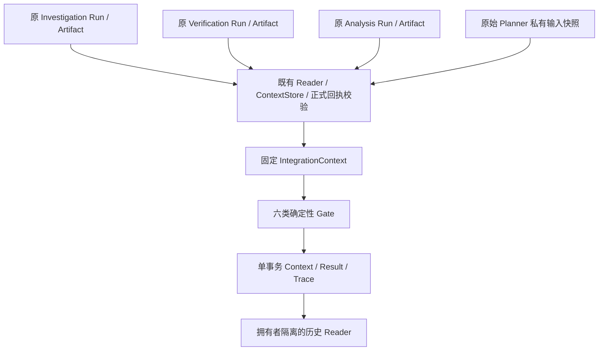

# Phase 11-C Integration Gate 完成报告

日期：2026-10-09T16:35:56+08:00。正式实施授权：`attachments/e694c611-bc20-4db9-9636-5f52bdc2f0a5/Pasted text.txt`。依据：`PHASE_11C_PLAN.md`、上一阶段报告及真实源码。

## 1. 最终实施状态

**工程验收：PASS。** Integration Gate 内部显式调用、六类确定性检查、统一结果、原子持久化与回读已实现。最终全量 **1169/1169** 通过；原 **1058** 项逐用例保留，新增 **111** 项，失败/错误/跳过均为 **0**。单次独立审查发现的两项 Important 均复现并修复；一项 Minor 留作已披露限制。

这里的 PASS 是本阶段工程验收，不表示每个调查均能业务 PASS，不表示公网生产准确率或获奖结果。开发止于 Phase 11-C。

## 2. Gate 实际架构



入口为 `IntegrationService.evaluate(request, actor=...)`；读取为 `read(integration_id, actor=...)` 和 `read_trace(...)`。由可信上层显式调用，没有插入 Scheduler 核心循环，没有新增第四个 LLM 裁判 Agent。Gate 不调度工具、模型或恢复任务，不重新执行调查、证据裁决或风险计算。Reader 复用旧系统既有保护字段/回执验证，属于来源校验。

## 3. 三 Agent 跨 Run 关联方案

三个不同 Run 可以产生统一结果。每个输入保留原 `run_id/task_id/artifact_id/schema_version`，按 actor 隔离读取。Verification 的原固定来源须准确消费选中的 Investigation；Analysis 的固定输入须准确消费选中的 Investigation 与 Verification。复用正式工具回执、旧 Reader 和固定 ContextStore，并验证正反向 Planner→Runtime 关联、原始请求摘要、Artifact 和上下文指纹。

`logical_investigation_id` 仅用于分组，由拥有者、调查根 Run、目标摘要派生，不是授权凭证。错误跨任务/跨来源/跨拥有者/Schema/快照关系拒绝。源 Run、Context 与 ToolCallRecord 输入输出纳入指纹；采集前后、早期观察及提交前复查，不修改原标识或候选证据。

## 4. PARTIAL、错误与取消处理

必需任务缺失、PARTIAL、未结束或依赖阻塞产生 `REPLAN_REQUIRED`，不修改旧状态，不绕过既有依赖机制。仅可将独立 root `evidence_search` 支路标为 optional；选中的任务、其祖先或被下游依赖的任务不能 optional。核心事实完整而独立可选来源失败可 `PASS_WITH_WARNINGS`。

来源冲突需要专业判断为 `HUMAN_REVIEW_REQUIRED`；程序/协议/资源清理类异常及取消为 `FAILED`。已知可恢复数据缺口与未知程序错误分开。概览中正常领域 UNKNOWN 可披露，不能掩盖必要工具部分执行。

`GateControl` 只用于内部协作式取消/期限；捕获前后、评估后、写成功前检查，flush 后晚取消回滚成功写入。DB 原 statement_timeout 为 30 秒，不承诺立即打断 SQL。存储故障返回 `FAILED / NOT_STORED`，不伪造可读成功回执。

## 5. 用户目标与范围处理

唯一旧生产文件改动是在 Planner 私有审计中增量保存原 `PlannerInput` 和原摘要算法哈希，规划逻辑、公开 DTO、Provider、旧入口不变。验收基于这个原输入，不能以 LLM 缩小后的 objective 代替原要求。

三种 Profile 为 `overview_v1`、`asset_impact_v1`、`asset_risk_v1`。原问题要求资产影响/修复/风险时，概览 Profile 不能削弱最低条件。精确修复版本或实际利用验证需额外条件；静态 POC 候选不满足实际利用验证。

已识别近/最近/过去 N 天仅支持 1–365；0 或超过 365 明确 `UNSUPPORTED_TIME_SCOPE / REPLAN_REQUIRED`，多窗口 `AMBIGUOUS_TIME_SCOPE`。缺原始范围的历史行不伪造回填，正常为非 PASS；新结构化目标必须显式指定并标记 `NEW_EXPLICIT_OBJECTIVE` 警告，只覆盖新目标。

## 6. IntegrationContext

固定请求引用、拥有者、逻辑调查标识、原始 ObjectiveContract、目标/input 摘要、评估时钟、I/V/R 类型化 Artifact、核验源快照、资产快照、必要/可选任务终态及依赖、原 Run/Trace 引用、来源指纹、捕获检查、规则版本。

外部请求只能传标识与受限新目标，不能直接塞业务 Artifact。Context 从既有读取机制创建；类型、重复身份、旧 Schema、有限数字和数量/大小均校验。请求 64 KiB、Context 4 MiB、Result 512 KiB、审计 8 MiB。超限或 NaN/Inf 明确拒绝，不截断关键事实来通过验收。

## 7. IntegrationResult

保存 integration/logical/trace ID、源 Run、唯一最终状态、目标覆盖、任务完成摘要、全部 GateCheck、通过/失败检查、阻塞/警告/未解决项、Artifact 与 Evidence 引用、Replan 与人工复核原因、输入/目标/规则摘要和固定评估时间。

只有 `PASS` 与 `PASS_WITH_WARNINGS` 有 `final_result_references`；非 PASS 保留 `partial_result_references`，不把不完整产物包装为最终可信答案。Result 标记 `historical_snapshot=True` 及 `STORED/NOT_STORED`。

## 8. 六类验收规则

| Gate | 实际行为 |
| --- | --- |
| Task Completion | 必要阶段/任务/依赖/终态、必需部分失败、独立可选来源、取消和程序错误 |
| Artifact Integrity | 类型与身份、正式来源和上下游引用、Claim 值/范围/revision、EvidenceRef 闭合、损坏拒绝 |
| Evidence Coverage | 决策事实须消费已核验、直接、权威、可追溯的支持；来源血缘分组不按转载 URL 数加分 |
| Cross-Agent Consistency | UNKNOWN 不转 NOT_AFFECTED，REJECTED 不作确定风险事实，候选不转实际利用，精确修复有匹配确认证据 |
| Objective Satisfaction | 针对原漏洞/资产/组件/部署版本和必答项；普通修复未知与精确修复缺口分开；概览合理弃答可披露 |
| Freshness / Unresolved | 来源类型和请求窗口分别检查，核验及库存独立预算；缺失/未来时间和未解决问题显式记录 |

静态来源默认30天，概览90天，当前查询7天；已知利用默认7天，当前1天；核验默认7天/概览90天/当前24小时；库存默认7天/当前24小时，未来偏差5分钟。旧 B2 的30天来源门槛仍有效。近期问题按公告 publication 检查，不以刚抓取代替刚发生；没有的修改时间不补造。

## 9. 状态决策优先级

`FAILED (FATAL) > HUMAN_REVIEW_REQUIRED > REPLAN_REQUIRED > PASS_WITH_WARNINGS > PASS`。

全量运行六类已注册规则；混合问题形成一个状态且保留全部原因。confidence 或来源数量不单独裁决通过。状态聚合用穷举4⁴阻塞组合与排列验证；未为此安装属性测试依赖。

## 10. Trace、正式回执及幂等

复用原 AgentRun 私有审计类型 `integration-gate-v1`，不是假装第四个专业 Agent 已执行。一个事务保存固定 Context/Result/Trace 与各哈希。Trace 包含逻辑 ID、原 Run/Artifact、规则版本、六类检查、阻塞原因、证据指针、状态、耗时及固定错误码。

公共 Result/Trace 的 URL 删除 userinfo/query/fragment，大小写/空白正常化；常见授权头、API Key、client_secret、token locator 键脱敏；公开 lineage_key 为稳定 SHA-256 摘要。原证据私有快照保留以核验哈希，不可直接公开。异常日志仅固定码和 integration_id，无连接口令或异常原文。

actor/key 使用既有 PostgreSQL advisory lock。同 key 不同请求抛 IdempotencyConflict；有效、重新捕获且输入指纹相同复用旧结果和时间，Artifact/源快照/回执/时间有效性改变形成新修订。历史 Reader 按固定 Context 校验拥有者/版本/哈希/绑定并回放，不刷新实时数据。来源捕获失败按次保存审计，属于 Minor M1 限制，见第18节。

## 11. 新增文件清单

本阶段新增核心交付 **18 个生产文件、12 个测试/夹具文件，2 个文档，共 32 个文件**。计划预计16个生产文件，实际18个：独立公共规则辅助模块 `rules_common.py` 与公共指针脱敏模块 `redaction.py` 支撑真实边界；没有空占位文件凑数。测试按职责归并成12个实际文件，而非按预计15个文件凑数；时效规则根据正式指令细分类型/查询，不沿用原计划尚未实施的统一预算。

| 生产文件 | 职责 |
| --- | --- |
| `backend/app/integration/__init__.py` | 模块边界声明 |
| `backend/app/integration/completion.py` | 必需/可选任务完整性 |
| `backend/app/integration/consistency.py` | 跨 Agent 事实一致性 |
| `backend/app/integration/contracts.py` | 请求、Context、Result、Trace 与限额协议 |
| `backend/app/integration/evaluator.py` | 纯规则验收与统一 Result |
| `backend/app/integration/evidence.py` | 已核验证据的使用门禁 |
| `backend/app/integration/freshness.py` | 类型/查询时效与未解决事项 |
| `backend/app/integration/integrity.py` | Artifact 和引用完整性 |
| `backend/app/integration/objective.py` | 原始请求范围解析、覆盖判断、超范围时间阻塞 |
| `backend/app/integration/profiles.py` | 受限目标 Profile 与原问题最低验收条件 |
| `backend/app/integration/reader.py` | 拥有者隔离的固定历史回读 |
| `backend/app/integration/redaction.py` | 公共证据指针脱敏与来源血缘摘要 |
| `backend/app/integration/registry.py` | 六类规则固定注册 |
| `backend/app/integration/rules_common.py` | 确定性状态聚合与证据查找辅助 |
| `backend/app/integration/service.py` | 显式上层入口与取消/失败处理 |
| `backend/app/integration/snapshot.py` | 既有 Reader、固定快照、回执与跨 Run 来源绑定 |
| `backend/app/integration/store.py` | 原 AgentRun 原子审计、有效输入幂等、失败尝试留痕 |
| `backend/app/integration/trace.py` | Integration Trace 组装 |

测试/夹具文件：

- `backend/tests/integration/__init__.py`
- `backend/tests/integration/conftest.py`
- `backend/tests/integration/helpers.py`
- `backend/tests/integration/test_boundaries.py`
- `backend/tests/integration/test_contracts.py`
- `backend/tests/integration/test_end_to_end.py`
- `backend/tests/integration/test_isolation_limits.py`
- `backend/tests/integration/test_review_regressions.py`
- `backend/tests/integration/test_rules.py`
- `backend/tests/integration/test_service.py`
- `backend/tests/integration/test_snapshot.py`
- `backend/tests/integration/test_trace_redaction.py`

文档：`PHASE_11C_RESULT.md`、`docs/INTEGRATION_GATE_IMPLEMENTATION.md`。

实施工具、原备份、过程报告、JUnit、日志、审查及资源清理证据另存 `work/integration/`，不计入生产/测试文件。证据文件清单见 `evidence_manifest.json`；生成的 Python 缓存与数据库内部文件不作为代码交付。

## 12. 修改文件清单

**旧生产文件仅 1 个：`backend/app/planner/trace.py`**，只增量写入原输入快照/摘要的私有审计字段。备份 `work/integration/planner_trace_before.py` 与原哈希吻合。原测试、Runtime/DAG/Scheduler/Executor/三个 Agent/Tool Gateway/Model Gateway/Hybrid Retrieval/数据库模型与迁移/旧 API/前端未修改。

另更新已有计划文档 `PHASE_11C_PLAN.md`：只在末尾追加正式实施进度，保留原审批计划内容，原字节备份为 `work/integration/phase11c_plan_before.md`。因此已有文件的总修改范围是1个旧生产文件和1个计划文档。

## 13. 实际测试结果

| 运行 | 用例 | 失败 | 错误 | 跳过 | 耗时（秒） |
| --- | ---: | ---: | ---: | ---: | ---: |
| 新鲜基线 baseline | 1058 | 0 | 0 | 0 | 442.656 |
| 最终新增 targeted | 111 | 0 | 0 | 0 | 137.187 |
| 修复后最终全量 full_suite_final | 1169 | 0 | 0 | 0 | 555.109 |

原1058项用例与上阶段原用例逐ID计数对比：无缺失、无重复；新增111项。完整证据：`baseline.json/xml/log`、`gate_final.json/xml/log`、`full_suite_final.json/xml/log`、`acceptance_audit.json`，位于 `work/integration/`。

环境：Windows、Python 3.12.14、现有依赖、PostgreSQL 17.11，两个本机专用 `aegis_phase5_test` 库（55435 Runtime、55437 Legacy）。运行配置覆盖应用数据库URL，未使用生产库、付费模型或新增依赖。

实际入口（工作区根目录）：

```powershell
& work/integration/run_tests.ps1 baseline -q
& work/integration/run_tests.ps1 gate_final -q tests/integration
& work/integration/run_tests.ps1 full_suite_final -q
```

Runner 实际 Python 参数记录于每次 JSON：

```text
pytest -q -p pytest_order --junitxml=C:\Users\X\Documents\Codex\2026-10-03\files-mentioned-by-the-user-9\work\integration\baseline.xml
pytest -q tests/integration --junitxml=C:\Users\X\Documents\Codex\2026-10-03\files-mentioned-by-the-user-9\work\integration\gate_final.xml
pytest -q -p pytest_order --junitxml=C:\Users\X\Documents\Codex\2026-10-03\files-mentioned-by-the-user-9\work\integration\full_suite_final.xml
```

保留原收集方式。旧 B2 有收集时创建的未来时间参数，慢测试会使样本超过其判定时间边界；沿用之前的收集后排序插件先执行这个旧文件，原测试/断言不改、全部仅执行一次。原序和执行序保存 `_order.json`。新时间规则使用注入时钟。

最终全量有23个 warning：22个来自故意用 model_copy 构造非法 enum 的反例，1个旧 Starlette/AnyIO 弃用提示；没有隐瞒或跳过失败。早期 RawDocument append-only 夹具错误通过新增标记的合成来源修正，没有修改原原始记录。一次过程测试误重叠使用专用库已记录；不用于验收，最终 targeted/full 均串行重跑。

修复后的首次全量曾为1166/1169，三个未修改的旧Windows进程测试失败：一次读取 readiness 文件 PermissionError 导致尚未发取消指令，另外两次在 cleanup_verified 后立即读取后代存活状态不一致。原失败证据完整保留 `full_suite_post_review_attempt1.json/xml/log`。这三个旧测试文件随后原样单独运行11/11通过，再完整重跑才得到上表最终结果；没有修改旧断言、自动吞错或使用重试插件覆盖失败。瞬时文件访问/进程退出时序的底层根因未完整证明，作为旧系统可靠性限制保留，不能将最后一次通过解读为已根治。

## 14. 单次独立审查与修复

只执行 **1 次独立最终审查**。原报告保留在 `work/integration/final_review.md`：0 Critical、2 Important、1 Minor，审查的是修复前源码；没有伪造修复后第二份“无问题”审查。

| 问题 | 处理与验证 |
| --- | --- |
| I1 常见凭据与大小写 URL 泄漏公共指针 | 规范化凭据键、scheme/空白，URL 移除凭据/查询/片段，公开来源血缘改摘要；Result 与 Trace 同时检查哨兵秘密，原私有上下文不变 |
| I2 已识别超范围 N 天被丢弃 | 不支持的数字窗口显式 scope_gap，目标 Gate 强制 REPLAN；覆盖0、366、极大值和1/365边界，实际捕获链也验证非 PASS |
| M1 捕获失败重复追加审计 | 未做额外代码去重，准确收窄文档保证：仅有效输入复用；按次失败审计增加但无原业务副作用，后续单独优化 |

I1/I2 反例 RED：15项中12失败/3通过（`review_red`）；增强 Result/Trace 链 RED：1失败（`review_trace_red`）。修复 GREEN：16/16（`review_green`）；补充实际捕获链时间阻塞后，最终新增111/111及全量1169/1169通过。修复对应关系另见 `review_resolution.md`。Important/Critical 无已知未修复项；未将审查未评估领域当作通过。

## 15. 与旧系统兼容性

`acceptance_audit.json` 对本次变更前哈希与上阶段最终哈希联合保护：旧文件未删除，唯一变更是 Planner 私有审计扩展；原文件备份验证成功。原1058个测试及上一阶段用例全部保留通过。

Gate 没有旧入口生产调用点或新增HTTP路由；默认网页/API/Agent调用仍沿原链。Gate 只增加自身审计，不改原 Claim/Evidence/Review/Conflict/资产/匹配/风险快照和原AgentRun状态。既有量化表计数断言通过，所有SQL/迁移测试只在隔离库执行。未宣称另做人工浏览器UI或生产部署验收。

## 16. 实际跨 Agent 内部闭环证据

**三个不同 Run 已通过实际后台服务、Runtime、工具进程和 PostgreSQL 得到一个带完整证据引用的统一 IntegrationResult，并成功回读 Result 和 Trace。**

| 阶段 | 最终全量执行中的原 Run ID |
| --- | --- |
| Investigation | `23777665-aba9-458a-b622-09e955cc4a5f` |
| Verification | `db96e800-c5b4-4c4b-9de7-afc052dec5ce` |
| Security Analysis | `c610f6dd-ba66-436f-a190-8a92f9ab266c` |

- integration_id / trace_id：`885cc480-a455-4e0b-badb-c094543e74d6`。
- logical_investigation_id：`b23a5110-7b3c-5f4a-b999-7164759f2f01`。
- 状态：`PASS`；持久化：`STORED`；源 Run 数：3。
- Artifact 引用：3；Evidence 指针：3；Trace Gate 类别：6。
- 原业务表计数前后相等：`True`。

证据文件：`work/integration/actual_chain_receipt.json`，标记 `synthetic_not_production=true`；该文件由实际链测试写出，非手工拼接永久PASS JSON。调查种子、独立官方风格公告、CVSS、修复Claim与拥有者库存均为明确合成测试数据，Planner 使用受控 Model Gateway 输出。

测试程序先显式调用现有三服务得到正式引用，Gate 自动读取校验整合并保存/回读；没有实现网页提问自动调度三Agent的一键闭环。另有真实服务链的 UNKNOWN/概览/可选缺失/必需PARTIAL/被阻塞依赖/冲突场景，分别得到预期非PASS或有警告状态。

## 17. 真实模型、数据及跨平台未验证事项

没有调用付费商业模型、抓取公网实时情报、使用真实部署资产，未评估模型规划准确率、生产安全准确率、延迟/吞吐/成本、公开API/UI端到端或Linux跨平台表现。现有工程测试不替代这些评测。没有实际执行漏洞利用；POC关联和KEV只按原证据含义使用。

## 18. 遗留工程风险及资源清理

1. 无Git：保留原哈希、备份与独立过程证据；未创建虚假的提交或工作树。
2. 无密码学签名：来源校验依赖可信后端和数据库审计边界，不能抵抗管理员整体重写。
3. 来源读取跨多个Session，不是全表原子快照；前后指纹和提交前复查减小混读风险，最终复查至提交仍有极小并发窗口。
4. 取消是协作式并受旧SQL超时约束，不承诺立即中断阻塞数据库读取。
5. 目标识别受限，单漏洞、有限语句和结构化范围；日历日期、多漏洞批量、任意自然语言意图、完整公告更新时间尚未支持。
6. M1：相同无效来源反复请求会保存同 input_hash 的多个失败审计行，以actor/key/hash关联，无专门 predecessor 字段；不产生业务副作用，但可能增长历史。有效输入才有精确回执复用保证。
7. 公共指针过滤覆盖明确常见凭据和URL结构，不宣称检测任意自由文本中隐藏秘密。私有Context含原证据，必须保持可信内部访问。
8. 时效预算属于工程规则，尚未经真实生产数据校准。新规则版本/迁移需明确历史回放兼容，不能直接换常量后假装旧结果仍适用。
9. 未改动的旧Windows进程测试有本轮记录的偶发失败；专门重跑及最终全量成功，但文件权限瞬变和进程退出时序未根治。应后续独立诊断，不能据此宣称取消/清理在所有环境均无竞态。

专用测试资源已清理：两个拥有者记录匹配、路径/端口/PID验证过的 PostgreSQL 实例已停止，pid文件删除及原进程退出均确认；数据库文件和全部证据保留。没有关闭电脑或停止用户网页/无关服务。证据：`work/integration/resource_cleanup.json`。

## 19. 下一阶段建议与停止边界

建议下一阶段单独授权上层三Agent调查编排和 Answer Envelope 接入：在保持既有协议下把最终Gate状态/受限结果/人工复核或补充调查原因展示给用户，再规划相应入口和评测。

本阶段不实现自动Retry/Replan、Human Review工作流、前端Agent Trace、公网API、AegisBench、真实模型性能优化或Docker/服务器部署。Phase 11-C 已交付并停止，等待后续指令。
