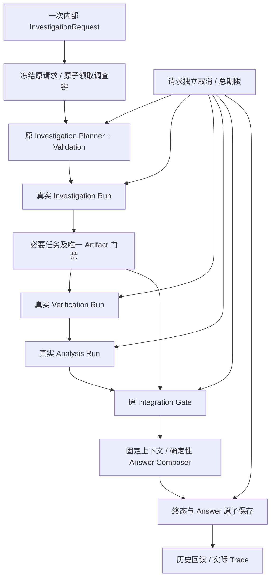

# AegisAI Phase 11-D 完成报告

验收日期：2026-10-10，Asia/Shanghai。执行依据：获批 `PHASE_11D_PLAN.md` 与附件 `79e23e44-95de-4050-ad80-4a133c227c8b/Pasted text.txt`。本阶段不接入网页，不进入 Phase 12。

## 1. 阶段验收状态

**PASS**。D1–D4 已完成；最终全量 **1261/1261 通过**，新增 92 项、保留原有 1169 项，0 失败/错误/跳过。一次独立审查发现均已失败复现、修复并验证；真实三 Run、Gate、持久化回读及专用服务清理证据齐全。停止在 Phase 11-D。

所有端到端输入均为明确标识的合成数据，模型只提供受控 Mock 计划。业务执行使用实际生产服务、三个专业 Runtime/Agent、Tool Gateway、原核验与风险算法、原 Integration Gate 和 PostgreSQL。没有预先灌入成功 Run 或成功 Artifact。

## 2. Orchestrator 最终架构

这是增量的上层同步服务，不是重新实现 Runtime、Scheduler、Planner 或第四个 Agent。内部入口为 `InvestigationOrchestrator.investigate()`，读取与控制方法为 `get_status()`、`get_result()`、`get_trace()`、`cancel()`。原网页默认 Assistant 入口不改变。

## 3. InvestigationRequest / InvestigationContext

请求复用 PlannerInput / QueryRequest，包含原始问题、目标、资产、组件版本、请求键；新增有限的 time_scope、用户上下文和选项。冻结前重新校验嵌套输入及 JSON，禁止依赖 `model_copy()` 绕过 Schema。请求键非空；禁止客户端扩大工具权限或预算。

Context 保存原请求及哈希、派生范围、原问题对应的 Objective、owner、根 logical ID、Planner ID、三个实际 Run ID、三个 ArtifactRef、Gate revision ID、Gate 自己的 logical ID、输入/目标哈希、答案 ID、阶段私有键、事件、取消/期限及 revision。

阶段与业务结论分开：CREATED → PLANNING → INVESTIGATING → VERIFYING → ANALYZING → INTEGRATING → COMPOSING，再进入终态。COMPLETED 也可能表示 INCOMPLETE，必须读取 overall_status / answer_status。

目标或版本冲突拒绝；多个目标、POC 完整性、不支持的历史快照/时间范围记录阻塞 gap。日历日期、中文数字天数、周/月限制不会静默变成当前概览。保留原请求，派生输入只补充明确目标/组件，旧解析器与 Gate 不改动。

## 4. 三 Agent 自动执行与交接

上层调用原 Investigation 的正式规划、验证和 Runtime；从实际绑定后的 TaskPlan 与 Reader 获取 Artifact。只接纳唯一、与原目标一致的调查产物，不任意取第一项。

Investigation → Verification → Analysis 传递真实 `(run_id, task_id, artifact_id, schema_version)`。Verification 输入不启用模型裁决，Analysis 复用原版本/风险引擎与资产归属检查。三个 Run 独立保存，未合并或伪造。

必要任务 PARTIAL / FAILED / BLOCKED / 缺失阻止后续 Agent；只有服务端可证明是非必要独立叶节点的检索失败可标为可选。完整无执行错误的冲突观察可交独立 Verification，原 WAITING_REVIEW 不改为 SUCCESS，也不解锁原 DAG。

## 5. Gate 接入

实际调用原 IntegrationService，保存上层/原 Gate 双 logical ID、原目标哈希、输入哈希、Artifact 引用及固定上下文。未改变 Gate 六类检查或裁决算法。

| 原 Gate 状态 | Answer 状态 | 上层 overall_status |
|---|---|---|
| PASS | COMPLETE | SUCCEEDED |
| PASS_WITH_WARNINGS | COMPLETE_WITH_WARNINGS | SUCCEEDED_WITH_WARNINGS |
| REPLAN_REQUIRED | INCOMPLETE | INCOMPLETE |
| HUMAN_REVIEW_REQUIRED | REVIEW_REQUIRED | REVIEW_REQUIRED |
| FAILED | FAILED | FAILED |

没有 Gate 结果时的失败/取消不伪造 Gate 状态。REPLAN_REQUIRED 只是保存未完成结果，不触发自动重规划。

## 6. AnswerEnvelope

采用冻结、有限长的 `answer-envelope-v1`，最大 512 KiB。包含原问题、状态、模板摘要、已核验事实、争议 Claim、证据观察、已确认事实的 Citation、受影响资产、原风险观察、原建议动作、警告/缺失项、Gate/Trace/Run 引用和固定生成时间。

`verified_claims` 只接纳满足原 grounded 条件的 CONFIRMED Claim。`disputed_claims` 独立保留非确认评估、作用范围、结构化值、支持/冲突 Evidence ID；不会进入确认事实。`evidence_observations` 保留核验快照全部支持及冲突证据指针、来源 UUID、哈希、完整性、直接性及原状态；被列入并不表示可信。

`agent_run_references` 是实际启动的三个 Run 子集，即使 Gate 捕获失败也保留；`accepted_source_run_references` 是 Gate 成功捕获的来源子集。两者与根 Trace 绑定，不能把失败 Run 当成已接纳事实。

UNKNOWN 不是安全，候选 POC 不证明利用有效，Patch 存在不证明已应用。非 PASS 风险/动作均标为 OBSERVATION；FAILED/CANCELLED 不交付确定事实或风险结论。

## 7. Answer Composer

纯确定性投影；不调用模型、数据库、工具或公网服务，也不重算核验/风险。数据来自已固定的 IntegrationContext / Result。精确修复版本或补丁必须关联已交付的确认 Claim 与 Citation，否则仅保留保守提示。

不复制来源正文、私有 Prompt、原始模型输出和任意分析文本。reference 使用字段/类型/长度白名单：HTTP(S) URL 清除凭据、查询与 fragment；locator 仅允许位置字段，拒绝任意摘录、自由备注、私有 Prompt、嵌套对象。原始问题按需求保留，因此内部读取接口不能直接冒充公网匿名导出。

## 8. 活动 Run 通知

旧 Runtime 增加可选 execution control，通知实际 Run 开始/结束并绑定当前 Executor。旧 InvestigationService 增加可选 Planner observer，记录真实 Planner ID、状态并在 Runtime 前检查。默认没有 control/observer 时沿用旧行为。

运行中 Planner 正向 Run 链接尚未写入是合法中间状态。Trace 通过实际 Run 的 owner、类型和 plan.route.planner_run_id 反向校验；正向链接写入失败后仍能读取真实 Run。非空正向错配或伪造反向链接拒绝。

## 9. 取消与总超时控制

默认上层预算 300 秒，请求可以收紧；与原 Task/Run 预算取较小期限。取消持久化，模型返回后、阶段启动前、Gate 前后、封存前均检查。创建与取消共用短 advisory lock，判断谁先提交。

控制器只绑定本次调查 Executor，不取消其他调查。活动工具子进程沿用原 Windows ProcessSupervisor / Job 清理；测试使用实际父子进程验证停止。取消先提交时不能随后保存成功答案；成功封存已提交后取消不改写历史。

同步模型请求不能由本层立即中断，须等 Provider 返回或已有超时，再停止后续阶段。该限制明确纳入验收边界。无无界重试；最多两次原规划尝试、三个专业 Run。

## 10. 幂等和并发策略

actor / agent_type / request_key 作为原子领取边界。同键同内容复用已有根与答案；同键不同内容拒绝。request_id 不参与语义哈希。并发重复请求只返回同一 RUNNING 快照，不启动第二个规划链。

根写入使用行锁、worker token 和 revision，阶段使用独立派生键。进程总并发上限 2，实例可收紧到 1；BUSY 不创建新根。这不是分布式全局配额。

## 11. 持久化及历史读取

复用 AgentRun，专用类型 `investigation-orchestrator-v1`、命名空间 `orchestration_v1`；不新增表/迁移，不写 Claim/Evidence/Review/资产。答案与终态在同一事务保存。

历史读取一次原子快照，验证 owner/type、请求/范围/Context/Answer 哈希及固定 Gate 绑定，并重新做确定性答案组合。改写后重新哈希的伪答案仍拒绝。当前来源变化不偷偷改写历史答案，也不重复调用 Gate。

数据库写入及确认同时失败时，返回最后观测的 RUNNING 快照、NOT_STORED、恢复需求和固定错误码，不谎称保存成功；提交结果未知时也不武断断言事务一定未提交。lease 过期只提示人工恢复，没有自动接管。

开发过程中本阶段自身的候选协议记录保留在专用测试库。候选 Answer 与最终字段不一致时，最终 Reader 显式拒绝；没有覆盖、删除或迁移旧快照。这些未交付的合成原型记录不是既有用户历史；Phase 11-C 及之前的业务历史接口与 Schema 未改动。

## 12. 修改文件清单

新增生产 15 文件：

| 路径 | 作用 |
|---|---|
| backend/app/orchestration/__init__.py | 包入口 |
| backend/app/orchestration/contracts.py | 请求、范围、生命周期与结果协议 |
| backend/app/orchestration/scope.py | 原请求范围适配 |
| backend/app/orchestration/lifecycle.py | 阶段和终态约束 |
| backend/app/orchestration/store.py | 原子领取、状态、取消与封存 |
| backend/app/orchestration/control.py | 本次调查控制与监控 |
| backend/app/orchestration/handoff.py | Artifact 选择和阶段门禁 |
| backend/app/orchestration/adapters.py | 复用真实服务及控制绑定 |
| backend/app/orchestration/service.py | 调查总控 |
| backend/app/orchestration/answer_contracts.py | 有限、结构化答案协议 |
| backend/app/orchestration/answer_sources.py | 固定 Gate 来源读取与绑定 |
| backend/app/orchestration/composer.py | 保守答案投影 |
| backend/app/orchestration/reader.py | 历史答案回读与校验 |
| backend/app/orchestration/trace.py | 受控实际执行链 |
| backend/app/runtime/control.py | 可选兼容控制协议 |

修改旧生产 3 文件：`backend/app/runtime/service.py` 与 `backend/app/agents/investigation/service.py` 增加上述两个兼容 hook；`backend/app/runtime/process.py` 增加必要的 Windows 进程退出确认局部修复。原始备份在 `work/orchestration/backup/`，精确差异见 `authorized_hooks.diff` 和 `local_process_confirmation.diff`。

第三份旧文件的调整依据正式指令“两个最小兼容扩展及必要的局部修复”。原因是两轮完整回归中原有进程清理断言仍观察到存活 PID；仅 Job 计数为空不能作为进程对象已退出的充分依据。局部修复先获取并校验本 Job 的有限进程句柄，发出原终止请求后同时确认计数为空和这些句柄已收到退出信号，最后关闭句柄。保持原两秒清理预算、旧断言及 POSIX 行为。4 项新增测试先失败再通过，连同原进程测试专项 23/23 通过，最终全量回归另行验收。不是 Scheduler 或 Runtime 重写。

新增测试 13 文件：`backend/tests/orchestration/` 下的 __init__.py、conftest.py、fixtures.py、test_actual_chain.py、test_answer_composer.py、test_contracts_scope.py、test_failure_cancel.py、test_handoff.py、test_legacy_compat.py、test_lifecycle.py、test_reader_trace.py、test_runtime_control.py、test_store_idempotency.py。

交付两份文档：本报告及 `docs/INVESTIGATION_ORCHESTRATOR_IMPLEMENTATION.md`。额外 `work/orchestration/` 文件仅为测试运行器、排序适配、只读取证、报告校验、备份、日志/哈希/回执；无新增正式依赖或业务模块。

## 13. 新增测试

最终新增测试 **92/92** 随最终全量回归真实通过，0 失败/错误/跳过，用例耗时合计 208.987 秒。`final_new_green.json/.xml/.log` 从实际 `full_suite_final.xml` 提取，标记 NOT_ANOTHER_TEST_RUN，不虚构另一次运行。此前独立新增 85/85、Composer 12/12 和进程修复专项 23/23 的运行记录另行保留。覆盖请求/范围、生命周期、原子并发领取、owner/type、revision/worker、取消、期限、实际三 Run、五类 Gate 状态、必要/可选失败、歧义、实际进程树停止、答案封存、数据库故障、历史防篡改、运行中 Trace、冲突证据交付与嵌套 locator 投影。

单元 Handoff/状态投影测试明确标为 unit；最终链路测试不替换 Planner/Runtime/Agent/工具服务，也不预生成成功 Artifact。没有跳过测试来取得通过结果。

## 14. 全量回归测试

最终完整回归 **1261/1261 通过**，exit_code=0，失败/错误/跳过均为 0，运行器耗时 700.235 秒。真实命令、完整日志和 JUnit 为 `work/orchestration/full_suite_final.json/.log/.xml`。日志另有 23 条原负向测试的 Pydantic 枚举序列化警告，完整保留；不将警告称为错误或隐去。清理修复后的源文件哈希与测试开始前一致。

必要进程修复前第二轮完整回归为 1255/1257，2 项旧超时后进程存活断言失败，699.485 秒；该结果、PARTIAL 检查点及清理记录保存在 `*_before_process_confirmation_fix` / `partial_*_checkpoint`。局部修复新增 4 项测试先失败，随后 23/23 专项通过；最终使用这次全量实际通过结果验收，未删除旧断言或失败证据。基线 1169 项完整保留，最终收集 1261 项，新增 92 项。收集覆盖与实际运行分别取证，collect-only 不算执行通过。

候选全量 `full_suite_candidate` 实际 1244/1245，通过 1244、失败 1、错误/跳过 0；原 Planner 四阶段资产链发生真实 TASK_TIMEOUT，后继 RUN_TIMEOUT/阻塞，没有工具回执。证据已保存；同一旧测试单独复跑 1/1 通过不能代替全量验收，也未归咎于本次 hook。

`full_suite_before_locator_format_fix` 在 C1 格式限制补充复现后主动中止，242.157 秒，未完成所有节点或生成完整 JUnit，不计通过。保留的进度日志还出现一项旧 Analysis 进程测试失败标记；没有完整异常栈，不能推断原因或伪称它通过。最终以修复后新的完整执行验收。

修复后首轮完整 `full_suite_after_fixes_failed_regression`：1254/1257 通过、3 失败、0 错误/跳过，689.031 秒，新增 88 项均通过。失败为旧 Verification / Runtime 超时后立即检查进程存活各一项，以及旧并行调度严格时间戳比较：并行 barrier 成功，但 start/end 出现相等时间戳。`final_failure_diagnostic` 原样复跑这三项 3/3 通过，4.594 秒；单独复查仍不当作全量 PASS。全部失败记录保留，原测试/清理/调度核心未修改；随后再次完整回归，以最后实际结果验收。

最终运行保留全部旧测试断言、文件和节点。原 B2 的未来时间参数在收集时生成，为避免长 Windows 测试让它自然落入原五分钟有效窗口，仅在测试运行器中将这些旧节点提前执行；不改测试、不减少数量。旧数据库报告逐字节恢复，原报告不被新运行覆盖。

会话恢复时专用 PostgreSQL 已停止；两个 stale pidfile 所在的原任务目录经过绝对路径/端口验证后重启，数据库完成 WAL recovery。受中断影响的 `final_review_green`、`review_extra_boundaries` 保留为失败环境尝试，不计验收。新增日历 E2E 首次恢复后另有测试字段 `scope`→`resolved_scope` 误用，已修正测试并真实复跑；未修改生产规则或放宽断言。

## 15. 内部端到端真实执行证据

取证文件 `work/orchestration/final_e2e_receipts.json` 保存实际 Context、Status、Answer、受控 Trace。五种 Gate 状态、规划失败、取消及期限失败均有真实记录。

| 正式 PASS 链对象 | 实际 ID |
|---|---|
| 上层根 logical investigation | `df1a055d-1e72-4b8e-9a98-24c0abdf2016` |
| Planner | `83e04c21-8848-41a5-925b-0c96bffd305e` |
| Investigation Run | `64e3ff1f-b30d-42e3-85f7-4da55fa4f8fa` |
| Verification Run | `2e0d10d5-785f-4708-bd81-0b19afec5acb` |
| Analysis Run | `feb55222-e678-48a3-bcc5-ba990b1166c8` |
| 原 Gate logical investigation | `e8f312e4-92dc-5294-bb69-376b8b99832b` |
| Integration revision | `792110ae-d688-4f2f-ae42-fa9349033040` |
| Answer | `616e193c-5b44-5b7b-ab70-7ae2a5bfb279` |

实际三个 Artifact 引用：

- `investigation-artifact-v1`：Run `64e3ff1f-b30d-42e3-85f7-4da55fa4f8fa` / Task `lookup` / Artifact `211d35b3-2466-4f5a-a58d-4f673aa1c43a`。
- `verification-artifact-v1`：Run `2e0d10d5-785f-4708-bd81-0b19afec5acb` / Task `verify` / Artifact `f6036789-4258-4bd0-aae6-1be8a7e3f121`。
- `risk-analysis-artifact-v1`：Run `feb55222-e678-48a3-bcc5-ba990b1166c8` / Task `analyze` / Artifact `870b7b31-ea43-4064-9499-2aa2843d436f`。

五类 Gate 取证根：

- PASS：根 `df1a055d-1e72-4b8e-9a98-24c0abdf2016`，Gate `792110ae-d688-4f2f-ae42-fa9349033040`。
- PASS_WITH_WARNINGS：根 `b424b1e9-a1fc-4452-9a47-e9f287ad2b2b`，Gate `c7cbf8ba-2447-431b-af53-6941073594d1`。
- REPLAN_REQUIRED：根 `697e5139-784d-455f-958e-d4096d88fd99`，Gate `6d3a8a1c-a12a-4a88-a3a4-36fbafe9ad4a`。
- HUMAN_REVIEW_REQUIRED：根 `3225d7ec-994f-41c2-ac3b-5bfd7b5298fb`，Gate `08a8c2ba-61df-4b09-badc-5a5d2d1ce930`。
- FAILED：根 `380557e7-efd4-4d1c-b615-6ac26d1bce2e`，Gate `7e5142a8-77a0-45c6-bc08-44e2308d6487`。

确认事实 3 条，Citation 3 条，Evidence 观察 3 条。首条 Citation：Claim `604ab987-e98f-4438-9e7b-e2f219fd5b9a`；Evidence `e03fa204-710d-48b1-a535-8d83ce0f1d86`；hash `01c1f245152f21fca9213828e52fbead20933efb41bca2e4d7fc26d4c45d4b0d`。均保留原 Claim/Evidence/Source/RawDocument/Observation 引用；Trace 包含实际工具调用。

只读取证另列出 77 条开发原型或负向 Store 测试记录的读取拒绝，逐 ID/异常类型保留，没有删除或算作端到端通过；正式五类场景及最终回读来自上述实际执行。

受控输入只决定数据与规划响应；所有结果由实际服务产生。记录每次实际 Run、ToolCallRecord、ArtifactRef、固定 Gate 上下文、Answer 和 Trace。证据文件内 `synthetic_not_benchmark=true`，不构造情报准确率。

## 16. 独立审查发现与修复

只执行一次独立 fresh-context 审查，审查者 `phase11d_final_review`（gpt-6-astra / ultra）。独立核对 30 个候选文件与 366 个基线文件，原结论 1 Critical / 3 Important / 1 Minor，候选暂不可 PASS。完整发现与原证据在 `independent_review.md`，不是修复后复审。

| 发现 | 最终等级 | 修复及验证 |
|---|---|---|
| C1 嵌套 locator 可导出自由文本凭据/私有 Prompt | Critical | 显式字段/类型/长度白名单；嵌套泄漏测试 RED→GREEN |
| I1 非确认 Claim 与冲突 Evidence 引用未交付 | Important | 分离 disputed_claims / evidence_observations；真实 HUMAN 场景保留原ID/哈希且不提升结论，RED→GREEN |
| I2 合法运行中 Trace 在 Planner 链接前失败 | Important | 所有权、类型和实际反向链接验证；真实暂停运行 RED→GREEN，另验证链接失败后回读及伪造反向拒绝 |
| I3 不支持时间限定被静默丢弃 | Important | scope gap 阻止 PASS；五类文本 RED→GREEN，实际日历范围 Gate=REPLAN_REQUIRED |
| M1 FAILED / 歧义时漏掉实际 Run 引用 | Important（实施方重定级） | 实际启动 Run 与 Gate 来源区分；真实失败/歧义 RED→GREEN |

M1 重定级依据：AnswerEnvelope 是正式导出的交接协议，遗漏真实执行链会损失承诺的审计关联，即使根历史尚能找回也必须修复。所有五项先实测失败再修复；修复后以最终全量结果验收，没有第二次审查或伪称审查者复验。

五项均在 final_review_red / final_review_time_red 先失败；C1 位置格式另由 locator_format_red 3/3 失败后修复。最终实际 JUnit 中新增 92/92 与全量 1261/1261 通过，ledger 逐项记录修复和 RED→GREEN，无未解决的本阶段 Critical/Important。独立审查仅针对 30 文件候选；后续 31 文件最终树及必要局部修复由失败复现、专项测试、全量和哈希验证，没有第二次独立复审。

## 17. 与原项目兼容情况

366 个旧源码/测试/前端基线逐文件 SHA-256 对照；仅两个兼容 hook 与一份必要的局部进程修复，共三份旧文件改变，无旧文件缺失。前端、原 Assistant API、Planner、DAG、Scheduler、Tool/Model Gateway、I/V/R 业务算法和原 Gate 不变。默认无 observer/control 的运行路径有针对性旧回归及全量回归。

候选、修复前和最终代码分别保存哈希；最终源码必须与最终测试启动前一致。没有 Git，采用原始备份、精确 diff、哈希检查代替提交；没有创建或覆盖 Git 历史。

测试结束后验证绝对目录、pidfile、监听端口和进程关系，仅停止本任务 55435 / 55437 两套专用 PostgreSQL。`work/orchestration/cleanup.json` 记录 all_stopped=true、端口无监听、服务进程退出、preserved_cluster_files=true；worker_cleanup.json 另记录本阶段测试运行器与执行子进程无剩余。保留集群、审计、日志和备份；没有关闭本机或原网页服务。

## 18. 未完成或未验证的功能

没有进行 Phase 12 前端/API接入、用户可见 Trace/证据链、Docker 公网部署、商业模型准确率/成本评测、生产资产覆盖率、实时采集时效性、正式 AegisBench、完整人工复核流、任意日历查询、长期记忆或自动重规划。本阶段接口只向可信内部调用者提供。

这里的工程 PASS 不代表上述产品能力或比赛指标已通过。真实模型和在线情报待后续独立评测。

## 19. 剩余工程风险

同步模型 I/O 不能立即打断；单进程配额不等于多实例全局配额；内部 actor 校验不等于生产身份认证。没有实验覆盖所有断电/数据库故障/OS调度窗口，没有自动 lease 接管。哈希用于检测漂移与绑定错误，不是抵抗可重写整库的管理员的数字签名。

Windows 进程退出确认已针对复现路径做有界修复；测试通过不代表覆盖所有 OS 调度窗口，也不是运行恶意程序的沙箱认证。候选旧 Planner 超时与一次严格时间戳比较失败已如实保留，不臆断同一根因。审计和合成测试记录持续累积，已有单次 JSON/节点/工具预算不等于数据库自动保留策略。历史固定快照表示当时证据状态，不代表来源永远有效。

实施裁定按发生顺序全部保存在 progress.md：①无 Git 时使用获批备份/哈希，不创造仓库；②保留验收工作目录；③内部 actor 信任边界；④复用并最终停止两套专用库；⑤修正上层中文相邻 CVE 范围解析；⑥创建/取消使用短锁；⑦完整冲突观察交独立 V；⑧M1 按审计交接后果重定级；⑨审查排除的模型/认证/即时取消/分布式配额/崩溃恢复/签名范围不扩张；⑩旧超时只披露证据、不臆断归因；⑪最终测试/报告/清理仍是硬门禁。本轮没有未修复的 Minor：唯一原 Minor 已重定级并纳入修复。

最后裁定更正：曾把“两份旧文件”预估错误当成硬边界，保存 PARTIAL 检查点并停止专用库。重读正式指令后确认“必要的局部修复”已获授权，撤销该错误裁定，恢复实施；上述必要进程修复未要求额外许可。代价与回滚：新增一份旧文件差异及 4 项回归，原文件完整备份；回滚只撤销该 diff，但会重新暴露旧退出确认问题。检查点、失败结果和更正记录全部保留，没有把失败改写为通过。

## 20. 下一阶段建议

停止在 Phase 11-D。必要的局部退出确认修复及本阶段最终验收完成后，不再自动开发后续功能。

推荐下一阶段 Phase 12：在现有网页接入调查请求/状态/取消，展示实际三 Agent Trace、冲突证据、完整/未完成/人工复核状态；随后独立制定真实 AegisBench 与模型评测。上述工作均未提前实现，等待新的指令。

### 六项验收问题

| 问题 | 结论 | 实际依据 |
|---|---|---|
| Q1：一次请求自动调用真实三个 Agent Run？ | PASS | test_actual_chain 与正式 PASS 根的三个独立 Runtime/ToolCallRecord |
| Q2：Artifact 自动交接且保持证据引用？ | PASS | 真实 I→V→R ArtifactRef；原 Evidence ID/哈希；真实 HUMAN 冲突引用保留 |
| Q3：Gate 通过实际调用做全局验收？ | PASS | PASS、PASS_WITH_WARNINGS、REPLAN_REQUIRED、HUMAN_REVIEW_REQUIRED、FAILED 五类实际场景 |
| Q4：生成、保存、回读原引用 AnswerEnvelope？ | PASS | actual answer、重复回读、固定来源历史、重新哈希篡改拒绝与原子状态测试 |
| Q5：重复相同请求不重复执行？ | PASS | 同键完成复用、运行中并发复用、原子领取、实际 Run 数/模型调用数不增加 |
| Q6：取消/超时停止后续阶段并保留审计？ | PASS | 模型/验证边界取消、实际 Windows 进程树取消/期限、封存竞争；同步模型边界明确披露 |

证据索引：

- [final_new_green.json](C:/Users/X/Documents/Codex/2026-10-03/files-mentioned-by-the-user-9/work/orchestration/final_new_green.json)
- [full_suite_final.json](C:/Users/X/Documents/Codex/2026-10-03/files-mentioned-by-the-user-9/work/orchestration/full_suite_final.json)
- [final_collection_coverage.json](C:/Users/X/Documents/Codex/2026-10-03/files-mentioned-by-the-user-9/work/orchestration/final_collection_coverage.json)
- [final_e2e_receipts.json](C:/Users/X/Documents/Codex/2026-10-03/files-mentioned-by-the-user-9/work/orchestration/final_e2e_receipts.json)
- [independent_review.md](C:/Users/X/Documents/Codex/2026-10-03/files-mentioned-by-the-user-9/work/orchestration/independent_review.md)
- [progress.md](C:/Users/X/Documents/Codex/2026-10-03/files-mentioned-by-the-user-9/work/orchestration/progress.md)
- [final_source_hashes.json](C:/Users/X/Documents/Codex/2026-10-03/files-mentioned-by-the-user-9/work/orchestration/final_source_hashes.json)
- [process_confirmation_red.json](C:/Users/X/Documents/Codex/2026-10-03/files-mentioned-by-the-user-9/work/orchestration/process_confirmation_red.json)
- [process_capture_red.json](C:/Users/X/Documents/Codex/2026-10-03/files-mentioned-by-the-user-9/work/orchestration/process_capture_red.json)
- [process_confirmation_green.json](C:/Users/X/Documents/Codex/2026-10-03/files-mentioned-by-the-user-9/work/orchestration/process_confirmation_green.json)
- [local_process_confirmation.diff](C:/Users/X/Documents/Codex/2026-10-03/files-mentioned-by-the-user-9/work/orchestration/local_process_confirmation.diff)
- [cleanup.json](C:/Users/X/Documents/Codex/2026-10-03/files-mentioned-by-the-user-9/work/orchestration/cleanup.json)
- [worker_cleanup.json](C:/Users/X/Documents/Codex/2026-10-03/files-mentioned-by-the-user-9/work/orchestration/worker_cleanup.json)
- [delivery_verification.json](C:/Users/X/Documents/Codex/2026-10-03/files-mentioned-by-the-user-9/work/orchestration/delivery_verification.json)
