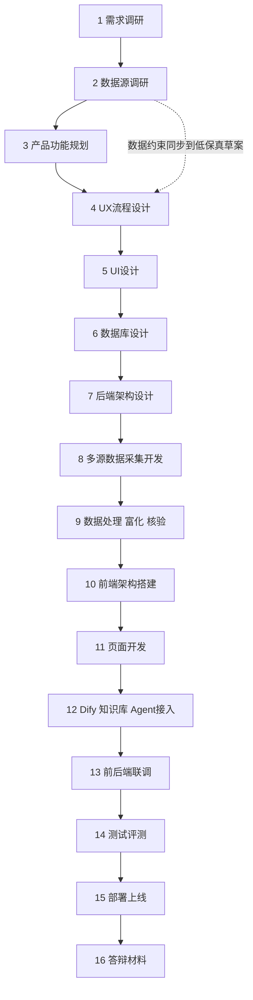

# AegisAI 项目开发路线

2026-10-03，长期采用16步开发流程。当前按用户文档落实Phase8资产/SBOM/版本命中/风险变化后停止，正式验收PARTIAL。Phase1—7设计与报告保持历史冻结；本阶段详细证据见[Phase8最终交接](reports/phase8/FINAL_SUMMARY.md)。阶段编号与长期16步不同，资产风险是后端情报应用能力；下一Phase9为Dify/混合检索/编排/多Agent，尚未启动。

需求调研 → 数据源调研 → 产品功能规划 → UX流程设计 → UI设计 → 数据库设计 → 后端架构设计 → 多源数据采集开发 → 数据处理/富化/核验 → 前端架构搭建 → 页面开发 → Dify/知识库/Agent接入 → 前后端联调 → 测试评测 → 部署上线 → 答辩材料。

## 当前进度与进入条件

| 步骤 | 主要结果与通过条件 | 当前情况 |
|---|---|---|
| 1 需求调研 | 必做/增强功能、评分点映射、Demo验收路径 | 13份需求文档、64条需求与20项评分映射已冻结；第2阶段完整复读 |
| 2 数据源调研 | 源目录、字段映射、权限/频率、真实样本、缺失和同源规则 | 完成13份源方案、35个候选调查、首批3源冻结与有限第二批；论文/正式标准/政策官方入口补齐。仅调研probe，无正式接入 |
| 3 产品功能规划 | 七模块的版本、操作、数据依赖与验收条件 | 冻结PRD/PAGE_REQUIREMENTS确定任务和分期，Phase 3 UX按其展开；PRODUCT_PLAN.md为历史草案 |
| 4 UX流程设计 | 发现→详情→证据、冲突复核、资产问答路径；加载/空/错误状态 | 用户指定Phase 3：完成design/ux/17份文档、六导航七页面五流程、低保真与逐元素数据依赖；仅设计 |
| 5 UI设计 | 七页面的效果稿、信息层级与状态规范 | 用户指定Phase 4完成：14份UI文档、七页离线高保真原型、54张截图、86项浏览器检查；业务数据和执行均为Mock，未搭生产前端 |
| 6 数据库设计 | ER、数据字典、约束、生命周期与产品操作对应 | 用户指定Phase 5完成：43表、16份必需文档+3份交接、迁移upgrade/downgrade/re-upgrade真库通过、45项检查全通过；无业务服务 |
| 7 后端架构设计 | 模块职责、接口契约、事务、重试、权限 | Phase6完成：独立Collector/Normalizer/Repository、逐条事务、统一HTTP重试与五个只读API；本机无认证，不宣称生产权限完成 |
| 8 多源采集开发 | 原始响应→标准化→DB；游标/修订/重试可回查 | Phase6三源真实1→10→100上限验证、失败恢复/增量/重放完成；278主体/347原文/198产品/19次SyncRun，有限覆盖/pending公开 |
| 9 处理/富化/核验 | 身份、版本、AI相关性、Evidence、候选和来源冲突 | Phase6已做确定性身份、基础产品/版本和AI相关性V0；Phase7已实现Evidence/POC/Patch/Vendor/EPSS/KEV、冲突、复核、门禁与Timeline，218项测试通过；28条人工样本仍待标注 |
| 10 前端架构 | 路由、API封装、类型、状态与权限 | 未开始；React/Vue和组件库在此步按UI及维护成本选定 |
| 11 页面开发 | 详情→列表→总览→监控，再扩复核、资产、问答 | 未开始；详情优先验证核心数据能力，导航仍以总览为首页 |
| 12 Dify/知识库/Agent | 可靠数据API工具、文档检索、引用回答与权限 | 可靠数据后开发，M1完整初赛必须有实际Agent/跨文档问答；Dify品牌待后续选型 |
| 13 联调 | 正常/加载/错误/空/分页/超时/权限场景 | 待真实前后端完成；避免用mock页面当作服务闭环验收 |
| 14 测试评测 | 工程回归、人工真值、Precision/Recall/F1、关联与版本指标、延迟 | 测试随每个开发步骤进行；此处集中做端到端和比赛评测。12条候选仍待人工确认，不公布虚假准确率 |
| 15 部署上线 | Compose、CI、health、日志、备份/恢复/重放 | 本机开发PG/API已运行，health/日志/原文重放可用；Compose静态检查，Docker/CI/生产部署/备份恢复未实测 |
| 16 答辩材料 | 技术报告、PPT、Demo视频、图表、对比实验和可复现记录 | 过程中保存实验/截图/结果；最终集中整理 |

## 本轮决策与工作边界

当前停在Phase8交付状态：手工资产、CycloneDX1.6/SPDX2.3、身份/版本比较、证据解释、优先级、风险变化、私有复核、针对性重算及API已实现。292项工程测试通过，49表/25历史保护，零ORM漂移。三个真实来源演示案例、34次最终回环接口验证和100组件实测完成。

正式验收PARTIAL：30条资产样本尚待真实人工标注，前阶段范围冲突/unsupported保留未知，不宣称最终Benchmark。所有资产为明确演示库存，未发现用户生产环境资产。Phase1—7的595份输入及原369份原文字节保持；0001/0002未修改，追加0003。

开发PG/API保持运行，专用测试库关闭，8768仍Mock。交付后停止，未进入Phase9；[阶段交接](reports/phase8/FINAL_SUMMARY.md)、[实测性能](reports/phase8/performance_final.json)和[限制](reports/phase8/KNOWN_ISSUES.md)。

第2阶段冻结CVE List、OSV、KEV三个入口，不能直接认定三个评分类别。M0是基础切片；完整初赛P0还需第二批不同类别的监测、论文/标准/政策知识、富化、自然语言跨文档问答及实际Agent。全部源选择和已知限制见research/data_sources/。

单个步骤可在前一步数据约束明确时启动草案；实际开发和验收按依赖推进。第14步集中评测与前面持续测试互相配合。当前不承诺16步已经实现，也不生成空端点、假复核结果或假资产命中。

相关入口：[数据源](DATA_SOURCES.md)、[字段映射](SOURCE_FIELD_MAPPING.md)、[功能规划草案](PRODUCT_PLAN.md)、[UX草案](UX_FLOWS.md)、[实际设计验证](design/verification.json)。
