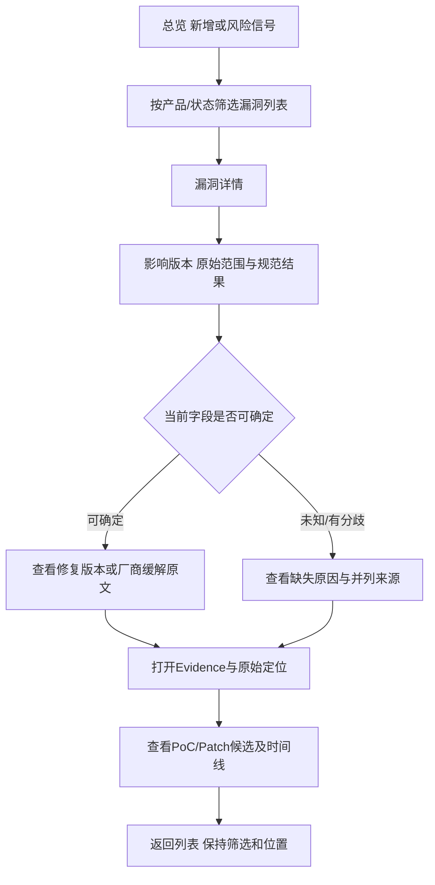
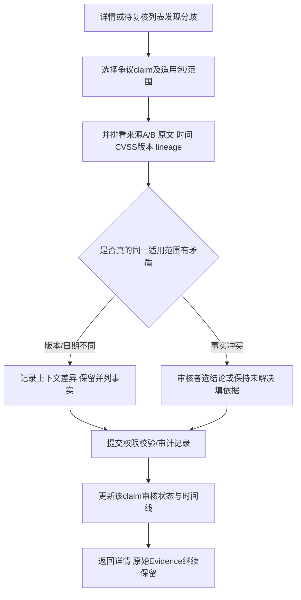
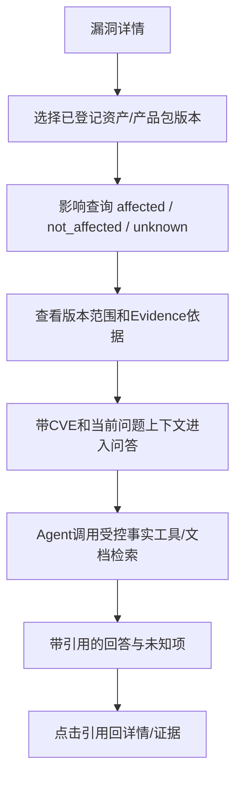

# 低保真UX草案

历史草案：当前以[Phase 3信息架构](design/ux/INFORMATION_ARCHITECTURE.md)及[核心流程](design/ux/CORE_FLOWS.md)为准。以下旧V0.1/V0.2取舍不覆盖冻结PRD；实际Agent问答、论文/标准/政策在M1/P0范围，资产与可写复核仍P1。

并行准备用户路径，供产品规划校准；没有正式UI效果图、颜色主题或前端实现。V0.1主路径优先；资产/人工写审核/问答在V0.2接通后进入导航。

## 发现与判断（V0.1）

详情低保真分区：顶部CVE/标题/产品/审核状态；主区影响范围、fixed和风险信号；来源展开区并列CVSS/CWE、KEV日期/CISA评估；证据区显示来源/定位/原文；底部时间线。候选PoC/Patch只提供引用与状态，不提供运行按钮。

## 来源分歧与人工复核（写操作V0.2）

V0.1先查看待审核/有争议状态；后续写API验证审核角色、revision与理由。并发时若原记录已修订，应提示刷新比较；不能静默覆盖另一人判断。

## 资产和问答（V0.2）

结构化数据使用有固定参数/只读权限的查询工具，SQL语句由后端控制；文章用检索、关系用受控查询。用户问题和原文不产生新权限。问答不自动更新人工复核结果或执行PoC。

## 每页必需状态

| 状态 | 用户看到什么 / 可做什么 |
|---|---|
| 加载 | 当前区域加载提示；保留已有筛选与数据，不误报零漏洞 |
| 无记录 | 显示筛选/配置产品覆盖范围及调整入口 |
| 字段未知/不支持 | 显示原因与原始来源；不将unknown画成安全 |
| 来源延迟/故障 | 最后成功时间、旧值日期、stale提示；可看既有证据 |
| API失败/超时 | 可重试及请求编号；保留上下文；不显示连接串/secret |
| 无权限 | 解释只读或需审核角色；隐藏不可执行写操作 |
| 分歧/待审核 | 两源并列与复核入口；无权限时可阅读依据 |
| 功能未接入 | 首期导航只出现已实现能力；Demo路线不依赖未接通模块 |

UI效果稿随后根据这些信息/状态制作；数据库和接口复核需逐项支持这些操作。
