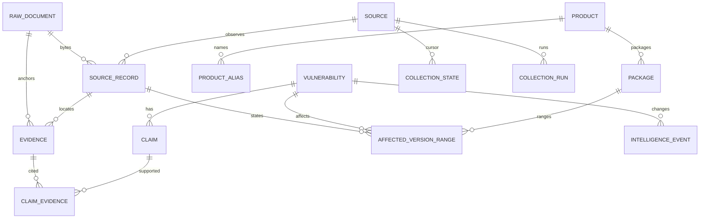

# 内部数据与数据库设计

NormalizedVulnerability的实际JSON Schema在 [normalized-vulnerability.schema.json](normalized-vulnerability.schema.json)。12条真实映射例在examples/。顶层统一字段：cve_id/title/description/published_at/modified_at/severity/cvss/cwe/products/affected_ranges/fixed_versions/references/sources/raw_documents/metadata。补充schema_version、AI三态和review_status。cvss/severity按source与version保存多个observations，未知为null/空集合＋reason，不取最高分盖过其他来源。未知字段进入metadata和不变raw，OSV非CVE案例未来可用UUID扩展。

## 最小物理模型：14张表

这是第6步的技术预案，待产品/UX/UI明确定稿后复核。除claim_evidence复合主键外使用UUID主键（vulnerability还UNIQUE cve_id），时间timestamptz/UTC。删除原则：raw/claim/evidence/event追加式；源修订不物理覆盖；过期blob有明确保留/GC策略。JSONB只放源扩展、候选/复杂值，不让必需身份和外键全藏JSON。

| 表及存在理由 | 主字段/PK | 唯一约束、索引、FK | 生命周期 |
|---|---|---|---|
| source 来源/许可/lineage | id,name,type,official_host,terms_url,authority_scope,enabled | UNIQUE name；状态索引 | 可停用，保留历史 |
| raw_document 字节证据 | id,sha256,blob_path,mime,bytes,stored_at | UNIQUE sha256；不含外部凭证 | 内容不可变；DB引用外的孤儿延时GC |
| source_record 源观察和revision | id,source_id,external_id,canonical_url,raw_id,published/modified/retrieved/last_seen,normalized_json,upstream_lineage,parser_version | UNIQUE(source_id,external_id,raw_id)；URL/source modified索引；FK source/raw | 同内容更新last_seen，不覆盖旧内容；unknown fields保留 |
| vulnerability 主体 | id,cve_id,title,state,ai_relevance,review_status,first/last_seen,created/updated,current_projection | UNIQUE cve_id；state/AI/review/time索引 | rejected/superseded留历史，不物理删除 |
| product 品牌/系统 | id,canonical_name,vendor,repository,category | UNIQUE canonical_name+vendor；repo索引 | 审核修订 |
| product_alias 可控映射 | id,product_id,alias,alias_type,scope,review_status,evidence_id | UNIQUE(alias_type,scope,alias,product_id)；alias索引；FK product/evidence | 同名不同产品允许并列；歧义UNKNOWN |
| package 生态身份 | id,product_id,ecosystem,canonical_name,purl,cpe_candidates | UNIQUE(ecosystem,canonical_name)；purl索引；FK product可空 | 一产品多包；CPE候选有证据，非强制1:1 |
| affected_version_range 结构化范围 | id,vulnerability_id,package_id,source_record_id,claim_id,raw_expression,type,scheme,events,intervals,parse_status,version_fingerprint | UNIQUE(vulnerability_id,package_id,source_record_id,version_fingerprint)；package/status索引；FK四主体 | 修订生成新范围，unsupported不猜测 |
| claim 一级事实 | id,vulnerability_id,predicate,scope,value_json,value_hash,status,rule_version,created_at | UNIQUE(vulnerability_id,predicate,scope,value_hash)；predicate/status索引；FK vulnerability | proposed/source_supported/reviewed/disputed/superseded；可多值 |
| evidence 原文定位 | id,source_record_id,raw_id,locator_type,locator,text_excerpt,excerpt_hash,observed_at | UNIQUE(source_record_id,locator_type,locator,excerpt_hash)；FK source_record/raw | 不变、可回查JSON pointer/页/行 |
| claim_evidence 多对多支持/反驳 | claim_id,evidence_id,polarity,basis,reviewer,created_at | 复合PK(claim_id,evidence_id,polarity)；FK claim/evidence | polarity支持/反驳/上下文；不删除冲突边 |
| intelligence_event 时间线 | id,vulnerability_id,kind,source_record_id,before_hash,after_hash,reason,actor,occurred_at | UNIQUE(vulnerability_id,kind,source_record_id,after_hash)；vuln/time索引；FK vuln/source_record可空 | append-only，便于重放 |
| collection_state 游标/回补 | id,source_id,scope,cursor,overlap_window,last_success,next_attempt,last_error_code | UNIQUE(source_id,scope)；next_attempt索引；FK source | 成功持久化才推进，不与published时间混用 |
| collection_run 批次可观测 | id,source_id,scope,status,start/finish,counts,error_codes,trace_id | source/time/status索引；FK source | 不记录raw secret；单记录失败有计数/重放索引 |

Reference本期存在于source_record/claims的source-qualified数组，标准URL与locator一并保存；EnrichmentRecord用source_record的normalized_json＋字段claims表达，不新增重复表。Verification/Conflict先由claim状态和polarity支持，完整Conflict Engine延后。PoC/Patch候选先保存predicate与metadata，不给verified。Asset/SBOM后续独立表，不塞一堆空表。

KEV是整目录快照，不强制将目录当成一条NormalizedVulnerability。目录级source_record保存catalogVersion和raw；对已存在CVE生成来源化kev_membership claim，以具体条目pointer或完整目录负匹配依据关联Evidence。CISA ADP在CVE source_record内按provider解析。未知/未入本系统的目录项留原始快照，不能仅凭CISA产品文本制造PyPI实体或版本范围。

## 实体与版本规则

Python包名规范化只处理大小写/-_.；PyTorch→torch由明确生态及官方repo/公告规则连接。vllm-project是repo组织/别名scope，不能直接当PyPI包名；模糊别名/同名repo不自动合并。

OSV ECOSYSTEM+PyPI用PEP440；introduced=0为起点哨兵，不当真实版本。事件顺序保持原样，允许多个区间；introduced含边界、fixed不含、last_affected含、limit不含。PEP440比较考虑rc/post/local；不直接用默认SpecifierSet成员过滤套OSV。GIT、未知生态、非法或歧义边界标UNSUPPORTED/INVALID，匹配返回UNKNOWN。preserve raw_expression、events、scheme、parse_status与错误理由；固定版本只有明确fixed事件/公告字段可给，last_affected下一版本不能推算fixed。
