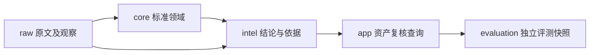

# AegisAI 数据库架构

本阶段交付PostgreSQL持久化骨架与实际迁移/数据库验证，不交付采集器、业务API、生产前端、RAG或Agent。前置[需求](../../requirements/PRD.md)、[源字段](../../research/data_sources/SOURCE_FIELD_MAPPING.md)、[UX依赖](../ux/PAGE_DATA_DEPENDENCIES.md)和[UI映射](../ui/COMPONENT_DATA_MAPPING.md)保持冻结。43张表覆盖用户明确要求的38个模型及5个必要关系/观察对象；没有万能Entity/Relation或深层继承。

## 固定技术选择

| 项目 | 冻结决定 | 理由与限制 |
|---|---|---|
| Database | PostgreSQL 17.11 | 官方Windows入口指向EDB便携包；实际测试版本一致，生产继续跟踪17系安全修订 |
| ORM | SQLAlchemy 2.0.54 | 2.x declarative，explicit FK/CHECK/UNIQUE；不使用create_all部署 |
| Migration | Alembic 1.20.0 | 0001固定DDL快照；事务DDL与upgrade/downgrade实测 |
| Driver | psycopg 3.3.6 | psycopg3同步驱动；后续API异步策略另作性能决策 |
| Pool | SQLAlchemy QueuePool 5+5/pre_ping | 本阶段起始配置，不代表吞吐测试；UTC与30s statement timeout |
| Vector | 预留接口，未装pgvector | 先验证真实检索需求再迁移vector维数/索引，无embedding/RAG |
| Local test | 127.0.0.1:55435专用测试cluster | 不安装Windows服务，loopback trust仅本机测试，验证后关闭 |
| Production auth | SCRAM/受控网络/环境secret | 不能复用本机trust配置，迁移owner与运行角色分开 |
| Backup | pg_dump custom + pg_restore，定期恢复演练 | 本轮迁移往返已测，备份恢复脚本流程见保留/迁移文档，未宣称生产恢复已测 |

## 四层与五个schema

Raw Data→raw：Source/RawDocument/SourceObservation/SyncRun。Normalized Data→core：Vulnerability、身份、产品包、版本、CVSS/CWE/AI评估。Trusted Intelligence→intel：Claim/Evidence/Verification/候选/时序/知识。Application Data→app：资产/Review/Audit/Agent；evaluation作为应用层的独立schema隔离评测，不能把测试Case导入core冒充真实漏洞。

原文16MiB内BYTEA保留准确entity字节，JSON可选parsed_payload仅作解析缓存；超限显式拒绝并登记缺口，不截断后称完整。所有扩展JSONB仅存异构结构/metadata；身份、状态、关系和时间均用可约束字段。[模型](DOMAIN_MODEL.md)、[表字典](TABLE_SPECIFICATIONS.md)、[约束](CONSTRAINTS.md)、[页面支持](PAGE_STORAGE_MAPPING.md)给出实现对应。

实际库使用UTC timestamptz；API以后输出ISO8601，UI转用户时区。来源未知时间保持null，采集retrieved不得补published。raw重用不吞各源观察。同上游lineage不算多份独立票，DB不自动按来源数confirmed。

参考：[PostgreSQL Windows官方入口](https://www.postgresql.org/download/windows/)、[EDB二进制包](https://www.enterprisedb.com/download-postgresql-binaries)、[SQLAlchemy engine/pool](https://docs.sqlalchemy.org/en/20/core/engines.html)、[Alembic迁移](https://alembic.sqlalchemy.org/en/latest/tutorial.html)。研究核查与本轮测试是不同事件。
