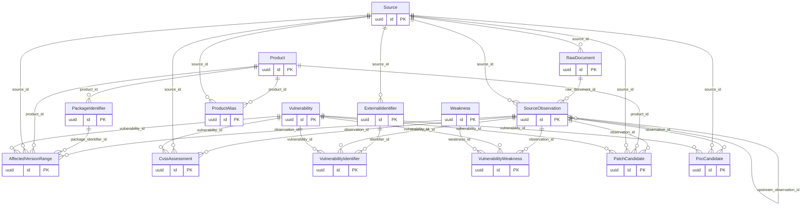
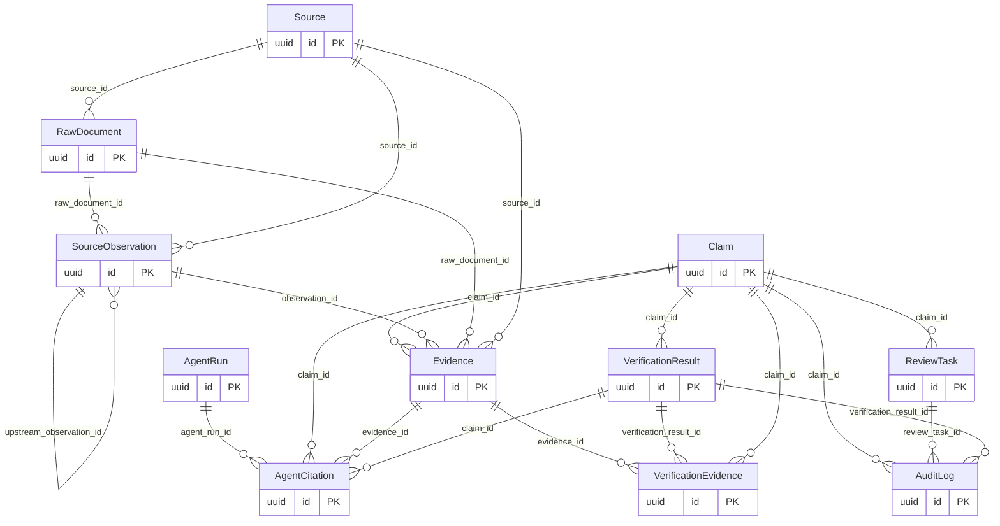
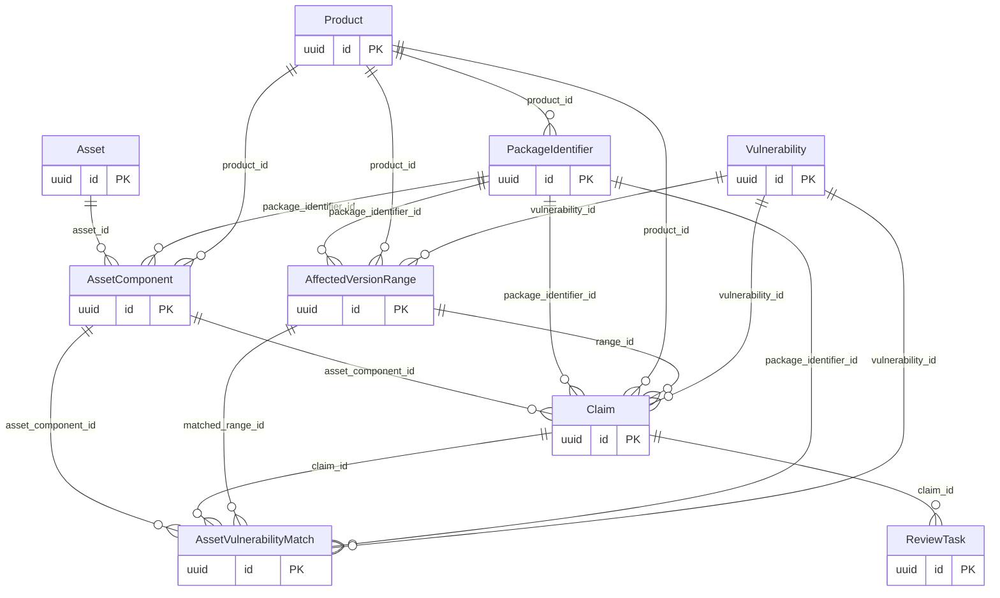

# 数据库 ER 图

完整图列出全部43模型以及去重后的父子FK连接，字段字典与精确复合关系另表保存；“||--o{”表示对象链接的主方向，nullable例外以RELATIONSHIPS/字段字典为准。完整图用于索引，日常按下列三个局部图阅读，避免把所有字段挤进一张图。

## 完整ER

```mermaid
erDiagram
    AgentRun {
        uuid id PK
    }
    Asset {
        uuid id PK
    }
    AiSecurityCategory {
        uuid id PK
    }
    Product {
        uuid id PK
    }
    Vulnerability {
        uuid id PK
    }
    Weakness {
        uuid id PK
    }
    EvaluationDataset {
        uuid id PK
    }
    Source {
        uuid id PK
    }
    ToolCallRecord {
        uuid id PK
    }
    ExternalIdentifier {
        uuid id PK
    }
    PackageIdentifier {
        uuid id PK
    }
    ProductAlias {
        uuid id PK
    }
    Reference {
        uuid id PK
    }
    EvaluationCase {
        uuid id PK
    }
    EvaluationRun {
        uuid id PK
    }
    RawDocument {
        uuid id PK
    }
    SyncRun {
        uuid id PK
    }
    AssetComponent {
        uuid id PK
    }
    EvaluationResult {
        uuid id PK
    }
    EpssSnapshot {
        uuid id PK
    }
    KnowledgeDocument {
        uuid id PK
    }
    KnownExploitation {
        uuid id PK
    }
    SourceObservation {
        uuid id PK
    }
    AffectedVersionRange {
        uuid id PK
    }
    AiRelevanceAssessment {
        uuid id PK
    }
    CvssAssessment {
        uuid id PK
    }
    VulnerabilityIdentifier {
        uuid id PK
    }
    VulnerabilityReference {
        uuid id PK
    }
    VulnerabilityWeakness {
        uuid id PK
    }
    KnowledgeChunk {
        uuid id PK
    }
    PatchCandidate {
        uuid id PK
    }
    PocCandidate {
        uuid id PK
    }
    VulnerabilityAiCategory {
        uuid id PK
    }
    Claim {
        uuid id PK
    }
    AssetVulnerabilityMatch {
        uuid id PK
    }
    ReviewTask {
        uuid id PK
    }
    Evidence {
        uuid id PK
    }
    KnowledgeVulnerabilityRelation {
        uuid id PK
    }
    VerificationResult {
        uuid id PK
    }
    AgentCitation {
        uuid id PK
    }
    AuditLog {
        uuid id PK
    }
    IntelligenceEvent {
        uuid id PK
    }
    VerificationEvidence {
        uuid id PK
    }
    AgentRun ||--o{ ToolCallRecord : "agent_run_id"
    Source ||--o{ ExternalIdentifier : "source_id"
    Product ||--o{ PackageIdentifier : "product_id"
    Product ||--o{ ProductAlias : "product_id"
    Source ||--o{ ProductAlias : "source_id"
    Source ||--o{ Reference : "source_id"
    EvaluationDataset ||--o{ EvaluationCase : "dataset_id"
    EvaluationDataset ||--o{ EvaluationRun : "dataset_id"
    Source ||--o{ RawDocument : "source_id"
    SyncRun ||--o{ SyncRun : "retry_of_id"
    Source ||--o{ SyncRun : "source_id"
    Asset ||--o{ AssetComponent : "asset_id"
    PackageIdentifier ||--o{ AssetComponent : "package_identifier_id"
    Product ||--o{ AssetComponent : "product_id"
    EvaluationCase ||--o{ EvaluationResult : "case_id"
    EvaluationRun ||--o{ EvaluationResult : "run_id"
    EvaluationDataset ||--o{ EvaluationResult : "dataset_id"
    RawDocument ||--o{ EpssSnapshot : "raw_document_id"
    Source ||--o{ EpssSnapshot : "source_id"
    Vulnerability ||--o{ EpssSnapshot : "vulnerability_id"
    RawDocument ||--o{ KnowledgeDocument : "raw_document_id"
    Source ||--o{ KnowledgeDocument : "source_id"
    RawDocument ||--o{ KnownExploitation : "raw_document_id"
    Source ||--o{ KnownExploitation : "source_id"
    Vulnerability ||--o{ KnownExploitation : "vulnerability_id"
    RawDocument ||--o{ SourceObservation : "raw_document_id"
    SyncRun ||--o{ SourceObservation : "sync_run_id"
    Source ||--o{ SourceObservation : "source_id"
    SourceObservation ||--o{ SourceObservation : "upstream_observation_id"
    SourceObservation ||--o{ AffectedVersionRange : "observation_id"
    PackageIdentifier ||--o{ AffectedVersionRange : "package_identifier_id"
    Product ||--o{ AffectedVersionRange : "product_id"
    Source ||--o{ AffectedVersionRange : "source_id"
    Vulnerability ||--o{ AffectedVersionRange : "vulnerability_id"
    KnowledgeDocument ||--o{ AiRelevanceAssessment : "knowledge_document_id"
    SourceObservation ||--o{ AiRelevanceAssessment : "observation_id"
    Vulnerability ||--o{ AiRelevanceAssessment : "vulnerability_id"
    SourceObservation ||--o{ CvssAssessment : "observation_id"
    Source ||--o{ CvssAssessment : "source_id"
    Vulnerability ||--o{ CvssAssessment : "vulnerability_id"
    ExternalIdentifier ||--o{ VulnerabilityIdentifier : "identifier_id"
    SourceObservation ||--o{ VulnerabilityIdentifier : "observation_id"
    Vulnerability ||--o{ VulnerabilityIdentifier : "vulnerability_id"
    SourceObservation ||--o{ VulnerabilityReference : "observation_id"
    Reference ||--o{ VulnerabilityReference : "reference_id"
    Vulnerability ||--o{ VulnerabilityReference : "vulnerability_id"
    SourceObservation ||--o{ VulnerabilityWeakness : "observation_id"
    Vulnerability ||--o{ VulnerabilityWeakness : "vulnerability_id"
    Weakness ||--o{ VulnerabilityWeakness : "weakness_id"
    KnowledgeDocument ||--o{ KnowledgeChunk : "document_id"
    RawDocument ||--o{ KnowledgeChunk : "raw_document_id"
    SourceObservation ||--o{ PatchCandidate : "observation_id"
    Product ||--o{ PatchCandidate : "product_id"
    Source ||--o{ PatchCandidate : "source_id"
    Vulnerability ||--o{ PatchCandidate : "vulnerability_id"
    SourceObservation ||--o{ PocCandidate : "observation_id"
    Source ||--o{ PocCandidate : "source_id"
    Vulnerability ||--o{ PocCandidate : "vulnerability_id"
    AiRelevanceAssessment ||--o{ VulnerabilityAiCategory : "assessment_id"
    AiSecurityCategory ||--o{ VulnerabilityAiCategory : "category_id"
    Vulnerability ||--o{ VulnerabilityAiCategory : "vulnerability_id"
    CvssAssessment ||--o{ Claim : "cvss_assessment_id"
    PatchCandidate ||--o{ Claim : "patch_candidate_id"
    PocCandidate ||--o{ Claim : "poc_candidate_id"
    AssetComponent ||--o{ Claim : "asset_component_id"
    KnowledgeDocument ||--o{ Claim : "knowledge_document_id"
    PackageIdentifier ||--o{ Claim : "package_identifier_id"
    Product ||--o{ Claim : "product_id"
    AffectedVersionRange ||--o{ Claim : "range_id"
    Vulnerability ||--o{ Claim : "vulnerability_id"
    AssetComponent ||--o{ AssetVulnerabilityMatch : "asset_component_id"
    Claim ||--o{ AssetVulnerabilityMatch : "claim_id"
    AffectedVersionRange ||--o{ AssetVulnerabilityMatch : "matched_range_id"
    PackageIdentifier ||--o{ AssetVulnerabilityMatch : "package_identifier_id"
    Vulnerability ||--o{ AssetVulnerabilityMatch : "vulnerability_id"
    Claim ||--o{ ReviewTask : "claim_id"
    Claim ||--o{ Evidence : "claim_id"
    SourceObservation ||--o{ Evidence : "observation_id"
    RawDocument ||--o{ Evidence : "raw_document_id"
    Source ||--o{ Evidence : "source_id"
    Claim ||--o{ KnowledgeVulnerabilityRelation : "claim_id"
    KnowledgeDocument ||--o{ KnowledgeVulnerabilityRelation : "knowledge_document_id"
    Vulnerability ||--o{ KnowledgeVulnerabilityRelation : "vulnerability_id"
    Claim ||--o{ VerificationResult : "claim_id"
    AgentRun ||--o{ AgentCitation : "agent_run_id"
    Claim ||--o{ AgentCitation : "claim_id"
    Evidence ||--o{ AgentCitation : "evidence_id"
    VerificationResult ||--o{ AgentCitation : "claim_id"
    Claim ||--o{ AuditLog : "claim_id"
    ReviewTask ||--o{ AuditLog : "review_task_id"
    VerificationResult ||--o{ AuditLog : "verification_result_id"
    Claim ||--o{ IntelligenceEvent : "claim_id"
    Evidence ||--o{ IntelligenceEvent : "evidence_id"
    KnowledgeDocument ||--o{ IntelligenceEvent : "knowledge_document_id"
    Source ||--o{ IntelligenceEvent : "source_id"
    Vulnerability ||--o{ IntelligenceEvent : "vulnerability_id"
    Evidence ||--o{ VerificationEvidence : "evidence_id"
    VerificationResult ||--o{ VerificationEvidence : "verification_result_id"
    Claim ||--o{ VerificationEvidence : "claim_id"
```

## Intelligence Core

## Evidence 与 Verification

## Asset 与 Risk

Review的target是Claim，Claim typed subject连接Range/PoC/Patch/CVSS/资产，原始source观察不被人工决定覆盖。Evaluation四表在独立schema通过dataset FK连接，不依赖production主体ID作为gold。
