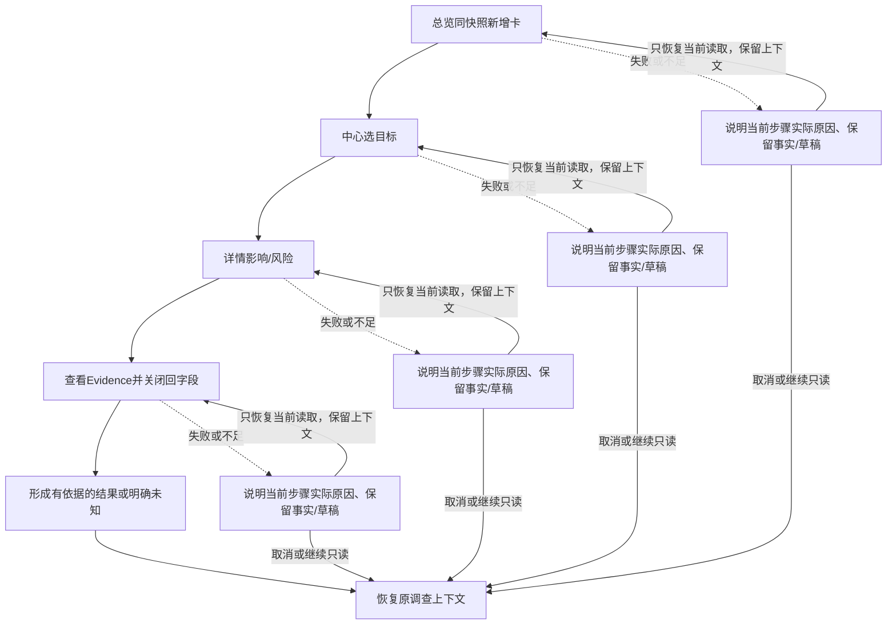
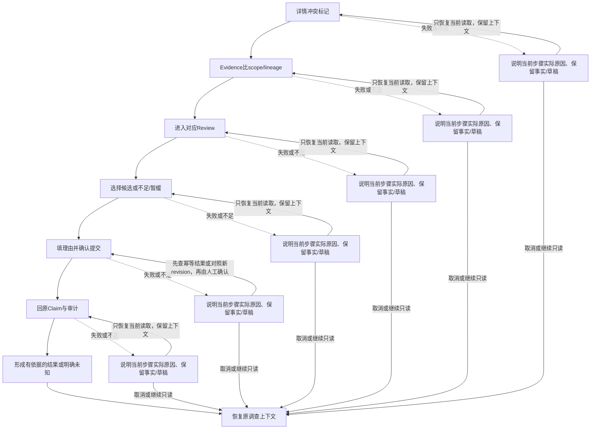
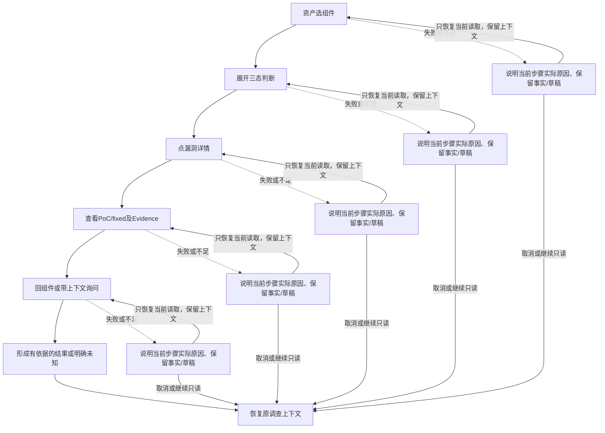
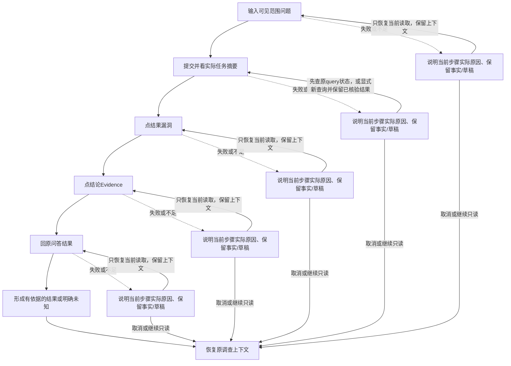
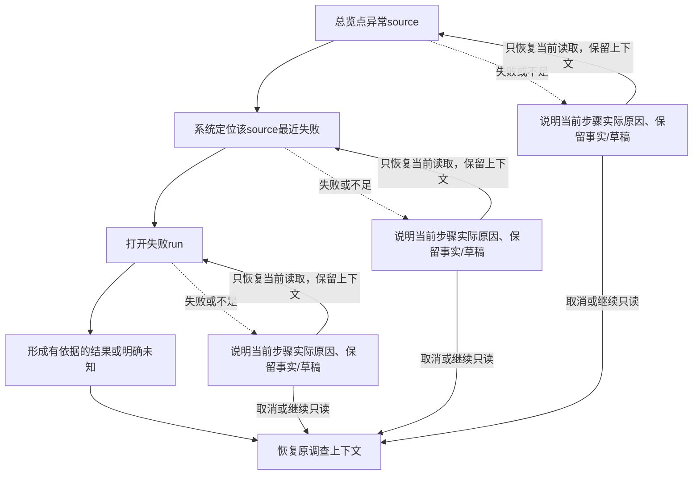

# 五条核心流程

角色、步骤预算、异常和返回一起设计。每次点击/确认计一次，输入和阅读另计；以下预算为目标，尚无运行产品或用户测试。P1不改变P0冻结。

## FLOW-01：发现新漏洞→详情→Evidence→判断风险

阶段：P0；用户：R1/R2；预算≤4次主动操作。

**正常路径**：总览同快照新增卡 → 中心选目标 → 详情影响/风险 → 查看Evidence并关闭回字段。

**异常/分支**：范围/PoC/fixed不足保留unknown；同scope冲突转FLOW-02[P1]；详情读取失败保留入口重试；来源离线仍读标日期旧证据。

**完成/返回**：判断结果是有出处的关注/修复建议或暂不能确定；返回原中心筛选/游标/滚动，再回总览窗口。

## FLOW-02：来源冲突→Evidence→待复核→人工处理→详情

阶段：P1；用户：有Review write的R1；其他用户只读；预算≤6次主动操作。

**正常路径**：详情冲突标记 → Evidence比scope/lineage → 进入对应Review → 选择候选或不足/暂缓 → 填理由并确认提交 → 回原Claim与审计。

**异常/分支**：不同CVSS版本/范围只并列不生成真冲突；无write权限只能读；证据加载失败可重试/保留不足；409保留草稿比较新revision再决定；提交超时查幂等结果。

**完成/返回**：成功显示决定及审计ID，原Observation保留；无结论/取消也返回原字段，无需强选A/B。

## FLOW-03：资产命中→漏洞→PoC/修复→处置建议

阶段：P1；用户：有权读该资产的R2；预算≤5次主动操作。

**正常路径**：资产选组件 → 展开三态判断 → 点漏洞详情 → 查看PoC/fixed及Evidence → 回组件或带上下文询问。

**异常/分支**：首次无库存先登记精确版本；歧义/不支持为unknown，不强制命中；无PoC或fixed写已查范围/缺证；无授权不泄露；未接P1退回公开组件查询，不能称完成资产匹配。

**完成/返回**：建议绑定包/分支/版本和出处；不执行PoC/升级；返回组件选择、inventory revision和原排序。

## FLOW-04：复杂问题→Agent→结果列表→详情→Evidence

阶段：P0（资产部分P1）；用户：R1/R2；预算≤5次主动操作。

**正常路径**：输入可见范围问题 → 提交并看实际任务摘要 → 点结果漏洞 → 点结论Evidence → 回原问答结果。

**异常/分支**：缺版本/未接资产先澄清或公开查询；无匹配说明窗口/覆盖，历史CVE不改日期；timeout保留已核验partial/显式重试或取消；引用失败可单项重试；越权工具拒绝。

**完成/返回**：每条事实有Claim回链，结果ID和revision固定；返回query_id、输入、结果位置和as_of；知识结果走共享知识详情。

## FLOW-05：总览来源异常→系统运行→失败SyncRun

阶段：P0；用户：R2；重试另需运维权限；预算≤3次主动操作。

**正常路径**：总览点异常source → 系统定位该source最近失败 → 打开失败run。

**异常/分支**：尚无run为未启用/未计划，不编失败记录；日志读失败保留source重试；无retry权限仍可看公开故障；实际源离线显示退避；partial明确成功/失败范围。

**完成/返回**：可选授权重试只显示实际queued/run状态；回同source历史再回总览，窗口和异常上下文保留。

## 共同边界

公共内容进入Agent只读工具；外部文档不能要求额外权限。Review/资产/运维是独立授权写操作；未知PoC没有执行动作。多源修订不自动覆盖人工决策，需新候选/重新复核。任意步骤异常可返回，不能要求用户完成不确定结论才能退出。共享Evidence使用原页锚点/快照，详细重试动作以对应页面为准，不自动重走整个写流程。

扩展JTBD-14知识旅程见USER_JOURNEYS.md，共享中心/知识详情/Evidence/问答，不另造第六条主Flow。
