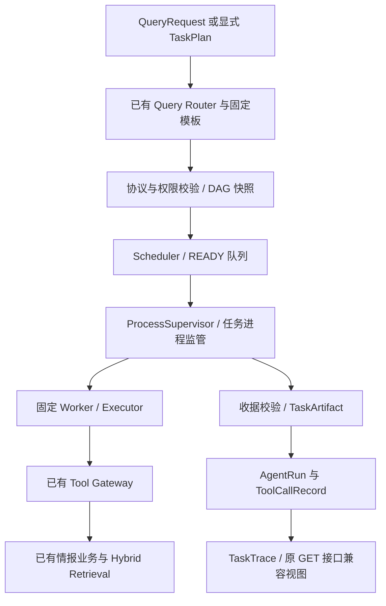

# AegisAI Phase 10-A：Agent Runtime 基础框架

日期：2026-10-08。范围依据已确认的 `PHASE10A_IMPLEMENTATION_PLAN.md`。

## 1. 实现目标与接入边界

本阶段新增独立 `app.runtime` 包，提供 Task Contract、Artifact、DAG、Scheduler、Executor、ToolContract 和可持久化的 Trace。保留已有 Router、Tool Gateway、安全业务、Hybrid Retrieval、Model Gateway 和前端，不修改数据库模型或迁移。

`RuntimeService` 是可显式调用的同步服务。现有 `POST /api/v1/assistant/query` 仍使用原 Agent；本阶段没有替换前端提问入口。新运行返回 `run_id` 后，可以通过现有 Assistant 页的“Run ID 读取运行”及原三个 GET 接口查看。自动切换提问入口属于后续单独接入工作。

规则模板不调用生成模型。可借用注入的 Model Gateway，但不会创建、关闭或调用它。本阶段不需要模型 API 额度，不启动 Dify。已有检索工具内部的旧 Embedding 路径保持原样，不能把 `model_called=[]` 解释为检索工具完全不做向量计算。

## 2. 架构



不重新实现版本匹配、资产风险、证据核验或安全工具。`ToolContract` 直接从已有 `REGISTRY` 和 Pydantic Schema 派生，避免两份工具清单发生漂移。

## 3. 接口

从已配置的后端服务代码中调用，`actor` 必须来自服务端认证，不能相信请求自行填写的身份：

```python
from app.assistant.contracts import QueryRequest
from app.db.session import make_engine
from app.runtime.service import RuntimeService

engine = make_engine()  # 沿用 AEGIS_DATABASE_URL
runtime = RuntimeService(engine)
snapshot = runtime.run(
    QueryRequest(question="CVE-2024-0001", request_key="由调用方生成的唯一键"),
    actor=authenticated_actor,
)
trace = runtime.read_trace(snapshot.run_id, authenticated_actor)
```

这是接口用法，示例 CVE 不代表系统已采集该漏洞。没有记录时保留工具返回的失败或缺项。

| 接口 | 输入 | 输出或行为 |
| --- | --- | --- |
| `RuntimeService.run` | 已有 QueryRequest、认证 actor | 固定规则计划、真实执行、持久化 RunSnapshot |
| `RuntimeService.run_plan` | TaskPlan、认证 actor、request_key | 校验明确的工具步骤后执行；不会执行任意代码 |
| `RuntimeService.read_trace` | run_id、认证 actor | 按计划顺序返回 TraceSnapshot，跨所有者读取拒绝 |
| `build_plan` | QueryRequest、RuntimePolicy | 有边界的固定模板，generation_calls=0 |
| `compile_graph` | TaskPlan、RuntimePolicy | 校验环、身份、工具输入、权限、预算，生成不可变 JSON 快照 |
| `TaskGraphBuilder.add_task/compile` | 任务协议 | 用于显式构建 TaskPlan；正式执行前仍要 compile_graph |
| `tools.tool_contract` | 已注册工具名、timeout_seconds | 工具输入/输出 Schema、权限、超时等派生协议 |

目前支持单 CVE 查询、PoC/Patch 并行查询、明确资产的既有风险快照读取、结构化与语义检索、系统状态。缺少资产或目标时生成 `input_required`，零工具调用并进入 WAITING_REVIEW。危险请求复用原 Router 拒绝；实时请求不属于本阶段默认模板。

## 4. 协议、状态与可信边界

- `TaskContract` 包含 task_id、task_type、description、input_data、dependencies、allowed_tools、expected_output、acceptance_criteria、max_tool_calls、timeout_seconds。
- `TaskArtifact` 包含 artifact_id、run_id、task_id、status、结构化 result、evidence、tool_calls、confidence、unresolved_questions、warnings、errors 和实际时间。
- `TaskTrace` 保存身份、任务类型、时间、状态、工具记录、model_called、错误、Artifact ID、依赖及状态转换。
- `tool_sequence` 仅接受注册工具和常量参数；不接受 shell、任意 SQL、动态导入或用户代码。`ToolSequenceResult-v1` 的 outputs 来自真实工具收据，dependencies 引用前置 Artifact ID。
- 固定验收代码为 `tools_succeeded`、`output_nonempty`、`evidence_present`；不会把自然语言验收描述当成可执行规则。

```text
CREATED → PENDING → READY → RUNNING → SUCCESS
                                 ├→ FAILED
                                 └→ WAITING_REVIEW
PENDING / READY → BLOCKED
```

只有 SUCCESS 解锁依赖。工具失败、无结果、partial 或必要证据缺失不会解锁后续任务；独立分支仍执行。BLOCKED 表示未执行，start_time 为空，不制造工具记录。终态不接受迟到覆盖。

SUCCESS 表示约定执行与验收完成，不能证明漏洞已经核验、产品一定受影响或资产一定安全。候选 PoC、原始公告、未知影响范围保留原工具的标记与警告；不将 `verified=false` 改为 true。证据按原工具收据核对和去重，保存 RawDocument ID、Claim revision、locator、来源等实际字段。`confidence` 默认 null，本阶段不计算或虚构置信度。

## 5. 权限与预算

RuntimePolicy 默认 READ_ONLY，由服务端创建；用户填写 allowed_tools 不会授予权限。显式写计划需要服务端 WRITE 授权，refresh 还要求 EXTERNAL_NETWORK；资产工具继续使用原 actor 检查。

| 边界 | 默认 / 最大值 |
| --- | --- |
| 任务数 | 16 |
| 图深度 | 8 |
| 并行任务 | 3 |
| 单任务工具调用 | 最多 8，TaskContract 默认 2 |
| 全运行预留工具预算 | 32 |
| 单任务超时 | 默认 30 秒，允许 1–60 秒 |
| 运行执行预算 | 默认 120 秒，允许 1–120 秒 |
| 输入 JSON | 64 KiB |
| 单 Artifact | 512 KiB |
| Worker 输出协议 | 4 MiB，stdout/stderr 合计计量 |
| 运行 metadata | 8 MiB |

编译时检查所有任务预留预算总和；每个任务继续受 Gateway 的实际调用计数限制。首期不借用其他任务预算，也不自动重试，attempt=1。超限显式失败，不静默截断证据。

证据本身超过 Artifact 上限时，任务明确 FAILED，完整证据仍随收据写入 ToolCallRecord。Artifact 使用 `evidence_storage=tool_receipts`、完整证据数量和 SHA-256 摘要引用，父进程按真实收据验证这三个字段。不会把证据静默裁剪成部分内容；修改数量、摘要或 verified 标记的引用都被拒绝。

## 6. 超时与异常

任务使用固定 Python Worker。Windows 上父进程先把 Worker 加入设置 KILL_ON_JOB_CLOSE 的 Job Object，再发送输入，随后产生的 Gateway 子进程同属受监管进程树。截止时间为任务期限与运行期限较早者。超过期限或取消协调器时终止整棵树，回收并检查 Job 活跃进程数，不依赖 Future.cancel()。

本机真实测试已验证任务进程及其子进程全部停止，而且没有迟到文件或成功结果。Linux 进程组分支已经实现，但本机是 Windows，尚未实际验证 Linux 行为。进程隔离不可用时失败，不降级为不可终止的线程执行。

正常退出也必须在观察完成时再次检查截止时间和取消状态；不能因 `poll()` 恰好返回退出码而把截止时间后的结果接受为 SUCCESS。此边界已用确定性时钟回归证明。

清理预算为 2 秒，清理失败明确报告 TASK_CLEANUP_FAILED。工具收据按 JSONL 事件传回父进程；中断的调用标为失败，已完成调用保留。错误码包括 TASK_TIMEOUT、RUN_TIMEOUT、WORKER_OUTPUT_LIMIT、WORKER_FAILED、WORKER_PROTOCOL_ERROR、GATEWAY_FAILURE、TASK_ISOLATION_UNAVAILABLE 等；原始内部异常不写入 Trace。

数据库持久化在父进程事务中完成。工具执行期限不等于服务的总 HTTP 响应时间，数据库保存和进程清理会增加开销。持久化错误抛出 STORE_FAILED，不能返回假成功；进程或数据库故障后的自动恢复不在本阶段范围内。默认模板只读；显式写工具已经提交的操作不会因之后超时自动撤销。

## 7. 持久化与兼容

复用 `app.agent_runs` 和 `app.tool_call_records`，没有新增表或 Migration。

- `agent_type=runtime-v1`，权威计划、任务状态、Artifact、幂等键放入 `details.runtime_v1`。
- 幂等限定 actor + agent_type + request_key；内容不同则冲突。新记录的 context 顶层不写 request_key，避免污染旧 Agent 幂等查询。
- 每次写操作使用独立 Session 和行锁，整块重赋值 JSONB，避免并行结果丢失或嵌套修改未保存。
- 父进程分配全运行唯一 sequence_no，关联真实 ToolCallRecord ID；现有 append-only 审计保护保持启用。
- Trace 与投影显式按计划顺序排列，不能依赖 PostgreSQL JSONB 的对象键顺序。
- 兼容投影提供 goal、ui_status、events、result、evidence_refs 等旧读取字段，不修改原 API 或页面。
- 投影事件使用旧接口识别的 started/success/partial/failed/blocked，同时保留 runtime_state；权威 TaskTrace 状态仍为大写，因此执行中读取也能展示实际进展。

已使用真实运行验证原服务的 read/tasks/trace 和已认证的 HTTP GET；未认证返回 401。

## 8. 文件

新增生产代码全部在 `backend/app/runtime/`：

| 文件 | 职责 |
| --- | --- |
| __init__.py | 独立包，不触发旧服务启动或接入 |
| contracts.py | 版本化协议、有限 JSON、身份和大小限制 |
| tools.py | 从原工具注册表派生元数据 |
| planning.py | 固定模板，调用原 Router |
| graph.py | 图构建、校验和不可变快照 |
| states.py | 状态转换与终态保护 |
| executor.py | Gateway 调用、验收、收据与 Artifact |
| worker.py | 固定 JSONL 任务进程入口 |
| process.py | 进程树监管、限时、限输出、取消与回收 |
| scheduler.py | READY 队列、有限并行、依赖阻塞与完成 |
| trace.py | 旧读取接口的派生兼容视图 |
| store.py | 原表持久化、幂等、行锁、所有者读取 |
| service.py | 显式调用的同步服务边界 |

新增测试在 `backend/tests/runtime/`，包含 7 个测试模块、conftest、受控低层工具响应及真实子进程 fixture。证据与历史文件哈希存放在 `work/runtime/`。现有代码、前端、配置、依赖声明、模型和迁移的修改清单为空；199 文件 SHA-256 基线核对为零修改、零缺失，证据为 `work/runtime/baseline_verified.json`。

## 9. 测试结果

最终实际全项目回归：**548 passed，0 failed，0 errors，0 skipped**；pytest 用时 61.34 秒，包含新增 80 个 Runtime 测试和既有 89 个 Model Gateway 测试。一条现有 AnyIO 弃用警告不影响结果。最终原始记录为 `work/runtime/reviewed_full_suite.json/.xml/.log`；此前 543 项通过的完整记录也保留。

测试覆盖协议拒绝、非法 DAG、预算与权限、图快照、SUCCESS-only 依赖、异常与不确定性、并行上限、并行时间重叠、任务进程树真实终止、输出超限、工作进程异常、取消、持久化、并行写入、所有者隔离、幂等隔离和旧读取兼容。

一次独立只读审查发现三个重要问题，均通过复现测试 RED→GREEN 修正：截止时间边界、超大证据审计丢失、运行中旧任务视图状态。随后执行上述完整回归。审查记录为 `work/runtime/final_review.md`，没有另行宣称第二次审查。

用户要求的五种场景均实际运行：单 CVE；CVE→既有版本匹配→资产风险读取；PoC/Patch 并行；循环 DAG 拒绝且不创建运行；工具失败后依赖 BLOCKED、独立任务 SUCCESS。

集成测试使用真实 PostgreSQL、真实 Gateway 和真实 Worker。数据明确标为 SYNTHETIC/NOT BENCHMARK，包含未核验的 Claim/Evidence；不能当作漏洞准确率或比赛 Benchmark。版本链条保留 UNCERTAIN，并在缺少风险快照时 WAITING_REVIEW。

测试数据库需隔离：`AEGIS_RUNTIME_TEST_DATABASE_URL` 给 Runtime 提交型审计 fixture；`AEGIS_TEST_DATABASE_URL` 给旧测试的空库/迁移检查，数据库名均受 `aegis_phase5_test` 防护。运行记录不可删除，因此不能让提交型 fixture 污染旧迁移测试库。`work/runtime/run_tests.py` 保存独立日志，并恢复旧测试报告文件。

## 10. 当前限制与扩展位置

本阶段没有 LLM Planner、自由 ReAct、多 Agent 协作、新 Integration Gate、流式接口、动画或新前端入口。服务同步执行，没有服务重启后的调度恢复；同一幂等键不会重复启动旧的运行。等待复核不自动创建业务 ReviewTask，也不自动继续下游。

暂缓的一项小问题：复用的旧 `record_tool()` 将 ToolCallRecord 起止时间按持久化时间和耗时推算；它们不能作为精确的工具执行时间。任务起止时间与工具耗时准确。未来可在首次写入时保留真实工具时间，不能回写修改已有 append-only 审计记录。

后续如接 LLM Planner，只允许生成符合 TaskPlan 的候选计划，依然必须经过 compile_graph、服务端权限、预算和收据校验；所有显式模型调用通过已有 Model Gateway。增加任务类型需新增明确协议、验收与测试，不引入任意回调执行。具体后续开发等待新指令。
