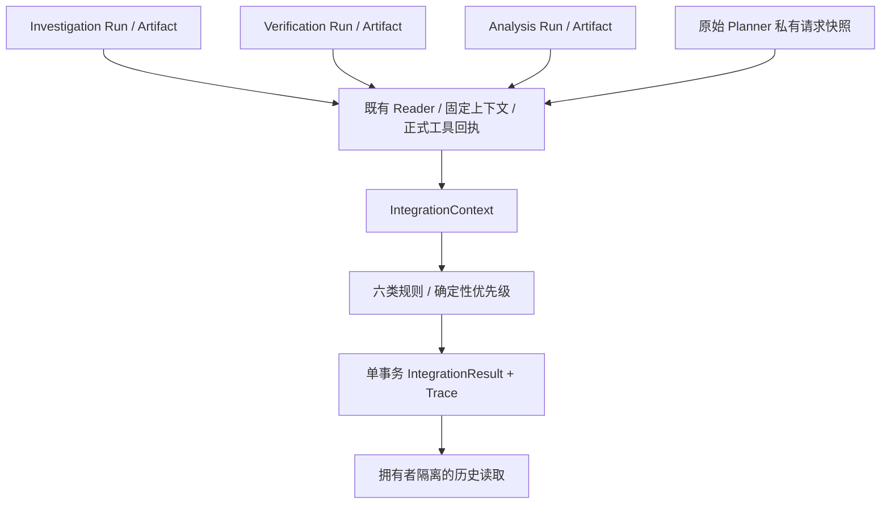

# Integration Gate 实现说明

本模块是上层服务显式调用的确定性全局验收层。工程最终验收及精确测试数量见根目录 `PHASE_11C_RESULT.md`；本文件描述接口和边界，不代表模型或生产情报准确率。

## 架构与调用



```python
from app.integration.service import IntegrationService
from app.integration.contracts import IntegrationRequest, ArtifactRef

service = IntegrationService(engine)
request = IntegrationRequest(
    request_key="acceptance-1", run_id=investigation_run_id,
    investigation=ArtifactRef(run_id=investigation_run_id, task_id="lookup",
        artifact_id=investigation_artifact_id, schema_version="investigation-artifact-v1"),
    verification=ArtifactRef(run_id=verification_run_id, task_id="verify",
        artifact_id=verification_artifact_id, schema_version="verification-artifact-v1"),
    analysis=ArtifactRef(run_id=analysis_run_id, task_id="analyze",
        artifact_id=analysis_artifact_id, schema_version="risk-analysis-artifact-v1"),
    objective_profile="asset_risk_v1",
)
result = service.evaluate(request, actor=authenticated_principal)
stored = service.read(result.integration_id, actor=authenticated_principal)
trace = service.read_trace(result.integration_id, actor=authenticated_principal)
```

`actor` 必须由可信调用服务提供，不从问题文字或外部 Artifact 读取。没有新增 HTTP 入口。服务不会调用 Planner 或专业 Agent，也不会执行恢复操作。

## 原始目标与 Profile

新 Planner 行私有 `context` 增量保存 `planner_input_v1` 和原序列化算法生成的 `planner_input_sha256`。公开 Planner DTO、规划逻辑和缓存行为不变。Gate 验证拥有者、正反向 Runtime 关联、原始问题及哈希。

| Profile | 必需结果 |
| --- | --- |
| overview_v1 | 单漏洞身份、已有情报概览；允许披露 UNKNOWN |
| asset_impact_v1 | 身份、指定资产、部署版本影响、处置状态 |
| asset_risk_v1 | 前述结果及风险等级、优先级 |

原问题明确询问影响/如何修复/风险时，不能通过选择概览缩小这些要求。明确要求精确补丁或实际利用验证时增加对应条件。支持的是受限结构化范围与有限语句模式；未实现任意自然语言全部意图证明、多漏洞批量验收。范围缺失返回 REPLAN，不能从 LLM 计划的 objective 推造用户原意。

历史 Planner 行没有原始范围时不回填。`new_structured_request` 可提供新的 `ObjectiveContract`，只验收该新目标，固定产生 `NEW_EXPLICIT_OBJECTIVE` 警告；不能宣称恢复了历史用户要求。

## 跨 Run 来源链

I、V、R 可以是三个不同 Run。原 Run/Task/Artifact 标识不修改。V 必须指向选中的 I 三元组和源快照；R 必须消费确切 I/V 产物。复用三个既有 Reader、ContextStore、正式工具回执验证及 B3 固定保护字段校验。Gate 没有复制版本匹配、Claim 核验或风险计算算法。

`logical_investigation_id` 由拥有者、调查根 Run、目标哈希派生，属于关联标识，不是来源认证凭证。不能凭这个标识读取别人的结果。真正绑定来自拥有者隔离、原审计关联、正式回执和固定快照哈希；没有密码学签名，也不能抵抗具有数据库管理员权限的整体篡改。

来源由多个 Session 读取，采用初始观察、前后指纹、上下文复读和保存前复查发现读取期间变化。不是跨所有表的数据库原子源快照；最后复查后的极小窗口及外部管理员并发修改属于信任边界，历史结果只声明记录时的固定输入。

## 六类规则

| 检查 | 核心约束 |
| --- | --- |
| Completion | 必要产物、任务、依赖和终态；必要 PARTIAL/阻塞不可通过；程序错误、取消不可通过 |
| Integrity | 类型、身份、I→V→R 引用、Claim 值/范围/revision、EvidenceRef 闭合 |
| Evidence | 决策事实使用已经确认、可追溯的直接支持；来源血缘不按转载 URL 数加分 |
| Consistency | UNKNOWN 不转安全，REJECTED 不转风险事实，候选不转真实利用，精确补丁有匹配 Claim |
| Objective | 原始漏洞、资产、组件、版本、必要回答是否满足；处置未知与精确修复缺失分开 |
| Freshness | 来源类型、请求窗口、核验和库存时间分别检查；缺时间不视作最新 |

所有规则固定注册，不允许请求动态禁用检查。状态聚合：FAILED（FATAL）> HUMAN_REVIEW_REQUIRED > REPLAN_REQUIRED > PASS_WITH_WARNINGS > PASS。混合问题保留所有原因。confidence 不作为 PASS 阈值；模型不裁决 Gate。

独立可选 evidence_search 任务可声明为 optional，必须证明不是必要产物或其依赖、也没有下游任务依赖它；必要任务内部失败不能伪装成可选。必要事实完整且独立可选检索缺失可 PASS_WITH_WARNINGS；程序/协议/资源清理错误即使在可选支路也 FAILED。

概览可披露正常领域弃答，但工具部分执行、被取消或必要任务依赖阻塞不会因此解锁。UNKNOWN 风险与已确认的版本影响可同时存在；最终是否满足目标由必要结果决定。

## 时间策略 integration-policy-v1

规则版本固定在服务端。静态产品/影响/修复/CVSS 来源检索默认 30 天；仅概览 90 天；明确当前查询 7 天。已知利用事实默认 7 天，当前查询 1 天。核验默认 7 天，当前查询 24 小时；仅概览 90 天。资产库存捕获默认 7 天，当前查询 24 小时。允许最大未来偏差 5 分钟。时间边界测试使用注入时钟。

这些是工程策略，不是经真实数据校准的安全保证。旧 B2 本身还有 30 天的来源采集门槛，Gate 的宽松概览预算不会重新确认 B2 拒绝的事实。旧公告发布时间很早但采集新鲜，不会仅因公告年龄被当成陈旧；“近 N 天”按来源发布时间/更新时间检查，不能用最近抓取代替近期事件。当前 DTO 缺少独立公告修改时间，因此只使用已有 publication 字段，缺失不补造。

已识别的“近/最近/过去 N 天”支持 1–365 天；0 天及超过 365 天返回 `UNSUPPORTED_TIME_SCOPE / REPLAN_REQUIRED`，多个窗口返回 `AMBIGUOUS_TIME_SCOPE`。不把超出支持范围的要求静默变成无时间限制的概览。日历日期范围及任意自然语言时间意图尚未支持。

## 幂等、取消与持久化

复用 `AgentRun` 的 `integration-gate-v1` 私有审计类型和 PostgreSQL 事务 advisory lock。相同 actor/key 请求内容不同：`IdempotencyConflict`。相同内容且有效输入指纹相同：复用精确旧结果与时间。源 Artifact、回执、固定上下文或时间有效性分类变化：生成新输入修订，旧结果可独立读取。规则版本不支持客户端切换；未来版本必须增加显式兼容处理。

一个事务写入 Context、Result、Trace 及三类哈希，成功回执不会分段写入。历史 Reader 检查拥有者/版本/哈希/关联并按固定上下文回放六类规则，不查询实时情报或模型。

独立审查的 Minor M1 暂未实现去重：来源捕获失败时，每次尝试都保存新的失败审计行，可能具有相同 input_hash，以 actor/request_key/input_hash 关联；有效且经过重新验证的输入才复用同一修订。重复失败没有原业务副作用，也不产生相互冲突的安全状态，但会增长审计历史。不会永久缓存暂时性来源故障，后续来源恢复仍会重新捕获。

`GateControl(cancel_event=..., deadline_monotonic=...)` 只接受内部对象。读取前后、评估后、写入成功前检查取消/期限；事务内晚取消会回滚。原 DB statement_timeout 为 30 秒，因此取消是协作式，不承诺中止正在阻塞的 SQL。数据库异常返回 `FAILED / NOT_STORED`，只记录固定错误码和新 integration_id，不输出异常原文或连接口令。

输入请求 64 KiB，固定 Context 4 MiB，Result 512 KiB，审计 8 MiB。拒绝超限和 NaN/Inf，不能静默截断关键事实。数量上限用于受控 DTO，不表示扫描了全部资产。Result/Trace 的证据链接去掉 URL 凭据/查询串和敏感 locator 键；原来源私有上下文仍用于精确核验，不能直接公开这个上下文。

URL scheme 大小写和外围空白统一处理，删除 userinfo、query、fragment；locator 键去除分隔符并识别 API Key、客户端 secret、授权头及 token 等凭据写法。公共 lineage_key 只导出稳定 SHA-256 分组摘要，不导出任意来源原文。Result 和 Trace 同时经过反例测试；这些规则不声称识别任意自由文本中隐藏的秘密，私有审计仍须由可信后端隔离。

## 测试与适用边界

测试实际执行现有 Planner（受控本地 Model Gateway 响应）、专业 Agent、Runtime、工具子进程和隔离 PostgreSQL；数据明确标注 SYNTHETIC。成功、可选缺失、必要部分、依赖阻塞、冲突、UNKNOWN 和概览均通过实际服务生成，不能据此声称公网模型能力或生产准确率。

验收证据保存在 `work/integration/`：每次测试独立 JSON/JUnit/log、原文件备份、哈希、真实统一回执、审查记录和最终用例清单。原 B2 收集时未来时间样本沿用原文件优先执行的 runner 插件，保留所有用例与原断言；新时间测试没有这种墙钟依赖。

## 后续扩展

后续可单独设计上层三 Agent 调查编排及 Answer Envelope 接入。当前必须由可信上层调用各现有服务并提供原始引用；Gate 自动读取和校验整合结果，但没有用户问答一键自动三 Agent 调度、自动 Replan、人审页面、前端展示、公开 API、Benchmark 或部署改造。
