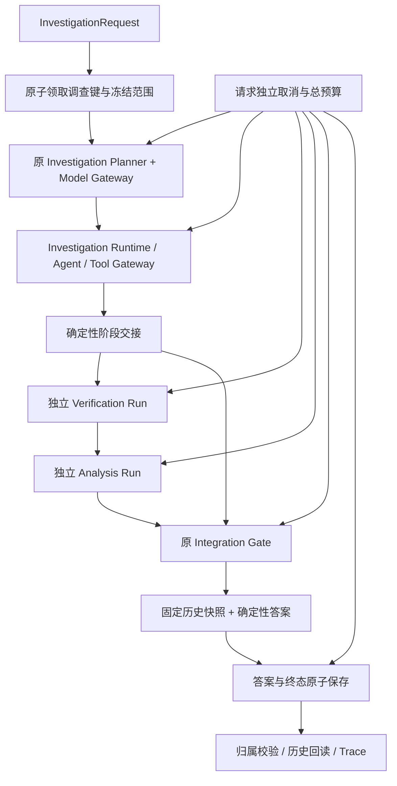

# Phase 11-D：自主调查总控与可信答案交付

## 范围与入口

新增 `backend/app/orchestration` 内部服务。保留原网页、Assistant API 和全部安全业务算法。本阶段没有接入公网 API、前端、Dify、第四个 Agent、消息队列或自动重新规划。调用者必须是可信内部服务，负责提供已确认的 `actor`；字符串归属检查不代表已经建立生产登录认证。



## 调用方式

```python
from uuid import uuid4
from app.assistant.contracts import QueryRequest
from app.planner.schemas import PlannerInput
from app.orchestration.contracts import InvestigationRequest
from app.orchestration.service import InvestigationOrchestrator

# engine 与 model_gateway 由现有服务初始化并借给本服务。
service = InvestigationOrchestrator(engine, model_gateway)
request = InvestigationRequest(planner_input=PlannerInput(query=QueryRequest(
    question="查询指定 CVE 的可信情报",
    target="CVE-2026-12345",
    request_key=str(uuid4()),
)))
result = service.investigate(request, actor=authenticated_actor)
logical_id = result.context.logical_investigation_id
status = service.get_status(logical_id, actor=authenticated_actor)
history = service.get_result(logical_id, actor=authenticated_actor)
trace = service.get_trace(logical_id, actor=authenticated_actor)
```

此 CVE 仅为接口格式示例，不宣称数据库已有该漏洞。无数据或不支持的范围须保留非完整结果。内部调用同步执行；另一线程或另一个服务实例可用 `cancel(logical_id, actor=...)` 提交持久化取消。不会关闭借用的数据库引擎或 Model Gateway。

## 请求、范围与生命周期

`InvestigationRequest` 采用 `investigation-request-v1`。保留原问题、PlannerInput、资产/组件、时间范围、用户上下文和选项。有效请求键必须非空。冻结及哈希前重新校验全部嵌套对象，避免 `model_copy(update=...)` 绕过输入约束。

派生范围只补充明确可解析的目标或组件，原请求不变。目标、版本、时间冲突拒绝；多个目标、不支持的历史快照、POC 完整性问题明确记录 scope gap，不靠缩小目标取得 PASS。旧 Unicode 单词边界无法识别紧贴中文的 CVE，本层使用 ASCII 标识符边界，旧 Planner/Gate 算法保持原样。

时间解析沿用已有的阿拉伯数字相对天数窗口。显式日历日期、中文数字天数、周/月等未实现的时间限制标记 `UNSUPPORTED_TIME_SCOPE`，由原 Gate 阻止 PASS；不自行把历史范围转换为当前数据查询。它是受限规则解析，并非任意语言的完整时间解析器。

生命周期：CREATED → PLANNING → INVESTIGATING → VERIFYING → ANALYZING → INTEGRATING → COMPOSING。可以因调查不足跳到 INTEGRATING；不允许倒退。终态为 COMPLETED / WAITING_REVIEW / FAILED / CANCELLED。调查过程状态与安全业务状态分开；COMPLETED 可以对应 INCOMPLETE，不能只看这个阶段名称判断结论可信。

| Gate 状态 | Answer 状态 | Overall 状态 | 交付边界 |
|---|---|---|---|
| PASS | COMPLETE | SUCCEEDED | 已验收结果 |
| PASS_WITH_WARNINGS | COMPLETE_WITH_WARNINGS | SUCCEEDED_WITH_WARNINGS | 保留非阻塞警告 |
| REPLAN_REQUIRED | INCOMPLETE | INCOMPLETE | 已核验事实与受限观察、缺失项；不自动重规划 |
| HUMAN_REVIEW_REQUIRED | REVIEW_REQUIRED | REVIEW_REQUIRED | 保留冲突与复核原因 |
| FAILED | FAILED | FAILED | 不交付风险结论或确定事实 |
| 尚未取得 Gate 结果时失败/取消 | FAILED / CANCELLED | FAILED / CANCELLED | 不伪造 Gate 状态 |

## 三个 Run 的交接

复用 Investigation 的正式 Planner 验证、角色绑定、Runtime、Scheduler、Executor、Tool Gateway。上层读取实际绑定后的 TaskPlan，而非尚未包含服务端角色绑定的 Planner 候选计划。

只选择与原目标一致且包含目标 `get_vulnerability` 调用的唯一 Artifact。没有唯一结果时停止下游；不能直接取第一项。传递原始 `(run_id, task_id, artifact_id, schema_version)`，不复制伪造成功 Artifact。

必要任务 PARTIAL、FAILED、BLOCKED、缺失均阻止下游。仅当服务器判断某证据检索任务是独立叶节点、非必要祖先、没有后继、且用户未明确请求该证据时，可作为可选来源。原任务和 Runtime 状态不修改。

完整但存在冲突的调查观察可以进入独立 Verification Run；这不是解锁原 DAG 的依赖节点。Verification 的 CONFLICT/PENDING 等业务状态可交给原 Analysis 形成 UNKNOWN / REVIEW_REQUIRED 观察。最后仍由原 Gate 判定，不重算风险，不弱化核验。

Gate 自己的 logical ID 与上层 logical investigation ID 不同，持久化明确映射两者，以及原输入哈希、目标哈希、三个 Artifact 引用和 Gate revision ID。

## 答案协议及来源

`AnswerEnvelope` 为 `answer-envelope-v1`，限制 512 KiB，冻结历史快照。

| 字段 | 来源 |
|---|---|
| original_question / logical_investigation_id | 原始调查请求与根审计 |
| answer_status / integration_status | 原 Gate 状态固定映射 |
| summary | 确定性模板 |
| verified_claims / key_findings | 固定 Verification 中满足原 Gate `grounded` 条件的 Claim |
| citations | 同一核验快照中支撑已确认事实的直接、有效、当前、权威证据；保留 Evidence/Claim/Source/RawDocument/Observation ID 与哈希 |
| disputed_claims | 原 Verification 的 CONFLICT / PENDING / REJECTED / INSUFFICIENT_EVIDENCE 评估、结构化值、作用范围及支持/冲突 Evidence ID；始终是 OBSERVATION |
| evidence_observations / evidence_references | 核验快照的全部支持与冲突证据指针，保留原状态、哈希、来源、完整性与直接性；包含在列表里不代表可信或已确认 |
| affected_assets | 固定 Analysis 的用户资产清单快照；不是主动扫描 |
| risk_assessment | 原 Risk Artifact 的 risk_level、priority、affected、verification_status、利用信号、补丁状态；不重新计算 |
| recommended_actions | 原 Analysis action，精确版本/补丁必须有对应已交付的核验与证据引用 |
| warnings / unresolved_items | 原 Gate 阻塞及警告，另加 UNKNOWN、候选 POC、候选补丁等交付提示 |
| agent_run_references / trace_reference | 根审计中实际启动的专业 Run（失败/歧义时也保留）及上层根引用 |
| accepted_source_run_references | Gate 已成功捕获的来源 Run 子集；与实际启动的 Run 列表区分 |
| generated_at | 固定 Gate evaluation_time；失败为固定调查终止时间 |

非 PASS 风险显示为 OBSERVATION，不能伪装成已经验收的整体结论。UNKNOWN 不是安全；POC 关联/候选并不证明利用有效；补丁存在不代表已经应用。FAILED/CANCELLED 没有确定事实或风险结论。确定性组合器没有模型、SQL 或工具调用。

答案不复制来源正文、模型原始输出、私有 Prompt 或任意分析文本。值和引用采用允许字段投影；URL 删除用户名/密码、查询参数与 fragment；来源文本无法变成工具权限。原问题和内部原请求仍按要求保存，因此此内部历史接口不是任意公网日志导出接口。

`reference.locator` 仅允许有限长的 JSON pointer/path/field 和整数行号、列号、页码、索引。摘录、自由备注、私有 Prompt、任意嵌套对象不进入交付字段。URL 字段只接受 HTTP(S)，引用中的来源 UUID 重新校验。冲突证据采用同一投影规则。

Trace 可在真实 Runtime 已启动而 Planner 尚未写入正向链接时读取。此时必须通过实际 Runtime 的归属、类型及计划中的反向 `planner_run_id` 校验；链接写入失败后的真实 Run 也保留。非空正向链接不匹配或反向链接被篡改仍拒绝。

## 持久化、幂等及历史

复用 AgentRun，类型为 `investigation-orchestrator-v1`，命名空间为 `orchestration_v1`。不新增 ORM 表或迁移，不写 Claim/Evidence/Asset/Review。根记录不使用旧 Assistant 的通用 `context.request_key`，避免旧入口混读。

同 actor / 类型 / 请求键使用 PostgreSQL 事务 advisory lock 原子创建。请求内容哈希不包含生成用的 request_id；相同内容复用已有调查，同键不同内容拒绝。已有 RUNNING 调查返回当前快照，不启动第二个 Planner/Agent 链。

根状态更新使用行锁、worker token 和 revision。每个阶段有从根 ID 派生的私有键。进程总并发上限 2，实例策略可收紧到 1；这是单进程预算，不宣称分布式全局配额。

答案和终态在同一事务保存。取消先写入时拒绝随后成功封存；成功封存先完成时，之后的取消不覆盖历史答案。数据库写入/确认均失败时仅交付最后观测快照，标记 NOT_STORED 与恢复需求，不假称已经保存，也不暴露底层异常中的凭据。

历史回读校验类型、归属、请求/范围/Context/Answer 哈希，验证固定 Gate revision 的原始绑定并重新做确定性答案组合。不会刷新来源或重新运行 Gate；历史 PASS 表示当时固定证据的结论。Source 当前权威性改变不会偷偷改写旧答案。未知 schema、错引用、缺失审计均显式拒绝。

心跳/lease 用于发现过期运行。没有自动接管、重跑或崩溃恢复，过期 RUNNING 标记 recovery_required，等待人工检查，不能推断成功。

## 两个最小兼容 hook

1. `runtime/service.py`：可选 request-local execution control，提供真实 Run 开始/结束通知、当前 Executor、既有取消接口，以及较小的总期限。默认调用没有 control，保持旧行为。
2. `agents/investigation/service.py`：可选 Planner observer，记录真实规划 ID、完成状态并在 Runtime 前检查。Planner/Runtime 创建与取消使用同一个短 advisory lock，使创建顺序可判断。

没有修改 Planner、DAG、Scheduler、Executor 或三个专业 Agent 的业务实现。

## 取消、期限与资源

默认上层总预算 300 秒，请求可收紧；原单 Run/Task 的预算继续存在，取较小期限。一个调查最多两个规划模型尝试、三个专业 Run；Gate 和 Composer 不触发重新规划。每个调查自己的 Control、Executor、服务实例和监控线程，取消不会作用于另一个调查。

持久化取消与实际观测停止分别记录。活动工具子进程沿用旧 ProcessSupervisor 的 Windows Job 清理；保留底层真实任务状态，不伪造 SUCCESS。阶段边界、Gate 后到封存前都继续检查取消/总时长。

同步模型网络调用无法由本层立即打断：等待原 Provider 返回或原超时，随后停止后续 Run。数据库读取遵守现有 statement_timeout；监控清理有界等待。文档和测试不能被解读为所有网络 I/O 可立即中断。

## 验证与限制

测试命令与实际数量见根目录 `PHASE_11D_RESULT.md` 和 `work/orchestration/*.json/.xml/.log`。E2E 使用生产 Planner、Runtime、三个 Agent、Tool Gateway、Gate、Composer、Store、Reader；仅模型计划响应和来源数据为受控 Mock/合成输入。

尚未接网页、真实商业模型、实时采集评测、公开部署、完整人工复核工作流、AegisBench。合成场景工程通过率不代表真实情报准确率或模型能力。下一阶段建议 Phase 12，但本阶段结束后不自动实施。

## 必要的局部进程退出确认修复

在两个兼容 hook 外，局部调整 runtime/process.py 的 Windows Job 清理确认。终止前获取有限的本 Job 成员进程句柄并验证归属；终止后不仅检查 Job active=0，还检查已取得句柄的退出信号，最后释放句柄。原两秒期限、旧测试断言、POSIX 路径保持；失败封闭处理不把查询失败当成清理完成。Microsoft 文档说明进程终止为异步调用，退出完成需要等待进程对象信号：[TerminateProcess](https://learn.microsoft.com/en-us/windows/win32/api/processthreadsapi/nf-processthreadsapi-terminateprocess)，[JobObject 进程列表](https://learn.microsoft.com/en-us/windows/win32/api/winnt/ns-winnt-jobobject_basic_process_id_list)。该修复依照正式指令中已授权的必要局部修复，原因、影响、回滚备份和回归详见结果报告。

## 最终验收证据

2026-10-10：Phase 11-D 工程验收 PASS；全量 1261/1261，新增 92/92，0 失败/错误/跳过，运行器耗时 700.235 秒。新增统计从实际全量 JUnit 提取，非额外执行。五项独立审查发现及必要进程修复均经 RED→GREEN 和最终全量验证。两套专用数据库已停止，原数据、审计与备份保留。实际回执、31 个源码/测试文件哈希、完整修改清单与 Q1–Q6 见 [PHASE_11D_RESULT.md](C:/Users/X/Documents/Codex/2026-10-03/files-mentioned-by-the-user-9/PHASE_11D_RESULT.md)。模型和来源为受控测试输入，工程通过不代表真实情报准确率或公网部署完成。没有进入 Phase 12。
