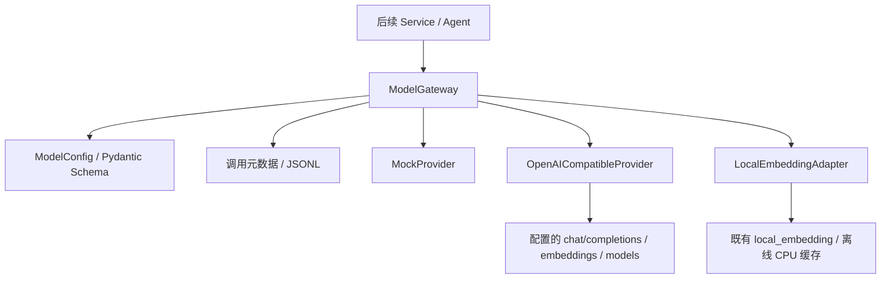

# AegisAI Phase 9-A：Model Gateway 实现说明

实施日期：2026-10-08。状态：**Phase 9-A 已完成，停在本阶段。** 范围：已确认的 [MODEL_GATEWAY_PLAN.md](C:/Users/X/Documents/Codex/2026-10-03/files-mentioned-by-the-user-9/MODEL_GATEWAY_PLAN.md)。

## 1. 设计目标与实现内容

新增独立 `backend/app/llm` 包，统一文本生成、结构化生成、Embedding 和健康检查。业务调用方使用 Gateway 的请求/结果 Schema，供应商协议由 Adapter 处理。未增加任何业务 API、页面、数据库表或 Agent 模型调用。

已实现 Mock、OpenAI Compatible、Local Embedding 三个适配器，以及输入/输出校验、类型化错误、Usage、request_id/trace_id、调用耗时和脱敏审计。默认文本与向量均为显式标记的 Mock；真实本地 Embedding 可单独配置。

旧 `knowledge/embedding.py` 和索引、检索调用点保持不变。新增本地 Adapter 复用该模型，不迁移旧入口、不更换向量空间、不重建知识索引。Tool Gateway、确定性 Agent、前端与 Dify 状态均未改变。

## 2. 架构说明



Gateway 负责参数和结果校验、Provider 选择、统一错误和审计；Adapter 负责 HTTP 或本地推理。结构化生成使用 JSON Schema 与可选 Pydantic 自定义验证器，均在本地执行。模型输出的结构合法不等于漏洞判断正确，也不自动成为系统 Evidence 或核验结果。

本阶段使用同步接口，不提供流式输出、异步接口、自动重试、自动降级或动态调用工具。每次操作最多调用一次选定的 Provider。

## 3. 接口说明

公开导入：

```python
from app.llm import (
    ModelConfig, ModelGateway,
    TextRequest, StructuredRequest, EmbeddingRequest,
)
```

| 接口 | 输入 | 成功结果 |
| --- | --- | --- |
| `generate_text(request)` | TextRequest 或等价字典 | TextData：text、finish_reason |
| `generate_structured(request, output_model=None)` | StructuredRequest；json_schema 与 Pydantic output_model 二选一 | StructuredData：已验证的对象、Schema 名称与 SHA-256 |
| `embed(request)` | texts、purpose=query/document | EmbeddingData：向量、维度、purpose；公共结果含模型、时间、Usage |
| `health_check(capability='text', trace_id=None)` | text/embedding 能力 | HealthData：探测方式、模型是否找到 |
| `close()` / 上下文管理 | 无 | 释放拥有的 HTTP Client；保留既有共享本地模型 |

公共 ModelResult：request_id、trace_id、provider、requested_model、实际 model、function、is_mock、status、开始/结束 UTC 时间、duration_ms、attempt_count、usage、data、error、original_error、warnings。

成功时 data 存在且 error 为 null；失败时 data 为 null，error 包含固定安全描述、错误码和 retryable。传入字典的错误输入会返回失败结果；调用方自己构造 Pydantic 请求时，构造阶段的验证错误发生在调用 Gateway 之前。Gateway 会重新验证传入的请求实例，避免修改后的实例绕过限制。

Usage 使用供应商返回的 token 统计，未知为 null；Mock 为零计费的模拟值，本地 Embedding 为未知 token 统计。attempt_count 记录 Provider 调用次数：调用前验证失败为 0，其余最多为 1；它不代表真实生成模型一定已执行。

is_mock 表示是否选用了内置 Mock，不证明外部 HTTP 服务一定执行了真实模型；回环合同服务器的合成结果同样不能进入真实模型质量 Benchmark。

### 文本与结构化示例

```python
from typing import Literal
from pydantic import BaseModel, ConfigDict
from app.llm import ModelConfig, ModelGateway

class VulnerabilityAnalysis(BaseModel):
    model_config = ConfigDict(extra='forbid')
    cve: str
    risk: Literal['high', 'medium', 'low']
    evidence: list[dict]

with ModelGateway(ModelConfig()) as gateway:
    text = gateway.generate_text({
        'messages': [{'role': 'user', 'content': 'Synthetic example.'}],
        'trace_id': 'example-trace',
    })
    structured = gateway.generate_structured({
        'messages': [{'role': 'user', 'content': 'Synthetic vulnerability fixture.'}],
    }, output_model=VulnerabilityAnalysis)
    assert text.is_mock and structured.is_mock
```

Mock 的 `VulnerabilityAnalysis` 是固定的 `CVE-2099-9999001` 合成 fixture，不是实际漏洞调查。Mock 不根据任意 Schema 生成虚构事实；其他 Schema 必须在 MockProvider 构造时显式注册 `structured_fixtures`。真实兼容 Provider 不依赖该 fixture 名称。

原始 JSON Schema 示例：

```python
result = gateway.generate_structured({
    'messages': [{'role': 'user', 'content': 'Return a structured result.'}],
    'schema_name': 'RiskSummary',
    'json_schema': {
        'type': 'object',
        'properties': {'risk': {'enum': ['high', 'medium', 'low']}},
        'required': ['risk'],
        'additionalProperties': False,
    },
})
```

上例应在打开的 Gateway 上调用；默认 Mock 未注册 RiskSummary 时会明确返回 CAPABILITY_UNSUPPORTED。结构化接口当前返回 JSON 对象，不承诺返回顶层数组或标量。

### 校验与限制

- messages 最多 32 条、输入文本总量 64 KiB；max_output_tokens 不超过配置上限，绝对上限 4096；temperature 可选。
- Embedding 每批最多 32 条、文本总量 64 KiB；query 只能有一条。输出检查数量、顺序、维度、有限值和非零向量。
- Schema 不超过 64 KiB、深度不超过 32、节点不超过 10000；支持 Draft 2020-12 和本地引用。调用前解析本地引用并验证目标，不存在或非 Schema 的目标立即失败；禁止外部引用和远程 Schema 获取。
- JSON 解析拒绝代码围栏、附加文本、重复键、NaN/Infinity、数值溢出与非法 Unicode；不修复不合格输出。
- JSON Schema 校验后，可执行 `output_model.model_validate_json(..., strict=True)` 和自定义验证器；输出仍转换为 JSON 数据。
- 远程响应最大 4 MiB；设置 HTTP 连接/读取/写入/连接池超时。它不是 Agent 总任务的强制截止机制。

常见错误：INVALID_INPUT、INVALID_SCHEMA、INVALID_JSON、SCHEMA_VALIDATION_FAILED、INVALID_EMBEDDING、AUTHENTICATION_FAILED、RATE_LIMITED、TIMEOUT、NETWORK_ERROR、PROVIDER_ERROR、MODEL_REFUSED、OUTPUT_TRUNCATED、MODEL_UNAVAILABLE、HEALTH_UNSUPPORTED、AUDIT_WRITE_FAILED。其他错误码见 [schemas.py](C:/Users/X/Documents/Codex/2026-10-03/files-mentioned-by-the-user-9/backend/app/llm/schemas.py)。

## 4. 配置方式与调用日志

ModelConfig.from_env() 只读取当前进程环境变量，不自动加载 `.env`。可显式传入 ModelConfig；更换配置时新建实例，不修改现有实例。

默认免费模式：

```ini
MODEL_PROVIDER=mock
MODEL_NAME=mock-text-v1
MODEL_EMBEDDING_PROVIDER=mock
MODEL_EMBEDDING_NAME=mock-embedding-v1
MODEL_EMBEDDING_DIMENSION=384
```

保留 Mock 文本、使用真实本地 Embedding：

```ini
MODEL_EMBEDDING_PROVIDER=local_embedding
MODEL_EMBEDDING_NAME=sentence-transformers/paraphrase-multilingual-MiniLM-L12-v2
MODEL_EMBEDDING_DIMENSION=384
```

本地模型复用已有缓存和 `local_files_only=True`。缓存不可用时返回 MODEL_UNAVAILABLE，不下载、不退回 Mock。测试已实际执行 query 和 document 推理，得到 384 维向量。

远程兼容接口需要 MODEL_PROVIDER=openai_compatible、MODEL_API_BASE、MODEL_API_KEY、MODEL_NAME、MODEL_EMBEDDING_NAME 和预期维度。若 Embedding 使用本地 Provider，则不需要远程 Embedding 模型。地址例子仅为占位：`https://model.example.invalid/v1`。

| 配置 | 默认/含义 |
| --- | --- |
| MODEL_TIMEOUT_SECONDS | 30；1–60 秒；连接超时最多 5 秒 |
| MODEL_MAX_OUTPUT_TOKENS | 1024；1–4096；请求不能超过配置 |
| MODEL_STRUCTURED_MODE | prompt_json；也可显式选择 json_object/json_schema |
| MODEL_TOKEN_PARAMETER | max_tokens；也可选择 max_completion_tokens |
| MODEL_ALLOW_KEYLESS_LOCAL | false；仅显式开启后允许回环服务无 Key |

公网要求 HTTPS；HTTP 仅允许回环地址；禁止 URL 中的凭据、查询参数和 fragment，禁用重定向与环境代理继承。Key 使用 SecretStr，在配置 repr/序列化中隐藏；模型名和 trace 中反射 Key 也会被拒绝，Trace 还禁止完整网址和非法 Unicode。httpx/httpcore 调试日志被设置为 WARNING，防止库层输出地址或请求头。

兼容接口通过 `/chat/completions`、`/embeddings` 和 `/models` 访问。结构化模式和 token 参数必须与供应商支持情况匹配；不支持返回明确失败，不自动换模式再次请求。健康检查只列出模型，未找到模型返回失败；不支持 `/models` 时返回 HEALTH_UNSUPPORTED，不发生成请求进行探测。协议依据：[Chat Completions](https://developers.openai.com/api/reference/resources/chat/subresources/completions/methods/create)、[Embeddings](https://developers.openai.com/api/reference/resources/embeddings/methods/create)。

### 审计记录

默认持久化到 [calls.jsonl](C:/Users/X/Documents/Codex/2026-10-03/files-mentioned-by-the-user-9/work/model_gateway/calls.jsonl)，并输出 `aegis.model_gateway` JSON 日志。记录 request_id、trace_id、provider、模型、function、latency（duration_ms）、Usage、状态和错误，包含输入校验失败及健康检查。

不记录消息、模型输出、向量、Key、Authorization、完整 URL 或原始异常文本。JSONL 同一路径在进程内共享写锁，写入后 flush，ASCII 转义适配 Windows 终端。可注入 RecordSink 改变记录目的地，测试使用内存 Sink 或临时 JSONL。

审计失败显式返回 AUDIT_WRITE_FAILED；如模型已经执行，保留 Usage、attempt_count 和原来的错误 original_error，不重新调用模型。日志存储故障时无法承诺持久化该条记录，调用方必须处理这个失败；不要据此自动重复付费调用。

## 5. 实际测试结果

环境：Python 3.12.14，Pydantic 2.13.5，httpx 0.28.1，jsonschema 4.25.1，fastembed 0.8.1，pytest 9.1.1。未安装或升级依赖；`pip check` 通过。

最终验收：**89 passed，0 failed，0 errors，0 skipped**，测试耗时 4.28 秒，包含独立复核后的修复回归。结果见 [final.json](C:/Users/X/Documents/Codex/2026-10-03/files-mentioned-by-the-user-9/work/model_gateway/final.json)、[执行日志](C:/Users/X/Documents/Codex/2026-10-03/files-mentioned-by-the-user-9/work/model_gateway/final.log)、[JUnit](C:/Users/X/Documents/Codex/2026-10-03/files-mentioned-by-the-user-9/work/model_gateway/final.xml)。

| 测试范围 | 证据 |
| --- | --- |
| 文本生成、结构化/Pydantic/JSON Schema、模拟向量 | 真实执行 Gateway 与 Mock，结果显式标记模拟 |
| Provider 切换 | 相同调用方式切换 Mock 和兼容 Adapter；回环 HTTP 服务器实际接收请求 |
| 兼容接口 | 参数、认证、路径前缀、Usage、JSON 三种模式、Embedding index 排序 |
| 异常处理 | 401/403/429/500/400/302、超时、网络故障、损坏/过大响应、拒答、截断、坏向量 |
| 本地 Embedding | 已有模型离线缓存，真实 CPU 查询/文档推理；加载失败不下载或降级 |
| 日志 | 请求关联、失败记录、敏感数据不落日志、并发 JSONL 完整性、审计故障保留原错误和 Usage |
| 严格边界 | 无效配置、输入预算、非法/外部 Schema、重复 JSON 键、非有限值、非法 Unicode |

测试分布：输入/输出与审计契约 48 项、HTTP Adapter 与切换 35 项、本地 Adapter 6 项。独立只读复核发现的 URL Trace、本地引用、输出 token 统计和初始化清理问题均先用失败测试复现再修复；未留待修复事项。补充验证了引用目标类型和备用日志也失败时的安全返回。

另执行四个入口的离线 smoke，全部成功且默认 JSONL 写入了四条调用记录，真实本地 Embedding 为 384 维；文本与结构化为 Mock。见 [smoke.json](C:/Users/X/Documents/Codex/2026-10-03/files-mentioned-by-the-user-9/work/model_gateway/smoke.json)。这些结果不是问答准确率或漏洞分析 Benchmark。

可复现运行方式，在项目根目录：

```powershell
.\backend\.venv\Scripts\python.exe work/model_gateway/run_tests.py final tests/model_gateway -q
.\backend\.venv\Scripts\python.exe work/model_gateway/smoke.py
```

专用测试运行器保留旧 `work/database_test_report.json`，生成独立 JUnit/日志。直接执行 pytest 也能运行这些测试，但已有公共 conftest 会覆盖其历史报告，因此建议使用上述运行器。该测试没有使用数据库 fixture，没有访问真实云端模型。

原有 185 个文件的 SHA-256 基线核对显示：仅配置示例和 requirements.in 发生计划内追加，其余现有业务/前端/测试/Prompt 文件一致；requirements.txt 未变。见 [scope_check.json](C:/Users/X/Documents/Codex/2026-10-03/files-mentioned-by-the-user-9/work/model_gateway/scope_check.json)。旧数据库测试报告也已恢复并核对一致。本轮没有启动旧业务系统或重跑全部数据库、前端测试，不宣称它们有新一轮全量通过结果。

## 6. 未来扩展

新 Provider 实现 `providers/base.py` 的 Protocol，在 `providers/__init__.py` 的 REGISTRY 注册模块、Adapter 和能力。配置显式指定模型身份，调用方继续使用 Gateway。兼容 OpenAI 协议的国产或本地服务可使用现有 HTTP Adapter，但每家服务仍需独立真实接入验证。

后续阶段可把新 Agent 的生成调用经 Gateway 注入，并按 trace_id 关联 Agent Trace；既有确定性 Agent 与旧 Embedding 入口可以继续运行。日志成本计算、生产保留策略、异步/流式调用、模型质量 Benchmark、旧入口兼容层等均不在本阶段实施。

## 7. 修改文件

- 新增 10 个运行模块：`backend/app/llm/` 下的 __init__.py、config.py、schemas.py、gateway.py、records.py；providers 下的 __init__.py、base.py、mock.py、openai_compatible.py、local_embedding.py。
- 新增 3 个测试文件和一个测试包初始化文件：`backend/tests/model_gateway/`。
- 仅追加 `backend/.env.example` 与 `backend/requirements.in`。后者声明锁定文件已有的 jsonschema、fastembed，未安装或升级。
- 新增本说明与根目录 `PHASE_9A_RESULT.md`；执行记录、基线、JUnit、日志和离线验证辅助文件位于 `work/model_gateway/`。

测试包 __init__.py 用于稳定的相对导入，是计划内测试目录的小幅配套补充。没有创建新系统、Agent Runtime、Planner、DAG Scheduler 或 Integration Gate。

## 8. 未完成事项与风险

真实远程生成/Embedding 模型未配置和未实测；本地 HTTP 合同服务器不能代替供应商真实模型测试。此项不影响离线运行和已验证的 Adapter 协议实现，但不能在答辩中宣称已经接入某家真实生成模型。

模型质量、事实准确性、费用估计与比赛 Benchmark 尚未由本模块证明。Mock 结果必须排除出真实效果评测。更换 Embedding 模型/维度/服务端别名版本时，不能混用已有向量索引，需要后续另行规划。

JSONL 的锁和 flush 提供进程内并发记录，不等于跨进程集中审计、断电持久化或生产日志保留体系。HTTP 超时不是总任务截止；本地推理没有强制杀进程式超时机制。上述生产能力留待明确的新阶段。

Phase 9-A 完成后停止；下一阶段仅建议准备新 Agent 对 Gateway 的依赖注入设计，等待新的开发指令。
