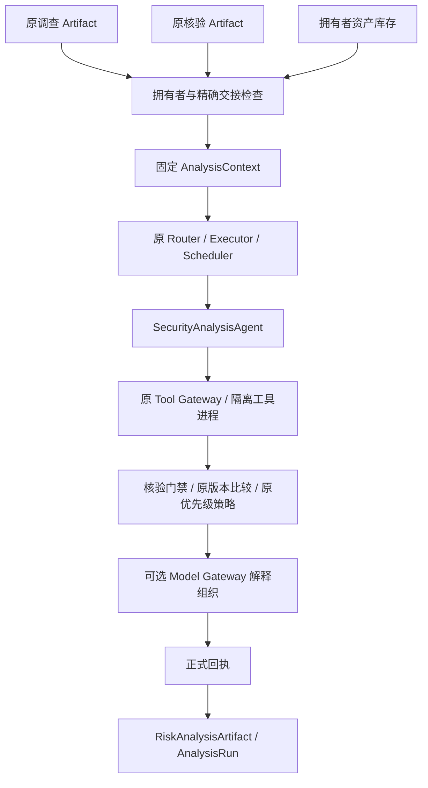

# Security Analysis Agent — Phase 11-B3

本阶段新增内部显式启用的风险分析链，不替换旧 Assistant / Planner / 资产页面的调用链。正式验收、测试计数和独立审查见根目录 `PHASE_11B3_RESULT.md`。

## 入口与调用边界

`app.agents.analysis.service.SecurityAnalysisService(engine)`：

- `run(AnalysisRequest, *, actor)`：检查拥有者与原调查/核验回执，固化输入，执行固定计划，返回原 Runtime RunSnapshot。
- `read_results(run_id, *, actor)`：从固化上下文和正式回执重建 RiskAnalysisArtifact 与 AnalysisRun。

`actor` 必须由可信服务层提供。本阶段没有公开 HTTP 接口，也没有新增认证入口。调用方须已取得 Investigation / Verification 运行中的精确 task_id、artifact_id 和 run_id；分析服务不会自动调用调查、核验或外部漏洞 API。

三个任务使用一套规则：

| task_type | READ_ONLY 工具 |
| --- | --- |
| risk_analysis | analyze_risk_snapshot |
| asset_impact_analysis | analyze_asset_impact_snapshot |
| remediation_prioritization | prioritize_remediation_snapshot |

工具输入只含 `context_id`；调用者不能提供风险结论、证据、工具地址或执行代码。专业注册 ID 为 `security_analysis_agent`，实现 ID 为 `security-analysis-v1`，Registry 为 `analysis-registry-v1`。

## 架构

新增 Agent 只负责调用协调、权限约束、输出协议及取消/超时处理。数据库读取在输入准备/工具边界；确定性计算位于 `rules.py`，动作位于 `recommendations.py`，解释位于 `assistance.py`。

## 输入与不可变历史结果

AnalysisRequest 包含调查和核验的三元引用、可选 asset_id/component_id、task_type、request_key、model_assistance（默认 False）。未知字段、空 key、只有 component_id 没有 asset_id、非布尔模型开关均拒绝。

核验结果必须指向同一调查 task / run / artifact，source_snapshot_hash、原 Artifact、Claim/Evidence 引用及调查工具回执必须一致。跨拥有者、错配及损坏来源拒绝为 `INVALID_INPUT_ARTIFACT`。不存在或不属于拥有者的资产不能伪装成缺失上下文。

资产只取用户库存声明，不执行扫描。确切包身份复用 `resolve_component`，版本复用 `compare_version`。快照保留 canonical package_name、生态、命名空间、库存版本、修订号、时间、environment/exposure 和 is_demo；criticality 固定 unknown。多组件歧义或无明确身份保持 UNKNOWN。

同拥有者、同 request_key 的内容与快照时间保持一致；改内容须换 key，否则 IdempotencyConflict。旧结果不读实时库存/情报，不重新发出模型请求。`historical_snapshot=True` 和 scope_notice 明确标注评估范围；新库存状态需要新请求。

## 门禁与风险策略

仅消费原核验结果，不重新生成 CONFIRMED。不完整调查、核验非 CONFIRMED、失败执行、冲突、缺失/未核验影响声明、不完整覆盖、缺资产/版本/明确范围均弃权：UNKNOWN / REVIEW_REQUIRED / affected=None。

在门禁满足后按顺序命中：

| 规则 | Risk Level |
| --- | --- |
| 明确所选组件 NOT_MATCHED，或全部确认范围均 NOT_AFFECTED | LOW，仅此范围 |
| 已受影响 + 确认 CISA KEV + 库存 internet | CRITICAL |
| 已受影响 + 确认 CISA KEV | HIGH |
| 已受影响 + 确认 high/critical severity，或确认静态 PoC 关联 | HIGH |
| 已受影响 + 确认 medium/low/info severity | MEDIUM |
| 已确认影响但缺可用 severity / 利用信号 | UNKNOWN；可保留 affected=True |

Priority 单独适配原 `assess_priority` 的 P0—P3；未知为 REVIEW_REQUIRED，明确范围不受影响为 DEFER。KEV/internal 可为 HIGH/P0，critical severity/internet/无 KEV 可为 HIGH/P1。Risk Level 不是 Priority 的映射函数。

Candidate PoC 不参加定级；确认静态 PoC 关联的 usability 仍为 NOT_EVALUATED。EPSS 仅保留有出处、时间和有效性标记的来源断言，不参加定级。补丁可用不等于适用或已安装，不降低风险。confidence 是未校准的启发式依据质量指标，不能解释为真实事故概率。

使用 PoC 前排除明确异包、异分支或值身份矛盾。未解析而可能相关的影响 Claim 不被过滤成“无影响”；明确其他发行包可排除。合法跨 Claim 冲突依原 Conflict 关系保存，不能当成损坏输入。

CVSS 必须是直接确认的完整 band/score/version，或者可由原 normalizer 解析的已确认向量；检查有限分值、版本和向量/分值/band 一致性。只有已确认 score 而调查中有相同 score/version 的条目，不足以确认另一个 severity。异常 CVSS 保留警告，不清空其他已确认影响或合法 KEV 决策。

## 动作与模型

精确升级版本须有同发行包/分支确认的 FIXED_VERSION Claim，且原版本比较证明候选在全部确认影响范围外。静态 Patch 引用提供检查/适用性评估方向，不承诺已安装。厂商公告本身不证明补丁存在。一般动作明确标 GENERAL_PRECAUTION，不生成厂商命令或执行资产变更。

动作类别为 IMMEDIATE、FURTHER_INVESTIGATION、LONG_TERM_HARDENING；未知结果必须有补充/复核动作。

模型默认关闭；开启时仅使用既有 Model Gateway 的 `generate_structured()`。单次调用、512 输出 token、模型网络超时至多 5 秒，外层仍受原 Runtime deadline 和进程树取消约束。模型只能返回既有因素/动作编号及受控组织字段，最终说明由原规则模板渲染；不向模型提供公告正文、自由版本、URL 或凭据。非法 JSON、伪造/遗漏编号、额外结论、配置变化或超时均保留规则结果并回退。

## Artifact 与 Trace

原 TaskArtifact / AgentArtifact 不被替换。业务投影增加 RiskAnalysisArtifact：影响/版本/核验状态、利用信号、补丁可用性、独立风险与优先级、因素、动作、证据、Claim dispositions、规则版本、快照时间/哈希/修订号、原回执和模型调用元数据。

AnalysisReader 校验运行拥有者、固定计划、注册指纹、Agent 绑定、Task/Trace/Artifact 身份、正式回执、输出的上下文/来源/时间及确定性受保护字段。AnalysisRun 保留输入/输出 Artifact 引用、比较过程、使用因素、规则 ID、状态及耗时。失败执行只投影未知的部分结果，核验原状态保持不变。

最终 evidence_refs 对因素、动作与原核验支持/冲突引用做有界并集。动作的证据编号能够在同一输出引用表解析；来源取自固定核验输入，不能用实时查询补全或替换。

## 容量与兼容

沿用 2 MiB 上下文、32 Claims、128 Evidence 引用；无组件选择时最多检查 100 个库存组件。工具包装预算 380 KiB，为原 512 KiB Artifact 留出空间；超限输出降级并保留完整上下文指针。截断/遗漏不能产生确定安全结论。

只有三个既有生产文件追加兼容能力：AgentTaskType 两个 Literal；Tool Registry 三个 READ_ONLY 工具与 context_id Schema；旧工具 adapter 三个固定分发。Planner、Runtime、Scheduler、调查/核验 Agent、原版本算法和优先级策略均保持原文件哈希。

测试使用专用 PostgreSQL、本地合成资产/证据和受控兼容 HTTP 服务。它们验证工程行为，不能代替真实资产、商业模型、生产数据准确率或安全概率校准。Integration Gate、公开 API、前端及部署均留待另行授权。
