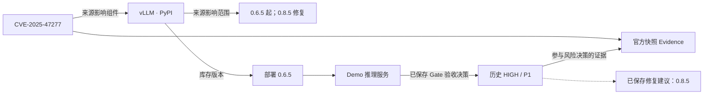

# 可复现知识关联演示

## 资料来源和运行方式

本包 JSON 来自实际 FastAPI GET 响应，不是手写 Mock。模式为 `SAVED_REAL_INVESTIGATION_READ_ONLY_PROJECTION`：读取已经保存的真实 Qwen Planner 调查，不重新运行模型，也不是新一次 Online Benchmark。

- 漏洞：CVE-2025-47277，官方 vLLM 安全公告和 OSV 采集快照。
- 官方来源：<https://github.com/vllm-project/vllm/security/advisories/GHSA-hjq4-87xh-g4fv>；保存来源 API 地址与原始 hash 可在图中追溯。
- 产品：vLLM；生态：PyPI；部署版本：0.6.5。
- 资产：`Phase12D3 vLLM demo inventory`，is_demo=true，人工库存，不是企业扫描数据。
- 来源影响区间：0.6.5 起、0.8.5 修复；图中原始范围和历史范围保留 SOURCE_ASSERTED / UNKNOWN，不能全部称为已核验。
- 已保存调查：`a583d1ae-ea72-45f6-92c7-85ef80879e65`。
- Gate：PASS；已验收历史风险：HIGH / P1；修复建议引用已保存的 0.8.5 修复版本 Claim。
- 保存的模型元数据：REAL / openai_compatible / aegisai-qwen25-planner:latest。

箭头说明以实际 KnowledgeEdge 状态为准。修复建议是 Risk 节点的 recommendation 字段，不是新增 FIX 类型节点。影响范围与部署版本是两个不同概念。

## 2 分钟展示步骤

1. 读取 `component-query.json`：按组件 vllm、PyPI、来源 HIGH 查询真实采集漏洞；此查询默认不包含私人资产或 Risk。
2. 读取 `saved-real-investigation-graph.json`：指定上述调查 ID，展示 19 个实体、23 条关系、三专业 Agent 的 Artifact 引用。
3. 区分官方影响范围、库存部署版本和 Evidence。对 UNKNOWN 的历史范围说明它已被后续 observation 替代，不把它隐藏。
4. 展示 Risk 的 HIGH/P1、evaluation_time、historical_snapshot=true，以及参与决策的 Evidence ID。
5. 展示修复版本 0.8.5 和 VERIFIED_CLAIM 来源；补充建议中 GENERAL_PRECAUTION/UNKNOWN 必须保留。

## 复现证据

`http-receipt.json` 保存三个实际 GET 的路径、参数、HTTP 200、模型来源元数据和只读检查。本次启用数据库 `default_transaction_read_only=on`，调用日志只出现 SELECT，相关记录数前后相等，模型入口被禁止推理的测试包装保护。

图中 `truncated=true`：长内容按投影预算截断；warnings 还包含历史范围提示。通过 source_records/raw_document/observation/Artifact 引用读取完整原记录。原始 JSON 保持接口输出，未手工修饰成更高可信状态。

演示只证明已有资料和已保存调查可关联，不能证明当前生产风险、全域采集覆盖、Benchmark 准确率或真实企业扫描能力。
