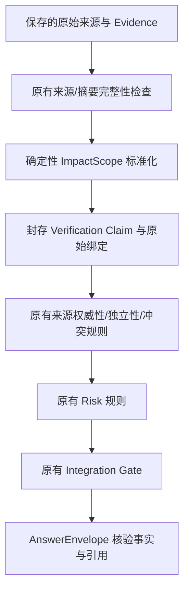

# Phase 14-B7 影响范围事实链契约

本说明对应提交 17d43c39ab84d80cdda9334dc12997397a0f4cae。新增能力位于现有核验快照和答案投影中，没有新增 Agent、路由、数据库表或评分公式。

## 数据和判断分开

- `VerificationClaim.impact_scope` 是可选字段。旧快照没有该字段时仍不序列化它，原指纹和读取保持兼容。
- `affected_version_range` 保存边界、开闭区间，并复用现有 PyPI / PEP440 比较，不做字符串比较，不调用模型判断大小。
- `fixed_version` 只在已经有明确修复值，或不可变来源的 `patched_versions` 字段明确给出单一包含式下界时填写。例如 `>= 0.30.0`。不能从受影响上界反推修复版本。
- `condition/platform/architecture/branch` 保留来源中已有值。未实现通用环境条件裁决；带不能判断的条件时排除为未解决适用性，不确认资产影响。
- `normalization_state` 仅描述解析状态。标准化成功不等于核验确认。
- 原始 `raw_expression`、Claim/Evidence 行和封存旧快照不修改。新快照保留每个原始 Claim ID、原始值及 Evidence 绑定。
- 超过 128 个不连续区间的集合保留原始值，标明不支持，不能截断后确认。并非支持所有生态、通配符或自然语言版本格式。

## 等价合并的边界

只有同漏洞、同包身份、同范围作用域、同分支、同适用性条件且规范语义严格等价的影响/修复 Claim 才能共用一个核验事实。明确选择原始 Claim 的调用不合并。

合并后 `source_claim_ids` 和 `evidence_refs[*].source_claim_id` 保留原绑定；不能把不同范围、不同产品或未知范围拼成一个新结论。范围冲突继续交给现有核验/Gate。转载仍保留其原始权威级别和上游 lineage，不能作为两份独立官方证据。

`ImpactScope.evidence_refs` 是来源集合，包含候选引用，不能把整个集合当作已支持该结论的证据。`ClaimVerification.supporting_evidence_ids` 和最终 `VerifiedFact.evidence_ids` 才表示规则选出的支持引用。

## 前端和联调

没有新增 URL。现有调查 Artifact 和 Answer 接口可读取新数据，前端通过同步的 OpenAPI / TypeScript 类型使用可选字段。

在 `AnswerEnvelope.verified_claims[*].value.impact_scope` 读取已核验范围、修复版本和原始引用。实际核验状态及 confidence 来自相同 Claim 的规则结果；争议事实仍在 `disputed_claims`，不能展示成已确认资产安全。

旧答案仍用旧投影。新的 HTTP 联调校验比较当前正式投影，而不是把 Claim 原值与带证明元数据的答案值直接比较。此变化不修改评分字段、匹配规则、分母或人工答案。

## 已验证的边界与当前限制

定向运行保存了 8 个固定场景：包括一个缺版本预检，实际进入完整链路的 7 题包含 8 个单资产/批次子调查。vLLM 的两种版本分别得到 AFFECTED / NOT_AFFECTED，28 条答案引用通过保存证据绑定检查。来源冲突、证据不足、缺版本继续保留。

这只是确定性事实链和引用检查，不能代替对输出的独立人工复核。正式 49 题结果以 PHASE_14B7_RESULT.md 和本轮原始回执为准。不能用工程测试数量推断安全准确率。
