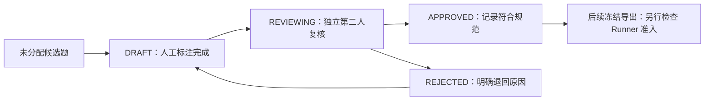

# AegisBench 人工标注与独立复核规范 v1

适用阶段：Phase 13-C 流程建设，后续由团队在 Phase 13-D 执行。候选集为 AegisBench-v0.2.1-pilot，49 题、5 个公告簇；当前人工草稿、复核中、已批准记录均为 0。标注工作的完成情况以 [GROUND_TRUTH_PROGRESS.md](GROUND_TRUTH_PROGRESS.md) 为准。

## 1. 先读什么、从哪里开始

1. 阅读本规范和 [MANUAL_RECORD_SCHEMA.md](MANUAL_RECORD_SCHEMA.md)。查看 [QUESTION_CLASSIFICATION.md](QUESTION_CLASSIFICATION.md)，按原问题 ID 领取任务。
2. 数据管理员在进度表登记真实标注人和另一位复核人。现阶段所有题保持未分配，不预填人员。
3. 从 `ground_truth_template.json` 复制空表。`template.json` 是相同内容的兼容副本；维护规范时两份同时更新、核对字节一致。
4. 人工从已冻结问题文件复制 id、question、category、input_context、origin 和 source_ids，不能改题目、版本或资产条件来适配已知答案。
5. 标注人独立读来源、填写答案与原文证据；填写完成后才把 `record_kind` 改为 HUMAN_RECORD，状态设为 DRAFT。
6. 将草稿提交另一人。对提交内容计算哈希，进入 REVIEWING。复核人按第 7 节逐项检查，给出 APPROVED 或 REJECTED。
7. 数据管理员保存每个版本和审核记录。Phase 13-D 再从真实已批准记录制作新的冻结评测版本；本阶段不填写答案、不导入、不运行评测。

AI 搜索、整理与翻译只能辅助草稿。标注人必须亲自核对原来源，记录 AI 辅助范围；AI 不担任标注人、复核人或裁决人。标准答案制作与系统回答的 OutcomeAudit 是两件事，后者在有真实输出后另外进行。

## 2. 文件与角色

```text
ground_truth/
├── schema.md                       # 原评测契约及人工流程映射入口
├── MANUAL_RECORD_SCHEMA.md         # 人工记录字段/枚举/导出规则
├── ANNOTATION_GUIDE.md             # 人工操作规范
├── ground_truth_template.json      # 唯一模板原本，空表
├── template.json                   # 相同内容的兼容文件
├── ground_truth_workflow.schema.json  # 表单结构校验，无 Runner 接入
├── QUESTION_CLASSIFICATION.md      # 49 题六类主分类/复合标签
├── GROUND_TRUTH_PROGRESS.md        # 唯一进度台账
├── progress.md                     # 进度入口
└── samples/
    ├── draft/
    ├── reviewing/
    ├── approved/
    └── rejected/                  # 退回版本保留，禁止删除审核历史
```

标注人负责逐项调查、引用原文和记录不确定性。复核人负责独立判断，必须与标注人是不同自然人，身份使用可追溯的团队 ID；同一人换账号、换大小写或由 AI 换名不构成独立复核。数据管理员负责版本、去重、冻结与台账，不代替证据判断。存在实质分歧时交由第三位实际成员复查；没有第三人时继续待复核，记录分歧，不自动批准。

## 3. 证据等级与直接性

以下等级是本项目的标注政策，不能仅凭域名或平台名称判定。等级不产生自动置信分，也不意味着来源必然支持当前结论。

| 等级 | 来源定位 | 允许用途和限制 |
|---|---|---|
| L1_OFFICIAL | 厂商/维护者原始公告、官方发行说明或补丁、CNA/CVE/NVD 正式记录 | 优先用于具体事实；仍要检查包、分支、版本、更新时间和原文直接性。官方 commit 被列为参考不等于该 commit 已确认修复 |
| L2_RESEARCH | 可识别作者的安全研究机构、经过审阅的安全社区/公告库、可溯源技术分析 | 用于补充与交叉核对；GitHub 官方仓库要确认所有者和维护者身份。平台上的任意仓库不能自动称为官方 |
| L3_SECONDARY | 普通博客、转载、未知作者仓库和二次总结 | 用于发现线索或明确标为候选；单独不足以确认受影响、修复或利用成功 |

官方数据库中的描述可能转引其他公告。两份转引同一资料的页面不算两条独立证据。现有五份 GHSA API 投影提供可溯源资料入口，人工仍须辨明原始发布者、引用关系及所需结论是否真的在其中。

每个关键判断必须挂接证据 ID；每个证据保存来源名称、实际 URL、原文、发布时间、获取时间、定位和快照哈希。时间未知时填 null，并在 time_note 写明原因；不能把获取时间当发布时间。新增来源需在后续人工工作中保存快照并纳入新 manifest，当前流程建设不编造来源。

原文 `quote` 面向人工阅读；`canonical_excerpt` 面向原评测器，是定位值的规范 JSON，二者不可混用。引用要能在相应版本重定位。若当前快照不包含所需事实，保留缺口，不能用一个相关页面支持不存在的原文。

## 4. 六类标注规则

### 4.1 漏洞事实查询

核对 CVE/GHSA、组件、描述、CWE，以及 CVSS 的版本、向量和分数。不同 CVSS 版本分别记录；缺向量的占位零分不能解释成已确认零风险。缺失 CWE 或评分保留缺失理由。不要把 CVE 编号、标题或产品名字当受影响证据。

原评测器对 summary、列表和结构化字段使用精确 JSON 匹配，不能把同义改写的字段得分宣传为语义问答质量。人工应记录来源措辞和字段顺序规范，Phase 13-D 再统一输出口径。

### 4.2 版本影响判断

| 人工结论 | 何时可用 |
|---|---|
| AFFECTED | 包与生态明确、被问版本明确，可靠来源的对应分支范围直接包含该版本；记录所有边界及版本条件 |
| NOT_AFFECTED | 相同包、生态、分支和配置下，有可覆盖该版本的明确排除/修复证据；仅“公告没有提到”不足以支持 |
| INSUFFICIENT_EVIDENCE | 部署版本缺失、分支不明确、解析规则无法确认、来源矛盾或依据不足；列出还需调查什么 |

记录受影响范围和修复版本，区分 `<` 与 `<=`、预发布、多个修复分支和区间空档。修复版本不代表所有后续分支都自动安全。描述中的“可能”不能改成确定影响。人工可保留 UNKNOWN；进入旧评测格式时与 INSUFFICIENT_EVIDENCE 均投影为 UNKNOWN，原结论留在人工记录中。

### 4.3 Patch 分析

区分公告确认的修复 release 与仅发现的 commit/PR。直接证据需说明该漏洞、修复分支/版本和实际引用关系。引用列表中出现 commit 只可形成 PATCH_CANDIDATE；不能据此认定代码审查或回归验证通过。CONFIRMED_FIX 要明确其确认范围是 release fix、commit fix 还是两者，避免扩大判断。

### 4.4 POC 核验

| 人工结论 | 必要依据 |
|---|---|
| POC_CANDIDATE | 可定位公开代码或报告与目标漏洞有关，但缺少可核对的独立利用验证记录 |
| VERIFIED_EXPLOIT | 已有授权隔离环境中的可审计独立验证记录，目标/版本/条件对应，预期与实际行为、验证者、时间和材料完整 |
| NO_EVIDENCE | 当前资料与调查范围未提供足够的利用验证依据；列出搜索/检查范围，不能解释为世界上不存在 PoC |

仓库名、README 提及 CVE、星数或视频标题均不能证明利用成功。未经授权不得为了标注而运行攻击代码；本阶段不执行 PoC。没有既有合法验证材料时保留候选或证据不足。原 Runner 将 NO_EVIDENCE 记为 UNKNOWN，且 `should_abstain` 由人确认。

### 4.5 资产风险分析

证据要覆盖资产输入、组件版本、配置/可达性、攻击前提、利用信息、现有防护和修复可行性；风险等级与建议措施分别说明。CVSS 是一个输入，不能凭它猜实际资产风险，也不能把控制资产说成真实生产部署。

当前 10 道 risk 题明确要求 benchmark-reference-triage-v1；7 道多跳题也含这一政策。它们可以人工核对**声明的政策符合性**，evaluation_profile 必须写 POLICY_CONFORMANCE，保留政策依据与推导。不得将该等级宣传成专家实际资产风险。若要评测真实资产风险，Phase 13-D 必须先创建与 CONTEXTUAL_ASSET_RISK 目标一致的新问题版本与证据，不能偷偷改当前 49 题的输入或直接混用两套风险政策。

补救建议使用适用前提和可追溯依据；不把 LLM 建议当官方修复要求。风险/优先级枚举与原生 Agent 不同的样本标为 EXPORT_BLOCKED，等待评分口径确认，不强行转换 enum。

### 4.6 复杂多跳问答

逐项记录组件 → 漏洞 → 版本 → 资产 → 风险的中间判断及证据。每个资产单独判断；未知版本的资产保留未知，已知资产仍可分析。required_hops 由人工按问题确定，不能读取已执行系统 Trace 再反写标准步骤。步骤记录只能证明过程覆盖，不能替代事实和推理支持性审查。

5 道 release-and-poc 同时含 POC 与 Patch 判断，保持一个 question ID、一份记录，按字段分别引用证据。不要重复计算为两条标准样本。

## 5. 独立调查与盲审

第一轮只给标注人和复核人问题、输入上下文及来源入口；不向其提供机器参考答案、各 baseline 输出、分数或模型排名。项目原机器 annotations.jsonl 和 Phase 13-B 实验报告保留在原目录，但不能复制到人工表单作为答案。

AI 辅助记录至少写用途、工具/版本、时间以及哪些内容经过人工查源。不能用 SYSTEM_GENERATED 或人工名字把模型生成答案伪装成最终标准答案。必要时裁决人复查来源而不是投票选模型结果。

## 6. 状态与版本交接



| 状态 | 进入条件 | 后续处理 |
|---|---|---|
| DRAFT | 标注人亲自核对，答案/证据/不确定性已填写，签署标注确认 | 提交哈希明确的当前修订给第二人 |
| REVIEWING | 指定不同自然人的复核人，锁定送审内容哈希和修订号 | 不在送审版本上边复核边改答案 |
| APPROVED | 独立复核通过检查表，复核人与时间可追溯，审核内容哈希等于当前内容哈希 | 保存已批准原件；后续再检查导出可用性 |
| REJECTED | 内容缺失、证据不支持、身份/版本不一致或分歧未解决，写明确原因 | 保留 rejected 原件，在新修订号重做，不删除历史 |

APPROVED 表示人工记录合格，可以批准合理的 INSUFFICIENT_EVIDENCE；不意味着漏洞受影响/补丁/利用均已确认。UNASSIGNED/ASSIGNED 仅是领取状态，NOT_STARTED 表示尚未形成完成的人工记录，均不是人工记录的四种状态。空模板、机器草稿和 .gitkeep 不进入人工进度。

文件名使用 `<question_id>__r0001.json`，每次改内容递增修订号。送审/批准后修改 question、input_context、expected_answer、judgments、evidence、evaluation 或不确定性，必须重新计算内容哈希并重新复核。保留旧 revision；每个题只计最新有效修订一次。存在多个互相冲突的 active 版本时停止该题导出。

## 7. 逐题复核检查表

- [ ] 与冻结题目的 ID、问题、上下文、来源 ID 和题目哈希一致。
- [ ] 标注人与复核人是可追溯的不同自然人，两人分别确认亲自查源；AI 辅助范围记录完整。
- [ ] 每个关键答案字段都有 judgement，绑定可定位支持证据，或清楚写明为什么不足。
- [ ] 来源实际 URL、原文、发布时间/未知原因、获取时间、快照 SHA 和定位已核对。
- [ ] 权威性与直接性分别检查；转载不重复计算为独立来源，冲突没有被隐去。
- [ ] 版本边界、生态、分支、CWE、CVSS 版本及缺失值没有擅自补全。
- [ ] Patch candidate/confirmed release、POC candidate/verified exploit/no evidence 分得清楚。
- [ ] 风险政策/资产条件清楚，CVSS 没有被当成实际风险判定；未知项与部分弃答保留。
- [ ] expected_answer、should_abstain、required_hops 与题目和依据一致；建议和新增字段标清评分范围。
- [ ] 复核人确认完整阅读答案与证据，没有只审核系统/机器自列的部分事实。
- [ ] reviewed_content_sha256 与当前 content_sha256 相同；复核时间、意见与退回原因已记录。
- [ ] 目录、台账、修订历史和导出状态同步；不因为目录名 approved 就跳过 Runner 准入。

结构校验只能检查字段，不能证明来源支持结论或两个人真的参与。实际审核签字/提交记录须由团队完成。

检查项不适用于当前题时，也须由复核人确认“不适用”并在 review_note 说明，不能机械地勾选。填写说明不等于增加一条已完成样本。

## 8. 冻结、导出与评测隔离

Phase 13-D 在独立新 dataset 目录封存 approved 表单与经过检查的 Annotation JSONL；旧 v0.1/v0.2/v0.2.1 的问题、机器标签、来源与报告不覆盖。保存 manifest、版本、发布时间、源/问题/标签/人工表单 SHA、导出映射、准入与排除清单。

人工表单不能直接交给原 Runner。它只认 Annotation 的既有字段，不识别 question/type/evidence/annotation/history 等外层字段。数据管理员按 [MANUAL_RECORD_SCHEMA.md](MANUAL_RECORD_SCHEMA.md) 的白名单逐项制作兼容投影；不存在自动转换器，本阶段也不开发。先保存人工批准原件，再投影，不能逆向修改原标准答案迎合模型输出。

分诊政策不同、资料不在冻结源目录、定位失效、人员不独立、记录不完整或含标签泄漏时，导出保持 EXPORT_BLOCKED，写原因。只把真正通过准入的记录纳入实验，公布所有未标注/待复核/排除数量，不能把小样本结果称作 49 题全量成绩。

按公告簇分组拆分开发/正式集，同一 CVE/GHSA 的相似版本题不能一部分开发、一部分冒充独立 holdout。当前五簇有开发重叠，是 pilot；独立 holdout 需后续新增。先冻结标准答案，再运行系统；结果审核 OutcomeAudit 另外绑定实际输出哈希，不用 Ground Truth APPROVED 替代。

## 9. 进度维护与答辩材料

唯一台账为 GROUND_TRUTH_PROGRESS.md，每行对应一个原始 question ID，分别记录领取状态与人工流程状态，并包含主类型、标注人、复核人、修订、记录路径和阻塞原因。每次状态变化由实际操作人更新，数据管理员核对 active 修订、目录和计数。NOT_STARTED + DRAFT + REVIEWING + APPROVED + REJECTED = 49；领取但尚未完成填写的题仍为 NOT_STARTED，领取列改为 ASSIGNED。导出成功数单独计算，不把 APPROVED 数自动当作已可评分数。

可在答辩展示冻结候选清单、证据出处、匿名团队人员 ID、分歧与复核记录、版本哈希和实际覆盖数量。模板和流程说明不属于人工标注成果；人工批准仍为 0 时必须如实说明。仅提交脱敏样本，不保存 API Key、账号密码或真实资产秘密。

## 10. 禁止事项

- 不自动生成或填满 49 条标准答案，不以模型输出、项目 Agent 输出或机器参考替代来源。
- 不编造 URL、公告、原文、发布时间、验证者、审核者或已经发生的审核。
- 不凭 CVSS 猜实际资产风险，不凭 CVE 编号猜影响，不凭博客确认漏洞，不凭仓库名确认利用成功。
- 不强行给缺证据问题确定结论，不隐藏来源冲突，不把未搜到解释为不存在。
- 不修改 Agent、Runtime、Evaluation Runner、评分函数或已冻结数据；不在本阶段执行评测或模型对比。
