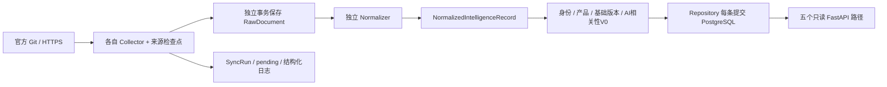

# Phase 6 后端架构

范围为已冻结的 CVE_LIST、OSV、CISA_KEV，完整输入指纹见 input_manifest.json。三源真实运行、原文与接口证据见 REAL_DATA_VALIDATION.md；已冻结的 Phase 1–5 文档与数据库迁移不改动。

HTTPX 提供统一允许地址、超时、重试、限速、User-Agent 与响应边界；Git 仅执行固定的官方仓库元数据操作。Normalizer 不写数据库，Repository 不发网络请求；SyncService 编排原文事务与逐条域事务。异常原文已提交，单条域事务回滚后继续下一条。

复用 Phase 5 的 43 表及 0001，未运行 create_all、未更改发布迁移。Raw/Observation/评分/版本历史由数据库 22 个触发器保护。真实库 aegis_phase6:55436 与可清空测试库 aegis_phase5_test:55435 分开。

SourceObservation 是来源陈述与域实体的桥梁；来源自身描述、时间、评分、范围与 locator 并存。canonical projection 只按固定来源优先级与来源修改时间更新；所有数据保持 UNTRUSTED、verification_status=pending。没有新增 Evidence/Claim 核验、PoC/Patch 关联、资产引擎、Agent 或前端联调。

架构检查：Collector 只负责获取、目录校验与来源游标；格式转换独立；身份、产品、版本规则独立于 HTTP/Git；数据库集中在 repository 与事务助手；SyncService 约 120 行，无巨大 service.py。新增第四源需要新增适配器/normalizer，并登记运行目录、工厂、版本/优先级、HTTP 允许地址和 API 参数枚举，约 7 处接线，不必改逐条核心链路。适配器接口目前是静态登记，未做插件热加载。

运行方式、可复跑命令、Compose 的未验证边界见 ../../backend/README.md。实际依赖版本与许可证见 THIRD_PARTY_NOTICES.md。部署限于本机；并发租约、认证、调度与完整覆盖留后续工程阶段。
