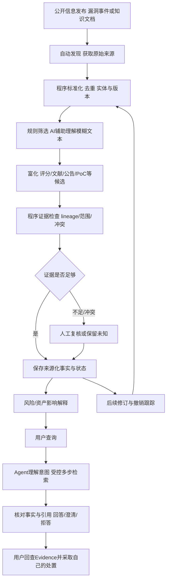

# 完整业务闭环

下面是业务职责和输入输出，不是UI跳转、数据库表或部署架构。自动步骤覆盖正常链；人工复核是明示例外，不自动提高可信等级。

| 步骤 | 输入→输出/用户价值 | 自动/程序/AI/人工与失败 |
|---|---|---|
| 发现/获取 | 登记源→原始信息及观察时间 | 自动程序；失败有状态/回补，不调用任意URL |
| 处理 | 原文→主体/知识文档、产品包与版本候选 | 程序；未知格式/身份保留原文，隔离单条 |
| AI相关性 | 产品/文本→相关、不相关或未知及理由 | 程序明确项，AI辅助模糊项；人工确认重要unknown |
| 富化 | 主体+关联线索→评分/论文/公告/资产/PoC等来源化Claim | 自动程序和受控语义关联；AI结果仍候选 |
| 核验 | Claim+原文→证据支持/反驳、独立性与适用范围 | 程序确定性检查，AI可提示关系；冲突/PoC可用性/重要资产人工参与 |
| 入库/持续跟踪 | 事实+Evidence→稳定可查询的历史和当前状态 | 程序；失败不宣称更新成功，不覆盖原依据 |
| 风险分析 | 版本/评分/利用信号/授权资产→可解释影响和建议 | 程序确定影响，AI可总结；无资产/范围不足则unknown |
| 用户查询/Agent | 问题→意图、工具与跨文档事实连接 | 用户发起，Agent自主受限编排；失败部分回答/澄清，不写可信事实 |
| 回答/处置 | 已核对依据→引用回答/修复建议 | AI表达，程序核查引用；用户决定处置，系统不自动攻击或强制升级 |

论文、标准和政策按文档类型并行汇聚到知识底座；与某漏洞的关联先候选后证据确认。没有CVE的AI风险事件使用自己的稳定身份。首次M0只跑数据技术链，M1还需知识文档、问答和实际Agent方形成比赛闭环。

需求属性与来源的完整登记以 [FEATURE_LIST.md](FEATURE_LIST.md) / [requirements.json](requirements.json) 为准；具体实现尚未开始。
