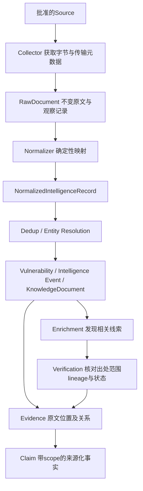

# 获取方式与职责

默认官方API > 官方Dataset/Feed > 官方Git > RSS/Atom > 网页。按任务粒度应用：批量官方推荐dataset时不逐项调用查询API；不能把优先序当必须使用不适合的接口。

| 源 | 选定方法与理由 | 备选/限制 |
|---|---|---|
| CVE_LIST | 官方README明确Git易保持更新；基线+commit差异 | 不能把需CNA凭证的管理接口当公共消费API；release日基线/小时delta用于恢复 |
| OSV | 官方API精确查询/取ID；官方Dataset及modified_id.csv承担批量发现 | /query不是全库modified扫描接口；querybatch不是CDC；不爬OSV网页 |
| KEV | 官方JSON数据镜像；条件HTTP + catalog hash | 没有核实KEV独立实时API，不捏造；全目录变化后才下载小快照；官方站点可作为回查 |
| EPSS | 少量CVE API查询；批量按当前官方指向每日CSV | 官方已注明查询API不用于全库同步；CSV当前地址和redirect必须从官方data文档解析/批准 |
| 厂商/GitHub | 已发布repository advisory REST；按references读Issue/PR/commit/release | 无高级全站搜索；私有/未发布advisory不访问；不同端点分别分页/条件获取 |
| arXiv | 官方Atom查询API，单连接每3秒以内最多1请求 | 保留paper版本；不是所有论文全文都可再分发；不默认自动下载PDF |
| 博客 | 出版者直接提供或官方链接的RSS/Atom | Google feed必须HTTPS，拒绝降级；Trail of Bits canonical index.xml；feed条目过期不是删除证据 |
| SAMR/NIST/CAC | 本轮未确认适用的稳定结构化API；官方目录/标准元数据+官方文档链接 | 仅固定栏目及有限文档，不全站爬；robots/站点条款/全文使用范围接入前核对；无通用开放许可则保持元数据/链接 |
| ATLAS/OWASP | 官方Git数据/版本内容 | 固定schema/知识edition；文档更改不意味着现实利用事件发生 |

Collector只处理批准地址、传输、分页、限流、原文、checkpoint候选；不做LLM解释或可信度写入。Normalizer按源schema输出业务契约/原文locator、保持null和扩展；不推理fixed或PoC可用性。Dedup做身份/修订，Entity Resolution按生态/包与审核别名，歧义不自动合并。Enrichment以后找评分/公告/论文/代码的候选关系。Verification以后检查scope、时间、lineage、证据与冲突；不能通过“来源多”自动标可信，重要冲突/可用性走人工。

这只是架构与调用设计，没有实现上述模块、数据库、知识库、Dify或Agent。
