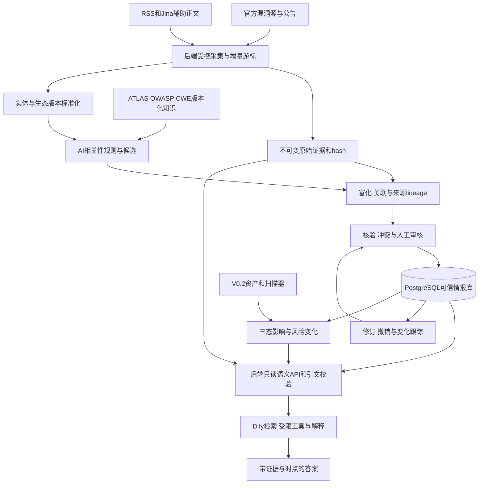

# AegisAI 最终选型：先打通可信情报小闭环

调研快照：2026-10-03。下面的 A/B/C/D 是本项目的采用方式，不是项目全球质量排名。首期冻结选型，不进入业务实现。

## 1. 调研数量和主要发现

按候选单位，共 **87项**：61个已取得元数据的独立仓库、16个具体Dify插件、10个官方服务/标准；A=18、B=44、C=9、D=16。这是选型清单数量，不是全部项目已部署数量，也不是独立情报源数量。

已完成真实 CVE-2025-32434 的跨源字段与来源链核对、公开修复 commit 的静态取证、packaging 的6个版本边界检查。未运行 Dify 集成或公开模型基准，未宣称已完成企业系统验证。

关键发现：Dify GitHub插件已有丰富读工具及写工具，市场旧描述不能代表权限；Postgres MCP源码默认可写且新增HTTP传输，不能照旧README判兼容；Extractor已使用pypdfium2且会抓远程图片；llm-guard已归档；OSV/GHSA/CVE/NVD可能共享同一原公告；MoreFixes数据已更新至2026；数据/模型/服务许可与根代码许可经常不同。

## 2. A：直接使用

复用通用解析/标准：packageurl-python与PURL规范、packaging、feedparser、CVE/OSV schema。npm引入时用node-semver，严格SemVer可用python-semver，不重复维护比较器。Dify首期需要Agent节点时使用官方Function Calling策略的显式工具允许列表；Extractor用于受控文件辅助解析。

后续直接使用Syft、OSV-Scanner、CycloneDX/SPDX、OpenVEX、python-stix2。A不表示全部立刻安装；它表示该通用能力不值得自行重写。JS PURL SDK只在JS组件有需要时增加。

## 3. B：封装接入

V0.1：CVE List V5、GHSA API/Advisory Database、OSV、NVD补充、CISA KEV/Vulnrichment、EPSS，ATLAS与OWASP分类资料、CWE名称/标识，Jina公共公告正文辅助。Dify独立部署，通过后端OpenAPI只读语义工具取审核数据。

V0.2：Firecrawl复杂网页、arXiv/Crossref/OpenAlex论文、官方GitHub MCP可选、arxiv MCP可选、univers更多生态、ATT&CK/CAPEC、Grype对照、Docling复杂文档、ModelScan、garak和选定基准。Trickest/CVEfixes/MoreFixes仅候选或评测种子，确认关系需证据审核。

## 4. C：借鉴设计

OpenCTI借鉴来源/实体/关系/生命周期，MISP借鉴事件/分类/共享/误报，IntelOwl借鉴分析任务与结果，GUAC借鉴供应链证据连接。VulnMCP与badchars/cve-mcp借鉴聚合工具字段与适配思路；modelcontextprotocol/servers借鉴接口。langgenius/dify-plugins作生态发现入口；mitre/cti作历史兼容参考，正式ATT&CK数据选attack-stix-data。

不复制未知许可或企业组件。首期不部署上述大型平台，后续企业已有平台时做最小连接器。

## 5. D：不建议当前使用及理由

- llm-guard：已归档，不做持续维护的核心防护。
- PostgreSQL MCP、第三方hjlarry/database与SQLite SQL Tool：自由SQL/默认写权限，首期业务库由语义API访问。
- ContrastAPI及其Dify插件：第三方在线服务的数据保留/条款和全部工具边界未验证，官方API已经可用。
- 社区ATT&CK MCP候选：缺已核实README/LICENSE/独立运行入口；社区OSV/RSS MCP：包装收益小、维护/依赖/许可增加。
- DuckDuckGo与Websearch作为核心通路：旧功能弃用或通用检索缺证据保证；RSSHub trigger不能代替定时采集。
- python-semanticversion：本次低频且有替代，避免多套版本库；不将低频直接定性为失效。
- PyMuPDF：首期已有解析能力，AGPL/商业路径增加管理；Semantic Scholar API：当前授权范围与额外收益未明确。

完整16个D单位以及各候选分类见机器清单；“当前不用”不是永久否定，也不是许可类别一票否决。

## 6. AegisAI 必须自己掌握的核心能力

| 能力 | 边界与理由 |
|---|---|
| AI相关性 | 自研产品注册表、规则与审核；ATLAS/OWASP只给分类知识，LLM给候选 |
| 实体统一 | 复用PURL/name规范；自研有证据别名、产品-包-仓库-CPE关系与历史 |
| 版本标准化 | 复用生态比较器；自研源语义、区间、原文/unknown、三态影响，不重写排序 |
| PoC真实性 | 自研关联状态和审核；搜索/SSVC仅信号，首期不运行 |
| Patch/Fix关联 | 复用官方refs/GitHub API/数据集；自研分支、版本、因果证据与审核 |
| 原始证据/多源核验 | 自研不可变hash、定位、lineage、独立组与字段支持/反驳关系 |
| 冲突/生命周期 | 自研修订、撤销、冲突、人工理由、审核状态和审计 |
| 资产影响/风险变化 | 后续复用scanner；自研可信三态、条件、时点与可解释diff |
| Agent任务规划 | 复用Dify执行；自研允许操作、输入输出schema、预算、任务状态与安全策略；首期固定流程足够 |
| Benchmark | 复用公开种子/评测框架；自研证据gold、困难负样本、时间切分与分层指标 |

## 7. 新增发现

最值得加入首期的不是更多Agent，而是：字段血缘、原始证据不可变、来源修订与撤销、unknown三态、审核理由、失败回补、时效显示、API配额和LLM费用账。否则多源汇聚会放大同源重复、过时范围和不可回查结论。

V0.2增加误报有效期、case与订阅、租户隔离、离线私有清单、回放/恢复演练；决赛再扩到模型供应链和攻击防御映射。外部内容注入以权限和来源校验限制，内容扫描只能补充，不能当安全边界。

## 8. V0.1 最小技术栈和明天的顺序

**固定范围：先支持明确身份的PyPI AI包，以torch/vllm等已审核目标小表起步；用1条真实漏洞跑通，再扩大采集。** 不用某个公共源没有该条记录就构造假数据。

| 层 | 冻结选择 | 安装/接入/自研 |
|---|---|---|
| 后端 | Python 3.12、FastAPI、HTTP客户端、受支持PostgreSQL；独立于Dify内部库 | 下阶段安装基础框架；版本锁定和适配测试，不在本轮建工程 |
| 调度/存储 | 单采集进程+持久任务/游标；PostgreSQL结构化记录；本地受控raw blob目录 | 保存hash/修订/失败回补；首期不强制Redis/Celery/图库 |
| 官方源 | CVE List、GHSA/OSV核心；NVD/CISA/EPSS补充 | 自研轻适配器、配额/缓存与lineage；不写假API |
| 身份与版本 | packageurl-python、packaging；feedparser供RSS辅助 | 直接库+自有审核别名、规则、unknown |
| 抓取/解析 | 官方JSON优先；Jina Reader辅助；Extractor文件通路可选 | 源文件原样留存、hash与引文定位；服务失败不阻塞核心 |
| AI分类/知识 | 小型产品注册表、CWE、ATLAS/OWASP参考 | 规则优先，模型给证据候选；知识数据锁版本 |
| 问答 | Dify单应用+现有合规模型供应商+后端只读OpenAPI | 单步/受限Function Calling，拿verified字段与证据，后端校验引用 |
| 验收 | 本报告真实样本+生态边界+后续人工gold | 不报虚构模型准确率；核对每字段/引文/状态和不当工具调用 |

Python/FastAPI/PostgreSQL是后续实现框架选择，尚未在本轮创建应用或验证整套运行兼容；开发阶段锁定受支持版本与依赖。PostgreSQL同时存结构化情报与简单检索，首期不引入独立向量库；Dify知识索引只是可重建的问答副本。

执行顺序：真实源响应和schema→原始证据→包/版本/AI筛选→显式引用富化→来源/冲突/审核→只读查询→Dify带引文回答。V0.1完成条件是同一漏洞能展示原公告、规范身份/范围、修复/风险信号、来源状态并回查证据；不以装了多少插件验收。

文档要求的18个明确答案：

| 问题 | 最终决定 |
|---|---|
| 1 GitHub插件/MCP还是API？ | 正式监测/公告/commit用后端GitHub REST；插件受限辅助，官方MCP V0.2可选 |
| 2 网页抓取？ | 官方API/RSS优先，Jina Reader公共正文辅助；复杂crawl V0.2 Firecrawl |
| 3 文档解析？ | 首期官方Dify Extractor辅助，源文件/JSON/定位后端留证；OCR V0.2 Docling |
| 4 CVE基础源？ | CVEProject/cvelistV5作身份/状态主干，GHSA/OSV补包语义，NVD补分析 |
| 5 OSV核心？ | 是，PyPI/npm包身份与范围非常适合；保留聚合来源，不能当独立第三票 |
| 6 Vulnrichment与KEV？ | CISA ADP/SSVC补充；KEV按完整目录记录已知利用，不在目录≠未利用 |
| 7 EPSS？ | 每日、按日期保存；少量API、全量CSV；用于优先级趋势，非严重性/事实可信度 |
| 8 成熟PoC搜索？ | 有候选发现资源和GitHub检索；未核实可靠通用真实性判断，关联自研，首期不执行 |
| 9 Patch/Fix？ | 官方refs+GitHub API+历史CVEfixes/MoreFixes种子；在线确认、分支/版本关系自研 |
| 10 实体库？ | PURL SDK和生态name规范直接用；PyTorch/torch等语义映射自研有证据表 |
| 11 版本库？ | PyPI packaging、npm node-semver；严格SemVer可python-semver；多生态V0.2 univers |
| 12 ATLAS？ | 官方版本化数据导入稳定AML ID/案例/关系，保留版本；无依据标签为候选 |
| 13 ATT&CK/CWE/CAPEC首期？ | CWE标识/名称值得首期接；CAPEC/ATT&CK全量映射放V0.2，不编完整链 |
| 14 SBOM首期？ | 不做完整SBOM/镜像服务；仅明确包版本的影响示例，V0.2复用现成scanner |
| 15 CTI平台用/接/借鉴？ | 首期三者借鉴；企业已有平台后续做导入/导出连接器 |
| 16 Dify负责？ | 会话、摘要/候选、已审核知识检索、受限工具编排和引用回答 |
| 17 后端掌握？ | 身份/版本/证据/源请求/核验/冲突/审核/生命周期/授权/预算/审计；可信写入只在后端 |
| 18 最小栈？ | Python/FastAPI/PostgreSQL+raw blob+packageurl/packaging+官方数据API+Dify只读OpenAPI问答 |

## 9. V0.2

增加RSS/官方仓库增量订阅、完整锁文件/SBOM导入、Syft/OSV-Scanner+Grype对照、更多生态、Docling复杂文件、Firecrawl复杂站点、论文富化、ATT&CK/CAPEC、case/误报、队列/worker与可观测性。先按实际瓶颈增加Redis/任务队列，而非首期装全。

官方GitHub MCP与arxiv MCP只有在多个客户端共享工具或明显减少重复适配时再接；按HTTP认证、只读allowlist、超时和原始响应做集成验收。AegisBench增大真实gold和注入负样本，按漏洞/产品/时间分组切分。

## 10. 决赛增强

增加模型供应链静态扫描、D3FEND有来源的防御映射、资产风险变化可解释diff、历史时点查询/replay、校准置信度、数据质量指标与多租户/灾难恢复演练。已有情报平台只做明确有价值的连接器；图数据库等在查询需求得到证明后才引入。

围绕可展示证据与可重复指标提升，而非扩充无验收标准的多Agent。漏洞描述、模型风险、prompt injection和PoC复现保持不同事实类型及授权运行环境。

## 11. 明确暂时不做

不部署OpenCTI/MISP/IntelOwl/GUAC整套；不新增多Agent、全网任意crawl、通用SQL Agent、图数据库、独立向量集群、自动运行PoC/模型反序列化、全量16GB patch库、复杂公司级case平台和未经验证的第三方安全聚合服务。首期不追求完整CVE→防御链、不自动给unknown编答案，不把模型输出直接当可信事实。

本轮停止于调研交付；报告中的安装、接口、schema和验收是下一阶段工作清单，没有在本轮偷偷创建业务项目。

## 12. 最终架构建议

修改原方案的理由：Dify继续负责交互与执行，但确定性采集、版本、写入、核验和状态不走自由Agent；后端OpenAPI比首期自建MCP简单；PostgreSQL+原始证据先闭环，知识索引/图系统按需求再增；大型CTI平台仅借鉴。这样既复用成熟能力，又让“可信”的证据、来源和审核过程成为AegisAI自己的价值。
